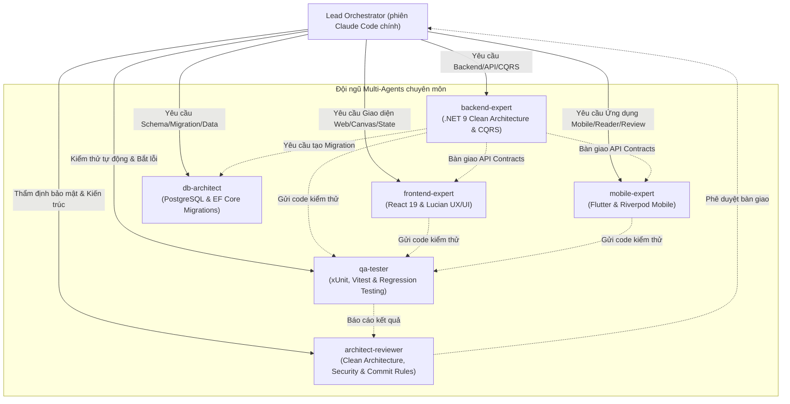

# PANELFORGE MULTI-AGENT DEVELOPMENT ARCHITECTURE & SPECIFICATION

> **Dự án:** PanelForge Manga Production Platform (`SEP490_FA26SE251`)  
> **Kiến trúc hệ thống:** Multi-Repo gồm:  
> - Backend: .NET 9 Clean Architecture + CQRS MediatR + EF Core + PostgreSQL 16 + PanelForge.AI  
> - Web Frontend: React 19 + TypeScript + Tailwind CSS + Lucian UX/UI + TanStack Query  
> - Mobile App: Flutter 3.44 + Dart 3.12 + Riverpod + GoRouter + Dio  
> **Quy chuẩn áp dụng:** Conventional Commits v1.0.0, Zero-Trust RBAC, Content-Addressed Storage (CAS SHA-256).

---

## 1. ĐỘI NGŨ SUB-AGENTS CHUYÊN BIỆT (SPECIALIZED DEV AGENTS)

Hệ thống trợ lý mã nguồn của PanelForge được chia thành 6 sub-agents chuyên trách, định nghĩa trong `.claude/agents/*.md` và được Lead gọi qua công cụ Agent của Claude Code (truyền ID task trong `note/plans/` và đường dẫn sandbox):



---

## 2. BẢNG PHÂN VAI & PHẠM VI TRÁCH NHIỆM

| Tên Sub-Agent | Phạm vi thư mục | Trọng tâm công nghệ | Tiêu chuẩn chất lượng / Lệnh kiểm tra (Pre-commit) |
|---|---|---|---|
| **`backend-expert`** | `PanelForge_FA26SE251/src/PanelForge.*` | C# 13, .NET 9, Clean Architecture, MediatR CQRS, Domain Rules, CAS SHA-256 | `dotnet build PanelForge_FA26SE251/PanelForge.slnx`<br/>`dotnet test PanelForge_FA26SE251/PanelForge.slnx` |
| **`frontend-expert`** | `panelforge-fe/src/*` | React 19, TypeScript, Vite, Tailwind CSS, Lucian UX/UI, Fabric/Canvas, Zustand, `docs/DESIGN_RULES.md` | `cd panelforge-fe && npm run typecheck`<br/>`cd panelforge-fe && npm run i18n:check`<br/>`cd panelforge-fe && npx vitest run` |
| **`mobile-expert`** | `panelforge-mobile/lib/*` | Flutter 3.44, Dart 3.12, Riverpod, GoRouter, Dio, CachedNetworkImage, Mobile Reader & Review Canvas, `lib/theme/app_theme.dart` | `cd panelforge-mobile && flutter analyze`<br/>`cd panelforge-mobile && flutter test` |
| **`db-architect`** | `db/*`, `PanelForge_FA26SE251/src/PanelForge.Infrastructure/Persistence/Migrations/*` | PostgreSQL 16, EF Core Migrations, snake_case mapping, Data Safety | `dotnet ef migrations add`<br/>`powershell -File db/check_db_sync.ps1` |
| **`qa-tester`** | `PanelForge_FA26SE251/test/*`, `panelforge-fe/src/**/*.test.*`, `panelforge-mobile/test/*` | xUnit, Moq, FluentAssertions, Vitest, Edge cases, Role gate assertions | Viết/cập nhật test cho mọi đổi luật nghiệp vụ; chỉ chạy test runner khi user yêu cầu |
| **`architect-reviewer`** | Toàn bộ dự án & PRs | Clean Architecture boundaries, RBAC zero-trust, API contracts, Commit conventions | Tuân thủ `note/GIT_COMMIT_CONVENTION.md` |

---

## 3. NGUYÊN TẮC HOẠT ĐỘNG VÀ HỢP TÁC (OPERATIONAL PROTOCOL)

1. **Quy tắc Multi-Repo (Multi-Repo Boundary Rule):**
   - Workspace gốc `Github/` là một folder tổng hợp, **KHÔNG PHẢI LÀ GIT REPO**.
   - Mọi thao tác git (`status`, `commit`, `push`, `diff`, `worktree`) phải được chạy bên trong từng thư mục repository tương ứng: `PanelForge_FA26SE251`, `panelforge-fe`, hoặc `panelforge-mobile`.

2. **Nguyên tắc Phụ thuộc tầng (Layer Integrity):**
   - `PanelForge.Domain` không phụ thuộc bất kỳ project nào.
   - `PanelForge.Application` chỉ dùng interface từ Domain và Contract.
   - `PanelForge.API` Controllers tuyệt đối không gọi trực tiếp `DbContext`.

3. **Nguyên tắc Bảo mật & RBAC Zero-Trust:**
   - Mọi quyền hạn (Producer, Writer, Artist, Letterer, Editor) phải được kiểm tra qua `WorkspaceRole`, `Assignment`, `PipelineStage` và trạng thái đóng băng `IsScriptFrozen` ở Backend. Frontend & Mobile chỉ phản chiếu để tối ưu UX.

4. **Nguyên tắc Toàn vẹn Dữ liệu:**
   - Không thực thi bất kỳ thao tác phá hủy dữ liệu (DROP, TRUNCATE, DELETE diện rộng).
   - Dữ liệu lịch sử Revision, Bible và Provenance luôn lưu theo cơ chế **Append-Only**.

5. **Quy chuẩn Git Commit bắt buộc:**
   - Định dạng: `<type>(<scope>): <description>` (tối đa 72 ký tự, không chấm cuối câu, động từ mệnh lệnh thì hiện tại).
   - Ví dụ: `feat(script): add chapter bible gate validation logic`

6. **Quy tắc Kiểm thử: CHỈ CHẠY TEST KHI USER YÊU CẦU (Explicit On-Demand Testing Only):**
   - **TUYỆT ĐỐI CẤM tự ý chạy test** (`dotnet test`, `vitest run`, `npm test`, `flutter test`) sau mỗi prompt, sau mỗi bước code hay trước mỗi lần commit/push (do User commit & push code liên tục sau mỗi prompt).
   - Việc tự ý chạy test sinh ra hàng nghìn dòng log, làm phình to ngữ cảnh và tiêu hao hàng chục nghìn token vô ích.
   - **CHỈ ĐƯỢC CHẠY TEST KHI NGƯỜI DÙNG YÊU CẦU TRỰC TIẾP** (Ví dụ bằng văn bản rõ ràng: *"chạy test"*, *"test cho tôi"*, *"kiểm thử tính năng này"*). Bình thường tuyệt đối không được tự ý gọi bất kỳ test runner nào.

7. **Giao thức Bàn giao Hợp đồng (Handoff Artifacts Protocol):**
   - Khi `backend-expert` hoàn thành API/Feature: Cung cấp tóm tắt Endpoint, DTO Models (Request/Response) và ví dụ JSON để `frontend-expert` và `mobile-expert` triển khai ngay.
   - Khi `frontend-expert` / `mobile-expert` hoàn thành UI: Bàn giao danh sách component và file test tương ứng cho `qa-tester` nghiệm thu.

8. **Nguyên tắc Đồng bộ UI Design System & Đa ngôn ngữ (UI Consistency & i18n Guardrail):**
   - **Frontend UI:** Bắt buộc tuân thủ `panelforge-fe/docs/DESIGN_RULES.md` ("UI Constitution") và hệ token `src/styles/tokens/studio-tokens.css`.
     - Tuyệt đối không dùng màu xám lạnh (`slate-*`, `gray-*`); chỉ dùng nền giấy manga ấm (`bg-[#FAF9F5]`, `stone-50`), mặt thẻ trắng (`bg-white`), và viền giấy (`border-stone-200/80`).
     - Màu thương hiệu chính là Mực Cam Studio (`#F97316` / `#EA580C`, `.btn-cta-primary`).
     - Màu ngữ nghĩa chuẩn: Tím (`violet-*`) cho AI/Bible, Xanh ngọc (`emerald-*`) cho Duyệt/Xong, Hổ phách (`amber-*`) cho Cảnh báo/Chờ duyệt, Đỏ (`rose-*`) cho Lỗi/Sửa, Lam (`blue-*`) cho Đang làm.
     - Cỡ chữ tối thiểu `text-xs` (12px), cấm dùng cỡ chữ siêu nhỏ `text-[10px]` hay `text-[11px]`.
     - Phông chữ chuẩn: `font-sans` (Plus Jakarta Sans), `font-serif` (Playfair Display), `font-studio` (Be Vietnam Pro), `font-comic` (Patrick Hand), `font-mono` (JetBrains Mono).
     - Chỉ dùng icon họ **Lucide Icons** (`w-3.5` inline/badge, `w-4` button/nav).
   - **Mobile UI:** Tuân thủ `panelforge-mobile/lib/theme/app_theme.dart` (Tangerine `#F97316`, Paper `#FCF9F2`, Obsidian `#07080D`, Mint `#10B981`, Rose `#EF4444`).
   - **Đa ngôn ngữ (i18n Parity):** Tuyệt đối không hardcode text tiếng Anh hoặc tiếng Việt trực tiếp vào view mới. Mọi chuỗi giao diện phải được khai báo song ngữ đồng thời vào cả 2 tệp:
     - `panelforge-fe/src/locales/vi/<namespace>.json`
     - `panelforge-fe/src/locales/en/<namespace>.json`
     - Kiểm tra bắt buộc qua lệnh: `npm --prefix panelforge-fe run i18n:check` trước khi commit để đảm bảo độ phủ song ngữ đạt 100%.

---

## 3B. KẾ HOẠCH TRIỂN KHAI DÙNG CHUNG (SHARED IMPLEMENT PLAN)

- Cả `backend-expert`, `frontend-expert`, `mobile-expert`, `db-architect`, `qa-tester` làm theo **một bộ plan duy nhất** ở `note/plans/` (plan tổng: `note/PANELFORGE_V2_6_IMPLEMENTATION_PLAN.md`; đặc tả: `panelforge-fe/docs/PANELFORGE_MASTER_SPECIFICATION_V2_6.md`).
- Quy tắc phối hợp ở `note/plans/README.md` §2: nhận task ở bảng §5 trước khi code, worktree riêng theo ID task, mỗi agent chỉ làm sub-task có tiền tố repo của mình (`[BE]`/`[FE]`/`[MO]`/`[DB]`/`[QA]`), BE ghi Hợp đồng API vào task trước khi FE/MO nối API, merge từng repo vào `trungkien` của repo đó.
- Lead giao task cho sub-agent bằng ID task (vd `RDR-07 [BE]`) kèm đường dẫn sandbox.

## 4. QUY CHUẨN TỐI ƯU CONTEXT & ĐỊNH VỊ 1-CHẠM (ZERO-EXPLORATION PROTOCOL)

Để AI Agent đọc và hiểu source code nhanh nhất, tránh hao tốn token và nhầm lẫn:
1. **Bắt buộc tra cứu Codebase Map & Index trước tiên:**
   - Mọi Agent khi nhận task nghiệp vụ phải mở và tham chiếu ngay [`.agents/CODEBASE_MAP.md`](CODEBASE_MAP.md) hoặc [`.agents/CODEBASE_INDEX.json`](CODEBASE_INDEX.json).
   - Có thể chạy nhanh công cụ: `powershell -File .agents/scripts/find_feature.ps1 -Feature <keyword>` để nhận đúng danh sách file trong 0.2s.
   - **Tuyệt đối không dùng recursive search (quét đệ quy toàn thư mục) nếu vị trí file đã được ánh xạ trong Codebase Map.**
2. **Quy chuẩn Đọc tệp có kiểm soát (Bounded File Reads):**
   - Với các file lớn hơn 200 dòng, tuyệt đối không đọc toàn bộ file nếu chỉ cần kiểm tra 1 hàm/class.
   - Dùng công cụ đọc file với giới hạn dòng (offset/limit) sau khi đã xác định vị trí symbol bằng tìm kiếm (Grep).
3. **Ghi nhớ quyết định:** Không có MCP `agentmemory`. Quyết định nghiệp vụ và kỹ thuật ghi vào plan module trong `note/plans/` (và bảng "Nhật ký quyết định" của spec nếu là quyết định nghiệp vụ do user chốt). Bộ nhớ riêng của Claude Code chỉ dùng cho sở thích làm việc của user.

---

## 5. QUY CHUẨN TỰ ĐỘNG CHIA WORKTREE (AUTOMATIC WORKTREE PARTITIONING PROTOCOL)

Để đảm bảo an toàn tuyệt đối khi nhiều AI Agent hoặc lập trình viên phát triển song song:
1. **Bất biến cách ly thư mục gốc (Root Workspace Isolation Invariant):**
   - Khi nhận bất kỳ tác vụ lập trình nào (thêm tính năng, sửa bug, refactor), AI Agent **TUYỆT ĐỐI KHÔNG CHỈNH SỬA TRỰC TIẾP** source code trong thư mục gốc `Github/PanelForge_FA26SE251`, `Github/panelforge-fe`, hoặc `Github/panelforge-mobile`.
2. **Bước 0 Tự Động – Khởi tạo Sandbox Worktree:**
   - Trước khi sửa bất kỳ tệp nào, AI Agent **TỰ ĐỘNG** thực thi lệnh điều phối:
     ```powershell
     powershell -ExecutionPolicy Bypass -File ".agents\scripts\worktree_manager.ps1" -Action create -AgentRole <task-id> -Module "<task-id>" -Target <all|backend|frontend|mobile>
     ```
   - `<task-id>` là ID task trong `note/plans/` viết thường (vd `rdr-07`), xem `note/plans/README.md` §2.4. Sandbox độc lập tại `D:\FPT-STUDY\10_FALL-2026\SEP490\panelforge-agent-<task-id>\` với các nhánh `feature/<task-id>-be`, `-fe`, `-mobile`. Sau khi tạo, kiểm tra `git branch --show-current` (script dùng lại worktree nếu trùng tên).
3. **Quy tắc Dịch chuyển Đường dẫn (Path Translation Rule):**
   - Mọi thao tác đọc/sửa file và lệnh chạy **BẮT BUỘC** trỏ vào đường dẫn Sandbox tương ứng:
     - Backend: `D:/FPT-STUDY/10_FALL-2026/SEP490/panelforge-agent-<task-id>/PanelForge_FA26SE251/`
     - Frontend: `D:/FPT-STUDY/10_FALL-2026/SEP490/panelforge-agent-<task-id>/panelforge-fe/`
     - Mobile: `D:/FPT-STUDY/10_FALL-2026/SEP490/panelforge-agent-<task-id>/panelforge-mobile/`

---

## 6. QUY CHUẨN COMMIT RÕ RÀNG & GỘP TRUNGKIEN TRƯỚC KHI PUSH (ZERO REMOTE EXTRA BRANCHES)

1. **Bắt buộc tạo Worktree khi code chức năng (Feature Isolation Invariant):**
   - Khi phát triển bất kỳ tính năng, module, hoặc sửa bug nào, AI Agent / Developer **BẮT BUỘC TẠO WORKTREE RIÊNG** để code.
   - **TUYỆT ĐỐI KHÔNG CODE TRỰC TIẾP TRÊN THƯ MỤC GỐC `Github/`** nhằm tránh trùng lặp code, tranh chấp file lock DLL và xung đột tệp tin (file collisions) khi phát triển song song.
   - Lệnh khởi tạo worktree:
     ```powershell
     powershell -ExecutionPolicy Bypass -File ".agents\scripts\worktree_manager.ps1" -Action create -AgentRole <task-id> -Module "<task-id>" -Target <all|backend|frontend|mobile>
     ```

2. **Quy chuẩn Conventional Commits v1.0.0 rõ ràng và chi tiết:**
   - Cấu trúc bắt buộc: `<type>(<scope>): <description>`
   - Tiêu đề tối đa **72 ký tự**, không kết thúc bằng dấu chấm (`.`), sử dụng động từ mệnh lệnh thì hiện tại viết thường (`add`, `fix`, `update`, `refactor`, `remove`, `enforce`).
   - Nội dung `<description>` **PHẢI RÕ RÀNG**, thể hiện chính xác thực thể và hành vi nghiệp vụ được thêm/sửa.
   - ❌ **CẤM COMMIT TỐI NGHĨA:** Tuyệt đối không commit các câu chung chung như: `fix bugs`, `update code`, `wip`, `temp`, `test`, `update`.
   - **Type hợp lệ:** `feat`, `fix`, `docs`, `style`, `refactor`, `perf`, `test`, `chore`.
   - **Scope hợp lệ:**
     - Backend: `api`, `auth`, `assignment`, `canvas`, `script`, `asset`, `ai`, `bible`, `publisher`, `consistency`, `chapter`, `export`
     - Frontend: `ui`, `letterer`, `writer`, `artist`, `editor`, `publisher`, `producer`, `reader`, `bible`, `service`
     - Mobile: `mobile`, `reader`, `auth`, `review`, `canvas`, `monetization`, `security`
     - Meta/Docs: `tracker`, `notes`, `convention`, `deps`, `config`, `worktree`
   - **Ví dụ chuẩn:**
     - ✅ `feat(publisher): add publisher role, controller, and query workflows`
     - ✅ `fix(artist): lock active stage to true stage and prevent skipping ahead`
     - ✅ `docs(mobile): add claude agent guidelines`
     - ❌ `fix bugs`
     - ❌ `update frontend`

3. **Quy tắc Kiểm tra Tiền Commit (Fast Syntax Check Only - KHÔNG TỰ CHẠY TEST):**
   - **TUYỆT ĐỐI CẤM chạy test runner** (`dotnet test`, `vitest`, `flutter test`) khi commit/push sau mỗi prompt.
   - Nếu cần kiểm tra an toàn cú pháp trước khi commit, chỉ chạy biên dịch tĩnh nhanh:
     - Backend: `dotnet build <sandbox>/PanelForge_FA26SE251/PanelForge.slnx`
     - Frontend: `npm --prefix <sandbox>/panelforge-fe run typecheck`
     - Mobile: `flutter --prefix <sandbox>/panelforge-mobile analyze`
   - Chỉ chạy test khi Người dùng đưa ra chỉ thị rõ ràng.

4. **BẮT BUỘC GỘP VÀO `trungkien` TRƯỚC KHI PUSH (Zero Remote Extra Branches Invariant):**
   - ❌ **TUYỆT ĐỐI CẤM PUSH NHÁNH PHỤ / FEATURE LÊN REMOTE GITHUB:** Không chạy `git push origin feature/...` lên remote repository nhằm tránh rác nhánh và làm phân mảnh lịch sử git trên GitHub.
   - **Quy trình gộp và đẩy chuẩn (Chuẩn 4 bước):**
     1. **Commit trong Worktree:** Commit toàn bộ mã nguồn rõ ràng bên trong sandbox worktree.
     2. **Kiểm tra & Gộp vào `trungkien`:**
        - Quay về thư mục gốc của repository (`PanelForge_FA26SE251`, `panelforge-fe`, hoặc `panelforge-mobile`).
        - Chuyển sang nhánh `trungkien`: `git checkout trungkien`
        - Kéo code mới nhất từ remote: `git pull origin trungkien`
        - Gộp nhánh feature từ worktree vào `trungkien`:
          ```powershell
          git merge feature/<module>-<scope> -m "<type>(<scope>): <mo-ta-nghiep-vu-ro-rang>"
          ```
     3. **Chạy kiểm thử nghiệm thu:** Xác nhận build và test thành công trên nhánh `trungkien`.
     4. **Chỉ Push duy nhất nhánh `trungkien` lên remote GitHub:**
        ```powershell
        git push origin trungkien
        ```
     5. **Dọn dẹp Worktree cục bộ:** Thu hồi sandbox và xóa nhánh feature cục bộ đã gộp xong:
        ```powershell
        powershell -ExecutionPolicy Bypass -File ".agents\scripts\worktree_manager.ps1" -Action remove -AgentRole <task-id>
        ```
   - **Lệnh tự động 1-chạm (Khuyến nghị):** Có thể chạy action hoàn tất tự động:
     ```powershell
     powershell -ExecutionPolicy Bypass -File ".agents\scripts\worktree_manager.ps1" -Action finish -AgentRole <task-id> -Target <all|backend|frontend|mobile> -Message "<type>(<scope>): <mo-ta>"
     ```

---

## 7. QUY CHUẨN CHỐNG AI-SLOP TRONG LOGIC & GIAO DIỆN (ANTI-SLOP QUALITY GATE)

> **Mục tiêu tối thượng:** Mọi dòng code, cấu trúc logic và giao diện do AI hỗ trợ xây dựng phải đạt chất lượng của một **kỹ sư và nhà thiết kế chuyên nghiệp (Artisan Craftsmanship)**, loại bỏ triệt để các dấu hiệu cẩu thả, rập khuôn vô hồn đặc trưng của AI ("AI-slop").

### 7.1. Chống AI-Slop trong Kiến Trúc & Logic Nghiệp Vụ (Code & Logic Quality Gate)

1. **Cấm Over-Engineering & Wrapper vô nghĩa (Zero Useless Abstraction):**
   - Tuyệt đối không tạo các file helper/utils chỉ để bọc các hàm có sẵn của ngôn ngữ (ví dụ: `isEmptyString()`, `addNumbers()`, `isValidEmail()` sơ sài bằng 1 dòng regex copypaste).
   - Tuyệt đối không tạo interface khi một class chỉ có duy nhất một implementation cục bộ (trừ khi ranh giới Clean Architecture / DI của Application & Infrastructure bắt buộc).
   - Không sinh thêm code "phỏng đoán tương lai" (YAGNI): Chỉ code đúng và đủ chức năng được yêu cầu; không tự ý thêm export CSV, cache ảo, analytics giả lập, hay các method chưa dùng tới.

2. **Cấm Tautological Comments (Comment Slop):**
   - Tuyệt đối cấm viết comment lặp lại tên hàm/biến rõ nghĩa:
     - ❌ `// Get user by id` trên hàm `GetUserByIdAsync(Guid id)`
     - ❌ `// Set active tab to overview` trên dòng `setActiveTab('overview')`
     - ❌ `// Return ok result` trên dòng `return Ok(response)`
   - Chỉ được viết comment giải thích **TẠI SAO (WHY)** khi có quy tắc nghiệp vụ đặc thù, ràng buộc phức tạp, hoặc giải pháp kỹ thuật ngoại lệ. Nếu code tự thể hiện rõ ràng, hãy giữ code sạch và không để lại comment rác.
   - Cấm để lại code chết bị comment (`// dead code...`) hoặc comment kiểu `// TODO: implement later` trong các module đã bàn giao.

3. **Cấm Xử Lý Lỗi Ảo & Nuốt Exception (No Defensive Error Swallowing):**
   - Tuyệt đối không viết các khối `try...catch` rỗng hoặc chỉ có `catch (Exception ex) { Console.WriteLine(ex); }` / `catch (e) { console.log(e); }` để nuốt lỗi và cho luồng chạy tiếp với dữ liệu rỗng.
   - Khi có lỗi nghiệp vụ: Ném `DomainException` hoặc trả về `Result.Failure(...)` chuẩn mực.
   - Khi có lỗi ngoài dự kiến: Để lỗi nổi lên Global Exception Handler / Error Boundary để ghi log và phản hồi đúng mã HTTP status code (400, 403, 404, 409, 500).
   - Không dùng fallback ảo (magic fallback defaults) để che giấu sự bất đồng bộ giữa backend DTO và frontend interface.

4. **Trọn vẹn Nghiệp vụ Domain (Rich Domain Model over Anemic Slop):**
   - Không biến Domain Entity thành những túi chứa dữ liệu vô tri (anemic property bags) rồi dồn toàn bộ logic kiểm tra vào Controller hay Service phình to.
   - Các bất biến nghiệp vụ (như trạng thái đóng băng `IsScriptFrozen`, kiểm tra chỉ số trang kịch bản, quota trang) phải được đóng gói và xác thực ngay tại Domain Entity / Value Object.

---

### 7.2. Chống AI-Slop trong Thiết Kế & Giao Diện Người Dùng (UI/UX Anti-Slop Gate)

1. **Cấm Cliché & Phấn son vô nghĩa (Zero Gratuitous Eye-Candy):**
   - ❌ **Cấm dải màu tím/hồng ma mị của AI SaaS:** Không tự ý thêm background gradient tím-xanh, đốm sáng mờ ảo (gradient orbs), viền phát sáng neon chỉ để trông "hiện đại".
   - ❌ **Cấm icon lấp lánh (Sparkles) vô tội vạ:** Chỉ dùng icon tia sáng / tím cho những tính năng tích hợp AI thực sự (PanelForge.AI, Consistency Check, Script Generation). Tuyệt đối không gắn vào các nút bấm hoặc tiêu đề thông thường.
   - ❌ **Cấm Metric ảo:** Không sinh ra các thẻ thống kê kiểu `+12.4% so với tuần trước` hay biểu đồ đường uốn lượn khi không có backend telemetry hoặc dữ liệu thực tế tương ứng.
   - ❌ **Cấm Glassmorphism dày đặc:** Không lạm dụng `backdrop-blur-md` trên mọi thẻ card gây nặng GPU và suy giảm độ tương phản đọc chữ.

2. **Tuân thủ Triệt để Bản sắc Studio "Warm Editorial & Tactile Paper":**
   - Mọi giao diện web phải tuân thủ nghiêm ngặt `panelforge-fe/docs/DESIGN_RULES.md`:
     - Nền giấy manga ấm: `bg-[#FAF9F5]`, `stone-50`.
     - Thẻ trắng phẳng chuyên nghiệp: `bg-white`, viền mờ `border-stone-200/80`, bóng nhẹ thanh lịch `shadow-xs`.
     - Điểm nhấn thương hiệu: Mực Cam Studio (`#EA580C` / `#F97316`).
   - Mọi giao diện mobile phải tuân thủ `panelforge-mobile/lib/theme/app_theme.dart`.

3. **Chống Bố Cục Lười Biếng (No Lazy Centered Cards & Empty Voids):**
   - Tránh việc đặt 1 chiếc card đơn độc trơ trọi giữa một màn hình desktop rộng lớn với hàng nghìn pixel trống không mục đích.
   - Giao diện làm việc (Studio Workbench) của Writer, Artist, Letterer, Editor phải mang tính **Workspace**: Mật độ thông tin hợp lý (information density), các panel công cụ rõ ràng, thanh tác vụ gãy gọn, ưu tiên không gian cho Canvas và kịch bản.

4. **Chống Văn Phong AI Sáo Rỗng (No Copywriting Slop):**
   - Tuyệt đối cấm sử dụng các từ ngữ rập khuôn AI trong placeholder, thông báo, modal và nút bấm:
     - ❌ *Cấm:* "Delve", "Tapestry", "Revolutionize", "Seamless experience", "Elevate your workflow", "Unlock the power of...", "Trải nghiệm đỉnh cao", "Khai phá tiềm năng vô tận".
     - ✅ *Chuẩn:* Dùng ngôn từ chuẩn xác, thực tế của studio xuất bản: "Lưu bản thảo", "Gửi duyệt phân cảnh", "Khóa kịch bản tập 3", "Kiểm tra tính nhất quán nhân vật", "Xuất file in".

5. **Kích hoạt Bộ Kỹ Năng Anti-Slop Khi Làm Giao Diện:**
   - Khi xây dựng giao diện mới hoặc refactor UI, Agent tự động nạp và kiểm tra chéo với các kỹ năng trong `.agents/skills/`:
     - `@skill:antislop`: Bộ lọc mục đích cốt lõi (Purpose Test) - Mọi yếu tố hiển thị phải có mục đích rõ ràng.
     - `@skill:antislop-ui`: Kiểm tra tỷ lệ tương phản, nhịp điệu typography, loại bỏ card rác.
     - `@skill:antislop-code`: Giữ code logic ngắn gọn, sạch sẽ, không thừa thãi.
     - `@skill:antislop-copywriting`: Đảm bảo từ ngữ tự nhiên, giàu tính ngữ cảnh biên kịch/họa sĩ.
     - `@skill:antislop-layoutmobile`: Đảm bảo touch targets ≥ 44x44px, không tràn ngang và thích ứng tự nhiên trên màn hình nhỏ.


