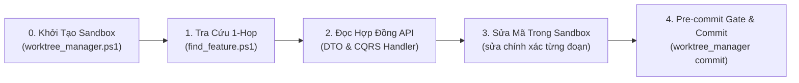

# PANELFORGE AI AGENT READING & EDITING SOP (HƯỚNG DẪN ĐỌC & SỬA MÃ NGUỒN CHO AI)

> **Mục tiêu:** Giúp AI Agent đọc hiểu mã nguồn trong 1 bước (1-hop), không bị tràn context / lãng phí token, nắm rõ cấu trúc phân tầng và sửa đổi mã nguồn chính xác 100% không gây regression bug.

---

## 1. BA NGUYÊN TẮC CỐT LÕI (THE 3 GOLDEN RULES)

### 📌 Nguyên tắc 1: Định vị 1-Chạm (Single-Hop Routing) – Không Quét Đệ Quy
- **Không bao giờ** chạy lệnh tìm kiếm đệ quy toàn bộ thư mục gốc (`grep -r`, `findstr /s` hoặc duyệt qua hàng chục file). Workspace chứa hàng chục nghìn file bao gồm cả `node_modules`, `obj`, `bin`, `.dart_tool`.
- **Luôn luôn tra cứu:**
  1. Bảng ma trận tại [`.agents/CODEBASE_MAP.md`](CODEBASE_MAP.md).
  2. Tệp chỉ mục máy học [`.agents/CODEBASE_INDEX.json`](CODEBASE_INDEX.json).
  3. Hoặc thực thi: `powershell -File .agents/scripts/find_feature.ps1 -Feature <keyword>` để nhận đúng danh sách file cần mở trong 0.1 giây.

### 📌 Nguyên tắc 2: Đọc Tệp Có Giới Hạn (Bounded Reads)
- Khi mở các file lớn (> 150 dòng) như Controller, DbContext, Service hay Canvas View:
  - **Không** đọc toàn bộ file một lần nếu chỉ cần sửa 1 hàm.
  - Dùng công cụ đọc file với giới hạn dòng (offset/limit) sau khi định vị bằng tìm kiếm.
  - Với C#, định vị trước tên Handler, Command, hoặc Method.
  - Với TypeScript/Dart, định vị method trong Service hoặc Interface DTO.

### 📌 Nguyên tắc 3: Nhận Diện Ranh Giới Multi-Repo (Multi-Repo Boundary)
- Workspace `Github/` là thư mục cha chứa 3 Git Repository độc lập:
  - `PanelForge_FA26SE251` (.NET 9 Web API)
  - `panelforge-fe` (React 19 Frontend)
  - `panelforge-mobile` (Flutter Mobile)
- **Tuyệt đối không chạy lệnh `git` tại thư mục gốc.** Luôn thực thi với đường dẫn tường minh:
  ```bash
  git -C PanelForge_FA26SE251 status
  git -C panelforge-fe status
  git -C panelforge-mobile status
  ```

---

## 2. QUY TRÌNH 5 BƯỚC THỰC THI & SỬA MÃ NGUỒN CÔ LẬP (5-STEP AGENT WORKFLOW)



### Bước 0: Bắt buộc phân vùng Worktree cô lập (Root Workspace Protection)
- **Tuyệt đối không sửa code trực tiếp trong thư mục `Github/`.**
- AI Agent tự động chạy lệnh tạo hoặc chuyển sang sandbox riêng:
```powershell
powershell -ExecutionPolicy Bypass -File .agents/scripts/worktree_manager.ps1 -Action create -AgentRole <task-id> -Module <task-id>
```
- Mọi thao tác tệp và lệnh bên dưới **BẮT BUỘC** trỏ vào đường dẫn Sandbox: `D:/FPT-STUDY/10_FALL-2026/SEP490/panelforge-agent-[role]/...`.

### Bước 1: Tra cứu file liên quan
Chạy script định vị:
```powershell
powershell -File .agents/scripts/find_feature.ps1 -Feature <tên_chức_năng>
```
Xác định đúng file ở tầng nào cần can thiệp:
- Nếu sửa logic nghiệp vụ Backend: Mở file `*Handler.cs` trong `PanelForge.Application/Features/<Domain>/`.
- Nếu sửa gọi API Frontend: Mở `panelforge-fe/src/services/<domain>.service.ts`.
- Nếu sửa UI Mobile: Mở `panelforge-mobile/lib/screens/<domain>/` hoặc `widgets/`.

### Bước 2: Đọc và xác nhận API Contract trước khi viết code
- Nếu tính năng liên quan đến gọi API giữa FE/Mobile và Backend:
  1. Kiểm tra DTO đầu vào/đầu ra trong Backend (`Features/<Domain>/Commands/...` hoặc `Queries/...`).
  2. Đảm bảo tên trường và kiểu dữ liệu (camelCase cho JSON, DateTime UTC, GUID ID) khớp 100% giữa Backend DTO và Frontend TypeScript interface hoặc Dart model.
  3. **Không tự suy diễn (hallucinate)** tên trường mới nếu chưa được định nghĩa ở Backend.

### Bước 3: Sửa đổi mã nguồn có kiểm soát (Surgical Edits)
- Khi sửa file, trỏ vào file trong Sandbox worktree, thay đúng block code, giữ nguyên khoảng trắng và thụt lề.
- Tuân thủ quy tắc kiến trúc:
  - **Backend:** Controller chỉ làm nhiệm vụ nhận HTTP Request và gửi MediatR Command/Query. Không inject `ApplicationDbContext` vào Controller.
  - **Frontend:** Không gọi trực tiếp `axios.get/post` trong component; luôn bọc qua `src/services/<domain>.service.ts`.
  - **Mobile:** Không đặt logic HTTP trong hàm `build()`; luôn gọi qua Provider hoặc Service.
  - **Thiết kế Giao diện (UI/UX) & Đa ngôn ngữ (i18n):**
    - Bắt buộc tham chiếu `panelforge-hub/docs/spec/DESIGN_RULES.md` ("UI Constitution") khi tạo mới hoặc sửa component/view.
    - Duy trì nền giấy manga ấm (`bg-[#FAF9F5]`, `stone-50`), mặt thẻ trắng (`bg-white`), viền `border-stone-200/80`, màu nhấn Mực Cam Studio (`#F97316` / `#EA580C`). Tuyệt đối không dùng màu xám lạnh (`gray-*`, `slate-*`).
    - Cỡ chữ hiển thị tối thiểu là `text-xs` (12px), tuyệt đối không dùng `text-[10px]` hay `text-[11px]`.
    - Không hardcode chuỗi text trực tiếp vào JSX; luôn bổ sung key vào cả 2 file `src/locales/vi/*.json` và `src/locales/en/*.json`, kiểm tra đồng bộ bằng `npm run i18n:check`.

### Bước 4: Kiểm tra nhanh và Commit chuẩn (Fast Pre-commit & Validated Commit)
- **Quy tắc quan trọng:** TUYỆT ĐỐI KHÔNG tự ý chạy test runner (`dotnet test`, `vitest`, `flutter test`) sau mỗi prompt hoặc trước commit. Chỉ chạy test khi Người dùng yêu cầu bằng lệnh trực tiếp.
- Khi cần commit sau mỗi prompt, thực hiện commit qua công cụ tự động (chỉ chạy kiểm tra cú pháp nhanh build/typecheck nếu cần, bỏ qua test runner):
```powershell
powershell -ExecutionPolicy Bypass -File .agents/scripts/worktree_manager.ps1 -Action commit -AgentRole <task-id> -Target <backend|frontend|mobile> -Message "<type>(<scope>): <mô_tả_dạng_mệnh_lệnh>"
```
*Lưu ý:* Hệ thống đã kích hoạt Git Hook `commit-msg`. Bất kỳ commit nào không theo chuẩn Conventional Commits v1.0.0 (`feat`, `fix`, `docs`, `style`, `refactor`, `perf`, `test`, `chore`) sẽ bị từ chối ngay lập tức.

---

## 3. DUY TRÌ NGỮ CẢNH GIỮA CÁC PHIÊN
Không có MCP `agentmemory`. Ngữ cảnh dùng chung nằm ở:
1. `panelforge-hub/docs/V2.6/PANELFORGE_MASTER_SPECIFICATION_V2_6.md`: nghiệp vụ và bảng "Nhật ký quyết định".
2. `note/plans/`: task, quyết định kỹ thuật, Hợp đồng API, Changelog (quy tắc ở `note/plans/README.md` §2).
3. `.agents/CODEBASE_MAP.md` / `CODEBASE_INDEX.json`: vị trí file. Khi thêm/đổi tên file chính của một domain, cập nhật 2 file này trong cùng lượt.
