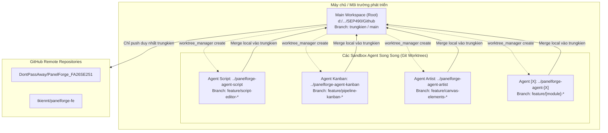
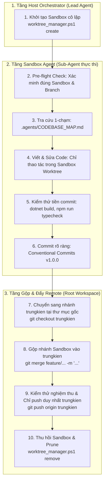

# HƯỚNG DẪN VẬN HÀNH MULTI-AGENT GIT WORKTREE & GITHUB MCP
*(PanelForge Parallel AI Agent Worktree & GitHub Operational Manual)*

> **Dự án:** PanelForge Manga Production Platform (`SEP490_FA26SE251`)  
> **Áp dụng cho:** Tất cả các AI Agent (Lead Orchestrator, Sub-agents, Cursor, Claude Code, Antigravity) & Developers.  
> 
> 🚨 **ĐIỀU KIỆN KÍCH HOẠT SANDBOX WORKTREE (QUAN TRỌNG):**  
> - **Khi chỉ có 1 Agent làm việc (Single-Agent Mode - Mặc định):** **KHÔNG TẠO SANDBOX WORKTREE.** Agent làm việc, đọc, sửa code và commit trực tiếp trên thư mục repo gốc ở nhánh `trungkien`.  
> - **Khi có từ 2 Agent trở lên cùng làm việc song song (Multi-Agent Swarm):** **BẮT BUỘC TẠO SANDBOX WORKTREE** để cô lập 100% môi trường, loại bỏ xung đột mã nguồn (file collision), lock DLL và quản lý tự động vòng đời Worktree ➔ Commit ➔ Push ➔ Cleanup.

---

## 1. MÔ HÌNH KIẾN TRÚC WORKSPACE CÔ LẬP (WORKTREE ISOLATION)



---

## 2. BẢNG QUY ĐỔI ĐƯỜNG DẪN (PATH TRANSLATION MATRIX)

Khi nhận một tác vụ thuộc về vai trò cụ thể, Agent bắt buộc phải dịch chuyển mọi đường dẫn tệp sang Sandbox Worktree tương ứng:

| Phân hệ / Agent | Đường dẫn Workspace Gốc (CẤM SỬA KHI CHẠY PARALLEL) | Đường dẫn Sandbox Worktree (BẮT BUỘC DÙNG) |
|---|---|---|
| **Agent Script** | `.../Github/PanelForge_FA26SE251/`<br/>`.../Github/panelforge-fe/` | `D:/FPT-STUDY/10_FALL-2026/SEP490/panelforge-agent-script/PanelForge_FA26SE251/`<br/>`D:/FPT-STUDY/10_FALL-2026/SEP490/panelforge-agent-script/panelforge-fe/` |
| **Agent Kanban** | `.../Github/PanelForge_FA26SE251/`<br/>`.../Github/panelforge-fe/` | `D:/FPT-STUDY/10_FALL-2026/SEP490/panelforge-agent-kanban/PanelForge_FA26SE251/`<br/>`D:/FPT-STUDY/10_FALL-2026/SEP490/panelforge-agent-kanban/panelforge-fe/` |
| **Agent Artist** | `.../Github/PanelForge_FA26SE251/`<br/>`.../Github/panelforge-fe/` | `D:/FPT-STUDY/10_FALL-2026/SEP490/panelforge-agent-artist/PanelForge_FA26SE251/`<br/>`D:/FPT-STUDY/10_FALL-2026/SEP490/panelforge-agent-artist/panelforge-fe/` |
| **Agent Mới [X]** | `.../Github/PanelForge_FA26SE251/`<br/>`.../Github/panelforge-fe/` | `D:/FPT-STUDY/10_FALL-2026/SEP490/panelforge-agent-[X]/PanelForge_FA26SE251/`<br/>`D:/FPT-STUDY/10_FALL-2026/SEP490/panelforge-agent-[X]/panelforge-fe/` |

---

## 3. QUY TRÌNH VẬN HÀNH CHUẨN (STANDARD OPERATING PROCEDURE - SOP)

Quy trình vòng đời hoàn chỉnh gồm 2 phân tầng: **Host Orchestrator** (Lead Agent) và **Sandbox Execution** (Sub-Agents).



### Bước 1: Khởi tạo Sandbox cô lập (Host Orchestration)

> `<task-id>` là ID task trong `note/plans/` viết thường (vd `rdr-07`). Ghi nhận task vào bảng "Đang làm" của `note/plans/README.md` §5 trước khi tạo sandbox (quy tắc đầy đủ ở §2).
Trước khi giao việc cho Sub-agent, Lead Orchestrator chạy lệnh:
```powershell
powershell -ExecutionPolicy Bypass -File ".agents\scripts\worktree_manager.ps1" -Action create -AgentRole <task-id> -Module "<task-id>" -Target <all|backend|frontend|mobile>
```

### Bước 2: Pre-flight Check (Xác thực môi trường Sandbox)
Sub-agent khi nhận task kiểm tra ngay branch hiện tại:
```powershell
cd "D:\FPT-STUDY\10_FALL-2026\SEP490\panelforge-agent-[role]\PanelForge_FA26SE251"
git branch --show-current
# BẮT BUỘC là: feature/[module]-be (Không được là main hoặc trungkien)

cd "D:\FPT-STUDY\10_FALL-2026\SEP490\panelforge-agent-[role]\panelforge-fe"
git branch --show-current
# BẮT BUỘC là: feature/[module]-fe
```

### Bước 3: Định vị tệp không đọc thừa (Zero-Exploration)
- Tra cứu bảng ma trận trong [`.agents/CODEBASE_MAP.md`](file:///d:/FPT-STUDY/10_FALL-2026/SEP490/Github/.agents/CODEBASE_MAP.md).
- Chỉ mở đúng các tệp cần sửa đổi trong sandbox.
- **Nghiêm cấm:** Quét đệ quy toàn bộ thư mục bằng lệnh grep/find rộng.

### Bước 4: Viết và sửa mã nguồn
- Mọi thao tác đọc/sửa file trỏ trực tiếp vào đường dẫn Sandbox.
- Quy chuẩn Bounded Read: Nếu file >300 dòng, chỉ đọc đoạn code liên quan (đọc có giới hạn dòng).

### Bước 5: Kiểm thử tiền commit bên trong Sandbox (Pre-commit Verification Gate)
> **Quy tắc bắt buộc:** **TUYỆT ĐỐI KHÔNG** chạy test sau mỗi câu trả lời/prompt lẻ. **CHỈ CHẠY TOÀN BỘ TEST** ngay trước khi tiến hành tạo git commit:
- **Backend:**
  ```powershell
  dotnet test "D:\FPT-STUDY\10_FALL-2026\SEP490\panelforge-agent-[role]\PanelForge_FA26SE251\test\PanelForge.UnitTests"
  ```
- **Frontend:**
  ```powershell
  cd "D:\FPT-STUDY\10_FALL-2026\SEP490\panelforge-agent-[role]\panelforge-fe"
  npm run typecheck
  npx vitest run
  ```

### Bước 6: Commit rõ ràng bên trong Sandbox Worktree
Tuân thủ nghiêm ngặt [Conventional Commits v1.0.0](../note/GIT_COMMIT_CONVENTION.md):
- Cấu trúc: `<type>(<scope>): <description>` (Tối đa 72 ký tự, không dấu chấm cuối, động từ mệnh lệnh thì hiện tại).
- Mô tả phải rõ ràng, chỉ rõ thực thể và hành vi logic được thay đổi.
- **CẤM** commit mơ hồ như: `fix bugs`, `update code`, `wip`.
```powershell
git -C "D:\FPT-STUDY\10_FALL-2026\SEP490\panelforge-agent-[role]\PanelForge_FA26SE251" commit -m "feat(script): add chapter dialogue freeze validation rule"
git -C "D:\FPT-STUDY\10_FALL-2026\SEP490\panelforge-agent-[role]\panelforge-fe" commit -m "fix(artist): lock active stage to true stage and prevent skipping ahead"
```

### Bước 7: Chuyển về Thư mục Gốc & Gộp vào nhánh `trungkien`
> ⚠️ **BẤT BIẾN QUAN TRỌNG:** **TUYỆT ĐỐI KHÔNG PUSH NHÁNH PHỤ / FEATURE LÊN REMOTE GITHUB** để tránh tạo thêm nhánh rác trên GitHub. Mọi thay đổi phải được gộp vào `trungkien` trước khi push.

1. Quay về thư mục gốc tương ứng (`PanelForge_FA26SE251`, `panelforge-fe`, hoặc `panelforge-mobile`).
2. Chuyển sang nhánh `trungkien` và kéo code mới nhất:
   ```powershell
   git checkout trungkien
   git pull origin trungkien
   ```
3. Gộp nhánh feature từ worktree vào `trungkien`:
   ```powershell
   git merge feature/[module]-[be|fe|mobile] -m "<type>(<scope>): <mo-ta-nghiep-vu-ro-rang>"
   ```

### Bước 8: Kiểm thử Nghiệm thu & Quy tắc Push (Batch Push / On-Demand Only)
1. Chạy nghiệm thu nhanh trên nhánh `trungkien`:
   - Backend: `dotnet build PanelForge_FA26SE251/PanelForge.slnx`
   - Frontend: `cd panelforge-fe && npm run typecheck`
   - Mobile: `cd panelforge-mobile && flutter analyze`
2. **QUY TẮC PUSH LÊN REMOTE GITHUB:**
   - ❌ **TUYỆT ĐỐI KHÔNG PUSH SAU MỖI LẦN LÀM / MỖI PROMPT / MỖI TASK NHỎ.**
   - **CHỈ PUSH DUY NHẤT NHÁNH `trungkien` LÊN REMOTE GITHUB KHI:**
     1. Đã hoàn thành trọn vẹn **1 module lớn**.
     2. **HOẶC khi Người dùng trực tiếp yêu cầu** (vd: *"push code"*, *"push lên github"*).
   - Lệnh push (khi thỏa mãn 1 trong 2 điều kiện trên):
     ```powershell
     git push origin trungkien
     ```

### Bước 9: Thu hồi Sandbox & Dọn dẹp Nhánh cục bộ (Cleanup Protocol)
Sau khi gộp code vào `trungkien` (dù chưa push lên GitHub ngay hay đã push), thu hồi worktree để giải phóng tài nguyên và xóa nhánh feature cục bộ đã gộp xong:
```powershell
powershell -ExecutionPolicy Bypass -File ".agents\scripts\worktree_manager.ps1" -Action remove -AgentRole <task-id>
```

---

## 4. BẢNG TRA CỨU NHANH LỆNH WORKTREE MANAGER

| Thao tác | Câu lệnh thực thi (chạy từ Workspace Root `Github/`) |
|---|---|
| **Xem danh sách worktrees** | `powershell -ExecutionPolicy Bypass -File ".agents\scripts\worktree_manager.ps1" -Action list` |
| **Khởi tạo worktree mới** | `powershell -ExecutionPolicy Bypass -File ".agents\scripts\worktree_manager.ps1" -Action create -AgentRole <task-id> -Module "<module>" -Target <all\|backend\|frontend\|mobile>` |
| **Cài đặt Git Hook Commit** | `powershell -ExecutionPolicy Bypass -File ".agents\scripts\worktree_manager.ps1" -Action setup-hooks` |
| **Kiểm tra cú pháp commit** | `powershell -ExecutionPolicy Bypass -File ".agents\scripts\worktree_manager.ps1" -Action check-commit -Message "<type>(<scope>): <desc>"` |
| **Commit chuẩn trong sandbox** | `powershell -ExecutionPolicy Bypass -File ".agents\scripts\worktree_manager.ps1" -Action commit -AgentRole <task-id> -Target <backend\|frontend\|mobile> -Message "<type>(<scope>): <desc>"` |
| **Gộp trungkien & dọn dẹp (Cục bộ)** | `powershell -ExecutionPolicy Bypass -File ".agents\scripts\worktree_manager.ps1" -Action finish -AgentRole <task-id> -Target <all\|backend\|frontend\|mobile>` |
| **Gộp trungkien, push & dọn dẹp (Khi xong module/User bảo)** | `powershell -ExecutionPolicy Bypass -File ".agents\scripts\worktree_manager.ps1" -Action finish -AgentRole <task-id> -Target <all\|backend\|frontend\|mobile> -Push` |
| **Xóa & dọn dẹp worktree** | `powershell -ExecutionPolicy Bypass -File ".agents\scripts\worktree_manager.ps1" -Action remove -AgentRole <task-id>` |

---

## 5. MẪU LỆNH ĐIỀU PHỐI (ORCHESTRATION PROMPT TEMPLATES)

### Mẫu: Giao task cho Agent chuyên biệt trong Sandbox
```markdown
[ROLE]: [Tên vai trò chuyên môn, vd: Backend & Frontend Script Specialist]
[SANDBOX_ROOT]: D:/FPT-STUDY/10_FALL-2026/SEP490/panelforge-agent-[role]
[BACKEND_PATH]: D:/FPT-STUDY/10_FALL-2026/SEP490/panelforge-agent-[role]/PanelForge_FA26SE251
[FRONTEND_PATH]: D:/FPT-STUDY/10_FALL-2026/SEP490/panelforge-agent-[role]/panelforge-fe
[BRANCH]: feature/[module]-be | feature/[module]-fe

[TASK]: [Mô tả chi tiết mục tiêu cần đạt được]
[RULES]:
1. CHỈ đọc và ghi file bên trong [SANDBOX_ROOT]. Tuyệt đối không sửa code ở Github/ gốc.
2. Tra cứu vị trí file cần sửa trong .agents/CODEBASE_MAP.md.
3. Không chạy test sau mỗi prompt. Chỉ chạy fast pre-commit ngay trước khi commit.
4. Commit rõ ràng theo chuẩn Conventional Commits: <type>(<scope>): <description> (cấm "fix bugs").
5. Merge vào nhánh 'trungkien' tại repo gốc. KHÔNG push sau mỗi lần làm; chỉ push khi xong trọn vẹn module lớn hoặc khi User yêu cầu trực tiếp.
```

---

## 6. CÁC HÀNH VI BỊ CẤM (STRICTLY FORBIDDEN ACTIONS)

1. ❌ **CẤM** tạo sandbox worktree khi chỉ có 1 Agent làm việc đơn lẻ (phải làm việc trực tiếp tại repo để tiết kiệm tài nguyên và đơn giản hoá luồng).
2. ❌ **CẤM** sửa trực tiếp vào thư mục gốc khi có từ 2 Agent trở lên chạy song song (khi đó bắt buộc phải tạo worktree sandbox).
3. ❌ **CẤM** tự ý push code lên remote sau mỗi lần làm / mỗi prompt. Chỉ push khi hoàn thành 1 module lớn hoặc khi Người dùng yêu cầu.
4. ❌ **CẤM** push bất kỳ nhánh phụ nào (`feature/*`, `fix/*`, `temp/*`) lên remote GitHub. Chỉ được phép push duy nhất nhánh `trungkien` (hoặc `main` khi có yêu cầu).
5. ❌ **CẤM** commit thông điệp mơ hồ, tối nghĩa như `fix bugs`, `update code`, `wip`, `temp`.
6. ❌ **CẤM** chuyển sang nhánh `main` hoặc `trungkien` bên trong thư mục worktree sandbox của Agent khi đang chạy Multi-Agent.
7. ❌ **CẤM** tự ý chạy `dotnet test` hoặc `npm run test` sau mỗi prompt nhỏ lẻ.
8. ❌ **CẤM** dùng `git push --force` hoặc sửa commit history đã đẩy lên remote.
