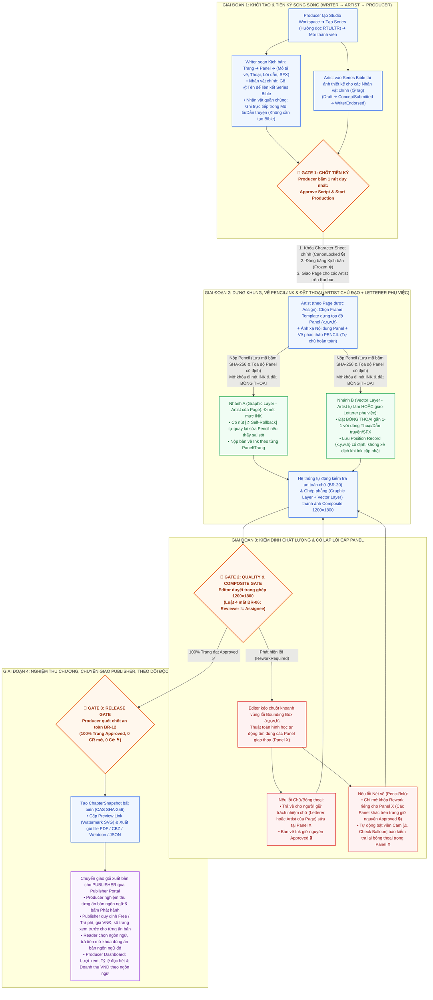
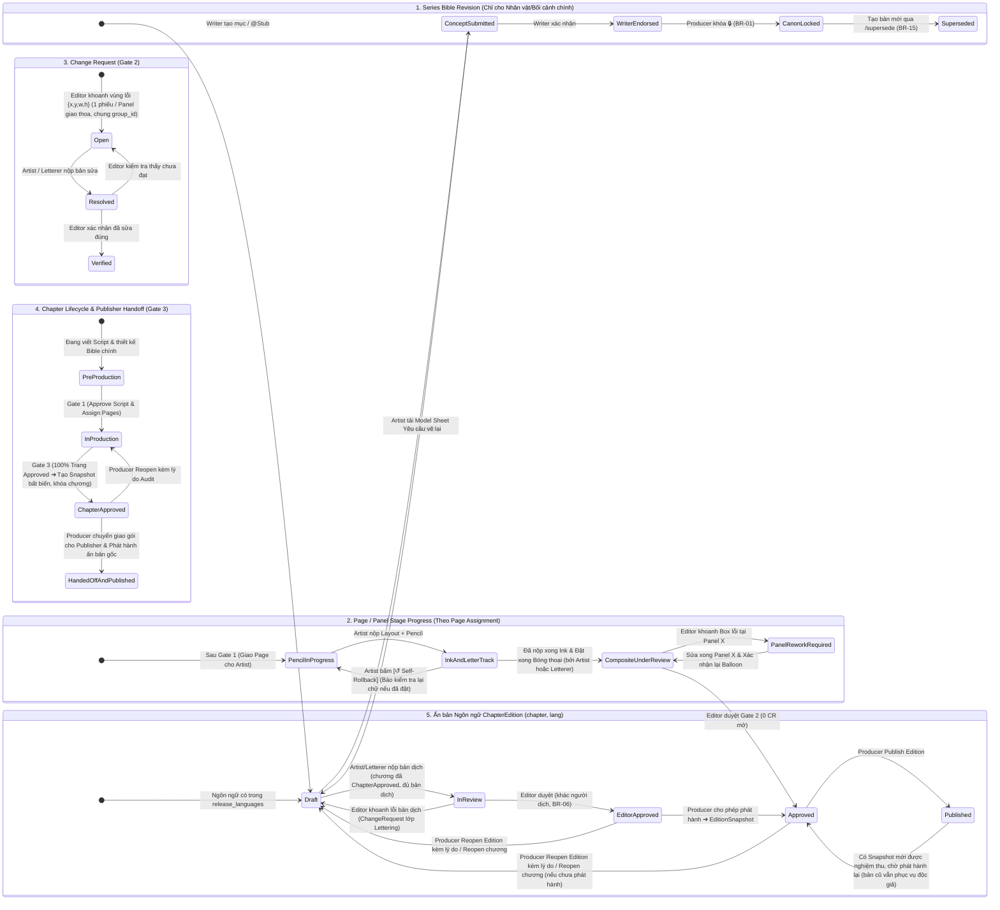

# 📘 ĐẶC TẢ TỔNG THỂ LUỒNG NGHIỆP VỤ, KIẾN TRÚC MODULE & BUSINESS RULES — PANELFORGE (V2.6 FINAL)

> **Dự án:** PanelForge — Nền tảng Quản lý Sản xuất Truyện tranh Manga có Cấu trúc & Truy vết Phiên bản  
> **Kiến trúc kỹ thuật:** .NET 9 Clean Architecture (CQRS/MediatR, SignalR) + React 19 (TypeScript, Konva/Canvas API) + Flutter Mobile + PostgreSQL 17, Marten Event Store & Cloudflare R2 (CAS SHA-256)  
> **Trọng tâm phiên bản V2.6 (Final):**
> 1. Tối giản cấu trúc kịch bản theo `Trang -> Panel -> Nội dung`, nhân vật quần chúng ghi trực tiếp trong chỉ dẫn/dẫn truyện (không cần tạo Bible trước).
> 2. Artist làm chủ hoàn toàn bước Layout + Pencil trên trang được giao và mặc định có sẵn quyền đặt bóng thoại (Lettering); Letterer là vai trò phụ việc tùy chọn (chỉ mở công cụ chữ trên trang được giao, khóa lớp tranh vẽ).
> 3. Cô lập sửa lỗi cấp Panel tại Gate 2, hỗ trợ từ 1 đến nhiều Artist làm việc song song không xung đột.
> 4. Định vị Publisher là đối tác phát hành bên ngoài Studio (External Stakeholder) nhận chuyển giao gói xuất bản từ Producer qua **Publisher Portal**. Publisher không tác động vào nội dung sản xuất, nhưng **là người quy định thương mại của từng ấn bản ngôn ngữ: loại Free / Trả phí, giá tiền và số trang xem trước** (BR-33).
> 5. Kiếm tiền chương bằng **tiền thật (VNĐ)**: độc giả trả tiền để mở khóa ấn bản trả phí. Hệ thống dùng **một đơn vị tiền tệ duy nhất là VNĐ**, không có token, không quy đổi tỷ giá ngoại tệ.
> 6. **Producer** là người xem số liệu đọc và doanh thu (Dashboard 360°, BR-32).
> 7. **Ấn bản ngôn ngữ (Language Edition):** Series khai báo ngôn ngữ gốc và các ngôn ngữ phát hành; mỗi bóng thoại có bản chữ theo từng ngôn ngữ trên cùng một vị trí. Mỗi cặp *(Chương, Ngôn ngữ)* là một **ấn bản** được Producer nghiệm thu riêng, Publisher đặt giá riêng, độc giả mua riêng: **mua ngôn ngữ nào đọc ngôn ngữ đó** (BR-34).
>
> **Nhật ký quyết định (chốt ngày 2026-11-12):**
>
> | # | Quyết định | Phần bị ảnh hưởng |
> |---|---|---|
> | Q1 | Trạng thái `Locked` gộp vào `ChapterApproved` | §5.2 |
> | Q2 | Lỗi vắt nhiều Panel → nhiều ChangeRequest gom bằng `group_id` | Module 3, §6.1.1 |
> | Q3 | Báo cáo Gross Revenue từ Publisher triển khai giai đoạn sau | Module 5 mục 3B |
> | Q4 | Không có gói VIP / thuê bao | BR-33 |
> | Q5 | Scene mặc định ẩn mỗi chương, `scene_id` giữ NOT NULL | §1.2 |
> | Q6 | ~~Token mua theo gói cố định~~ → **thay bằng Q11** | — |
> | Q7 | **Publisher** quy định xem trước & đặt giá chương (thay cho "chỉ Producer"). Publish/Reopen vẫn do Producer | Module 5, BR-33, §5.1, §5.3 |
> | Q8 | **Producer** xem lượt đọc & doanh thu | Module 5 mục 3, BR-32, §5.1 |
> | Q9 | Ngôn ngữ bóng thoại theo cấu hình ngôn ngữ của Series; độc giả chọn ngôn ngữ đọc | Module 2, Module 5 mục 5, BR-34, §6.1.6 |
> | Q10 | Producer **nghiệm thu từng ngôn ngữ**; **giá khác nhau theo ngôn ngữ**; **mua ngôn ngữ nào đọc ngôn ngữ đó** → khái niệm Ấn bản ngôn ngữ `ChapterEdition` | Module 2, Module 5 mục 1–5, BR-12/19/33/34, §5.1, §5.2, §6.1.5–6 |
> | Q11 | **Không dùng token, dùng tiền thật**: giá, ví, giao dịch, doanh thu đều bằng VNĐ; một đơn vị tiền tệ, không quy đổi ngoại tệ (thay Q6) | Module 5 mục 3–4, BR-32/33, §6.1.5 |
> | Q12 | **Toàn hệ thống chỉ có một tài khoản Publisher**, phát hành cho mọi Workspace và Series | Module 5 mục 2 & 4, BR-33, §5.1 |
> | Q13 | Tiền nạp Ví chuyển vào **tài khoản ngân hàng của nền tảng**; doanh thu Workspace tính từ giao dịch mở khóa | Module 5 mục 4, BR-33, §6.1.5 |
> | Q14 | Ấn bản ngôn ngữ dịch: **Editor duyệt**, **Producer cho phép phát hành** | Module 5 mục 1, BR-12/34, §5.1, §5.2 |

---

## PHẦN I. TỔNG QUAN LUỒNG NGHIỆP VỤ XUYÊN SUỐT (END-TO-END MASTER WORKFLOW)

### 1.1. Sơ Đồ Kiến Trúc Luồng Tinh Gọn (Mermaid Flowchart)



### 1.2. Chuẩn Hóa Cấu Trúc Kịch Bản & Quy Tắc Thực Thể Quần Chúng

Khác với kịch bản điện ảnh tính theo thời gian quay (Scene), kịch bản truyện tranh là nghệ thuật sắp đặt không gian vật lý trên trang giấy. Do đó, hệ thống loại bỏ tầng Scene khỏi luồng soạn thảo và tổ chức dữ liệu đi thẳng theo 3 cấp bên dưới. **Quyết định kỹ thuật (D2, chốt 2026-11-12):** mỗi Chương có sẵn **một Scene mặc định ẩn** do hệ thống tạo khi tạo Chương; mọi dòng kịch bản gắn vào Scene này, giao diện không hiển thị Scene. Cột `scene_id` giữ `NOT NULL` dưới DB (không đổi sang `nullable`) để không phá vỡ lịch sử revision và luồng AI đang chạy theo Scene. Chương cũ có nhiều Scene vẫn hoạt động; Scene khi đó chỉ là nhóm hiển thị tùy chọn.

1. **Page (Trang truyện):** Sắp xếp thứ tự bằng thuật toán `LexoRank` để dễ dàng chèn trang bổ sung vào giữa mà không phải đánh lại số thứ tự toàn chương.
2. **Panel (Khung tranh):** Thuộc về một Trang, lưu tọa độ chuẩn hóa BoundingBox `{x, y, w, h}` (tỉ lệ $0..1$ trên khung trang chuẩn $1200 \times 1800$) và thứ tự đọc (`panelIndex`).
3. **Panel Contents (Nội dung bên trong Panel):** Mỗi Panel chứa một danh sách các mục nội dung có thứ tự:
   - **ACTION_DIRECTION (Artist phải vẽ gì?):** Mô tả bối cảnh, góc máy camera, hành động, biểu cảm nhân vật và mô tả trực tiếp các thực thể quần chúng/vật phụ.
     - **Nhân vật chính/cốt lõi (Canon Entity):** Writer gõ `@Akira` $\rightarrow$ Hệ thống liên kết với Series Bible để hiển thị Model Sheet của Akira ngay cạnh khung vẽ và bắt buộc khóa `CanonLocked` tại Gate 1.
     - **Thực thể quần chúng (Mob / Minor Entity):** Không cần tạo trong Series Bible trước. Writer chỉ cần viết mô tả bình thường trong phần `ACTION_DIRECTION` hoặc `NARRATION` (ví dụ: *"Góc rộng hai tên lính gác mặc áo giáp xám đứng canh trước cổng thành, người dân xung quanh chạy tán loạn"*) để Artist đọc hiểu và tự do sáng tạo khi vẽ mà không làm nghẽn tiến độ tiền kỳ.
   - **DIALOGUE / THOUGHT (Nhân vật có lời thoại/suy nghĩ gì?):** Gắn `speaker_character_id` (nullable nếu là tiếng nói của đám đông/quần chúng) + nội dung lời thoại để tạo bóng thoại (`SPEECH_BALLOON` / `THOUGHT_BALLOON`).
   - **NARRATION (Có lời dẫn truyện không?):** Nội dung hộp dẫn chuyện của tác giả (`NARRATION_BOX`), có thể dùng để giới thiệu nhanh bối cảnh hoặc đám đông quần chúng.
   - **SFX (Có hiệu ứng âm thanh gì?):** Chữ tượng thanh minh họa tiếng động trên tranh (`SOUND_EFFECT`).

### 1.3. Thuật Toán Hình Học Đánh Số Thứ Tự Đọc Panel Theo Hướng Đọc (Reading Order Algorithm)

Hệ thống áp dụng thuật toán phân hàng hình học (Row-Banding Geometric Sort) tự động tính toán `panelIndex` ($1, 2, 3\dots$) ngay khi Artist chọn Frame Template hoặc kẻ khung trên trang được giao:

* **Không gian tọa độ:** Tọa độ chuẩn hóa $[0..1] \times [0..1]$ trên khung canvas $1200 \times 1800$.
* Mỗi Panel $i$ có BoundingBox $(x_i, y_i, w_i, h_i)$ và tâm trọng tâm $(cx_i, cy_i) = (x_i + \frac{w_i}{2}, y_i + \frac{h_i}{2})$.
* **Các bước sắp xếp:**
  1. **Bước 1 (Trục dọc):** Sắp xếp danh sách Panel theo tọa độ đỉnh trên $y$ tăng dần từ trên xuống dưới.
  2. **Bước 2 (Gom cụm hàng ngang - Row Banding):** Hai Panel $A$ và $B$ được coi là thuộc cùng một hàng ngang khi:
     $$|cy_A - cy_B| < \frac{\min(h_A, h_B)}{2}$$
  3. **Bước 3 (Sắp xếp trong hàng theo `ReadingDirection` của Series):**
     - **Manga Nhật Bản (`RightToLeft` — RTL):** Sắp xếp giảm dần theo $cx$ (Phải ➔ Trái, $cx$ lớn hơn đọc trước).
     - **Comics Âu Mỹ (`LeftToRight` — LTR):** Sắp xếp tăng dần theo $cx$ (Trái ➔ Phải, $cx$ nhỏ hơn đọc trước).
     - **Webtoon Cuộn Dọc (`Vertical`):** Bỏ qua phân hàng, sắp xếp tuần tự theo $cy$ tăng dần từ trên xuống dưới.
  4. **Bước 4 (Đánh số `panelIndex` & Quyền tùy biến của Artist):** Gán chỉ số đọc tăng dần $1, 2, 3, \dots, N$. Artist phụ trách trang đó có quyền đổi số thứ tự đọc thủ công trên giao diện `ArtistDeskView` nếu trang có bố cục nghệ thuật phá cách (Panel lồng, Panel chéo).

---

## PHẦN II. ĐỊNH NGHĨA LUỒNG GIAO VIỆC & PHỐI HỢP ĐA HỌA SĨ (ASSIGNMENT ENGINE & MULTI-ARTIST WORKFLOW)

### 2.1. Nguyên Tắc Giao Việc Qua Từng Giai Đoạn (Ai Quản Lý, Thủ Công hay Tự Động?)

| Giai đoạn (Stage) | Đơn vị giao việc (Scope) | Ai thực hiện? | Cơ chế điều phối (Thủ công vs. Tự động) |
|---|---|---|---|
| **1. Soạn Kịch Bản (Script)** | Toàn Chương (Chapter) | Writer | **Tự động (Ngoài luồng Assignment):** Writer chủ động tạo và viết kịch bản chương. Producer không cần tạo thẻ giao việc Script. |
| **2. Thiết kế Nhân vật chính (Series Bible)** | Từng Thực thể chính (`@Tag`) | Writer tạo đặc tả $\rightarrow$ Artist vẽ Model Sheet | **Bán tự động:** Khi Writer gõ `@Tên_Mới` cho nhân vật chính, hệ thống đẩy vào hàng đợi `Pending Concept Art` để Artist vào tải Model Sheet lên. Nhân vật quần chúng không qua bước này. |
| **3. Dựng Khung & Vẽ Chì (Layout + Pencil)** | Theo Trang (Page) | Artist (Ai được assign Page nào thì làm nhiệm vụ trên Page đó) | **Producer phân công tại Gate 1 (Hoặc kế thừa mặc định):** Khi bấm Gate 1, Producer gán 1 Artist cho cả chương hoặc chia dải trang (VD: Artist A làm Trang 1..10, Artist B làm Trang 11..20). Artist nào nhận Page nào sẽ toàn quyền chọn Frame Template, dựng khung và vẽ Pencil trên Page đó. |
| **4. Đi Nét Mực (Ink)** | Theo Trang (Page) hoặc Khung (Panel) | Artist | **Tự động 100% (Auto-Handoff):** Ngay khi Artist nộp xong Pencil của Page X, hệ thống tự động mở khóa bước Ink của Page X cho chính Artist đó (hoặc chuyển sang Inker chuyên trách nếu Producer cấu hình sẵn). |
| **5. Đặt Chữ / Bóng Thoại (Lettering)** | Theo Trang (Page) | Artist (Mặc định) hoặc Letterer (Phụ việc nếu được gán) | **Cơ chế Kế thừa & Phụ việc linh hoạt (BR-31):**<br>• *Mặc định:* Role Artist có sẵn công cụ thêm chữ (Vector Text Tools) trên trang mình được giao để tự đặt bóng thoại luôn.<br>• *Khi có Letterer phụ việc:* Nếu Producer gán một Letterer vào Page X, hệ thống mở quyền truy cập Page X cho Letterer đó, nhưng trên màn hình của Letterer chỉ mở khóa duy nhất công cụ thêm chữ (lớp tranh vẽ của Artist bị khóa Read-only). |
| **6. Kiểm Định Gate 2 (Quality Review)** | Theo Trang (Page) | Editor | **Tự động định tuyến:** Khi cả lớp tranh (Ink) và lớp chữ (Lettering) của Page X đã hoàn tất (Submitted), hệ thống tự ghép ảnh $1200 \times 1800$ và đẩy vào hàng đợi của Editor (đảm bảo Luật 4 mắt BR-06: `EditorId != ArtistId`). |
| **7. Sửa Lỗi Cấp Panel (Rework)** | Cô lập đúng Panel X bị lỗi | Artist hoặc Letterer | **Tự động định tuyến theo vùng khoanh lỗi:** Editor khoanh vùng lỗi trên Panel X. Nếu lỗi nét vẽ $\rightarrow$ trả về đúng Artist giữ Panel X. Nếu lỗi chữ $\rightarrow$ trả về cho Letterer (nếu trang có gán Letterer) hoặc trả về cho chính Artist của trang đó. |

### 2.2. Kịch Bản Vận Hành Khi Có 1, 2, 3 Hoặc Nhiều Artist (Multi-Artist Scaling)

Hệ thống giải quyết bài toán từ 1 đến $N$ họa sĩ thông qua cơ chế Phân quyền theo Phạm vi Trang/Khung (Granular Page/Panel-Scoped ABAC) với thứ tự ưu tiên: `Panel Assignment > Page Assignment > Chapter Default Assignment`.

* **Kịch bản 1 Artist (Solo / All-in-One Mangaka):**
  * Producer gán Artist A làm người phụ trách mặc định của Chương.
  * Khi qua Gate 1, toàn bộ các trang trong chương thuộc về Artist A. Vì mặc định role Artist đã có quyền thêm chữ, Artist A tự chọn Frame Template, vẽ Pencil, đi nét Ink và dùng luôn công cụ Vector Text ngay trên cùng một màn hình `ArtistDeskView` để đặt bóng thoại mà không cần bất kỳ tài khoản Letterer nào tham gia.
* **Kịch bản 2 Artist (Chia dải trang song song hoặc Bóc tách ứng cứu — Scope Carve-out):**
  * *Chia trang từ đầu:* Tại Gate 1, Producer gán Artist A phụ trách Trang 1..10, Artist B phụ trách Trang 11..20. Ai được assign trang nào thì toàn quyền làm Layout + Pencil + Ink (và đặt chữ nếu không có Letterer) trên đúng các trang đó. Artist A mở Trang 11 sẽ chỉ ở chế độ Read-only (chặn ghi `403 Forbidden`).
  * *Bóc tách / Chuyển giao giữa chừng (Mid-flight Transfer — BR-30):* Giả sử Artist A nhận cả 10 trang, đã làm xong Trang 1..4, nhưng Trang 5..6 bị Editor trả về bắt sửa (`ReworkRequired`) trong khi A đang bận vẽ Trang 7..10. Producer thực hiện Transfer Scope riêng Trang 5..6 (hoặc riêng Panel 2 của Trang 5) sang cho Artist B. Hệ thống lập tức thu hồi quyền ghi của A trên Trang 5..6, cấp quyền ghi cho B và chuyển toàn bộ phiếu ChangeRequest đang mở trên phạm vi đó sang hàng đợi của B.
* **Kịch bản 3+ Artist & Letterer phụ việc (Dây chuyền Studio Công nghiệp):**
  * Studio lớn có thể chia theo cả Dải trang lẫn Chuyên môn hóa công đoạn:
    * Artist 1 được assign dựng khung Layout + Pencil từ Trang 1..10; Artist 2 dựng Layout + Pencil từ Trang 11..20.
    * Ngay khi một trang nộp xong Pencil, hệ thống tự động mở khóa cuốn chiếu cho Artist 3 (chuyên đi nét Ink) và Letterer C (nhân sự phụ việc chuyên đặt bóng thoại được assign vào chương/trang đó).
    * Nhờ tách biệt Graphic Layer (cho Artist) và Vector Text Layer (cho Letterer), Artist 3 và Letterer C có thể mở cùng một trang làm việc song song theo thời gian thực mà không bao giờ ghi đè làm hỏng dữ liệu của nhau.

---

## PHẦN III. CHI TIẾT ĐẶC TẢ THEO 5 MODULE PHÁT TRIỂN

### MODULE 1: Quản Trị Studio, Series Bible Tinh Gọn & Soạn Thảo Kịch Bản (CF1 & Pre-CF2)
* **Actor:** Administrator, Producer, Writer, Artist.
* **Luồng chi tiết:**
  1. **Thiết lập Studio & Series:** Producer tạo Workspace, tạo Series (cấu hình hướng đọc RTL, LTR hoặc Vertical), mời các thành viên vào Workspace theo 5 vai trò nội bộ (Producer, Writer, Artist, Letterer, Editor).
  2. **Soạn Kịch bản Độc lập & Phân biệt Nhân vật Chính / Quần chúng:**
     - Writer chủ động tạo và viết kịch bản chương theo cấu trúc `Trang dự kiến -> Panel -> Nội dung` mà không cần chờ Producer giao thẻ việc.
     - Đối với Nhân vật chính/quan trọng: Writer gõ `@Tên_Nhân_Vật` để gắn thẻ liên kết với Series Bible (nếu chưa có thì tự tạo `@Stub Entity` nháp trong Bible).
     - Đối với Thực thể quần chúng / Bối cảnh phụ thoáng qua: Writer không tạo mục trong Series Bible, mà ghi trực tiếp mô tả vào dòng `ACTION_DIRECTION` hoặc `NARRATION` của Panel để Artist đọc và vẽ trực tiếp.
  3. **Quy trình Duyệt Series Bible 2 Tầng & Quản lý Nhân vật Đa Thời Kỳ:**
     - Mỗi mục `BibleEntry` quản lý ngoại hình theo cột mốc chương thông qua trường `effective_from_chapter_number` (ví dụ: Akira lúc nhỏ có hiệu lực từ Chương 1; Akira lúc lớn tạo qua `/supersede` có hiệu lực từ Chương 15).
     - **Bước 1:** Artist tải lên bản vẽ thiết kế nhân vật chính (Model Sheet) $\rightarrow$ Trạng thái chuyển từ `Draft` sang `ConceptSubmitted` (file ảnh được băm SHA-256 lưu vào Cloudflare R2).
     - **Bước 2 (Thẩm định nguyên tác):** Writer kiểm tra thiết kế đúng với mô tả cốt truyện $\rightarrow$ Bấm xác nhận chuyển sang `WriterEndorsed`.
     - **Bước 3 (Khóa chuẩn Canon):** Producer bấm khóa chuẩn $\rightarrow$ Chuyển sang `CanonLocked` 🔒. Cấm hoàn toàn việc sửa đè hay mở khóa (`/unlock` bị loại bỏ).
  4. **Cổng Chốt Tiền Kỳ 1 Chạm (Gate 1 — Pre-Production Gate):**
     - Khi kịch bản hoàn tất, hệ thống quét kiểm tra nhất quán: đảm bảo các nhân vật được gắn thẻ `@Tag` trong chương đã được khóa `CanonLocked` (BR-21 & BR-30). Các thực thể quần chúng không bị kiểm tra.
     - Producer bấm 1 nút duy nhất: **Approve Script & Start Production** (kèm xác nhận phân công Page cho Artist) $\rightarrow$ Kịch bản chuyển sang trạng thái đóng băng chỉ đọc (`is_script_frozen = true`) và mở khóa bảng Kanban sản xuất hình ảnh.

### MODULE 2: Bàn Vẽ Dựng Khung, Đi Nét & Đặt Chữ Linh Hoạt (CF2)
* **Actor:** Artist (Chủ đạo — có quyền vẽ và thêm chữ), Letterer (Phụ việc tùy chọn — chỉ có quyền thêm chữ), Producer.
* **Luồng chi tiết:**
  1. **Dựng Khung (Layout) và Vẽ Phác Thảo (Pencil) theo Page được Assign:** Artist nào được assign Page nào thì mở bàn vẽ (`ArtistDeskView`) của Page đó, chọn mẫu khung từ thư viện Frame Templates (hoặc tự kẻ khung), ánh xạ các dòng nội dung kịch bản vào từng Panel (thanh Script Coverage Counter báo đủ 100% dòng thoại của trang), vẽ phác thảo Pencil và bấm **Submit Pencil**.
  2. **Mở khóa Đi Nét (Ink) và Đặt Chữ (Lettering) ngay sau Pencil:**
     - Ngay khi bản Pencil của trang được nộp, tọa độ các khung Panel đã cố định. Hệ thống mở khóa đồng thời 2 nhánh công việc trên trang đó:
       - **Nhánh Graphic Layer (Ink):** Artist của trang đó tiếp tục đi nét mực và dán screentone.
       - **Nhánh Vector Text Layer (Lettering — Linh hoạt theo phân công BR-31):**
         - *Trường hợp 1 (Không gán Letterer riêng):* Chính Artist của trang đó sử dụng bộ công cụ chữ (Vector Text Tools được mở sẵn mặc định cho role Artist) để đặt bóng thoại (SPEECH, THOUGHT, NARRATION, SFX) gắn 1-1 với `script_line_id`.
         - *Trường hợp 2 (Có gán Letterer phụ việc):* Nhân sự có role Letterer được assign vào trang đó sẽ vào đặt bóng thoại trên nền bản vẽ Pencil. Trên màn hình của Letterer, hệ thống chỉ hiển thị duy nhất thanh công cụ thêm/chỉnh sửa chữ (`letter:write`), tuyệt đối không cho phép thay đổi khung Panel hay tải đè ảnh Artwork của Artist.
     - Mỗi bóng thoại lưu tọa độ độc lập Position Record: `{x, y, width, height}`. Khi Artist tải bản vẽ Ink hoàn chỉnh lên lớp dưới, vị trí bóng thoại ở lớp trên hoàn toàn giữ nguyên.
     - **Ngôn ngữ Bóng thoại (Balloon Localization — BR-34):**
       - **Cấu hình ở Series:** Producer khai báo `original_language` (ngôn ngữ kịch bản gốc, ví dụ `'vi'`) và danh sách `release_languages` (các ngôn ngữ sẽ phát hành, ví dụ `['vi', 'en', 'ja']`, luôn chứa ngôn ngữ gốc). Mã ngôn ngữ theo chuẩn BCP 47 rút gọn (`vi`, `en`, `ja`, `ko`, `fr`…).
       - **Một vị trí, nhiều bản chữ:** Mỗi bóng thoại có một Position Record `{x, y, w, h}` và kiểu chữ dùng chung, cùng một bản chữ cho **mỗi** ngôn ngữ trong `release_languages`. Bản chữ ngôn ngữ gốc lấy từ dòng kịch bản (BR-05); bản dịch do Artist/Letterer của trang nhập (có thể nhận đề xuất AI, tuân BR-02).
       - **Chuyển ngôn ngữ trên bàn vẽ:** `ArtistDeskView` / `LetteringWorkspace` có bộ chọn ngôn ngữ đang soạn; đổi ngôn ngữ chỉ đổi chữ hiển thị, không đổi khung Panel hay lớp Ink. Kiểm tra BR-20 (tràn chữ, thứ tự đọc, đè nét vẽ) chạy riêng cho từng ngôn ngữ vì độ dài chữ khác nhau.
       - **Điều kiện hoàn tất:** Lớp chữ của một trang được nộp vào Gate 2 (BR-19) khi mọi bóng thoại đã có chữ ở **ngôn ngữ gốc**. Bản dịch các ngôn ngữ khác được nhập song song hoặc sau đó, và được nghiệm thu riêng theo từng **ấn bản ngôn ngữ** ở Gate 3 (Module 5 mục 1), nên thêm hay sửa bản dịch không cần mở lại chương.
  3. **Cơ chế Artist tự thu hồi / quay lui (Self-Rollback: Ink ➔ Pencil):** Nếu đang làm ở bước Ink mà Artist tự phát hiện bản Pencil trước đó có sai sót (và trang chưa bị khóa bởi phiên duyệt `UnderReview` của Editor), Artist bấm nút `[ ↺ Quay lại sửa Pencil ]` để chủ động lùi trạng thái về Pencil (`InProgress`), tải lên bản sửa Version n+1. Nếu trên trang đã có bóng thoại được đặt trước đó, hệ thống tự động bật cờ nhắc kiểm tra lại vị trí bóng thoại.

### MODULE 3: Kiểm Định Chất Lượng, Cô Lập Lỗi Cấp Panel & Cảnh Báo Liên Đới (CF3)
* **Actor:** Editor (Reviewer), Artist, Letterer, AI Continuity Service.
* **Luồng chi tiết:**
  1. **Cổng Kiểm Định Hợp Nhất (Gate 2 — Quality & Composite Gate):** Khi cả lớp tranh (Ink) và lớp chữ (Lettering) của trang đã hoàn tất, hệ thống ghép phẳng thành trang Composite $1200 \times 1800$ và mở màn hình `ReviewView` cho Editor. Editor sử dụng 3 chế độ đối chiếu phiên bản (Side-by-side, Swipe slider, Onion-skin) và bộ lọc Canvas Pixel Diff.
  2. **Khoanh vùng lỗi Bounding Box $0..1$ & Cô lập sửa lỗi theo Panel:**
     - Khi phát hiện lỗi, Editor kéo chuột khoanh vùng lỗi trên ảnh (`AnchorCoordinates: {x, y, w, h}`).
     - Thuật toán hình học `FindIntersectingPanelIds()` tự động xác định chính xác Panel (hoặc nhóm Panel nếu lỗi nằm vắt ngang ranh giới khung với tỷ lệ giao thoa $\ge 15\%$) chứa vùng khoanh lỗi:
       - **Chỉ cô lập đúng Panel lỗi:** Chỉ Panel bị khoanh lỗi chuyển về trạng thái `ReworkRequired` kèm phiếu `ChangeRequest` (`Open`). Các Panel khác trên cùng trang vẫn giữ nguyên trạng thái `Approved` 🔒.
       - **Lỗi vắt nhiều Panel:** Mỗi Panel giao thoa $\ge 15\%$ sinh **một phiếu `ChangeRequest` riêng** (cùng nội dung nhận xét). Các phiếu sinh ra từ cùng một vùng khoanh dùng chung một `group_id` để màn hình gom lại thành một góp ý. Mỗi phiếu đóng độc lập theo Panel của nó, nên Panel sửa xong trước không phải chờ Panel còn lại.
  3. **Định tuyến thông minh & Cảnh báo liên đới:**
     - Nếu Editor chọn lỗi thuộc lớp Lettering (Chữ/Bóng thoại): Phiếu sửa chỉ gửi cho người phụ trách chữ của trang đó (Letterer được assign, hoặc Artist của trang nếu Artist tự làm chữ); phần tranh vẽ giữ nguyên.
     - Nếu Editor chọn lỗi thuộc lớp Artwork (Pencil/Ink): Phiếu sửa gửi cho Artist phụ trách Panel đó vẽ lại. Đồng thời, nếu trong Panel đó đã có bóng thoại, hệ thống tự động bật cờ `is_artwork_updated_alert = true` (hiển thị viền cảnh báo màu Cam `⚠️ Check Balloon Fit`) để Artist hoặc Letterer kiểm tra lại vị trí bóng thoại sau khi cập nhật nét vẽ mới.
  4. **Vòng đời đóng phiếu sửa lỗi (Open ➔ Resolved ➔ Verified):** Khi sửa xong và nộp lại, phiếu chuyển sang `Resolved`. Editor vào đối chiếu bản mới và bấm Verify (`Verified`). Nút `Approve Page` chỉ mở khóa khi 100% phiếu ChangeRequest trên trang đã đạt `Verified`.

### MODULE 4: Xử Lý Bổ Sung / Sửa Kịch Bản Muộn & Truy Vết Lịch Sử (CF4 - Xương Sống)
* **Actor:** Hệ thống tự động, Producer, Writer, Artist, Letterer.
* **Luồng chi tiết:**
  1. **Lưu vết sự kiện bất biến (Append-Only Event Sourcing & CAS):** Mọi thao tác thay đổi trạng thái, sửa kịch bản, tải ảnh artwork hay di chuyển bóng thoại đều được ghi thành sự kiện append-only trong PostgreSQL & Marten Event Store. Mọi file ảnh đều được định danh bằng mã băm nội dung SHA-256 (Content-Addressed Storage). Khôi phục phiên bản cũ (Restore) luôn tạo ra phiên bản mới Version n+1 sao chép trạng thái cũ, tuyệt đối không xóa lịch sử.
  2. **Cơ chế Xử lý Bổ sung / Sửa Kịch bản sau khi đã Đóng băng (Chia 2 cấp độ):**
     - **Cấp độ Cơ bản (Sprint MVP):** Producer bấm `Unfreeze / Reopen Script` (bắt buộc nhập lý do vào Audit Log) $\rightarrow$ Writer sửa nội dung Panel $\rightarrow$ Producer khóa lại (`Frozen`) $\rightarrow$ Hệ thống gửi thông báo cho Artist và Letterer phụ trách trang đó.
     - **Cấp độ Nâng cao (Sprint Mở rộng):** Khi Writer sửa một dòng thoại/mô tả đã gắn vào Panel X, hệ thống tự động gắn cờ `FlagImpactReview` (⚑) lên Panel X và đánh dấu `isStale = true` lên bóng thoại tương ứng. Ê-kíp chỉ cần xem đúng Panel X để bấm chọn `Keep` (giữ nguyên tranh nếu chỉ sửa chính tả/từ ngữ nhẹ) hoặc `Rework` (vẽ lại riêng khung đó).

### MODULE 5: Nghiệm Thu Chương, Chuyển Giao Cho Publisher (External Stakeholder), Giám Sát Độc Giả & Báo Cáo Doanh Thu (CF5)
* **Actor:** Producer (Studio Owner), Publisher (External Stakeholder qua Publisher Portal: nhận bàn giao, quy định xem trước & giá), Public Reader.
* **Luồng chi tiết:**
  1. **Cổng Nghiệm Thu (Gate 3 — Release Gate) theo 2 cấp:**
     - **Cấp Chương — `Approve Chapter` (khóa tranh & ấn bản ngôn ngữ gốc):** Producer bấm `Approve Chapter`. Hệ thống chạy chốt kiểm tra tự động (`ChapterLockGate`):
       - Chương có ít nhất 1 trang (`Pages.Count >= 1`).
       - 100% các trang trong chương đã đạt `Approved` ở Gate 2.
       - Không còn bất kỳ phiếu `ChangeRequest` nào chưa đóng (`UnclosedCR == 0`).
       - Không còn lỗi nhất quán mức độ chặn (`BlockingFinding == 0`) hoặc cờ ảnh hưởng ⚑ chưa giải quyết.
       - Nếu thiếu bất kỳ điều kiện nào, Backend trả về ngay `HTTP 409 Conflict` kèm danh sách các trang còn vướng.
       - Đạt: chương chuyển `ChapterApproved` (lớp tranh và bố cục khóa Read-only) và **ấn bản ngôn ngữ gốc** chuyển `Approved`.
     - **Cấp Ấn bản — duyệt từng ngôn ngữ (quyết định Q10, Q14):** Mỗi ngôn ngữ còn lại trong `release_languages` là một ấn bản `ChapterEdition(chapter, lang)` đi qua 2 bước riêng, theo thứ tự ngôn ngữ tùy ý:
       1. **Nộp bản dịch:** Artist/Letterer phụ trách chữ bấm nộp khi chương đã `ChapterApproved` (tranh đã khóa) và mọi bóng thoại có chữ ở ngôn ngữ `lang`, không còn cảnh báo BR-20 mức chặn của ngôn ngữ đó (tràn chữ chưa xác nhận lý do, đè vùng nét vẽ chính). Ấn bản chuyển `InReview`.
       2. **Editor duyệt bản dịch:** Editor xem bản ghép theo ngôn ngữ `lang`, khoanh lỗi như Gate 2 (phiếu `ChangeRequest` lớp Lettering gắn `language_code`) hoặc duyệt → `EditorApproved`. Luật 4 mắt BR-06 áp dụng: Editor duyệt phải khác người đã nhập bản dịch của ấn bản đó.
       3. **Producer cho phép phát hành (`Approve Edition`):** chỉ với ấn bản `EditorApproved` → `Approved`, sinh `EditionSnapshot`. Producer sau đó bấm `Publish Edition` (có thể ngay hoặc lên lịch).
       - Thiếu điều kiện ở bất kỳ bước nào → `409 Conflict` kèm danh sách bóng thoại/trang còn vướng.
  2. **Snapshot Bất Biến theo Ấn bản & Chuyển Giao Cho Publisher (External Stakeholder):**
     - Mỗi lần nghiệm thu một ấn bản sinh một `EditionSnapshot` bất biến: danh sách mã băm SHA-256 ảnh trang đã ghép lớp tranh với lớp chữ ngôn ngữ đó. Ấn bản gốc dùng chung `ChapterSnapshot` của cấp Chương.
     - `ChapterApproved` **chính là trạng thái khóa chương**; không có trạng thái `Locked` riêng. Muốn sửa tranh phải `Reopen` chương về `InProduction` kèm lý do (ghi Audit); khi đó mọi ấn bản chưa phát hành quay về `Draft`, ấn bản đã phát hành vẫn phục vụ độc giả bằng Snapshot cũ cho tới khi được nghiệm thu và phát hành lại.
     - Sửa bản dịch của một ấn bản đã `EditorApproved` / `Approved`: Producer `Reopen Edition(lang)` kèm lý do → ấn bản về `Draft` (phải qua lại Editor), không ảnh hưởng chương và các ấn bản khác.
     - **Định vị vai trò Publisher:** Publisher (Nhà xuất bản / Đơn vị phát hành) là một **External Stakeholder**, không tham gia vào quy trình sản xuất nội bộ của Studio. **Toàn hệ thống chỉ có đúng một tài khoản Publisher** (quyết định Q12), phát hành cho mọi Workspace và Series:
       - Producer gửi `PreviewLink` bảo mật (có hạn tối đa 72 giờ, gắn email định danh của Publisher, chọn ấn bản ngôn ngữ, phủ Watermark SVG lặp chéo) để Publisher xem trước, hoặc xuất gói file bàn giao theo từng ấn bản (Release Package: PDF bản in, CBZ, Webtoon Vertical Slice, JSON Provenance).
       - Publisher có tài khoản đăng nhập vào **Publisher Portal** gồm hai phần:
         - **Bàn giao (chỉ đọc):** xem danh sách gói Release, PreviewLink và tải gói được chuyển giao.
         - **Quy định thương mại:** đặt loại Free / Trả phí, giá (VNĐ) và số trang xem trước (`free_preview_pages`) cho **từng ấn bản ngôn ngữ** của mọi chương trên nền tảng (chi tiết ở mục 4, BR-33).
       - Publisher **không** được sửa nội dung, duyệt, nghiệm thu, từ chối, phát hành hay mở lại chương/ấn bản.
       - **Phát hành (`Publish Edition(lang)`) và mở lại chỉ do Producer thực hiện**, theo từng ấn bản đã được Producer cho phép phát hành (`Approved`). Ấn bản `Published` xuất hiện trên Web Catalog và Mobile Reader. Ấn bản chưa được Publisher cấu hình thương mại mặc định là **Free**.
  3. **Bảng Điều Khiển Tổng Quan Dành Cho Producer (Owner 360° Dashboard): Phân Tích Độc Giả & Doanh Thu (Readership Analytics & Revenue — BR-32):**
     - **Người xem:** Producer của Workspace (và Admin). Publisher và các vai trò sản xuất khác không xem Dashboard này.
     - Mọi chỉ số lọc được theo Series, Chương, **Ấn bản ngôn ngữ** và kỳ (ngày/tháng/quý).
     - **A. Chỉ số Hành vi Độc giả & Mức độ Tiêu thụ (Readership & Consumption Analytics):**
       - **Tổng lượt xem / lượt mở đọc (Total Views / Impressions):** Thống kê số lần ấn bản được mở đọc trên Web Catalog và Mobile Reader.
       - **Độc giả thực tế (Unique Readers):** Xác định theo tài khoản độc giả hoặc thiết bị duy nhất.
       - **Tỷ lệ hoàn thành đọc (Completion Rate — Hook / Retention Rate):** Tỷ lệ phần trăm độc giả cuộn/lật đến trang cuối cùng của chương. Đây là chỉ số then chốt giúp Producer và Writer đánh giá độ lôi cuốn của kịch bản (ví dụ: 10.000 lượt mở, 8.200 lượt đọc đến trang cuối $\rightarrow 82\%$).
       - **Thời gian đọc trung bình (Average Reading Time):** Đo lường thời lượng dừng lại (Dwell Time) trên mỗi chương (tính bằng giây).
       - **Phân bố nền tảng tiêu thụ (Platform Distribution):** Tỷ lệ phần trăm đọc qua Web Browser vs. Ứng dụng Mobile Reader.
       - **Phân bố ngôn ngữ đọc (Language Distribution):** Tỷ lệ lượt đọc theo từng ấn bản ngôn ngữ.
       - **Đánh giá & Mức độ yêu thích (Reader Rating & Feedback):** Điểm đánh giá trung bình (1..5 sao) và số lượt phản hồi từ độc giả.
     - **A2. Doanh thu bán ấn bản trong ứng dụng (In-app Revenue, VNĐ):**
       - Tổng tiền (VNĐ) độc giả đã trả để mở khóa, số lượt mở khóa, theo Chương / Ấn bản ngôn ngữ / kỳ; doanh thu trung bình trên 1.000 lượt xem (RPM = doanh thu / lượt xem × 1000).
       - Tính từ sổ giao dịch mở khóa (append-only), không nhập tay.
     - **B. Báo Cáo Doanh Thu Thương Mại Từ Publisher (Commercial Gross Revenue Tracking) — ⏸️ triển khai giai đoạn sau:**
       - *Ghi chú phạm vi:* Phần này giữ trong đặc tả để theo dõi nhưng chưa triển khai trong đợt hiện tại. Cách xử lý khi sửa số liệu (ghi đè hay append-only tạo bản mới kèm Audit) sẽ chốt khi bắt đầu triển khai; hướng đề xuất là append-only theo BR-18.
       - Cho phép Producer cập nhật số liệu **Tổng doanh thu (Gross Revenue, VNĐ)** mà bộ truyện mang về từ kênh phân phối bên ngoài của Publisher theo từng kỳ (tháng/quý), kèm tên đơn vị phát hành (Publisher Name) và mã hợp đồng/đối soát ngoài (External Reference).
       - **Ranh giới phạm vi (Scope Boundary):** Hệ thống chỉ lưu trữ và hiển thị số liệu doanh thu và tương tác độc giả để Studio nắm bắt hiệu quả kinh doanh; các nghiệp vụ kế toán phức tạp như tính toán tỷ lệ chia lợi nhuận (*royalty split*), đối soát công nợ hay thanh toán lương cho từng thành viên nằm ngoài phạm vi hệ thống (*Out-of-Scope*).
  4. **Kiếm Tiền Bằng Tiền Thật Theo Ấn Bản Ngôn Ngữ (Chapter Edition Monetization — BR-33):**
     - **Đơn vị tiền tệ (quyết định Q11):** mọi giá, số dư, giao dịch và doanh thu tính bằng **VNĐ** (số nguyên đồng). Không có token, xu hay đơn vị ảo; không quy đổi ngoại tệ.
     - **Ví VNĐ của độc giả:** Ví dùng chung cho mọi Workspace. Độc giả nạp tiền thật vào Ví bằng chuyển khoản/QR **vào tài khoản ngân hàng của nền tảng** (quyết định Q13; không nạp vào tài khoản riêng của từng Workspace), có hạn mức tối thiểu/tối đa mỗi lần nạp; giao dịch nạp chỉ được cộng vào Ví sau khi thanh toán được xác nhận. Doanh thu của từng Workspace tính từ các giao dịch mở khóa ấn bản thuộc Series của Workspace đó. Mở khóa trừ tiền trong Ví. Mọi giao dịch nạp và mở khóa ghi sổ append-only.
     - **Hai loại ấn bản:**
       - **Free:** độc giả đọc toàn bộ ấn bản, không trả tiền.
       - **Trả phí:** độc giả chưa mở khóa chỉ xem được `free_preview_pages` trang đầu (N ≥ 0) của ấn bản đó. Hết phần xem trước, ứng dụng hiện màn hình mở khóa với giá `price_vnd` của ấn bản. Mở khóa có hiệu lực vĩnh viễn cho tài khoản đó.
     - **Giá theo ngôn ngữ & mua ngôn ngữ nào đọc ngôn ngữ đó (quyết định Q10):** mỗi ấn bản ngôn ngữ có loại, giá và số trang xem trước riêng (ví dụ bản `vi` 5.000đ, bản `en` 15.000đ, bản `ja` Free). Mở khóa ấn bản `vi` **chỉ** cho đọc trọn bản `vi`; muốn đọc bản `en` phải mở khóa bản `en`.
     - **Không có gói VIP / thuê bao:** cách duy nhất để đọc trọn ấn bản trả phí là mở khóa từng ấn bản.
     - **Người cấu hình (quyết định Q7):** chỉ tài khoản **Publisher** (duy nhất của nền tảng, Q12) được đặt loại, giá và số trang xem trước của từng ấn bản. Producer và các vai trò Studio khác chỉ xem cấu hình. Thao tác này không đụng nội dung nên được phép ở mọi trạng thái ấn bản (kể cả `Approved` và `Published`), có ghi Audit. Đổi giá không ảnh hưởng độc giả đã mở khóa trước đó.
     - **Bảo vệ ở Backend:** Server chỉ trả danh sách trang và URL ảnh của N trang đầu khi độc giả chưa mở khóa ấn bản đó; yêu cầu ảnh trang thứ N+1 trở đi bị chặn (`403 Forbidden`). Không chỉ ẩn ở giao diện.
     - Thành viên đang hoạt động của Workspace sở hữu truyện, cùng Publisher và Admin, đọc toàn bộ mọi ấn bản mà không trả tiền.
  5. **Độc Giả Chọn Ngôn Ngữ Đọc (Reader Language Selection — BR-34):**
     - Web Catalog và Mobile Reader hiển thị các ấn bản ngôn ngữ **đã phát hành** của chương, mỗi ấn bản kèm trạng thái: Free, Đã mở khóa, hoặc giá mở khóa. Độc giả chọn một ngôn ngữ; lựa chọn được nhớ theo tài khoản (hoặc thiết bị nếu chưa đăng nhập) và áp dụng cho các chương sau nếu chương đó có ấn bản ngôn ngữ ấy.
     - Ngôn ngữ mặc định khi chưa chọn: ngôn ngữ giao diện của độc giả nếu có ấn bản đã phát hành, ngược lại là `original_language`.
     - Ảnh trang trả cho độc giả lấy từ Snapshot của đúng ấn bản đã chọn. Đổi ngôn ngữ **không** chuyển quyền mở khóa: ấn bản chưa mở khóa của ngôn ngữ mới chỉ hiện phần xem trước.

---

## PHẦN IV. HỆ THỐNG QUY TẮC NGHIỆP VỤ CHUẨN HÓA (MASTER BUSINESS RULES)

| Mã Quy Tắc | Tên Quy Tắc | Đặc Tả Ràng Buộc Kỹ Thuật & Mã Phản Hồi HTTP | Module Áp Dụng |
|---|---|---|---|
| **BR-01 (BR-25)** | Tính bất biến của Series Bible (CanonLocked) | Một khi Revision của Series Bible đã được Producer khóa (`CanonLocked`), cấm mọi thao tác sửa đè hoặc mở khóa (`/unlock` bị loại bỏ hoàn toàn). Mọi thay đổi ở các chương sau bắt buộc gọi `POST /api/bible/{id}/supersede` để tạo Revision mới. | Module 1 (CF1) |
| **BR-02 & BR-10** | Minh bạch nguồn gốc AI (AI Provenance) | AI chỉ đóng vai trò đề xuất. Mọi gợi ý từ AI phải lưu lại `provider`, `model`, `promptHash` và quyết định của con người (`Accepted`, `Edited`, `Rejected`) vào bảng sự kiện Provenance. | Module 1, 2, 3, 4 |
| **BR-04 & BR-13** | Toàn vẹn file bằng mã băm (CAS SHA-256) | Khi tải lên Model Sheet hoặc Artwork (Pencil/Ink), Client tính mã SHA-256 và gửi kèm file; Server tính lại và đối chiếu. Nếu lệch mã băm trả về `HTTP 400 Bad Request`. Nếu trùng mã băm trong cùng Workspace thì tái sử dụng file qua `AssetReference`. | Module 1, 2, 4 |
| **BR-05** | Liên kết 1-1 giữa Bóng thoại và Kịch bản | Mỗi phần tử bóng thoại (SPEECH, THOUGHT, NARRATION, SFX) trên Vector Layer bắt buộc gắn với đúng một `script_line_id` hợp lệ của Panel đó và lưu Position Record `{x,y,w,h}`. | Module 2 (CF2) |
| **BR-06 (BR-26)** | Quy tắc 4 mắt & Chống tự duyệt (Four-Eyes Principle) | Người duyệt bài (`ReviewerId`) tại Gate 2 bắt buộc phải khác với người được giao việc (`AssigneeId`) và người nộp bài (`SubmitterId`). Nếu vi phạm trả về ngay `HTTP 403 Forbidden`. Khi trả bài (`ReworkRequired`) bắt buộc phải đính kèm vùng khoanh lỗi và nhận xét. | Module 3 (CF3) |
| **BR-07 & BR-23** | Phân quyền cô lập theo Workspace & Page Assignment | Thành viên chỉ truy cập được Workspace mình tham gia. Đặc quyền viết kịch bản thuộc về Writer (`403 Forbidden` nếu Producer sửa đè thoại). Ở bước sản xuất, Artist/Letterer nào được assign trên Page/Panel nào chỉ có quyền ghi trên đúng Page/Panel đó. | Toàn hệ thống |
| **BR-08** | Khôi phục không phá hủy (Non-Destructive Restore) | Thao tác khôi phục phiên bản cũ (Restore) luôn tạo ra một Version n+1 mới sao chép dữ liệu của phiên bản cũ, tuyệt đối không xóa các phiên bản trung gian. | Module 2, 4 (CF4) |
| **BR-09, BR-16, BR-17** | Bảo vệ bản quyền xem thử & Chuyển giao Publisher | Tài nguyên ảnh gốc chỉ truy cập qua Signed URL ngắn hạn (10 phút). Link xem thử gửi cho Publisher/Đối tác (`PreviewLink`) có thời hạn tối đa 72 giờ, gắn email người nhận và bắt buộc phủ Watermark SVG lặp chéo. | Module 5 (CF5) |
| **BR-11** | Chống ghi đè đồng thời (Optimistic Concurrency) | Mọi thao tác cập nhật Kịch bản, Panel hoặc Bóng thoại phải gửi kèm `expectedVersion` (VersionVector). Nếu lệch phiên bản trên Server, trả về ngay `HTTP 409 Conflict`. | Module 1, 2, 4 |
| **BR-12 (BR-28)** | Chốt an toàn khóa chương (ChapterLockGate) | Producer chỉ được duyệt khóa chương tại Gate 3 khi: `Pages.Count >= 1`, 100% Trang == `Approved`, `UnclosedCR == 0`, `BlockingFindings == 0`, `ImpactFlags == 0`. Vi phạm trả về `HTTP 409 Conflict`. Ấn bản ngôn ngữ khác chỉ được Producer cho phép phát hành (`Approve Edition`) khi chương đã `ChapterApproved`, ấn bản đã được Editor duyệt (`EditorApproved`), đủ bản dịch và không còn cảnh báo BR-20 mức chặn của ngôn ngữ đó (BR-34). | Module 5 (CF5) |
| **BR-15** | Series Bible hiệu lực theo mốc Chương (Era Versioning) | Mỗi `BibleEntryRevision` mang trường `effective_from_chapter_number`. Khi kiểm tra hoặc gợi ý tại Chương N, hệ thống dùng hàm duy nhất `EffectiveRevisionAt(N)` lấy bản CanonLocked có số chương hiệu lực lớn nhất $\le N$. | Module 1, 3 |
| **BR-18** | Ghi nhật ký kiểm toán bắt buộc (Transactional Audit) | Mọi hành động đổi trạng thái ở cả 5 Module phải ghi `AuditLog` / `ProvenanceEvent` trong cùng một Transaction. Nếu không ghi được log thì hủy toàn bộ thao tác. | Module 4 (CF4) |
| **BR-19** | Kiểm soát phụ thuộc công đoạn (Stage Dependency) | Chỉ khi Artist nộp xong Pencil của trang mới mở khóa cho bước Ink và bước đặt chữ (Lettering); chỉ khi cả Ink và Lettering trên trang hoàn tất (Lettering hoàn tất = mọi bóng thoại có chữ ở ngôn ngữ gốc; bản dịch được nghiệm thu riêng theo ấn bản, BR-34) mới mở khóa Gate 2 Review. | Module 2 (CF2) |
| **BR-20** | Kiểm tra an toàn kỹ thuật Lettering (Geometry Guard) | Hệ thống tự động tính toán hình học trên Vector Layer để cảnh báo 3 lỗi: Tràn chữ khỏi bóng thoại (`TEXT_OVERFLOW`), Ngược chiều đọc Manga/Comic (`READING_ORDER_MISMATCH`), và Đè lên vùng nét vẽ chính (`OVERLAPS_KEY_ARTWORK_REGION`). | Module 2, 3 |
| **BR-21 & BR-30** | Kiểm tra nhất quán Nhân vật chính & Miễn trừ Quần chúng | Chỉ các thực thể chính được gắn thẻ `@Tag` trong kịch bản mới bắt buộc phải đạt `CanonLocked` để qua Gate 1. Các thực thể quần chúng (ghi trực tiếp trong mô tả vẽ/dẫn truyện) không cần tạo trong Series Bible và không chặn Gate 1. | Module 1, 3, 5 |
| **BR-27** | Tự thu hồi bước vẽ & Cảnh báo liên đới cấp Panel | (1) Artist được quyền Self-Rollback từ Ink về Pencil nếu trang chưa vào `UnderReview` (tự động nhắc kiểm tra lại bóng thoại nếu trang đã đặt chữ).<br>(2) Khi một Panel bị đánh dấu sửa nét vẽ ở Gate 2, hệ thống tự động bật cờ `CheckBalloonPlacement` cho các bóng thoại thuộc Panel đó. | Module 2, 3 |
| **BR-31 (Mới)** | Quyền thêm chữ mặc định của Artist & Giới hạn công cụ của Letterer | (1) Role Artist mặc định có cả quyền vẽ (`graphic:write`) lẫn quyền thêm chữ (`letter:write`) trên Page mình được assign.<br>(2) Role Letterer là vai trò phụ việc tùy chọn; nếu được assign vào Page nào thì chỉ được mở duy nhất công cụ thêm chữ (`letter:write`) trên Page đó, cấm thao tác lên Layout hoặc Graphic Layer (`403 Forbidden`). | Module 2 (CF2) |
| **BR-32** | Ranh giới Publisher, Phân tích Độc giả & Doanh thu | (1) Publisher là External Stakeholder, nhận chuyển giao qua Publisher Portal; Publisher chỉ được ghi cấu hình thương mại của ấn bản (BR-33), mọi thao tác sửa nội dung, nghiệm thu, phát hành, mở lại của Publisher trả `403 Forbidden`. (2) Dashboard 360° chỉ dành cho **Producer** của Workspace (và Admin); vai trò khác gọi API thống kê/doanh thu trả `403`. (3) Dashboard gồm: chỉ số độc giả (Tổng lượt xem, Độc giả thực tế, Tỷ lệ hoàn thành đọc, Thời gian đọc trung bình, Phân bố Web/Mobile, Phân bố ngôn ngữ, Đánh giá); doanh thu bán ấn bản trong ứng dụng tính bằng **VNĐ** từ sổ giao dịch mở khóa, lọc theo Chương / Ấn bản ngôn ngữ / kỳ; và Gross Revenue do Publisher báo về theo kỳ (triển khai giai đoạn sau). (4) Chia lợi nhuận (royalty split, hoa hồng) nằm ngoài phạm vi (*Out-of-Scope*). | Module 5 (CF5) |
| **BR-33** | Kiếm tiền theo Ấn bản bằng Tiền thật & Xem trước | (1) Mọi giá, số dư Ví, giao dịch và doanh thu tính bằng **VNĐ** (số nguyên ≥ 0); không có token/đơn vị ảo, không quy đổi ngoại tệ. Ví dùng chung, tiền nạp chuyển vào tài khoản của nền tảng; nạp Ví chỉ cộng tiền sau khi thanh toán được xác nhận; doanh thu Workspace tính từ giao dịch mở khóa. (2) Mỗi ấn bản ngôn ngữ `ChapterEdition(chapter, lang)` có loại Free/Trả phí, `price_vnd` và `free_preview_pages` riêng. Ấn bản Trả phí: độc giả chưa mở khóa ấn bản đó chỉ nhận N trang đầu; trang thứ N+1 trở đi trả `403 Forbidden`. (3) Chỉ tài khoản **Publisher** (duy nhất của nền tảng) được đặt loại, giá và N (`403` với mọi vai trò khác, kể cả Producer); được phép ở mọi trạng thái ấn bản và ghi Audit. Ấn bản chưa cấu hình là Free. (4) Mở khóa khi Ví không đủ tiền trả `400 Bad Request` kèm số tiền còn thiếu; mở khóa thành công trừ đúng `price_vnd` hiện hành, ghi giao dịch append-only và có hiệu lực vĩnh viễn **chỉ cho ấn bản ngôn ngữ đó**. (5) Mở khóa lại ấn bản đã mở không trừ thêm tiền. (6) Không có gói VIP/thuê bao; quyền đọc ấn bản trả phí chỉ đến từ mở khóa ấn bản đó (hoặc là thành viên Studio, Publisher, Admin). | Module 5 (CF5) |
| **BR-34** | Ngôn ngữ Bóng thoại & Ấn bản Ngôn ngữ | (1) Series khai báo `original_language` và `release_languages` (chứa ngôn ngữ gốc); chỉ Producer sửa. Mỗi ngôn ngữ trong `release_languages` tạo một ấn bản `ChapterEdition` cho mỗi chương. (2) Mỗi bóng thoại (SPEECH, THOUGHT, NARRATION, SFX) có một vị trí `{x,y,w,h}` dùng chung và một bản chữ cho mỗi ngôn ngữ; bản ngôn ngữ gốc gắn với `script_line_id` (BR-05). (3) Artist/Letterer của trang nhập bản dịch; đổi bản dịch không đổi hình học Panel hay lớp Ink; kiểm tra BR-20 chạy theo từng ngôn ngữ. (4) Gate 2 chỉ cần lớp chữ ngôn ngữ gốc đầy đủ. (5) Duyệt **từng ấn bản**: ấn bản gốc cùng `Approve Chapter`; ấn bản khác đi qua *Nộp bản dịch* (chương đã `ChapterApproved`, đủ bản dịch, thiếu thì `409 Conflict` kèm danh sách bóng thoại) → **Editor duyệt** (luật 4 mắt BR-06 với người dịch) → **Producer cho phép phát hành** (`Approve Edition`, sinh Snapshot riêng của ấn bản). (6) Phát hành, mở lại theo từng ấn bản, chỉ Producer. Mở lại chương (tranh) đưa mọi ấn bản chưa phát hành về `Draft`; ấn bản đã phát hành tiếp tục phục vụ Snapshot cũ. (7) Độc giả chọn ngôn ngữ trong các ấn bản đã phát hành; quyền mở khóa không chuyển giữa các ngôn ngữ. | Module 2, 5 (CF2, CF5) |

---

## PHẦN V. MA TRẬN PHÂN QUYỀN, MÁY TRẠNG THÁI & ĐIỀU HƯỚNG MÀN HÌNH

### 5.1. Ma Trận Phân Quyền Theo Vai Trò (RBAC & Page-Scoped ABAC Matrix)

*(Lưu ý: Publisher là External Stakeholder tương tác qua Publisher Portal (bàn giao chỉ đọc + quy định thương mại) và PreviewLink; đối soát tài chính thực hiện bên ngoài. Cột cuối gộp Publisher và Reader, ô ghi rõ ai được phép.)*

| Hành động Nghiệp vụ | Admin | Producer | Writer | Artist (Chủ đạo) | Letterer (Phụ việc) | Editor | Publisher / Reader (Ngoài HT) |
|---|:---:|:---:|:---:|:---:|:---:|:---:|:---:|
| Cấu hình ngôn ngữ gốc & ngôn ngữ phát hành của Series | ❌ | ✅ | ❌ | ❌ | ❌ | ❌ | ❌ |
| Quản lý tài khoản hệ thống (gồm tài khoản Publisher duy nhất), tài khoản ngân hàng nền tảng, AI Quota & Cấp quyền tạo Studio | ✅ | ❌ | ❌ | ❌ | ❌ | ❌ | ❌ |
| Tạo Studio Workspace, Tạo Series & Mời thành viên nội bộ | ❌ | ✅ | ❌ | ❌ | ❌ | ❌ | ❌ |
| Viết/Sửa Kịch bản (Page -> Panel -> Contents, tả quần chúng, gõ @Tag nhân vật chính) | ❌ | 👁️ (Chỉ đọc) | ✅ (Độc quyền) | 👁️ (Chỉ đọc) | 👁️ (Chỉ đọc) | 👁️ (Comment) | ❌ |
| Tải ảnh thiết kế nhân vật chính (Model Sheet) lên Series Bible | ❌ | ❌ | ❌ | ✅ | ❌ | ❌ | ❌ |
| Xác nhận thiết kế nhân vật đúng nguyên tác (WriterEndorsed) | ❌ | ❌ | ✅ | ❌ | ❌ | ✅ | ❌ |
| Bấm khóa chuẩn Series Bible (🔒 CanonLocked) & /supersede | ❌ | ✅ | ❌ | ❌ | ❌ | ❌ | ❌ |
| Bấm chốt kịch bản, Giao Page cho Artist & Bắt đầu sản xuất (Gate 1) | ❌ | ✅ | ❌ | ❌ | ❌ | ❌ | ❌ |
| Dựng khung Frame Template, vẽ Pencil/Ink & Self-Rollback | ❌ | ❌ | ❌ | ✅ (Trên Page được assign) | ❌ (Khóa cứng) | ❌ | ❌ |
| Sử dụng công cụ đặt bóng thoại Vector (Balloon/Caption/SFX) | ❌ | ❌ | ❌ | ✅ (Mặc định có sẵn trên Page được assign) | ✅ (Chỉ mở công cụ chữ trên Page được assign) | ❌ | ❌ |
| Nhập bản dịch bóng thoại theo ngôn ngữ phát hành | ❌ | ❌ | ❌ | ✅ (Trên Page được assign) | ✅ (Trên Page được assign) | ❌ | ❌ |
| Khoanh vùng lỗi Bounding Box, tạo ChangeRequest & Duyệt Gate 2 | ❌ | ✅ (Dự phòng) | ❌ | ❌ (Chặn tự duyệt) | ❌ (Chặn tự duyệt) | ✅ (Chính) | ❌ |
| Bóc tách phạm vi trang (Carve-out / Scope Transfer từ Artist A $\rightarrow$ B) | ❌ | ✅ | ❌ | ❌ | ❌ | ❌ | ❌ |
| Duyệt khóa chương (Gate 3 Snapshot), Xuất gói file chuyển giao cho Publisher & Ghi nhận Doanh thu | ❌ | ✅ | ❌ | ❌ | ❌ | ❌ | ❌ |
| Duyệt bản dịch của ấn bản ngôn ngữ (khoanh lỗi, `EditorApproved`) | ❌ | ✅ (Dự phòng) | ❌ | ❌ (Chặn tự duyệt) | ❌ (Chặn tự duyệt) | ✅ (Chính) | ❌ |
| Cho phép phát hành từng ấn bản ngôn ngữ (`Approve Edition`) | ❌ | ✅ | ❌ | ❌ | ❌ | ❌ | ❌ |
| Phát hành & Mở lại chương / ấn bản (`Publish`, `Reopen`) | ❌ | ✅ | ❌ | ❌ | ❌ | ❌ | ❌ |
| Quy định ấn bản Free / Trả phí, giá VNĐ & số trang xem trước | ❌ | 👁️ (Chỉ xem) | ❌ | ❌ | ❌ | ❌ | ✅ (Publisher) |
| Xem Dashboard lượt đọc & doanh thu (BR-32) | ✅ | ✅ | ❌ | ❌ | ❌ | ❌ | ❌ |
| Xem thử qua PreviewLink (Watermark), Nhận gói chuyển giao thương mại & Đọc truyện đã phát hành | ❌ | ✅ | ✅ | ✅ | ✅ | ✅ | ✅ (Publisher & Reader) |
| Publisher Portal: xem & tải gói Release | ❌ | ✅ | ❌ | ❌ | ❌ | ❌ | ✅ (Publisher, chỉ đọc) |
| Nạp tiền vào Ví & Mở khóa ấn bản trả phí (VNĐ) | ❌ | ❌ | ❌ | ❌ | ❌ | ❌ | ✅ (Reader) |
| Chọn ngôn ngữ đọc | ✅ | ✅ | ✅ | ✅ | ✅ | ✅ | ✅ (Publisher & Reader) |

### 5.2. Chuẩn Hóa 5 Máy Trạng Thái Cốt Lõi (Unified State Machines)



> **Ghi chú máy trạng thái Chương:** `ChapterApproved` là trạng thái khóa chương; không tồn tại trạng thái `Locked` riêng (đã gộp, quyết định 2026-11-12). Cấu hình Free/Trả phí và giá VNĐ (BR-33, do Publisher đặt) là thuộc tính của **ấn bản**, không phải trạng thái, nên đổi được ở mọi trạng thái mà không cần Reopen. Bản dịch bóng thoại (BR-34) thuộc nội dung của ấn bản: sửa bản dịch của ấn bản đã `Approved` chỉ cần `Reopen Edition` ngôn ngữ đó, không mở lại chương.

### 5.3. Luồng Điều Hướng Màn Hình Thống Nhất (Unified Screen Navigation)

Toàn bộ các vai trò nội bộ trong Studio đều đi theo trục điều hướng đồng nhất trong khung `<AppShell>`, tự động hiển thị công cụ theo đúng quyền hạn và Page được giao:

```text
[Bước 1: Đăng nhập (/login)]
   │
   ▼
[Bước 2: Chọn Studio Workspace (/workspaces ➔ WorkspaceListView)]
   │  • Lưu activeWorkspaceId & lấy đúng WorkspaceRole của người dùng tại Studio đó.
   ▼
[Bước 3: Tổng quan Studio & Chọn Bộ Truyện (/workspace/:wId/series ➔ Series Hub)]
   │  • Header Breadcrumb: Workspaces / <Tên Studio>
   │  • Hiển thị danh sách Series của Studio kèm tiến độ; Producer thấy thêm tổng lượt đọc & doanh thu (VNĐ) mỗi Series.
   ▼
[Bước 4: Không Gian Dự Án Của Series (/workspace/:wId/series/:sId)]
   │  • Left Sidebar cố định gồm:
   │      1. 📊 Dashboard, Readership & Revenue (Tiến độ Chương & ấn bản; riêng Producer: Lượt xem, Tỷ lệ đọc hết, Phân bố ngôn ngữ, Doanh thu VNĐ theo ấn bản)
   │      2. 📋 Production Pipeline (Bảng Kanban chia Page cho các Artist & Letterer phụ việc)
   │      3. 📖 Series Bible (Kho Nhân vật chính, Bối cảnh, Model Sheet & Khóa Canon)
   │      4. 👥 Members & Roles (Quản lý nhân sự tham gia Series)
   │      5. 📜 Audit Log & Provenance (Lịch sử sự kiện & Truy vết AI)
   ▼
[Bước 5: Bàn Làm Việc Chuyên Môn Khi Chọn 1 Chương / Trang (/workspace/:wId/chapters/:cId/...)]
   ├── WRITER   ➔ ScriptEditorView.tsx     (Soạn Trang ➔ Panel ➔ Mô tả/Thoại/Dẫn truyện/SFX; tả quần chúng trực tiếp, tag @Bible cho nhân vật chính)
   ├── ARTIST   ➔ ArtistDeskView.tsx       (Mở Page được assign: Chọn Frame Template, vẽ Pencil/Ink, Self-Rollback VÀ có sẵn công cụ đặt Bóng thoại Vector)
   ├── LETTERER ➔ LetteringWorkspace.tsx   (Role phụ việc - Mở Page được assign: Chỉ hiển thị duy nhất công cụ đặt Bóng thoại Vector, khóa lớp vẽ của Artist)
   ├── EDITOR   ➔ ReviewView.tsx           (So sánh Side-by-side/Swipe/Pixel Diff, khoanh Box lỗi cô lập Panel, Verify CR; duyệt bản dịch từng ấn bản ngôn ngữ)
   └── PRODUCER ➔ ChapterReleaseModal.tsx  (Chốt Gate 1 & Giao Page, Carve-out/Transfer trang giữa các Artist, Chốt Gate 3 Snapshot, Nghiệm thu & Phát hành từng ấn bản ngôn ngữ, Xem cấu hình giá do Publisher đặt, Xuất gói chuyển giao theo ấn bản & Nhập số liệu Doanh thu [giai đoạn sau])
   (ARTIST / LETTERER có bộ chọn "ngôn ngữ đang soạn" trên bàn vẽ để nhập bản dịch bóng thoại)

[Ngoài AppShell sản xuất]
   ├── PUBLISHER ➔ Publisher Portal  (Bàn giao chỉ đọc: gói Release & PreviewLink, tải gói · Quy định thương mại theo ấn bản: Free/Trả phí, giá VNĐ, số trang xem trước; không có nút hành động sản xuất)
   └── READER    ➔ Web Catalog / Mobile Reader (Chọn ấn bản ngôn ngữ, đọc ấn bản Free, xem trước N trang ấn bản Trả phí, Ví VNĐ, nạp tiền & mở khóa đúng ấn bản)
```

---

## PHẦN VI. KIẾN TRÚC KỸ THUẬT NÂNG CAO & GIẢI PHÁP TỐI ƯU CÔNG NGHỆ

### 6.1. Tối Ưu Cơ Sở Dữ Liệu & Backend (.NET 9 + PostgreSQL 17)

1. **Toán Tử Hình Học Native PostgreSQL (`box` & GiST Index) Cho Bounding Box:**
   * Lưu trữ tọa độ Panel và vùng khoanh lỗi bằng kiểu dữ liệu hình học native `box` trong PostgreSQL, lập chỉ mục `GiST (boundingBox)` để tối ưu hóa truy vấn không gian.
   * **Công thức xác định Panel giao thoa (`FindIntersectingPanelIds`):**
     $$\text{OverlapRatio} = \frac{\text{Area}(\text{ErrorBox} \cap \text{PanelBox})}{\text{Area}(\text{ErrorBox})}$$
     Nếu $\text{OverlapRatio} \ge 0.15$ (15%), Panel đó được đưa vào danh sách mở khóa Rework. Giải quyết triệt để lỗi nét vẽ hoặc bóng thoại nằm vắt ngang giữa 2 Panel.
   * Với mỗi Panel trong danh sách, hệ thống tạo một dòng `change_requests` riêng (`panel_id` = Panel đó); các dòng sinh từ cùng một vùng khoanh dùng chung cột `group_id UUID NULL`. Không dùng bảng nối nhiều-nhiều.

2. **SignalR (.NET 9) Cho Bảng Kanban & Cảnh Báo Liên Đới Thời Gian Thực:**
   * Sử dụng ASP.NET Core SignalR (nhóm kết nối theo `ChapterId` hoặc `PageId`).
   * Ngay khi Artist tải bản vẽ Ink mới hoặc bấm Self-Rollback, giao diện `LetteringWorkspace.tsx` của Letterer đang mở sẽ tự động cập nhật lớp ảnh nền bên dưới lớp Vector tức thời mà không cần reload trang, đồng thời kích hoạt viền cảnh báo màu cam `⚠️ Check Balloon Fit` theo thời gian thực.

3. **Background Worker Ghép Phẳng Composite 1200×1800 (SkiaSharp / NetVips):**
   * Sử dụng thư viện đồ họa hiệu năng cao SkiaSharp hoặc NetVips chạy ngầm qua `System.Threading.Channels` trên .NET 9 để ghép Graphic Layer và Vector Layer thành ảnh Composite 1200×1800, sinh mã băm SHA-256 lưu trữ CAS trên Cloudflare R2 mà không làm nghẽn luồng xử lý HTTP request chính.

4. **Schema Cơ Sở Dữ Liệu Tinh Gọn Cho Phân Tích Độc Giả & Báo Cáo Doanh Thu (Readership & Revenue Schemas):**
   * **Bảng `chapter_readership_metrics`:** Tự động ghi nhận và tổng hợp các chỉ số hành vi độc giả từ Web Viewer và Flutter Mobile Reader:
     ```sql
     CREATE TABLE chapter_readership_metrics (
         id UUID PRIMARY KEY DEFAULT gen_random_uuid(),
         chapter_id UUID NOT NULL REFERENCES chapters(id) ON DELETE CASCADE,
         series_id UUID NOT NULL REFERENCES series(id) ON DELETE CASCADE,
         language_code VARCHAR(10) NOT NULL,             -- Ấn bản ngôn ngữ (BR-34)
         total_views BIGINT NOT NULL DEFAULT 0,          -- Tổng số lượt mở xem chương
         unique_readers BIGINT NOT NULL DEFAULT 0,       -- Số độc giả duy nhất
         completed_reads BIGINT NOT NULL DEFAULT 0,      -- Số lượt đọc đến trang cuối cùng
         completion_rate DECIMAL(5, 2) DEFAULT 0.00,     -- Tỷ lệ đọc hết = (completed_reads / total_views) * 100
         avg_reading_time_seconds INT NOT NULL DEFAULT 0,-- Thời gian đọc trung bình (giây)
         web_views BIGINT NOT NULL DEFAULT 0,            -- Lượt đọc qua Web Browser
         mobile_views BIGINT NOT NULL DEFAULT 0,         -- Lượt đọc qua Flutter Mobile App
         rating_score DECIMAL(3, 2) DEFAULT 5.00,        -- Điểm đánh giá trung bình (1..5)
         total_ratings INT NOT NULL DEFAULT 0,           -- Tổng số lượt đánh giá
         last_synced_at TIMESTAMPTZ NOT NULL DEFAULT NOW(),
         CONSTRAINT uq_chapter_readership UNIQUE (chapter_id, language_code)
     );
     CREATE INDEX idx_readership_series_chapter ON chapter_readership_metrics(series_id, chapter_id);
     ```
   * **Bảng `chapter_revenue_reports` (⏸️ triển khai giai đoạn sau):** Ghi nhận số liệu thương mại do Publisher chuyển giao đối soát theo từng kỳ:
     ```sql
     CREATE TABLE chapter_revenue_reports (
         id UUID PRIMARY KEY DEFAULT gen_random_uuid(),
         chapter_id UUID NOT NULL REFERENCES chapters(id) ON DELETE CASCADE,
         series_id UUID NOT NULL REFERENCES series(id) ON DELETE CASCADE,
         reporting_period VARCHAR(20) NOT NULL,           -- Ví dụ: "2026-Q4", "2026-11"
         gross_revenue NUMERIC(15, 2) NOT NULL,           -- Tổng doanh thu thương mại báo về
         currency VARCHAR(10) NOT NULL DEFAULT 'VND',     -- Đơn vị: 'VND', 'USD', 'JPY'
         publisher_name VARCHAR(100) NOT NULL,           -- Tên đối tác phát hành
         external_reference VARCHAR(100),                -- Mã biên bản đối soát / hợp đồng ngoài
         reported_at TIMESTAMPTZ NOT NULL DEFAULT NOW(),
         notes TEXT
     );
     CREATE INDEX idx_revenue_series_period ON chapter_revenue_reports(series_id, reporting_period);
     ```
   * **Cơ chế Ingestion Không Nghẽn (Non-blocking Ingestion Buffer):** Khi độc giả đọc truyện, Client gửi beacon nhẹ `POST /api/catalog/chapters/{id}/read-heartbeat` (trang hiện tại, thời gian đọc, hoàn thành). Server đưa vào bộ đệm Redis/MemoryCache và định kỳ (batch 1–5 phút) cập nhật lũy kế vào `chapter_readership_metrics`, đảm bảo không làm quá tải database PostgreSQL.

5. **Schema Ấn Bản Ngôn Ngữ & Kiếm Tiền Bằng VNĐ (BR-33, BR-34):**
   * **Bảng `series`:** `original_language VARCHAR(10) NOT NULL DEFAULT 'vi'`, `release_languages VARCHAR(10)[] NOT NULL DEFAULT '{vi}'` (CHECK chứa `original_language`). Mã ngôn ngữ BCP 47 rút gọn.
   * **Bảng `chapter_editions`** — một dòng cho mỗi cặp (chương, ngôn ngữ phát hành), thay cho các cột `is_locked`, `price_vnd` đang nằm trên `chapters`:
     ```sql
     CREATE TABLE chapter_editions (
         id UUID PRIMARY KEY DEFAULT gen_random_uuid(),
         chapter_id UUID NOT NULL REFERENCES chapters(id) ON DELETE CASCADE,
         language_code VARCHAR(10) NOT NULL,
         status VARCHAR(20) NOT NULL DEFAULT 'Draft',      -- Draft | InReview | EditorApproved | Approved | Published
         is_paid BOOLEAN NOT NULL DEFAULT FALSE,           -- do Publisher đặt (BR-33)
         price_vnd INT NOT NULL DEFAULT 0 CHECK (price_vnd >= 0),
         free_preview_pages INT NOT NULL DEFAULT 0 CHECK (free_preview_pages >= 0),
         current_snapshot_id UUID NULL,                    -- Snapshot đang phục vụ độc giả
         approved_at TIMESTAMPTZ NULL, approved_by UUID NULL,
         published_at TIMESTAMPTZ NULL,
         version BIGINT NOT NULL DEFAULT 0,                -- BR-11
         CONSTRAINT uq_chapter_edition UNIQUE (chapter_id, language_code),
         CONSTRAINT ck_free_has_no_price CHECK (is_paid OR price_vnd = 0)
     );
     ```
   * **Snapshot ấn bản:** `edition_snapshots(id, edition_id, snapshot_number, manifest_json, manifest_hash, created_by, created_at)` — append-only, manifest gồm hash ảnh trang đã ghép lớp chữ của ngôn ngữ đó. Ấn bản gốc tham chiếu `ChapterSnapshot` của cấp Chương.
   * **Ví & sổ giao dịch (VNĐ):** `wallets.balance_vnd BIGINT NOT NULL CHECK (balance_vnd >= 0)`. Mọi biến động ghi một dòng append-only vào bảng giao dịch với `amount_vnd` (dương khi nạp đã xác nhận, âm khi mở khóa); giao dịch mở khóa lưu `chapter_edition_id` (suy ra Workspace để tính doanh thu). Không có cột tỷ giá hay đơn vị tiền tệ khác. Thông tin tài khoản ngân hàng nhận tiền nạp là cấu hình **cấp nền tảng** (Admin quản lý), không theo Workspace.
   * **Quyền đọc đã mua:** `edition_entitlements(user_id, chapter_edition_id, price_paid_vnd, unlocked_at)`, UNIQUE `(user_id, chapter_edition_id)` — bảo đảm mở khóa lại không trừ tiền (BR-33.5) và quyền không chuyển giữa ngôn ngữ (BR-34.7).
   * **Ghi cấu hình thương mại:** `is_paid`, `price_vnd`, `free_preview_pages` chỉ ghi qua lệnh `SetEditionMonetization` với quyền Publisher (BR-33.3), có Audit.

6. **Schema Bóng Thoại Đa Ngôn Ngữ & Ngôn Ngữ Đọc (BR-34):**
   * **Phần tử chữ trên canvas (`ElementState` trong Marten):** giữ một Position Record + `TextStyle`; nội dung chữ chuyển thành từ điển `texts: { "<language_code>": "<chữ>" }`. Bản ngôn ngữ gốc tiếp tục gắn `script_line_id` (BR-05) và cờ `isStale` (Module 4). Sửa bản dịch là sự kiện append-only `ElementTranslationUpdated { elementId, languageCode, text, expectedVersion }` (BR-11).
   * **Reader API:** nhận `?lang=`; trả danh sách ấn bản đã phát hành của chương (ngôn ngữ, Free/giá, đã mở khóa hay chưa) và ảnh trang từ `current_snapshot_id` của ấn bản đã chọn; `lang` không có ấn bản phát hành → ấn bản `original_language`.
   * **Ngôn ngữ đọc của độc giả:** `users.preferred_reading_language VARCHAR(10) NULL`; khách chưa đăng nhập lưu ở thiết bị.
   * **Thống kê:** beacon read-heartbeat gửi thêm `languageCode`; `chapter_readership_metrics` tách theo `(chapter_id, language_code)` để tính Phân bố ngôn ngữ và doanh thu theo ấn bản (BR-32).

### 6.2. Tối Ưu Giao Diện & Trải Nghiệm Người Dùng (React 19 + Konva.js)

1. **Thanh Trượt Đối Chiếu "Ghost Pencil Overlay":**
   * Trên thanh công cụ của `LetteringWorkspace.tsx` và `ReviewView.tsx`, tích hợp thanh trượt độ mờ (Opacity Slider: Pencil $\leftrightarrow$ Ink). Letterer có thể kéo mờ lớp Ink để soi lại lớp phác thảo Pencil ban đầu, kiểm tra xem nét mực mới có vô tình lấn vào không gian bóng thoại đã định vị hay không.

2. **Bắt Dính Khung Tự Động (Magnetic Snapping & Gutter Guide):**
   * Khi Artist tự kẻ hoặc chỉnh sửa khung tranh trên Konva Canvas, áp dụng thuật toán Magnetic Snapping: tự động hút cạnh Panel vào lề an toàn Safe Margin (3%) hoặc bắt thẳng hàng với cạnh Panel lân cận khi khoảng cách nhỏ hơn $8\text{px}$, loại bỏ hoàn toàn hiện tượng lệch lề 1-2px gây mất thẩm mỹ.

3. **Băm SHA-256 Bất Đồng Bộ Bằng Web Crypto API & Presigned PUT R2:**
   * Theo quy tắc BR-04, Client tính mã băm SHA-256 của file ảnh Artwork (10MB–30MB) bằng `window.crypto.subtle.digest('SHA-256', arrayBuffer)` chạy bên trong một **Web Worker** dưới nền, đảm bảo giao diện vẽ không bị đơ giật.
   * Upload file trực tiếp lên Cloudflare R2 thông qua **Presigned PUT URL** ngắn hạn, không đẩy file qua máy chủ .NET Server để tiết kiệm băng thông và tài nguyên RAM backend.