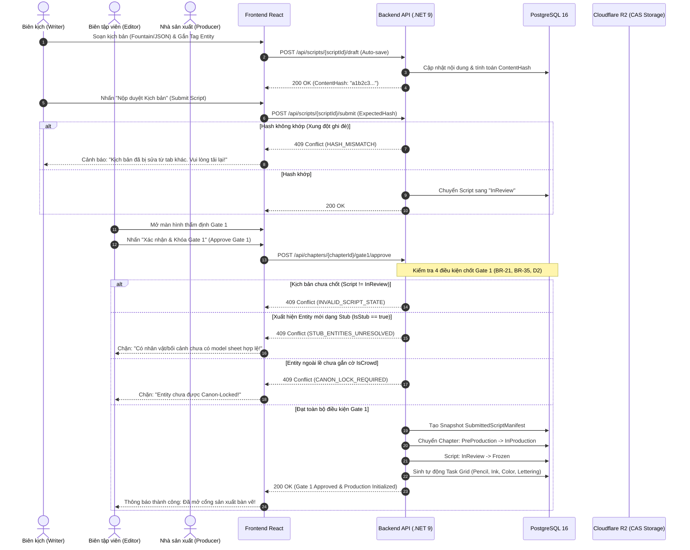
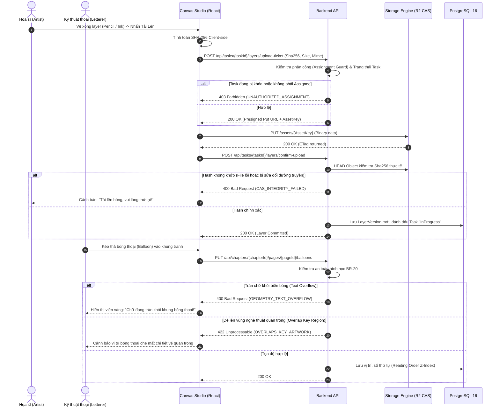
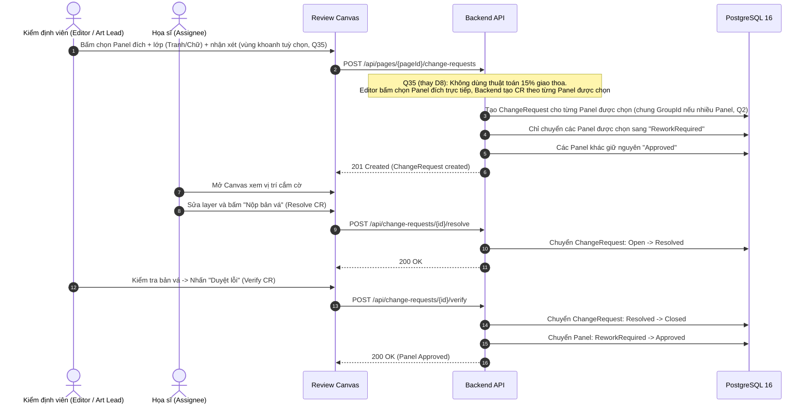
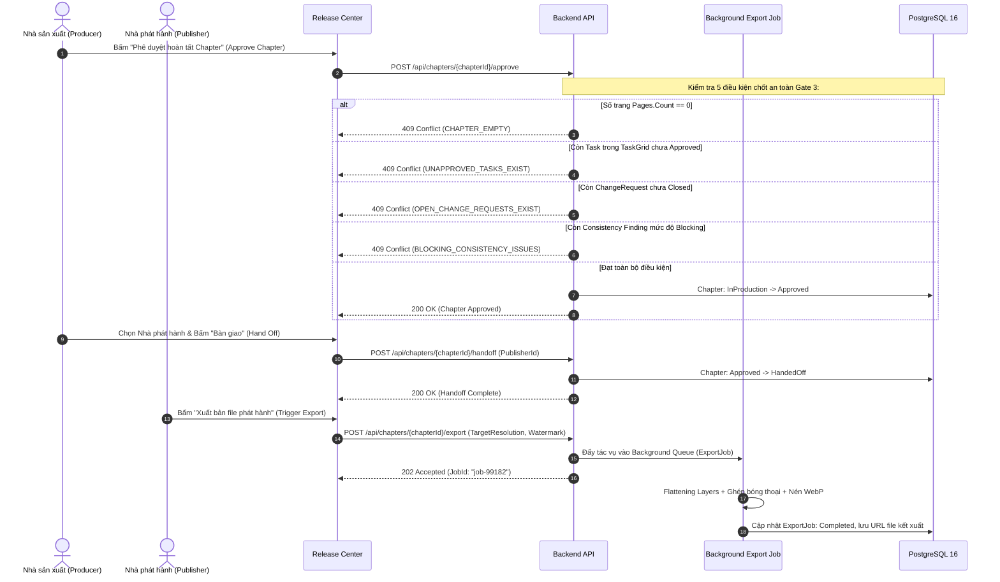
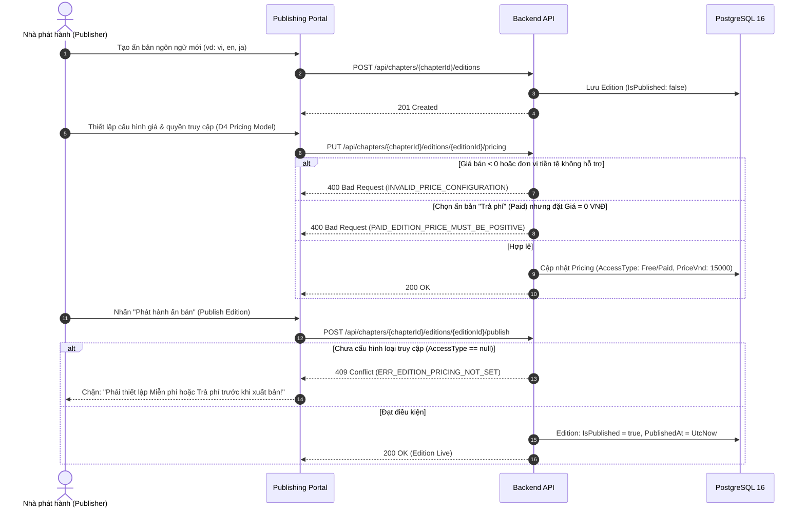
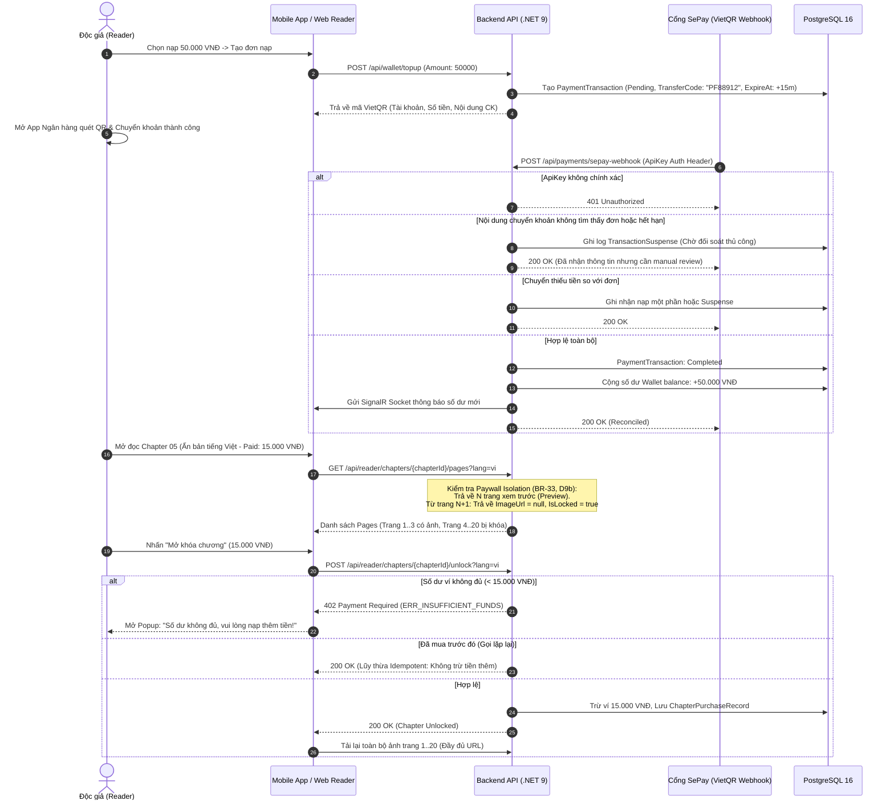

# ĐẶC TẢ CHI TIẾT CÁC LUỒNG HỆ THỐNG VÀ CHIẾN LƯỢC XỬ LÝ LỖI (SYSTEM FLOWS & EXCEPTION HANDLING SPECIFICATION)
## PanelForge V2.6 Production Architecture & Quality Gates

> **Phiên bản tài liệu:** V2.6-FINAL-FLOWS-ERRORS  
> **Phạm vi áp dụng:** Toàn bộ hệ thống PanelForge (Backend .NET 9 Clean Architecture, Frontend React 19, Mobile Flutter, Web Viewer).  
> **Nguyên tắc cốt lõi (SSOT):** Tài liệu này chuẩn hóa toàn bộ các kịch bản chạy (Happy Path, Alternative Path), điểm kiểm tra an toàn (Quality Gates: Gate 1, Gate 2, Gate 3), các chế độ thất bại (Failure Modes) và cơ chế khắc phục lỗi (Remediation & Rollback Strategy).

---

## MỤC LỤC
1. [Chuẩn Hóa Xử Lý Lỗi & Kiến Trúc Phản Hồi (Exception Handling Architecture)](#1-chuẩn-hóa-xử-lý-lỗi--kiến-trúc-phản-hồi)
2. [Flow 1: Tiền Kỳ, Kịch Bản & Gate 1 Pre-Production Gate](#2-flow-1-tiền-kỳ-kịch-bản--gate-1-pre-production-gate)
3. [Flow 2: Sản Xuất Song Song (Pencil, Ink, Color) & Đặt Thoại (Lettering)](#3-flow-2-sản-xuất-song-song-pencil-ink-color--đặt-thoại-lettering)
4. [Flow 3: Kiểm Định Chất Lượng Gate 2 & Cô Lập Lỗi Cấp Panel](#4-flow-3-kiểm-định-chất-lượng-gate-2--cô-lập-lỗi-cấp-panel)
5. [Flow 4: Kịch Bản Khoá Cứng Tại Gate 1 (Hard Script Freeze - Q32)](#5-flow-4-kịch-bản-khoá-cứng-tại-gate-1-hard-script-freeze---huỷ-sửa-kịch-bản-muộn-theo-q32)
6. [Flow 5: Gate 3 Release Gate, Bàn Giao Publisher & Xuất Bản](#6-flow-5-gate-3-release-gate-bàn-giao-publisher--xuất-bản)
7. [Flow 6: Quản Lý Ấn Bản Ngôn Ngữ, Cấu Hình Giá & Xuất Bản Độc Quyền](#7-flow-6-quản-lý-ấn-bản-ngôn-ngữ-cấu-hình-giá--xuất-bản-độc-quyền)
8. [Flow 7: Thanh Toán Ví VNĐ (SePay), Bảo Vệ Paywall & Mua Ấn Bản](#8-flow-7-thanh-toán-ví-vnđ-sepay-bảo-vệ-paywall--mua-ấn-bản)
9. [Ma Trận Tra Cứu Mã Lỗi Toàn Hệ Thống (Exception & Remediation Matrix)](#9-ma-trận-tra-cứu-mã-lỗi-toàn-hệ-thống-exception--remediation-matrix)

---

## 1. Chuẩn Hóa Xử Lý Lỗi & Kiến Trúc Phản Hồi

Hệ thống PanelForge áp dụng mô hình Clean Architecture kết hợp `Result<T>` pattern và middleware xử lý ngoại lệ tập trung (`GlobalExceptionHandlerMiddleware`). Mọi lỗi trả về cho client đều tuân theo chuẩn RFC 7807 (Problem Details).

### 1.1 Cấu Trúc Payload Phản Hồi Chuẩn (Problem Details)

```json
{
  "isSuccess": false,
  "errorCode": "CONFLICT_HASH_MISMATCH",
  "errorMessage": "Script content has been modified concurrently. Expected hash does not match current state.",
  "status": 409,
  "traceId": "00-847291a100f2e821-4389274c6792348a-01",
  "errors": [
    {
      "field": "ExpectedScriptHash",
      "attemptedValue": "a3f5b2c...",
      "message": "Current database hash is b7c8e9f..."
    }
  ],
  "remediation": {
    "action": "RELOAD_LATEST_DRAFT",
    "targetUrl": "/workspaces/{workspaceId}/series/{seriesId}/chapters/{chapterId}/script"
  }
}
```

### 1.2 Phân Cấp Mã Lỗi HTTP & Ý Nghĩa Nghiệp Vụ

| Mã HTTP | Tên Phân Loại | Kịch Bản Điển Hình Trong PanelForge | Hướng Xử Lý Phía Client (FE/Mobile) |
| :--- | :--- | :--- | :--- |
| **`400 Bad Request`** | Validation Error | Dữ liệu đầu vào sai định dạng, vi phạm ràng buộc FluentValidation (vd: thiếu tên project, tọa độ bóng thoại nằm ngoài trang). | Đánh dấu viền đỏ trường nhập liệu, hiển thị tooltip thông báo lỗi chi tiết theo từng field. |
| **`401 Unauthorized`** | Authentication Failure | Token JWT hết hạn, thiếu Bearer token trong header `Authorization`, hoặc Refresh Token bị thu hồi. | Tự động gọi endpoint `/api/auth/refresh-token`. Nếu thất bại, xóa session và điều hướng về trang Login. |
| **`403 Forbidden`** | Authorization / Rule Guard | Vi phạm RBAC (vai trò), ABAC (quyền theo phân công), vi phạm nguyên tắc Bốn Mắt (Four-Eyes Rule), hoặc cố truy cập Studio khác. | Hiển thị màn hình chặn quyền (Access Denied Dialog / Screen) kèm lý do giải thích nghiệp vụ rõ ràng. |
| **`404 Not Found`** | Resource Missing | Truy vấn ID Chapter, Task, Asset hoặc Language Edition không tồn tại hoặc đã bị Soft Delete. | Hiển thị trang 404 Not Found hoặc Toast thông báo tài nguyên không còn tồn tại. |
| **`409 Conflict`** | Concurrency / Domain Guard | Trùng hash optimistic locking, vi phạm điều kiện chuyển trạng thái State Machine, hoặc chặn xóa khung tranh có layer đang vẽ. | Kích hoạt cơ chế Resolve Conflict: Tải lại dữ liệu mới nhất (Refetch), hiển thị diff hoặc thông báo chặn nghiệp vụ. |
| **`429 Too Many Requests`** | Rate Limiting | Vượt quá ngưỡng gọi API (vd: brute-force login, spam upload file lên CAS). | Khóa nút gửi yêu cầu, đếm ngược `Retry-After` seconds trước khi cho phép gọi lại. |
| **`500 Internal Error`** | Server Unhandled | Lỗi cơ sở dữ liệu sập, kết nối Cloud Storage Cloudflare R2 bị đứt, lỗi logic chưa bắt. | Hiển thị màn hình "Đã có lỗi hệ thống phát sinh" kèm `traceId` để người dùng báo cáo bộ phận kỹ thuật. |

---

## 2. Flow 1: Tiền Kỳ, Kịch Bản & Gate 1 Pre-Production Gate

### 2.1 Sơ Đồ Tuần Tự (Sequence Diagram)



### 2.2 Các Hướng Xử Lý Lỗi Điển Hình (Failure Handling Modes)

#### Case 1.1: Xung Đột Hash Khi Nộp Kịch Bản (Optimistic Concurrency Collision)
* **Mã lỗi:** `409 Conflict` (`ERR_SCRIPT_HASH_MISMATCH`).
* **Nguyên nhân:** Writer mở 2 tab trình duyệt hoặc đồng tác giả cập nhật bản thảo cùng lúc khiến `ExpectedScriptHash` client gửi lên bị lệch với `ContentHash` trong database.
* **Hướng xử lý:**
  1. Backend từ chối ghi đè dữ liệu.
  2. Frontend hiển thị Modal cảnh báo xung đột (Conflict Resolution Modal).
  3. Cho phép Writer so sánh Diff giữa bản lưu cục bộ và bản trên Server.
  4. Writer chọn "Ghi đè bản của tôi" (Force Overwrite kèm cập nhật hash mới) hoặc "Tải bản mới nhất từ máy chủ".

#### Case 1.2: Thực Thể Series Bible Chưa Khóa Canon (BR-21, BR-35 Violation)
* **Mã lỗi:** `409 Conflict` (`ERR_GATE1_UNRESOLVED_BIBLE_ENTITIES`).
* **Chi tiết payload:** Trả về danh sách entity IDs vi phạm kèm tên nhân vật/đạo cụ.
* **Hướng xử lý:**
  - Nếu là nhân vật quần chúng: Editor hoặc Writer bật cờ `IsCrowd = true` trực tiếp trên danh sách entity để bỏ qua kiểm tra Model Sheet.
  - Nếu là nhân vật chính/phụ quan trọng: Hệ thống điều hướng sang mục Series Bible, yêu cầu Concept Artist tải lên Model sheet (`.png`/`.psd`), Editor nhấn "Canon-Lock" thực thể trước khi thử lại Gate 1.

#### Case 1.3: Sai Lệch Kế Thừa Bible Manifest (D2 Inheritance Drift)
* **Mã lỗi:** `409 Conflict` (`ERR_MANIFEST_INHERITANCE_DRIFT`).
* **Nguyên nhân:** Kịch bản kế thừa một phiên bản Bible cũ đã bị thay đổi cấu trúc cốt lõi.
* **Hướng xử lý:** Hệ thống kích hoạt quy trình đồng bộ Manifest: Yêu cầu Editor xác nhận "Chấp nhận phiên bản Bible hiện tại cho Chapter này" (Re-sync Manifest), backend tính toán lại Manifest Snapshot và đóng dấu phiên bản.

---

## 3. Flow 2: Sản Xuất Song Song (Pencil, Ink, Color) & Đặt Thoại (Lettering)

### 3.1 Sơ Đồ Tuần Tự (Sequence Diagram)



### 3.2 Các Hướng Xử Lý Lỗi Điển Hình

#### Case 2.1: Lỗi Xác Thực Toàn Vẹn CAS Storage (CAS Integrity Check Failure)
* **Mã lỗi:** `400 Bad Request` (`ERR_CAS_CHECKSUM_MISMATCH`).
* **Nguyên nhân:** Đường truyền mạng bị gián đoạn giữa chừng, gói tin bị hỏng khiến SHA-256 của file tải lên Cloudflare R2 khác với SHA-256 đã khai báo ở Upload Ticket.
* **Hướng xử lý:**
  1. Backend hủy bản ghi tạm và xóa tệp hỏng trên R2.
  2. Trả về mã lỗi yêu cầu Client tính toán lại Chunk Hash và kích hoạt tính năng **Chunked Resumable Upload** nếu file có dung lượng lớn (> 50MB).

#### Case 2.2: Tự Thu Hồi Lớp Vẽ Đã Nộp (Self-Rollback An Toàn)
* **Nghiệp vụ:** Artist vừa bấm nộp duyệt nhưng phát hiện sót lỗi và muốn rút lại trước khi Reviewer mở duyệt.
* **Quy tắc:** Chỉ cho phép Self-Rollback khi Task đang ở trạng thái `Submitted` và Reviewer **chưa** chuyển sang trạng thái `InReview`.
* **Mã lỗi nếu thất bại:** `409 Conflict` (`ERR_CANNOT_ROLLBACK_UNDER_REVIEW`).
* **Hướng xử lý:** Nếu đã có Reviewer mở bài xem xét, hệ thống khóa nút Self-Rollback và hướng dẫn Artist sử dụng khung Chat trao đổi nội bộ để báo cho Reviewer từ chối (Request Changes).

---

## 4. Flow 3: Kiểm Định Chất Lượng Gate 2 & Cô Lập Lỗi Cấp Panel

### 4.1 Sơ Đồ Tuần Tự (Sequence Diagram)



### 4.2 Các Hướng Xử Lý Lỗi Điển Hình

#### Case 3.1: Vi Phạm Nguyên Tắc Bốn Mắt (BR-06 Four-Eyes Principle Breach)
* **Mã lỗi:** `403 Forbidden` (`ERR_FOUR_EYES_VIOLATION`).
* **Nguyên nhân:** Người nộp bài tự duyệt bài của chính mình, hoặc Reviewer chính là người được phân công (Assignee) của Task đó.
* **Hướng xử lý:** Backend kiểm tra `CurrentUserId != AssigneeId` và `CurrentUserId != LastSubmitterId`. Nếu vi phạm, nút "Phê duyệt" (Approve) trên Frontend bị ẩn hoàn toàn; nếu can thiệp API trực tiếp, backend chặn đứng với mã lỗi 403.

#### Case 3.2: Khiếu Nại Yêu Cầu Sửa Đổi (Dispute / Reject Change Request)
* **Kịch bản:** Artist cho rằng yêu cầu sửa của Reviewer không hợp lý hoặc mâu thuẫn với kịch bản gốc.
* **Hướng xử lý:**
  1. Artist chọn hành động "Từ chối sửa / Khiếu nại" (Dispute Change Request), bắt buộc nhập lý do vào trường `DisputeReason`.
  2. Trạng thái `ChangeRequest` chuyển thành `Disputed`.
  3. Hệ thống gửi thông báo Notification tới Producer/Lead Editor để làm trung gian phân giải.
  4. Producer có thẩm quyền tối cao: Chọn "Ép sửa" (Force Rework) hoặc "Hủy yêu cầu sửa" (Dismiss CR).

---

## 5. Flow 4: Kịch Bản Khoá Cứng Tại Gate 1 (Hard Script Freeze - Q32)

> **Quyết định Q32 (Chốt 2026-11-28):** Kịch bản khoá cứng tại Gate 1, `Frozen` vĩnh viễn và chỉ đọc. `ScriptStatus` chỉ còn `Draft ↔ InReview → Frozen`. Bỏ hoàn toàn luồng Unfreeze / Refreeze kịch bản (`unfreeze-script`, `refreeze-script`, `refreeze-preview`) cùng cơ chế cờ ảnh hưởng do sửa kịch bản khi đang sản xuất (`ScriptImpactClassifier`, cờ ⚑ kịch bản thay đổi, bóng thoại `isStale` do sửa kịch bản). Mọi sửa đổi kịch bản dồn về trước Gate 1: Writer có nút *Rút về bản thảo* (`recall-script`) khi cần, Producer thấy số góp ý còn mở trước khi bấm *Bắt đầu sản xuất*. Nếu cần đổi kịch bản sau Gate 1, các thay đổi phải làm ở chương sau.
> 
> *Lưu ý:* Cờ `ImpactFlags` / `InputOutdated` khi Producer mở lại ô tranh đã duyệt (BR-27, BR-12) vẫn được giữ nguyên.

---

## 6. Flow 5: Gate 3 Release Gate, Bàn Giao Publisher & Xuất Bản

### 6.1 Sơ Đồ Tuần Tự (Sequence Diagram)



### 6.2 Các Hướng Xử Lý Lỗi Điển Hình

#### Case 6.1: Vi Phạm Chốt Khóa Gate 3 (BR-12 Quality Gate Violation)
* **Mã lỗi:** `409 Conflict` (`ERR_GATE3_CONDITIONS_NOT_MET`).
* **Hướng xử lý:** Trả về danh sách chi tiết các vi phạm:
  - Danh sách Task còn ở trạng thái `InProgress` hoặc `Submitted`.
  - Danh sách ChangeRequest còn `Open` hoặc `Resolved` chưa được `Verified`.
  - Frontend hiển thị Bảng điều khiển vi phạm (Gate 3 Blocker Checklist), bấm vào dòng vi phạm sẽ nhảy thẳng đến trang/panel cần giải quyết.

#### Case 6.2: Tiến Trình Xuất File Nền Bị Thất Bại (Background Export Job Crash)
* **Mã lỗi:** Job Status `Failed` (`ERR_EXPORT_PROCESSING_FAILED`).
* **Nguyên nhân:** Hết bộ nhớ (OOM) khi xử lý trang có độ phân giải siêu cao (> 8K), hoặc thiếu file layer gốc trên Cloudflare R2.
* **Hướng xử lý:**
  1. Worker tự động thử lại tối đa 3 lần (Retry Policy with Exponential Backoff).
  2. Nếu sau 3 lần vẫn lỗi: Đánh dấu Job `Failed`, ghi log StackTrace và thông báo qua SignalR tới màn hình của Publisher kèm nút "Thử lại với độ phân giải thấp hơn (Downscale to 4K)".

---

## 7. Flow 6: Quản Lý Ấn Bản Ngôn Ngữ, Cấu Hình Giá & Xuất Bản Độc Quyền

### 7.1 Sơ Đồ Tuần Tự (Sequence Diagram)



### 7.2 Các Hướng Xử Lý Lỗi Điển Hình

#### Case 7.1: Bắt Buộc Cấu Hình Giá Trước Khi Xuất Bản (D4 Enforcement)
* **Mã lỗi:** `409 Conflict` (`ERR_PRICING_MODEL_REQUIRED`).
* **Nghiệp vụ:** Theo nguyên tắc bất biến D4, một ấn bản ngôn ngữ không được phép chuyển sang trạng thái `Published` nếu chưa xác định rõ là `Free` hay `Paid`.
* **Hướng xử lý:** Nút "Xuất bản" trên UI bị vô hiệu hóa kèm tooltip giải thích. Nếu gọi qua API, backend chặn và trả về hướng dẫn chi tiết yêu cầu gọi endpoint PUT Pricing trước.

#### Case 7.2: Đổi Giá Sau Khi Đã Xuất Bản (Published Edition Price Lock)
* **Mã lỗi:** `409 Conflict` (`ERR_CANNOT_CHANGE_PRICE_ON_PUBLISHED_EDITION`).
* **Nguyên nhân:** Tránh gian lận thương mại và bảo vệ quyền lợi độc giả đã mua trước đó.
* **Hướng xử lý:** Không cho phép sửa trực tiếp trường `PriceVnd`. Muốn áp dụng giá mới hoặc khuyến mãi, Publisher phải tạo một "Chiến dịch giảm giá" (Discount Campaign) có thời hạn bắt đầu/kết thúc cụ thể thay vì sửa giá niêm yết gốc.

---

## 8. Flow 7: Thanh Toán Ví VNĐ (SePay), Bảo Vệ Paywall & Mua Ấn Bản

### 8.1 Sơ Đồ Tuần Tự (Sequence Diagram)



### 8.2 Các Hướng Xử Lý Lỗi Điển Hình

#### Case 8.1: Lỗi Webhook SePay (Chuyển Sai Nội Dung / Chuyển Thiếu Tiền)
* **Kịch bản:** Người dùng sửa nội dung chuyển khoản khiến ngân hàng không gửi đúng cú pháp `PF88912`, hoặc nạp 49.000 VNĐ thay vì 50.000 VNĐ.
* **Hướng xử lý:**
  1. Backend không báo lỗi `500` cho SePay (để tránh SePay retry vô hạn gây tắc nghẽn). Trả về `200 OK`.
  2. Ghi nhận giao dịch vào bảng `SuspenseTransactions` với trạng thái `UnmatchedContent` hoặc `Underpaid`.
  3. Bắn thông báo lên kênh Quản trị Admin Dashboard.
  4. Cung cấp chức năng cho Admin: "Gán thủ công giao dịch Suspense vào Ví người dùng" sau khi kiểm tra biên lai ngân hàng.

#### Case 8.2: Cách Ly Paywall Tầng Server & Bảo Vệ Ấn Bản Ngôn Ngữ (BR-33, BR-34, D9b)
* **Quy tắc bảo vệ tuyệt đối:**
  - ❌ **CẤM** trả link ảnh gốc về client rồi dùng cờ Javascript để ẩn đi (vì sẽ bị bẻ khóa bằng F12 Network Tab).
  - 🛡️ **BẢO VỆ TẦNG SERVER:** Nếu người dùng chưa mua chương, endpoint `GET /pages` trả về `ImageUrl = null` và `IsLocked = true` đối với toàn bộ các trang ngoài phạm vi Preview.
  - 🌐 **CÁCH LY NGÔN NGỮ:** Nếu độc giả gọi `?lang=en` nhưng ấn bản tiếng Anh chưa phát hành (`IsPublished == false`), backend trả về ngay `404 Not Found` (`ERR_EDITION_NOT_PUBLISHED`). Tuyệt đối **KHÔNG tự động chuyển sang tiếng Việt/ngôn ngữ gốc** để tránh rò rỉ dữ liệu chưa duyệt.

---

## 9. Ma Trận Tra Cứu Mã Lỗi Toàn Hệ Thống (Exception & Remediation Matrix)

Dưới đây là bảng tổng hợp đầy đủ các mã lỗi nghiệp vụ của PanelForge, nguyên nhân và cách xử lý chuẩn hóa:

| Mã Lỗi Hệ Thống (Error Code) | HTTP | Module / Nguồn Phát Sinh | Nguyên Nhân Gốc (Root Cause) | Hướng Khắc Phục Cho Người Dùng / Dev |
| :--- | :--- | :--- | :--- | :--- |
| `ERR_AUTH_EXPIRED` | 401 | Auth / JWT | Access Token đã hết hạn. | Client tự động gọi Refresh Token; nếu thất bại chuyển hướng về Login. |
| `ERR_STUDIO_ACCESS_DENIED` | 403 | RBAC / Studio | User không thuộc Studio hoặc bị khóa tài khoản. | Liên hệ Admin Studio để được cấp quyền hoặc kiểm tra lại Tenant ID. |
| `ERR_FOUR_EYES_VIOLATION` | 403 | Task / Quality Gate | Tự phê duyệt bài nộp của chính mình (BR-06). | Phải để một thành viên khác trong Studio tiến hành kiểm định và duyệt bài. |
| `ERR_SCRIPT_HASH_MISMATCH` | 409 | Pre-Production / Script | Kịch bản bị chỉnh sửa đồng thời từ phiên làm việc khác. | Tải lại bản mới nhất (Reload) và đối chiếu thay đổi trước khi lưu/nộp. |
| `ERR_GATE1_BIBLE_NOT_LOCKED` | 409 | Pre-Production / Gate 1 | Còn nhân vật/bối cảnh chưa Canon-Locked (BR-21, BR-35). | Khóa Canon thực thể trong Series Bible hoặc đánh dấu `IsCrowd = true`. |
| `ERR_CAS_CHECKSUM_MISMATCH` | 400 | Asset / Cloud Storage | SHA-256 thực tế khi tải lên khác với Ticket khai báo. | Kiểm tra tính ổn định mạng, đọc lại file từ đĩa cục bộ và upload lại. |
| `ERR_GEOMETRY_TEXT_OVERFLOW` | 400 | Lettering / Canvas | Text trong bóng thoại tràn ra ngoài ranh giới hình học. | Giảm cỡ chữ (Font size), kéo rộng bóng thoại hoặc ngắt bớt dòng. |
| `ERR_OVERLAPS_KEY_ARTWORK` | 422 | Lettering / Canvas | Bóng thoại đặt đè lên khuôn mặt nhân vật quan trọng. | Kéo bóng thoại sang vị trí thoáng hơn theo hướng dẫn của hệ thống gợi ý. |
| `ERR_CANNOT_DELETE_ACTIVE_ARTWORK` | 409 | Script / Gate 2 (Đã bỏ theo Q32) | Xóa khung tranh khi đã có layer vẽ nét hoặc màu. | Đã bỏ theo Q32: kịch bản khoá cứng sau Gate 1. |
| `ERR_UNRESOLVED_IMPACT_FLAGS` | 409 | Gate 3 / Producer Reopen (BR-27) | Còn cờ tác động do Producer mở lại ô đã duyệt chưa giải quyết. | Đã bỏ phần kịch bản (Q32); chỉ áp dụng cho cờ mở lại ô tranh (BR-27). |
| `ERR_GATE3_UNAPPROVED_TASKS` | 409 | Post-Production / Gate 3 | Còn ô Task trong TaskGrid chưa đạt `Approved` (BR-12). | Kiểm tra lại tiến độ các khâu (Pencil, Ink, Color, Lettering) để duyệt nốt. |
| `ERR_GATE3_OPEN_CHANGE_REQUESTS`| 409 | Post-Production / Gate 3 | Còn yêu cầu sửa lỗi chưa được đóng hoàn toàn. | Hoàn thành sửa lỗi và Reviewer phải xác nhận `Verify` đóng Change Request. |
| `ERR_PRICING_MODEL_REQUIRED` | 409 | Publishing / Edition | Xuất bản khi chưa cấu hình Free hoặc Paid (D4). | Vào phần Cấu hình giá thiết lập loại truy cập và giá tiền trước khi xuất bản. |
| `ERR_EDITION_NOT_PUBLISHED` | 404 | Reader / Paywall | Yêu cầu đọc ngôn ngữ chưa được phát hành chính thức. | Trả về 404 Not Found cách ly, hướng dẫn độc giả chọn ngôn ngữ đã phát hành. |
| `ERR_INSUFFICIENT_FUNDS` | 402 | Reader / Wallet | Số dư ví tiền VNĐ của độc giả nhỏ hơn giá ấn bản. | Điều hướng độc giả sang màn hình Nạp tiền qua mã VietQR SePay. |
| `ERR_PAYMENT_TRANSACTION_EXPIRED`| 400 | Payment / SePay | Chuyển tiền vào đơn hàng nạp đã quá thời hạn 15 phút. | Hệ thống chuyển vào mục Suspense; Admin sẽ kiểm tra và cộng tiền thủ công. |
| `ERR_EXPORT_PROCESSING_FAILED` | 500 | Background Service | Tiến trình Render trang xuất bản bị lỗi bộ nhớ hoặc đứt file. | Kích hoạt cơ chế tự động Retry; nếu thất bại chọn nén ảnh xuống chuẩn 4K. |

---

## 10. Kết Luận & Hướng Dẫn Tích Hợp Cho Dev / Agent

1. **Đối với Backend Developers:** Mọi Command Handler và Validator trong thư mục `PanelForge_FA26SE251/src/` phải bám sát tuyệt đối các mã lỗi và điều kiện nghiệp vụ trong tài liệu này. Áp dụng pattern `Result.Failure(ResultErrorCodes.ERR_*)`.
2. **Đối với Frontend/Mobile Developers:** Bắt buộc bắt các mã lỗi `400`, `401`, `403`, `404`, `409`, `429` và mapping trực tiếp thông báo theo cột "Hướng Khắc Phục Cho Người Dùng" để đảm bảo trải nghiệm người dùng mượt mà, không hiển thị các lỗi hệ thống thô (`raw exception`).
3. **Đối với QA / Testers:** Sử dụng tài liệu này làm ma trận kiểm thử (Test Matrix) cho các ca kiểm thử tích hợp (Integration Tests) và ca kiểm thử lỗi ngoại lệ (Boundary & Negative Test Cases).
