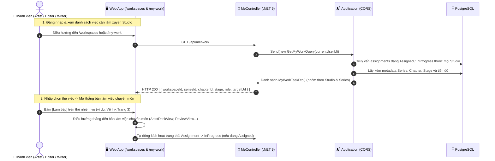

# 🔄 Sơ Đồ Tuần Tự 5 Core Flows (CF1 – CF5) — PanelForge V2.6
*(End-to-End Sequence Diagrams for 5 Core Flows in Clean Architecture)*

> **Dự án:** PanelForge Manga Production Platform (`FA26SE251`)  
> **Căn cứ nghiệp vụ:** [PANELFORGE_MASTER_SPECIFICATION_V2_6.md](../V2.6/PANELFORGE_MASTER_SPECIFICATION_V2_6.md) và [clean-architecture-structure.md](./clean-architecture-structure.md).  
> **Kiến trúc phân tầng:** Presentation (React 19 / Flutter) ➔ API Gateway (.NET 9 Controllers / SignalR) ➔ Application (MediatR CQRS / Domain Services) ➔ Domain (Aggregates / Events) ➔ Infrastructure & Storage (PostgreSQL, Marten Event Store, Cloudflare R2).  
> **Vị trí tài liệu:** `panelforge-hub/docs/architecture/core-flows-sequence-diagrams.md`.

---

## 🧭 Tổng Quan 5 Core Flows Trong PanelForge

| Core Flow | Tên nghiệp vụ cốt lõi | Phạm vi trách nhiệm | Điểm giao cắt kiến trúc & Cổng chất lượng |
|---|---|---|---|
| **CF1** | **Studio, Series, Bible & Script Setup** | Khởi tạo Studio Workspace, Series (RTL/LTR), soạn thảo kịch bản chữ thuần, tự động nhận diện thực thể Series Bible, thiết kế Model Sheet & khóa Canon. | **Gate 1** (Pre-Production Gate): Kịch bản `Frozen` ❄️, khóa `chapter_bible_bindings` 🔒, chuyển `InProduction`. |
| **CF2** | **Chapter Production** | Phân bổ trang (Page-scoped ABAC), dựng layout, thuật toán đọc `panelIndex`, vẽ Pencil, tự động phân nhánh Ink (Graphic Layer) & Lettering (Vector Layer đa ngôn ngữ), ghép ảnh Composite. | Tự động hóa Pipeline & đồng bộ đa tầng; kiểm tra an toàn chữ BR-20; hỗ trợ `[↺ Self-Rollback]`. |
| **CF3** | **Quality Control & Review** | Thẩm định ảnh Composite trên `ReviewView` (Luật 4 mắt BR-06), khoanh vùng lỗi Bounding Box $0..1$, thuật toán hình học Overlap $\ge 15\%$, cô lập lỗi cấp Panel, vòng đời `ChangeRequest`. | **Gate 2** (Quality & Composite Gate): 100% Panel `Approved` ➔ suy diễn `PageReviewStatus == Approved`. |
| **CF4** | **Versioning & Provenance (Xương Sống)** | Lưu vết append-only (Marten Event Sourcing + PostgreSQL), định danh CAS SHA-256. Kịch bản khoá cứng sau Gate 1 (Q32; không mở lại kịch bản, giữ cờ mở lại ô tranh đã duyệt BR-27). | Nền tảng truy vết lịch sử toàn hệ thống; Audit Log bất biến. |
| **CF5** | **Approval, Release & Reader Monetization** | Nghiệm thu Gate 3 (quét BR-12), đóng băng `ChapterSnapshot`, cấp `PreviewLink` Watermark, bàn giao Publisher (`ChapterHandedOff`), duyệt ấn bản ngôn ngữ, Publisher cấu hình giá VNĐ & phát hành, độc giả nạp ví & mở khóa. | **Gate 3** (Release Gate); Vòng đời `ChapterEdition` (`Draft` ➔ `Published`); Sổ cái Ví VNĐ append-only; Dashboard 360°. |

---

## CF1: Studio, Series, Bible Setup & Script Pre-Production (Gate 1)

Luồng nghiệp vụ tiền kỳ: Producer tạo Studio Workspace, phân tầng vai trò 2 cấp (Spec D10). Writer soạn kịch bản chữ thuần độc lập theo cấu trúc `Trang -> Panel -> Dòng`. Hệ thống tự động nhận diện tên người nói để tạo mục Series Bible nháp (`IsStub = true`). Artist nộp phiên bản concept Model Sheet (`ConceptSubmitted`), Editor xác nhận khóa bất biến `CanonLocked`. Writer gửi duyệt kịch bản (`SubmittedScriptManifest`), và Producer chốt Gate 1 để chuyển sang sản xuất.

```mermaid
sequenceDiagram
    autonumber
    actor Producer as 🎬 Producer
    actor Writer as ✍️ Writer
    actor Artist as 🎨 Artist
    actor Editor as 🧐 Editor
    participant FE as 🖥️ Web Studio (React 19)
    participant API as ⚙️ Controllers (.NET 9)
    participant MediatR as 📬 Application (MediatR CQRS)
    participant Domain as 🏛️ Domain Entities & Invariants
    participant DB as 🗄️ PostgreSQL / EF Core
    participant R2 as ☁️ Cloudflare R2 (CAS)

    %% 0. Phân tầng thành viên & Gán vai trò Series (Spec D10)
    Note over Producer,DB: 0. Phân tầng Thành viên Studio & Thiết lập Ê-kíp Series (Spec D10)
    Producer->>FE: Mời thành viên vào Studio (Role: Producer hoặc Member)
    FE->>API: POST /api/workspaces/{wId}/invitations { email, role: "Member" }
    API->>DB: Lưu workspace_members (WorkspaceRole: Producer / Member)
    Producer->>FE: Tạo Series (cấu hình ReadingDirection: RTL=0 Manga, LTR=1 Comic, Vertical=2)
    Producer->>FE: Mở SeriesMembersModal -> Phân vai chuyên môn sản xuất
    FE->>API: POST /api/series/{sId}/members { userId, role: "Writer"|"Artist"|"Letterer"|"Editor" }
    API->>DB: Lưu bảng series_members (Quyền hạn Series-Scoped ABAC)

    %% 1. Soạn kịch bản & Commit ScriptVersion
    Note over Writer,FE: 1. Soạn thảo kịch bản chữ thuần (Page -> Panel -> Content)
    Writer->>FE: Nhập thoại (speaker_label), mô tả hành động, lời dẫn, SFX
    FE->>FE: Bôi đen thực thể không thoại trong Lời dẫn/Mô tả để tham chiếu Bible
    Writer->>FE: Bấm [Lưu Kịch Bản] (Commit)
    FE->>API: POST /api/scripts/{chapterId}/commit (Payload: cây Trang -> Panel -> Dòng)
    API->>MediatR: Send(new CommitScriptCommand(chapterId, scriptTree))
    MediatR->>MediatR: Chuẩn hóa NFC tên người nói; Trích xuất đoạn bôi đen
    MediatR->>DB: Đối sánh tên với SeriesBible; Chưa có -> Tạo BibleEntry (Draft, IsStub=true)
    MediatR->>Domain: ScriptVersion.Create(chapterId, scriptTree, sha256Hash)
    MediatR->>DB: Lưu ScriptVersion mới (bất biến, versionNumber tự tăng)
    MediatR-->>API: Result.Success(scriptVersionId, stubEntries)
    API-->>FE: HTTP 200 { versionNumber: v2, stubEntries: [...] }

    %% 2. Thiết kế Concept Art & Khóa Canon
    Note over Artist,Editor: 2. Thiết kế Concept Art Model Sheet cho thực thể mới
    Writer->>FE: Viết định nghĩa cho mục stub (mô tả, ngoại hình, gỡ cờ IsStub)
    FE->>API: PUT /api/bible/entries/{id}/definition
    API->>MediatR: Send(new DefineBibleStubCommand(entryId, description))
    MediatR->>DB: Cập nhật định nghĩa; Đưa vào hàng đợi Artist (Pending Concept Art)
    
    Artist->>FE: Tải ảnh Model Sheet lên hệ thống
    FE->>R2: Upload ảnh trực tiếp qua Pre-signed URL (CAS SHA-256)
    FE->>API: POST /api/bible/entries/{id}/revisions (assetHash, variantLabel)
    API->>MediatR: Send(new SubmitConceptArtCommand(entryId, assetHash, variantLabel))
    MediatR->>Domain: BibleEntryRevision.Create(ConceptSubmitted, assetHash)
    MediatR->>DB: Lưu BibleEntryRevision
    
    Editor->>FE: Mở xem phiên bản concept Model Sheet trên giao diện Bible
    alt Không đạt yêu cầu
        Editor->>FE: Bấm [Yêu cầu vẽ lại] (ReworkRequired) kèm lý do
        FE->>API: POST /api/bible/revisions/{id}/rework
        API->>MediatR: Send(new RequestConceptReworkCommand(id, reason))
        MediatR->>DB: Cập nhật BibleEntryRevision -> ReworkRequired
    else Đạt yêu cầu chính thức
        Editor->>FE: Bấm [Xác nhận thiết kế] (Luật 4 mắt BR-06: Editor != Artist)
        FE->>API: POST /api/bible/revisions/{id}/lock-canon
        API->>MediatR: Send(new LockCanonRevisionCommand(id))
        MediatR->>Domain: Revision.LockCanon() -> Trạng thái CanonLocked 🔒 (Bất biến)
        MediatR->>DB: Cập nhật trạng thái CanonLocked trong CSDL
    end

    %% 3. Gửi duyệt kịch bản (Push)
    Note over Writer,Editor: 3. Gửi duyệt kịch bản & Đóng băng SubmittedScriptManifest
    Writer->>FE: Bấm [Gửi Duyệt Kịch Bản] (Draft -> InReview)
    FE->>API: POST /api/scripts/{chapterId}/submit-for-review
    API->>MediatR: Send(new SubmitScriptForReviewCommand(chapterId))
    MediatR->>DB: Quét Danh sách thực thể chương (Chapter Cast Manifest)
    MediatR->>MediatR: Kiểm tra: Mọi mục stub đã có định nghĩa hoặc cờ Quần chúng? (Q21)
    alt Có mục nháp chưa xử lý
        MediatR-->>API: DomainException("Còn mục nháp chưa định nghĩa")
        API-->>FE: HTTP 409 Conflict { missingDefinitions: [...] }
    else Hợp lệ
        MediatR->>Domain: SubmittedScriptManifest.Create(scriptVersionId, manifestHash, resolvedRevisions)
        MediatR->>DB: Lưu SubmittedScriptManifest; Chapter.ScriptStatus -> InReview
        API-->>FE: HTTP 200 { status: "InReview", manifestHash: "..." }
        API-)Editor: Gửi thông báo SignalR (Kịch bản mới đang chờ duyệt)
    end
    Editor->>FE: Đọc đúng bản gửi duyệt, gửi nhận xét theo dòng kịch bản

    %% 4. Gate 1: Chốt Tiền kỳ & Bắt đầu sản xuất
    Note over Producer,Domain: 4. Cổng Gate 1: Producer bấm Approve Script & Start Production
    Producer->>FE: Mở màn hình Gate 1, kiểm tra Manifest & Bản kế thừa Bible
    Producer->>FE: Bấm [Bắt đầu sản xuất] (Gate 1)
    FE->>API: POST /api/chapters/{chapterId}/gate1-approve
    API->>MediatR: Send(new ApproveGate1Command(chapterId))
    MediatR->>DB: Quét 100% thực thể không Quần chúng có bản CanonLocked? (BR-21, BR-35)
    MediatR->>DB: Đối chiếu SubmittedScriptManifest với kế thừa Bible hiện hành
    alt Còn thực thể chưa CanonLocked hoặc manifest bị lệch
        MediatR-->>API: DomainException("Chờ thực thể Naruto đạt CanonLocked")
        API-->>FE: HTTP 409 Conflict { reason: "Chờ Naruto Mặc định v2 CanonLocked" }
    else Đủ điều kiện
        MediatR->>Domain: Chapter.StartProduction()
        Domain->>Domain: ScriptStatus = Frozen ❄️; ChapterStatus = InProduction 🚀
        Domain->>Domain: Khóa số thứ tự ChapterNumber (D9a)
        MediatR->>DB: Lưu Bản đồ thực thể chương (chapter_bible_bindings 🔒)
        MediatR->>DB: Cập nhật Chapter state
        API-->>FE: HTTP 200 { status: "InProduction", isFrozen: true }
        API-)Writer: SignalR: Kịch bản đã chốt sản xuất
        API-)Artist: SignalR: Mở bảng công việc Kanban để nhận trang vẽ
    end
```

---

## CF2: Chapter Production — Layout, Pencil, Parallel Inking & Lettering

Luồng sản xuất trang truyện: Producer phân bổ trang, Artist dựng layout, thuật toán hình học sắp xếp thứ tự đọc `panelIndex`, Artist vẽ và nộp phác thảo Pencil (cố định Bounding Box). Hệ thống tự động mở đồng thời 2 nhánh: Graphic Layer (Ink) và Vector Text Layer (Lettering đa ngôn ngữ), sau đó tự động ghép thành ảnh Composite $1200 \times 1800$.

```mermaid
sequenceDiagram
    autonumber
    actor Producer as 🎬 Producer
    actor Artist as 🎨 Artist (Chủ đạo)
    actor Letterer as 🔤 Letterer (Phụ việc)
    participant FE as 🖥️ ArtistDeskView (Konva Canvas)
    participant API as ⚙️ Controllers (.NET 9)
    participant MediatR as 📬 Application (CQRS)
    participant Engine as 📐 Reading Order Engine
    participant Marten as 🧱 Marten Event Store (Page)
    participant DB as 🗄️ PostgreSQL
    participant R2 as ☁️ Cloudflare R2

    %% 1. Phân bổ trang
    Note over Producer,MediatR: 1. Producer phân bổ trang tại Gate 1
    Producer->>FE: Gán Artist phụ trách Trang 1..10
    FE->>API: POST /api/assignments/assign-pages { artistId, pageRange: [1..10] }
    API->>MediatR: Send(new AssignPagesCommand(artistId, [1..10]))
    MediatR->>DB: Tạo Assignment (Status: Assigned, Page-scoped ABAC)

    %% 2. Dựng khung & Thuật toán đọc
    Note over Artist,Engine: 2. Artist mở bàn vẽ, chọn Frame Template & Sắp xếp đọc
    Artist->>FE: Mở ArtistDeskView (Trang 1)
    Artist->>FE: Kéo mẫu Frame Template dựng các khung Panel
    FE->>Engine: Sắp xếp Panel theo ReadingDirection của Series (RTL / LTR / Vertical)
    Engine->>Engine: B1: Sort Y -> B2: Row Banding (|cyA - cyB| < min(hA,hB)/2)
    Engine->>Engine: B3: Manga RTL -> Sort giảm dần theo X (Phải qua Trái)
    Engine-->>FE: Gán panelIndex tự động (1, 2, 3...)
    Artist->>FE: Gán các dòng kịch bản vào từng panel (Script Coverage Counter: 100%)

    %% 3. Vẽ Pencil & Nộp
    Note over Artist,R2: 3. Vẽ phác thảo Pencil & Nộp hoàn thành Layout
    Artist->>FE: Vẽ phác thảo Pencil trên Graphic Layer
    Artist->>FE: Bấm [Nộp Bản Pencil]
    FE->>R2: Upload ảnh Pencil qua Pre-signed URL (CAS SHA-256)
    FE->>API: POST /api/pages/{pageId}/submit-pencil (panelBoxes, assetHash)
    API->>MediatR: Send(new SubmitPencilCommand(pageId, panelBoxes, assetHash))
    MediatR->>DB: Cố định tọa độ BoundingBox {x,y,w,h} chuẩn hóa [0..1] của các Panel
    MediatR->>DB: PanelStageProgress.Pencil -> Submitted / Approved
    API-->>FE: HTTP 200 { status: "PencilSubmitted", panelsLocked: true }

    %% 4. Tự động mở nhánh song song: Ink & Lettering
    Note over Artist,Letterer: 4. Tự động mở đồng thời: Nhánh Nét Vẽ (Ink) & Nhánh Chữ (Lettering)
    par Nhánh Graphic Layer (Artist vẽ Ink)
        Artist->>FE: Đi nét mực hoàn chỉnh & Screentone trên Graphic Layer
        opt Artist tự phát hiện sai sót cần quay lui (Self-Rollback)
            Artist->>FE: Bấm [↺ Quay lại sửa Pencil] (khi chưa bị Editor khóa duyệt)
            FE->>API: POST /api/pages/{pageId}/rollback-pencil
            API->>MediatR: Send(new RollbackPencilCommand(pageId))
            MediatR->>DB: Trả trạng thái về Pencil (InProgress), giữ nguyên bóng thoại
        end
        Artist->>FE: Bấm [Nộp Nét Mực Ink]
        FE->>R2: Upload ảnh Ink (CAS SHA-256)
        FE->>API: POST /api/pages/{pageId}/submit-ink (assetHash)
        API->>MediatR: Send(new SubmitInkCommand(pageId, assetHash))
        MediatR->>DB: PanelStageProgress.Ink -> Submitted
    and Nhánh Vector Text Layer (Artist tự làm HOẶC Letterer phụ việc)
        alt Không gán Letterer riêng
            Artist->>FE: Dùng Vector Text Tools có sẵn trên ArtistDeskView
        else Có gán Letterer phụ việc (BR-31)
            Letterer->>FE: Mở LetteringWorkspace (chỉ mở quyền letter:write, lớp vẽ bị khóa)
        end
        loop Đặt bóng thoại đa ngôn ngữ (BR-34)
            Note over FE: Đặt bóng thoại gắn 1-1 với kịch bản; Lưu Position Record {x,y,w,h}
            FE->>FE: Nhập thoại ngôn ngữ gốc (vi) & bản dịch các ngôn ngữ phát hành (en, ja)
            FE->>FE: Kiểm tra an toàn chữ BR-20 (Tràn chữ, đè nét vẽ, thứ tự đọc)
        end
        FE->>API: POST /api/pages/{pageId}/submit-lettering (balloonsPayload)
        API->>MediatR: Send(new SubmitLetteringCommand(pageId, balloonsPayload))
        MediatR->>Marten: Lưu các Event tạo bóng thoại vào Event Stream của Page
        MediatR->>DB: PanelStageProgress.Lettering -> Submitted
    end

    %% 5. Tự động ghép Composite & Đẩy Gate 2
    Note over MediatR,R2: 5. Ghép phẳng ảnh Composite & Đẩy vào hàng đợi Gate 2
    MediatR->>MediatR: Nhận đủ Submitted từ Ink & Lettering ngôn ngữ gốc
    MediatR->>MediatR: Ghép phẳng Graphic Layer + Vector Layer thành ảnh Composite 1200x1800
    MediatR->>R2: Lưu ảnh Composite (CAS SHA-256)
    MediatR->>DB: Cập nhật PageReviewStatus -> Reviewing
    API-)Producer: SignalR: Trang đã sẵn sàng cho Editor thẩm định Gate 2
```

---

## CF3: Quality Control & Composite Gate (Gate 2)

Luồng kiểm định chất lượng: Editor thẩm định ảnh composite trên `ReviewView`, khoanh vùng lỗi hình học $0..1$. Thuật toán hình học xác định panel giao thoa $\ge 15\%$, cô lập chuyển panel lỗi sang `ReworkRequired`, giữ nguyên các panel khác. Phiếu `ChangeRequest` được xử lý qua vòng đời `Open -> Resolved -> Verified`. Khi 100% panel đạt `Approved`, trang tự động chuyển sang `Approved`.

```mermaid
sequenceDiagram
    autonumber
    actor Editor as 🧐 Editor (Reviewer)
    actor Artist as 🎨 Artist
    actor Letterer as 🔤 Letterer
    participant FE as 🖥️ ReviewView (Canvas Diff)
    participant API as ⚙️ Controllers (.NET 9)
    participant MediatR as 📬 Application (CQRS)
    participant DB as 🗄️ PostgreSQL
    participant Hub as 📡 SignalR Hub

    %% 1. Editor mở ReviewView
    Note over Editor,FE: 1. Editor mở trang cần thẩm định (Luật 4 mắt: Editor != Assignee)
    Editor->>FE: Mở ReviewView (Trang 1 - Composite 1200x1800)
    FE->>API: GET /api/reviews/pages/{pageId}
    API->>MediatR: Send(new GetPageReviewDetailsQuery(pageId))
    MediatR->>DB: Lấy ảnh Composite, tọa độ Panel, bóng thoại, Model Sheet đối chiếu
    MediatR-->>API: PageReviewDetailsDto
    API-->>FE: HTTP 200 { compositeUrl, panels, balloons, modelSheets }
    Editor->>FE: Bật các chế độ kiểm tra: Side-by-side, Slider, Onion-skin, Pixel Diff

    %% 2. Chọn Panel đích & lớp lỗi (Q35, thay D8)
    Note over Editor,MediatR: 2. Editor bấm chọn Panel đích + lớp lỗi (Tranh/Chữ) + nhận xét (vùng khoanh tuỳ chọn, Q35)
    Editor->>FE: Chọn Panel đích (ví dụ: Panel 2), lớp lỗi & nhập nhận xét (vùng khoanh tuỳ chọn)
    Editor->>FE: Bấm [Gửi Yêu Cầu Sửa Lỗi]
    FE->>API: POST /api/reviews/pages/{pageId}/change-requests
    API->>MediatR: Send(new CreateChangeRequestCommand(pageId, panelIds, layer, comment, region))

    %% 3. Cô lập sửa lỗi cấp Panel
    Note over MediatR,DB: 3. Cô lập lỗi đúng Panel 2, bảo vệ các Panel khác
    alt Lỗi vắt qua nhiều Panel
        MediatR->>DB: Sinh nhiều ChangeRequest riêng cho từng Panel (dùng chung group_id)
    else Lỗi nằm trọn 1 Panel
        MediatR->>DB: Sinh 1 ChangeRequest (Status: Open, PanelId: 2)
    end
    MediatR->>DB: Panel 2: PanelStageProgress -> ReworkRequired
    MediatR->>DB: Panel 1, 3, 4: Giữ nguyên trạng thái Approved 🔒 (Không bị ảnh hưởng)
    MediatR->>DB: PageReviewStatus -> ChangesRequested

    alt Lỗi thuộc về Nét vẽ (Pencil/Ink)
        MediatR->>DB: Kích hoạt cờ cảnh báo: is_artwork_updated_alert = true
        MediatR->>Hub: Gửi thông báo đến Artist giữ Panel 2 kèm tọa độ lỗi
        Hub-)Artist: SignalR: Panel 2 cần sửa lại nét vẽ; Bật viền cam [⚠️ Check Balloon Fit]
    else Lỗi thuộc về Bóng thoại (Lettering)
        MediatR->>Hub: Gửi thông báo đến Letterer (hoặc Artist phụ trách chữ)
        Hub-)Letterer: SignalR: Sửa lại vị trí / chính tả bóng thoại tại Panel 2
    end

    %% 4. Khắc phục & Đóng phiếu
    Note over Artist,Editor: 4. Khắc phục lỗi, Verify và Nghiệm thu trang
    Artist->>FE: Mở ArtistDeskView, sửa lại nét vẽ tại đúng Panel 2 và nộp lại
    FE->>API: POST /api/change-requests/{id}/resolve (resolvedAssetHash)
    API->>MediatR: Send(new ResolveChangeRequestCommand(id, resolvedAssetHash))
    MediatR->>DB: ChangeRequest -> Resolved; Ghép lại ảnh Composite mới
    API-)Editor: SignalR: Phiếu sửa lỗi đã nộp bản khắc phục

    Editor->>FE: Đối chiếu bản vẽ cũ vs mới trên ReviewView
    Editor->>FE: Bấm [Xác nhận đã sửa đạt] (Verify)
    FE->>API: POST /api/change-requests/{id}/verify
    API->>MediatR: Send(new VerifyChangeRequestCommand(id))
    MediatR->>DB: ChangeRequest -> Verified (Đã đóng)
    MediatR->>DB: Panel 2: PanelStageProgress -> Approved

    %% 5. Suy diễn trạng thái Trang
    Note over MediatR,DB: 5. Kiểm tra quy tắc suy diễn: 100% Panel Approved -> Page Approved
    MediatR->>DB: Kiểm tra: 100% Panel trên trang đã Approved VÀ không còn CR Open?
    alt Đạt toàn bộ
        MediatR->>DB: PageReviewStatus -> Approved ✅
        API-->>FE: HTTP 200 { pageStatus: "Approved" }
        API-)Producer: SignalR: Trang đã đạt kiểm định Gate 2
    end

    %% 6. Chế độ Đọc Duyệt Liên Tục & Ghim Bình Luận Trang (UIQ-11r)
    Note over Editor,DB: 6. Đọc duyệt truyện liên tục & Ghim nhận xét toạ độ (Pinned Comments -> Rework)
    Editor->>FE: Mở /workspaces/:wId/series/:sId/read (Series Continuous Reader)
    FE->>API: GET /api/series/{sId}/reading-stream (Lấy chuỗi trang liên tục theo ReadingDirection)
    Editor->>FE: Click trực tiếp lên toạ độ {pinX, pinY} trên trang để ghim phản hồi
    FE->>API: POST /api/chapters/{chId}/pages/{pageId}/comments { pinX, pinY, commentText }
    API->>MediatR: Send(new AddPinnedPageCommentCommand(pageId, pinX, pinY, commentText))
    MediatR->>DB: Lưu PinnedComment với toạ độ tương đối chuẩn hoá [0..1]
    API-->>FE: HTTP 200 { commentId, pinX, pinY, createdAt }
    
    opt Chuyển bình luận thành yêu cầu vẽ lại (Convert to Rework)
        Editor->>FE: Bấm [Chuyển thành Rework] trên popup bình luận
        FE->>API: POST /api/chapters/{chId}/pages/{pageId}/comments/{commentId}/convert-to-rework
        API->>MediatR: Send(new ConvertCommentToReworkCommand(commentId))
        MediatR->>DB: Tạo ChangeRequest mới gắn với Panel bao toạ độ {pinX, pinY}
        MediatR->>DB: Panel.StageProgress -> ReworkRequired; Comment.isConverted = true
        API-)Artist: SignalR: Thông báo yêu cầu vẽ lại kèm toạ độ ghim cụ thể
    end
```

---

## CF4: Versioning, Provenance & Immutability (Xương Sống)

Cơ chế quản lý phiên bản bất biến và tính toàn vẹn sự kiện: Mọi thay đổi trạng thái đều lưu vết Event Sourcing (Marten) và Audit Log trong cùng một transaction (BR-18).

> **Quyết định Q32 (Chốt 2026-11-28):** Kịch bản khoá cứng tại Gate 1, `Frozen` vĩnh viễn và chỉ đọc. Bỏ hoàn toàn luồng Unfreeze / Refreeze kịch bản (`unfreeze-script`, `refreeze-script`, `refreeze-preview`) cùng cơ chế cờ ảnh hưởng do sửa kịch bản khi đang sản xuất (`ScriptImpactClassifier`, cờ ⚑ kịch bản thay đổi, bóng thoại `isStale` do sửa kịch bản). Mọi sửa đổi kịch bản dồn về trước Gate 1: Writer *Rút về bản thảo* khi cần, Producer thấy số góp ý còn mở trước khi bấm *Bắt đầu sản xuất*. Khi Producer mở lại ô tranh đã duyệt (BR-27), cờ `ImpactFlags` được kích hoạt cho các bước tiếp nối.

---

## CF5: Approval, Language Editions, Release Gate (Gate 3), Publisher Portal & Reader Monetization (VNĐ)

Luồng nghiệm thu, xuất bản và tiêu thụ: Producer duyệt Gate 3 (`ChapterApproved`, tạo `ChapterSnapshot`), bàn giao cho Publisher Portal (`ChapterHandedOff`). Translator nộp bản dịch, Editor duyệt, Producer nghiệm thu ấn bản (`EditionSnapshot`). Publisher cấu hình thương mại (Free/Paid VNĐ) và phát hành. Độc giả nạp tiền VNĐ vào ví, mở khóa ấn bản và đọc truyện; dữ liệu tương tác được tổng hợp về Dashboard 360° cho Producer.

```mermaid
sequenceDiagram
    autonumber
    actor Producer as 🎬 Producer
    actor Translator as 🌐 Translator
    actor Editor as 🧐 Editor
    actor Publisher as 🏢 Publisher (Portal)
    actor Reader as 👤 Độc giả (Reader)
    participant FE as 🖥️ Web / Publisher Portal
    participant Mobile as 📱 Mobile Reader (Flutter)
    participant API as ⚙️ Controllers (.NET 9)
    participant MediatR as 📬 Application (CQRS)
    participant Gate as 🛡️ ChapterLockGate (BR-12)
    participant DB as 🗄️ PostgreSQL (wallets, entitlements)
    participant R2 as ☁️ Cloudflare R2
    participant Bank as 🏦 VietQR / Ngân Hàng Nền Tảng

    %% 1. Producer nghiệm thu Gate 3
    Note over Producer,Gate: 1. Producer nghiệm thu Gate 3 (Approve Chapter)
    Producer->>FE: Mở màn hình Release Gate, bấm [Approve Chapter]
    FE->>API: POST /api/chapters/{id}/gate3-approve
    API->>MediatR: Send(new Gate3ApproveCommand(id))
    MediatR->>Gate: ValidateChapterLockPreconditions(id)
    Gate->>DB: Quét: 100% trang Approved, 0 CR mở, ImpactFlags == 0 (BR-12)
    Gate-->>MediatR: Hợp lệ
    MediatR->>DB: Chapter.ChapterStatus -> ChapterApproved 🔒
    MediatR->>DB: Ấn bản gốc (vi) tự động đạt Approved (D5)
    MediatR->>DB: Tạo ChapterSnapshot bất biến (CAS SHA-256)
    
    %% Bàn giao cho Publisher
    Producer->>FE: Bấm [Bàn Giao Cho Publisher]
    FE->>API: POST /api/chapters/{id}/hand-off
    API->>MediatR: Send(new HandOffToPublisherCommand(id))
    MediatR->>DB: Ghi nhận sự kiện ChapterHandedOff (handed_off_at, handed_off_by)
    MediatR->>R2: Sinh gói Release Package (PDF bản in, CBZ, Webtoon, JSON)
    API-)Publisher: Thông báo: Gói xuất bản đã sẵn sàng trên Publisher Portal

    %% 2. Quản lý ấn bản dịch thuật
    Note over Translator,Producer: 2. Dịch thuật & Nghiệm thu ấn bản tiếng Anh ('en')
    Translator->>FE: Nhập thoại tiếng Anh vào bóng thoại -> Bấm [Nộp Bản Dịch]
    FE->>API: POST /api/editions/{id}/en/submit
    API->>MediatR: Send(new SubmitEditionTranslationCommand(id, "en"))
    MediatR->>DB: ChapterEdition('en'): Draft -> InReview
    
    Editor->>FE: Thẩm định bản dịch tiếng Anh -> Bấm [Duyệt Bản Dịch]
    FE->>API: POST /api/editions/{id}/en/review-approve
    API->>MediatR: Send(new ReviewApproveEditionCommand(id, "en"))
    MediatR->>DB: ChapterEdition('en'): InReview -> Reviewed (lưu reviewed_by)
    
    Producer->>FE: Bấm [Nghiệm Thu Ấn Bản Tiếng Anh]
    FE->>API: POST /api/editions/{id}/en/approve
    API->>MediatR: Send(new ApproveEditionCommand(id, "en"))
    MediatR->>R2: Ghép phẳng và lưu ảnh các trang tiếng Anh hoàn chỉnh
    MediatR->>DB: Tạo EditionSnapshot; ChapterEdition('en') -> Approved 🎯

    %% 3. Publisher cấu hình thương mại & Phát hành
    Note over Publisher,API: 3. Publisher cấu hình thương mại VNĐ & Phát hành (D4)
    Publisher->>FE: Đăng nhập Publisher Portal (1 tài khoản duy nhất toàn hệ thống)
    Publisher->>FE: Cấu hình: Trả phí, Giá 15.000 VNĐ, Xem trước 3 trang đầu
    FE->>API: PUT /api/publisher/editions/{id}/pricing { isPaid: true, priceVnd: 15000, freePages: 3 }
    API->>MediatR: Send(new ConfigureEditionPricingCommand(id, 15000, 3))
    MediatR->>DB: Lưu cấu hình thương mại vào ChapterEdition
    
    Publisher->>FE: Bấm [Phát Hành Ngay] (PublishEdition)
    FE->>API: POST /api/publisher/editions/{id}/publish
    API->>MediatR: Send(new PublishEditionCommand(id))
    MediatR->>DB: ChapterEdition: Approved -> Published 🚀 (lưu published_at)
    API-->>Mobile: Đồng bộ ấn bản xuất hiện trên Mobile Reader Catalog

    %% 4. Độc giả nạp tiền & Mở khóa ấn bản
    Note over Reader,Bank: 4. Độc giả nạp Ví VNĐ & Mở khóa ấn bản trả phí
    Reader->>Mobile: Mở ấn bản 'en', đọc 3 trang đầu miễn phí
    Mobile->>API: GET /api/reader/pages/4/image
    API-->>Mobile: HTTP 403 Forbidden { reason: "EDITION_LOCKED", priceVnd: 15000 }
    
    Reader->>Mobile: Nạp 50.000 VNĐ vào Ví qua VietQR
    Mobile->>API: POST /api/wallet/topup-request { amountVnd: 50000 }
    API->>Bank: Tạo VietQR nạp tiền vào tài khoản nền tảng
    Reader->>Bank: Quét mã chuyển khoản thành công
    Bank->>API: Webhook: TransactionConfirmed
    API->>DB: Cộng 50.000 VNĐ vào Ví độc giả (wallets append-only)

    Reader->>Mobile: Bấm [Mở Khóa Ấn Bản - 15.000 VNĐ]
    Mobile->>API: POST /api/reader/editions/{id}/unlock
    API->>MediatR: Send(new UnlockEditionCommand(userId, editionId))
    MediatR->>DB: Bắt đầu Transaction: Trừ 15.000 VNĐ, tạo record edition_entitlements
    MediatR->>DB: Commit Transaction
    API-->>Mobile: HTTP 200 { unlocked: true }
    
    %% 5. Đọc trọn vẹn & Báo cáo Producer
    Note over Reader,Producer: 5. Đọc trọn vẹn & Báo cáo doanh thu 360°
    Mobile->>API: GET /api/reader/pages/4/image (Kèm entitlement)
    API-->>Mobile: Trả về URL ảnh CDN R2
    Reader->>Mobile: Đọc đến trang cuối cùng
    Mobile->>API: POST /api/telemetry/reading-progress { isCompleted: true, dwellSeconds: 240 }
    API->>DB: Ghi nhận Completion Rate & Doanh thu
    Producer->>FE: Mở Owner 360° Dashboard xem Lượt đọc, Tỷ lệ đọc hết (88%) & Doanh thu VNĐ
```

---

## CF6: Không Gian Làm Việc Xuyên Studio (Cross-Studio My Work Hub - UIQ-11q)

Luồng tập hợp công việc cá nhân đa studio: Thành viên tham gia sản xuất tại nhiều Studio/Series có thể theo dõi và truy cập trực tiếp các nhiệm vụ được giao trên một giao diện thống nhất `/my-work` hoặc dải My Work Bar tại `/workspaces` mà không cần lần lượt vào từng Studio.



---

## 📊 Bảng Đối Chiếu Ma Trận 5 Core Flows & Clean Architecture

| Thành phần | CF1: Studio, Series & Bible | CF2: Chapter Production | CF3: Quality Control | CF4: Versioning & Provenance | CF5: Release & Reader |
|---|---|---|---|---|---|
| **Actor chính** | Writer, Artist, Editor, Producer | Producer, Artist, Letterer | Editor, Artist, Letterer | Producer, Writer, Artist | Producer, Publisher, Reader |
| **API Controller** | `WorkspacesController`, `BibleController`, `ScriptsController` | `AssignmentsController`, `PagesController`, `PanelsController` | `ReviewsController`, `ChangeRequestsController` | `VersionsController`, `AuditController` | `ChapterApprovalController`, `EditionsController`, `WalletController`, `ReaderController` |
| **MediatR CQRS** | `CommitScriptCommand`, `LockCanonCommand`, `ApproveGate1Command` | `AssignPagesCommand`, `SubmitPencilCommand`, `SubmitInkCommand` | `CreateChangeRequestCommand`, `VerifyChangeRequestCommand` | `ReopenScriptCommand`, `ResolveImpactFlagCommand` | `Gate3ApproveCommand`, `HandOffCommand`, `PublishEditionCommand`, `UnlockEditionCommand` |
| **Domain State** | `ScriptStatus` (`Draft` ➔ `InReview` ➔ `Frozen`) | `PanelStageProgress`, `PositionRecord` | `PageReviewStatus`, `ChangeRequestStatus` | `VersionEvent`, `AuditLog`, `FlagImpactReview` (⚑) | `ChapterStatus` (`ChapterApproved`), `ChapterEditionStatus` (`Draft` ➔ `Published`) |
| **Cổng kiểm soát** | **Gate 1** (Pre-Production Gate) | Thuật toán đọc & Auto-Handoff | **Gate 2** (Quality & Composite Gate) | AST Diff Engine & Impact Review | **Gate 3** (Release Gate) & Backend Security (403 N+1) |
| **Lưu trữ chính** | PostgreSQL, Cloudflare R2 | Marten (Page), PostgreSQL, Cloudflare R2 | PostgreSQL | Marten Event Store, PostgreSQL | PostgreSQL (`wallets`, `entitlements`), Cloudflare R2 |

---
*(Hết tài liệu Sơ đồ tuần tự 5 Core Flows PanelForge V2.6)*
