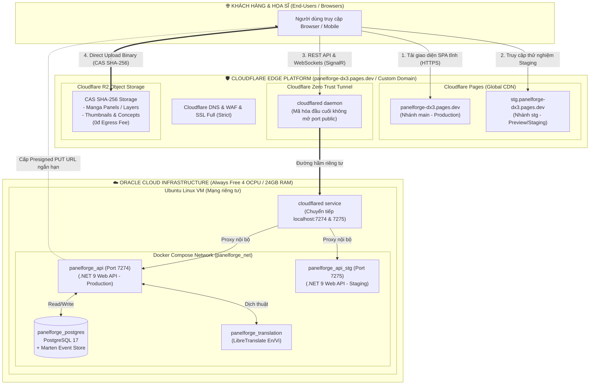

# Kiến Trúc Triển Khai Hạ Tầng & Tự Động Hóa CI/CD (Deployment & Infrastructure Architecture)

> **Dự án:** PanelForge — Manga Production Management Platform  
> **Tài liệu kỹ thuật:** Chiến lược triển khai hạ tầng đám mây (Cloudflare & Oracle Cloud) và tự động hóa CI/CD cho Frontend & Backend  
> **Tác giả:** Đội ngũ kiến trúc hệ thống

---

## 1. Tổng Quan Mô Hình Kiến Trúc (Architecture Blueprint)

Hệ thống **PanelForge** được thiết kế theo mô hình lai (Hybrid Cloud Architecture) kết hợp giữa:
1. **Cloudflare (Edge CDN, Storage & Zero Trust Security):** Phục vụ giao diện người dùng, lưu trữ tài sản ảnh số lượng lớn (Manga Panels / Layers) và bảo vệ an ninh mạng.
2. **Oracle Cloud Infrastructure - OCI (Compute & Database):** Vận hành lõi xử lý nghiệp vụ .NET 9, cơ sở dữ liệu quan hệ PostgreSQL 17, Marten Event Store và mô hình AI dịch thuật offline.



---

## 2. Quy Hoạch Môi Trường & Tên Miền (Environments & Routing)

Hệ thống phân tách triệt để 2 môi trường: **Staging (Preview)** để kiểm thử nội bộ và **Production** cho người dùng thật:

| Môi trường | Nhánh Git | Frontend URL | Backend API URL | CSDL PostgreSQL | R2 Storage Bucket |
|---|---|---|---|---|---|
| **Staging** | `stg` | `https://stg.panelforge-dx3.pages.dev` | `https://stg-api.panelforge.com` | `panelforge_staging` | `panelforge-assets-stg` |
| **Production** | `main` | `https://panelforge-dx3.pages.dev` | `https://api.panelforge.com` | `panelforge` | `panelforge-assets-prod` |

---

## 3. Triển Khai Frontend (Cloudflare Pages)

### 3.1. Đặc tính Kỹ thuật
- **Bundler & Framework:** React 19 + TypeScript + Vite.
- **SPA Fallback Routing:** Sử dụng file `public/_redirects` với luật `/*  /index.html  200` để đảm bảo khi người dùng refresh (F5) hoặc truy cập sâu vào các URL con (`/workspace`, `/canvas`) không bị lỗi HTTP 404.
- **Bảo mật Popup & Firebase Auth:** File `public/_headers` thiết lập `Cross-Origin-Opener-Policy: same-origin-allow-popups` hỗ trợ đăng nhập Google qua Firebase.
- **Cache CDN:** Tự động gắn nhãn `Cache-Control: public, max-age=31536000, immutable` cho toàn bộ tài nguyên băm trong thư mục `/assets/*`.

### 3.2. Cấu hình Biến Môi Trường (Cloudflare Pages Settings)
- **Tab Production:**
  ```text
  VITE_API_URL = https://api.panelforge.com/api
  VITE_APP_URL = https://api.panelforge.com
  ```
- **Tab Preview:**
  ```text
  VITE_API_URL = https://stg-api.panelforge.com/api
  VITE_APP_URL = https://stg-api.panelforge.com
  ```

### 3.3. Lệnh Triển Khai Nhanh (NPM Scripts)
Mã nguồn đã tích hợp sẵn lệnh đóng gói và đẩy lên Cloudflare Pages:
- Deploy Staging: `npm run deploy:stg`
- Deploy Production: `npm run deploy:prod`

---

## 4. Triển Khai Backend & Dữ Liệu (Oracle Cloud Infrastructure)

### 4.1. Cấu hình Máy Chủ OCI
- **Hình thức:** Oracle Compute Instance Always Free (`VM.Standard.A1.Flex` ARM 4 OCPU, 24GB RAM).
- **Mạng bảo mật (Zero Public Inbound):** Toàn bộ cổng inbound (kể cả 80 và 443) đều đóng trên Security List của OCI VCN.
- **Cầu nối Cloudflare Tunnel (`cloudflared`):** Kết nối outbound từ bên trong VM tới Edge của Cloudflare, bảo vệ máy chủ khỏi nguy cơ scan IP và tấn công DDoS.

### 4.2. Khởi chạy Cụm Dịch vụ (Docker Compose)
Tệp `docker-compose.prod.yml` chạy cô lập trên mạng bridge nội bộ `panelforge_net`:
1. `panelforge-api`: .NET 9 Kestrel Web API, bind vào `127.0.0.1:7274`.
2. `postgres-db`: PostgreSQL 17 với volume lưu trữ vĩnh viễn `panelforge_db_data`.
3. `translation-service`: LibreTranslate tải model dịch offline En-Vi.

---

## 5. Quy Trình Vận Hành Hằng Ngày Cho Nhóm (Git-Flow & CI/CD)

```
[ Developer ] 
     │ 1. Viết code & test máy cá nhân
     ▼
[ Nhánh stg ] ────────► Cloudflare Pages Auto-build ──► Link Preview: https://stg.panelforge-dx3.pages.dev
     │
     │ 2. Cả nhóm test nghiệp vụ, vẽ canvas, upload ảnh
     │    (Nếu có lỗi: sửa tiếp trên stg, không ảnh hưởng Production)
     ▼
     ✅ Đã kiểm thử 100% không còn lỗi
     │
[ PR stg -> main ] ──► Cloudflare Pages Auto-build ──► Link Production: https://panelforge-dx3.pages.dev
```

### Các Lợi Ích Cốt Lõi:
1. **0 VNĐ Chi phí Vận hành:** Toàn bộ dịch vụ thuộc diện Always Free của Oracle và gói Free Tier không giới hạn băng thông của Cloudflare Pages.
2. **Không Rủi Ro Gián Đoạn:** Mọi thay đổi đều qua Staging nghiệm thu trước khi cập nhật Production.
3. **Độc Lập Triển Khai:** Frontend và Backend phân tách ranh giới rõ ràng, không phụ thuộc vào máy trạm cục bộ của bất kỳ thành viên nào.
