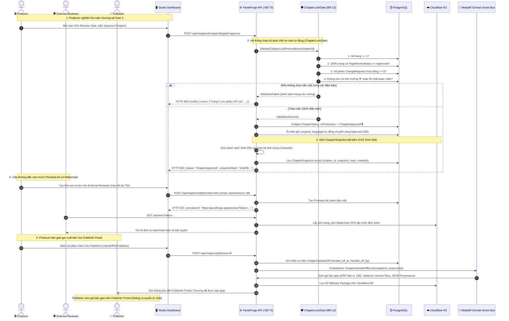
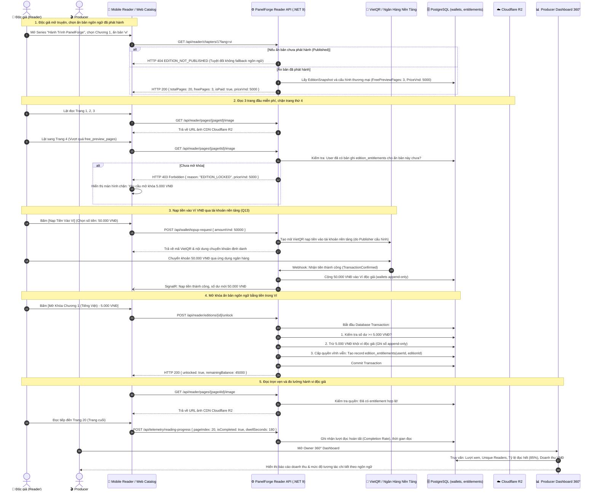
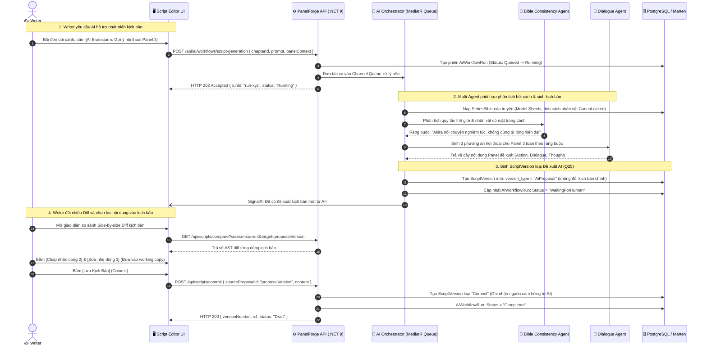
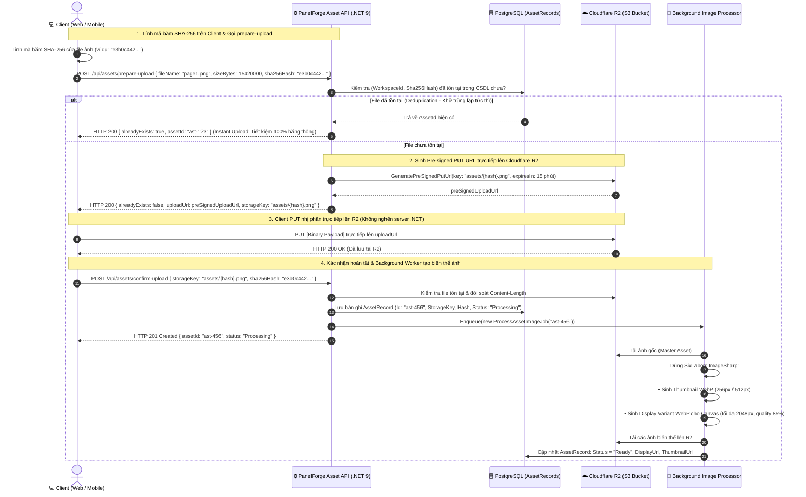

# 📐 Sơ Đồ Tuần Tự Các Luồng Nghiệp Vụ Cốt Lõi — PanelForge V2.6
*(Comprehensive Workflow Sequence Diagrams & Multi-Component Interactions)*

> **Dự án:** PanelForge — Nền tảng Quản lý Sản xuất Truyện tranh Manga có Cấu trúc & Truy vết Phiên bản  
> **Căn cứ nghiệp vụ:** [PANELFORGE_MASTER_SPECIFICATION_V2_6.md](../V2.6/PANELFORGE_MASTER_SPECIFICATION_V2_6.md), [PanelForge_Ubiquitous_Language_and_State_Glossary.md](../standards/PanelForge_Ubiquitous_Language_and_State_Glossary.md) và [clean-architecture-structure.md](./clean-architecture-structure.md).  
> **Kiến trúc áp dụng:** .NET 9 Clean Architecture (CQRS/MediatR, SignalR) + React 19 (TypeScript, Konva/Canvas API) + Flutter Mobile + PostgreSQL 17, Marten Event Store & Cloudflare R2 (CAS SHA-256).  
> **Vị trí tài liệu:** `panelforge-hub/docs/architecture/workflow-sequence-diagrams.md`.

---

## 📑 Danh Mục Sơ Đồ Tuần Tự (Sequence Diagrams Index)

Tài liệu này bao quát toàn diện **9 luồng tương tác tuần tự** đại diện cho toàn bộ vòng đời sản xuất, kiểm định, xuất bản và tiêu thụ truyện tranh trên nền tảng PanelForge:

1. [Workflow 1: Tiền kỳ & Kịch bản — Soạn Thảo Chữ Thuần, Đồng Bộ Series Bible & Chốt Gate 1 (CF1 & Gate 1)](#workflow-1-tiền-kỳ--kịch-bản--soạn-thảo-chữ-thuần-đồng-bộ-series-bible--chốt-gate-1-cf1--gate-1)
2. [Workflow 2: Phân Công & Sản Xuất Bàn Vẽ — Dựng Khung (Layout), Phác Thảo (Pencil) & Phân Nhánh Ink + Lettering (CF2)](#workflow-2-phân-công--sản-xuất-bàn-vẽ--dựng-khung-layout-phác-thảo-pencil--phân-nhánh-ink--lettering-cf2)
3. [Workflow 3: Kiểm Định Chất Lượng Gate 2 — Khoanh Vùng Bounding Box, Cô Lập Lỗi Cấp Panel & Vòng Đời Change Request (CF3)](#workflow-3-kiểm-định-chất-lượng-gate-2--khoanh-vùng-bounding-box-cô-lập-lỗi-cấp-panel--vòng-đời-change-request-cf3)
4. [Workflow 4: Nghiệm Thu Chương Gate 3, Đóng Băng Snapshot & Bàn Giao Publisher (CF4/CF5)](#workflow-4-nghiệm-thu-chương-gate-3-đóng-băng-snapshot--bàn-giao-publisher-cf4cf5)
5. [Workflow 5: Quản Lý Ấn Bản Ngôn Ngữ (Chapter Edition) & Xuất Bản Qua Publisher Portal (CF5)](#workflow-5-quản-lý-ấn-bản-ngôn-ngữ-chapter-edition--xuất-bản-qua-publisher-portal-cf5)
6. [Workflow 6: Độc Giả (Reader) Mua & Đọc Truyện — Nạp Ví VNĐ, Mở Khóa Ấn Bản & Đo Lường Doanh Thu (CF5)](#workflow-6-độc-giả-reader-mua--đọc-truyện--nạp-ví-vnđ-mở-khóa-ấn-bản--đo-lường-doanh-thu-cf5)
7. [Workflow 7: Đề Xuất Kịch Bản AI Đa Tác Nhân (Multi-Agent AI Scripting & Brainstorming Workflow)](#workflow-7-đề-xuất-kịch-bản-ai-đa-tác-nhân-multi-agent-ai-scripting--brainstorming-workflow)
8. [Workflow 8: Xử Lý Sửa Kịch Bản Muộn & Phân Tích Tác Động (Late Script Revision & Impact Review Flow - CF4)](#workflow-8-xử-lý-sửa-kịch-bản-muộn--phân-tích-tác-động-late-script-revision--impact-review-flow---cf4)
9. [Workflow 9: Tải Lên Tài Nguyên Trực Tiếp CAS SHA-256 (Direct Upload & Pre-signed URL Flow)](#workflow-9-tải-lên-tài-nguyên-trực-tiếp-cas-sha-256-direct-upload--pre-signed-url-flow)

---

## Workflow 1: Tiền kỳ & Kịch bản — Soạn Thảo Chữ Thuần, Đồng Bộ Series Bible & Chốt Gate 1 (CF1 & Gate 1)

> **Mục tiêu:** Mô tả luồng Writer soạn kịch bản độc lập (không cần thẻ giao việc), hệ thống tự động nhận diện thực thể/tạo stub Bible, Artist vẽ concept Model Sheet, Editor khoá Canon, và Producer chốt kịch bản tại Gate 1 để bước sang sản xuất.

```mermaid
sequenceDiagram
    autonumber
    actor Writer as ✍️ Writer
    actor Artist as 🎨 Artist
    actor Editor as 🧐 Editor
    actor Producer as 🎬 Producer
    participant FE as 🖥️ Web Studio (React 19)
    participant API as ⚙️ PanelForge API (.NET 9)
    participant DB as 🗄️ PostgreSQL / EF Core
    participant Storage as ☁️ Cloudflare R2 (CAS)

    %% 1. Soạn kịch bản & Autosave/Save
    Note over Writer,FE: 1. Soạn thảo kịch bản chữ thuần (Page -> Panel -> Content)
    Writer->>FE: Nhập thoại (speaker_label), mô tả hành động, lời dẫn, SFX
    FE->>FE: Bôi đen thực thể không thoại (Mô tả/Lời dẫn) tham chiếu mục Bible
    FE->>API: POST /api/scripts/autosave (Bản nháp tạm thời - working copy)
    API->>DB: Lưu Working Copy (không tạo ScriptVersion, không sinh hash)

    Writer->>FE: Bấm nút [Lưu Kịch Bản] (Commit)
    FE->>API: POST /api/scripts/commit (payload: cây Trang -> Panel -> Dòng)
    API->>API: Trích xuất speaker_label & đoạn bôi đen; Chuẩn hóa NFC tên mục
    API->>DB: Đối sánh tên với SeriesBible; Chưa có -> Tạo BibleEntry (Draft, IsStub=true)
    API->>API: Tính băm SHA-256 nội dung cây kịch bản
    API->>DB: Tạo ScriptVersion mới (bất biến, số phiên bản tăng dần)
    API-->>FE: HTTP 200 { versionNumber: v3, contentHash: "sha256...", stubEntries: [...] }

    %% 2. Thiết kế Concept Art & Khóa Canon
    Note over Artist,Editor: 2. Thiết kế Concept Art Model Sheet cho thực thể mới
    Writer->>FE: Viết định nghĩa cho mục stub (mô tả, ngoại hình, gỡ IsStub)
    FE->>API: PUT /api/bible/entries/{id}/definition
    API->>DB: Cập nhật định nghĩa; Đưa vào hàng đợi Pending Concept Art
    Artist->>FE: Tải ảnh Model Sheet lên hệ thống
    FE->>Storage: Tải ảnh trực tiếp qua Pre-signed URL (CAS SHA-256)
    FE->>API: POST /api/bible/entries/{id}/revisions (assetHash, variantLabel)
    API->>DB: Tạo BibleEntryRevision (ConceptSubmitted, v1)
    
    Editor->>FE: Mở xem phiên bản concept Model Sheet của Artist
    Writer->>FE: Đọc phiên bản concept, gửi nhận xét (Comment Thread)
    alt Nếu không đạt yêu cầu
        Editor->>FE: Bấm [Yêu cầu vẽ lại] (ReworkRequired) kèm lý do
        FE->>API: POST /api/bible/revisions/{id}/rework
        API->>DB: Chuyển BibleEntryRevision -> ReworkRequired
    else Nếu đạt yêu cầu chuẩn xác
        Editor->>FE: Bấm [Xác nhận thiết kế] (Luật 4 mắt BR-06: Editor != Artist)
        FE->>API: POST /api/bible/revisions/{id}/lock-canon
        API->>DB: Chuyển BibleEntryRevision -> CanonLocked 🔒 (Bất biến)
    end

    %% 3. Gửi duyệt kịch bản (Push)
    Note over Writer,Editor: 3. Gửi duyệt kịch bản & Đóng băng Manifest
    Writer->>FE: Bấm [Gửi Duyệt Kịch Bản] (Draft -> InReview)
    FE->>API: POST /api/scripts/submit-for-review (scriptVersionId: v3)
    API->>DB: Quét Danh sách thực thể chương (Chapter Cast Manifest)
    API->>API: Kiểm tra: Mọi mục stub đã có định nghĩa hoặc cờ Quần chúng? (Q21, Q22)
    alt Có mục nháp chưa xử lý
        API-->>FE: HTTP 409 Conflict { missingDefinitions: [...] }
    else Hợp lệ
        API->>DB: Lưu SubmittedScriptManifest (script_version_id, manifest_hash, resolved_revisions)
        API->>DB: Chuyển Chapter.ScriptStatus -> InReview
        API-->>FE: HTTP 200 { status: "InReview", manifestHash: "..." }
        API-)Editor: Gửi thông báo SignalR (Kịch bản đã gửi duyệt)
    end
    Editor->>FE: Đọc đúng bản gửi duyệt, gửi nhận xét theo dòng kịch bản

    %% 4. Gate 1: Chốt Tiền kỳ & Bắt đầu sản xuất
    Note over Producer,DB: 4. Cổng Gate 1: Producer bấm Approve Script & Start Production
    Producer->>FE: Mở màn hình Gate 1, kiểm tra Danh sách thực thể & Phiên bản gửi
    Producer->>FE: Bấm [Bắt đầu sản xuất] (Gate 1)
    FE->>API: POST /api/chapters/{id}/gate1-approve (lastSubmittedVersionId)
    API->>DB: Đối chiếu SubmittedScriptManifest với kế thừa Bible hiện hành
    API->>DB: Kiểm tra: 100% thực thể không Quần chúng có bản CanonLocked? (BR-21, BR-35)
    alt Còn thực thể chưa CanonLocked hoặc manifest bị lệch
        API-->>FE: HTTP 409 Conflict { reason: "Chờ Naruto Mặc định v2 đạt CanonLocked" }
    else Đủ điều kiện chốt
        API->>DB: Đóng băng Chapter.ScriptStatus -> Frozen ❄️ (is_script_frozen = true)
        API->>DB: Khóa Bản đồ thực thể chương (chapter_bible_bindings 🔒)
        API->>DB: Chuyển Chapter.ChapterStatus: PreProduction -> InProduction 🚀
        API->>DB: Khóa số thứ tự ChapterNumber (D9a)
        API-->>FE: HTTP 200 { status: "InProduction", isFrozen: true }
        API-)Writer: SignalR: Kịch bản đã chốt sản xuất
        API-)Artist: SignalR: Mở phân công công việc trên Kanban
    end
```

---

## Workflow 2: Phân Công & Sản Xuất Bàn Vẽ — Dựng Khung (Layout), Phác Thảo (Pencil) & Phân Nhánh Ink + Lettering (CF2)

> **Mục tiêu:** Mô tả quy trình phân bổ trang cho Artist, hệ thống tự động tính thứ tự đọc theo hình học, nộp bản phác thảo Pencil và phân nhánh song song cho Inking và Lettering.

```mermaid
sequenceDiagram
    autonumber
    actor Producer as 🎬 Producer
    actor Artist as 🎨 Artist (Chủ đạo)
    actor Letterer as 🔤 Letterer (Phụ việc)
    participant FE as 🖥️ ArtistDeskView (Canvas Konva)
    participant Engine as 📐 Reading Order Engine
    participant API as ⚙️ PanelForge API (.NET 9)
    participant DB as 🗄️ PostgreSQL / Marten
    participant Storage as ☁️ Cloudflare R2

    %% 1. Phân công trang
    Note over Producer,API: 1. Producer phân bổ trang tại Gate 1
    Producer->>API: POST /api/assignments/assign-pages (ArtistId, PageRange: [1..10])
    API->>DB: Tạo Assignment cho Artist (Assigned, Page-scoped ABAC)

    %% 2. Dựng khung & Thuật toán đọc
    Note over Artist,FE: 2. Artist mở bàn vẽ, chọn Frame Template & Dựng layout
    Artist->>FE: Mở ArtistDeskView (Trang 1 được giao)
    Artist->>FE: Kéo mẫu khung (Frame Template) hoặc kẻ khung tự do
    FE->>Engine: Sắp xếp Panel theo ReadingDirection (RTL Manga / LTR Comic / Vertical)
    Engine->>Engine: B1: Sort theo trục Y -> B2: Row Banding (|cyA - cyB| < min(hA,hB)/2)
    Engine->>Engine: B3: Manga RTL -> Sort giảm dần theo X (Phải qua Trái)
    Engine-->>FE: Gán panelIndex tự động (1, 2, 3...)
    Artist->>FE: Kéo thả các dòng kịch bản vào từng khung (Script Coverage 100%)

    %% 3. Vẽ Pencil & Nộp
    Note over Artist,API: 3. Vẽ phác thảo Pencil & Nộp hoàn thành Layout
    Artist->>FE: Vẽ phác thảo Pencil trên Canvas Layer
    Artist->>FE: Bấm [Nộp Bản Pencil]
    FE->>Storage: Tải ảnh phác thảo lên R2 qua Pre-signed URL (CAS SHA-256)
    FE->>API: POST /api/pages/{pageId}/submit-pencil (panelBoxes, assetHash)
    API->>DB: Cố định tọa độ BoundingBox {x,y,w,h} của các Panel
    API->>DB: Cập nhật PanelStageProgress.Pencil -> Submitted / Approved
    API-->>FE: HTTP 200 { status: "PencilSubmitted", panelsLocked: true }

    %% 4. Tự động mở nhánh song song: Ink & Lettering
    Note over Artist,Letterer: 4. Tự động mở đồng thời: Nhánh Graphic Layer (Ink) & Vector Text (Lettering)
    par Nhánh Graphic Layer (Artist vẽ Ink)
        Artist->>FE: Đi nét mực hoàn chỉnh & Screentone trên Graphic Layer
        opt Artist tự phát hiện sai sót cần quay lui (Self-Rollback)
            Artist->>FE: Bấm [↺ Quay lại sửa Pencil] (khi chưa bị Editor khóa duyệt)
            FE->>API: POST /api/pages/{pageId}/rollback-pencil
            API->>DB: Trả trạng thái về Pencil (InProgress), giữ bóng thoại
        end
        Artist->>FE: Bấm [Nộp Nét Mực Ink]
        FE->>Storage: Upload ảnh Ink (CAS SHA-256)
        FE->>API: POST /api/pages/{pageId}/submit-ink (assetHash)
        API->>DB: PanelStageProgress.Ink -> Submitted
    and Nhánh Vector Text Layer (Artist tự làm HOẶC Letterer phụ việc)
        alt Không gán Letterer riêng
            Artist->>FE: Dùng Vector Text Tools có sẵn trên ArtistDeskView
        else Có gán Letterer phụ việc (BR-31)
            Letterer->>FE: Mở LetteringWorkspace (chỉ mở quyền letter:write, lớp tranh vẽ bị khóa)
        end
        loop Đặt bóng thoại đa ngôn ngữ (BR-34)
            Note over FE: Đặt bóng thoại gắn 1-1 với dòng kịch bản; Lưu Position Record {x,y,w,h}
            FE->>FE: Nhập thoại ngôn ngữ gốc (vi) & bản dịch các ngôn ngữ phát hành (en, ja)
            FE->>FE: Kiểm tra an toàn chữ BR-20 (Tràn chữ, đè nét vẽ, thứ tự đọc)
        end
        FE->>API: POST /api/pages/{pageId}/submit-lettering (balloonsPayload)
        API->>DB: PanelStageProgress.Lettering -> Submitted
    end

    %% 5. Tự động ghép Composite & Đẩy Gate 2
    Note over API,DB: 5. Ghép phẳng ảnh Composite & Đẩy vào hàng đợi Gate 2
    API->>API: Nhận đủ Submitted từ Ink & Lettering ngôn ngữ gốc
    API->>API: Ghép phẳng Graphic Layer + Vector Layer thành ảnh Composite 1200x1800
    API->>Storage: Lưu ảnh Composite (CAS SHA-256)
    API->>DB: Cập nhật PageReviewStatus -> Reviewing; Mở cổng Gate 2 cho Editor
    API-)Producer: SignalR: Trang đã sẵn sàng thẩm định Gate 2
```

---

## Workflow 3: Kiểm Định Chất Lượng Gate 2 — Khoanh Vùng Bounding Box, Cô Lập Lỗi Cấp Panel & Vòng Đời Change Request (CF3)

> **Mục tiêu:** Mô tả quy trình Editor kiểm tra trang ghép trên ReviewView, khoanh vùng lỗi hình học $0..1$, thuật toán tự động xác định Panel giao thoa $\ge 15\%$, cô lập sửa lỗi cấp Panel mà không ảnh hưởng các panel khác, và đóng phiếu ChangeRequest.

```mermaid
sequenceDiagram
    autonumber
    actor Editor as 🧐 Editor (Reviewer)
    actor Artist as 🎨 Artist (Khung tranh)
    actor Letterer as 🔤 Letterer (Bóng thoại)
    participant FE as 🖥️ ReviewView (Canvas Diff)
    participant API as ⚙️ PanelForge API (.NET 9)
    participant Geo as 📐 Geometry Engine (Overlap >= 15%)
    participant DB as 🗄️ PostgreSQL
    participant Hub as 📡 SignalR Realtime Hub

    %% 1. Editor mở ReviewView
    Note over Editor,FE: 1. Editor mở trang cần thẩm định (Luật 4 mắt: Editor != Assignee)
    Editor->>FE: Mở ReviewView (Trang 1 - Composite 1200x1800)
    FE->>API: GET /api/reviews/pages/{pageId}
    API-->>FE: Trả về ảnh Composite, tọa độ Panel, bóng thoại, Model Sheet đối chiếu
    Editor->>FE: Bật các chế độ kiểm tra: Side-by-side, Slider, Onion-skin, Pixel Diff

    %% 2. Khoanh vùng lỗi & Thuật toán hình học
    Note over Editor,Geo: 2. Editor kéo chuột khoanh vùng lỗi AnchorBox {x,y,w,h}
    Editor->>FE: Kéo chuột khoanh vùng lỗi (Tọa độ chuẩn hóa [0..1] x [0..1])
    Editor->>FE: Nhập nhận xét & chọn phân loại lỗi: [Lỗi Nét Vẽ] hoặc [Lỗi Bóng Thoại]
    Editor->>FE: Bấm [Gửi Yêu Cầu Sửa Lỗi]
    FE->>API: POST /api/reviews/pages/{pageId}/change-requests (errorBox, comment, type)
    
    API->>Geo: FindIntersectingPanelIds(errorBox, pagePanels)
    Geo->>Geo: OverlapRatio = Area(Error ∩ Panel) / min(Area(Error), Area(Panel))
    Geo-->>API: Trả về danh sách Panel có OverlapRatio >= 0.15 (ví dụ: Panel 2)

    %% 3. Cô lập sửa lỗi cấp Panel
    Note over API,DB: 3. Cô lập lỗi đúng Panel 2, bảo vệ các Panel khác
    alt Lỗi vắt qua nhiều Panel
        API->>DB: Sinh nhiều ChangeRequest riêng cho từng Panel (dùng chung group_id)
    else Lỗi nằm trọn 1 Panel
        API->>DB: Sinh 1 ChangeRequest (Status: Open, PanelId: 2)
    end
    API->>DB: Panel 2: PanelStageProgress -> ReworkRequired
    API->>DB: Panel 1, 3, 4: Giữ nguyên trạng thái Approved 🔒 (Không bị ảnh hưởng)
    API->>DB: PageReviewStatus -> ChangesRequested

    alt Lỗi thuộc về Nét vẽ (Pencil/Ink)
        API->>DB: Kích hoạt cờ cảnh báo: is_artwork_updated_alert = true
        API->>Hub: Gửi thông báo đến Artist giữ Panel 2 kèm tọa độ lỗi
        Hub-)Artist: Thông báo: Panel 2 cần sửa lại nét vẽ; Bật viền cam [⚠️ Check Balloon Fit]
    else Lỗi thuộc về Bóng thoại (Lettering)
        API->>Hub: Gửi thông báo đến Letterer (hoặc Artist phụ trách chữ)
        Hub-)Letterer: Thông báo: Sửa lại vị trí / chính tả bóng thoại tại Panel 2
    end

    %% 4. Khắc phục & Đóng phiếu
    Note over Artist,Editor: 4. Khắc phục lỗi, Verify và Nghiệm thu trang
    Artist->>FE: Mở ArtistDeskView, sửa lại nét vẽ tại đúng Panel 2 và nộp lại
    FE->>API: POST /api/change-requests/{id}/resolve (resolvedAssetHash)
    API->>DB: ChangeRequest -> Resolved; Tự động ghép lại ảnh Composite mới
    API-)Editor: SignalR: Phiếu sửa lỗi đã nộp bản khắc phục

    Editor->>FE: Đối chiếu bản vẽ cũ vs mới trên ReviewView
    Editor->>FE: Bấm [Xác nhận đã sửa đạt] (Verify)
    FE->>API: POST /api/change-requests/{id}/verify
    API->>DB: ChangeRequest -> Verified (Đã đóng)
    API->>DB: Panel 2: PanelStageProgress -> Approved

    %% 5. Suy diễn trạng thái Trang
    Note over API,DB: 5. Kiểm tra quy tắc suy diễn: 100% Panel Approved -> Page Approved
    API->>DB: Kiểm tra: 100% Panel trên trang đã Approved VÀ không còn CR Open?
    alt Đạt toàn bộ
        API->>DB: PageReviewStatus -> Approved ✅
        API-->>FE: HTTP 200 { pageStatus: "Approved" }
        API-)Producer: SignalR: Trang đã đạt kiểm định Gate 2
    end
```

---

## Workflow 4: Nghiệm Thu Chương Gate 3, Đóng Băng Snapshot & Bàn Giao Publisher (CF4/CF5)

> **Mục tiêu:** Mô tả Producer quét điều kiện chốt an toàn BR-12 tại Gate 3, đóng băng ChapterSnapshot CAS SHA-256, cấp PreviewLink có watermark, và kích hoạt bàn giao cho Publisher qua sự kiện `ChapterHandedOff`.



---

## Workflow 5: Quản Lý Ấn Bản Ngôn Ngữ (Chapter Edition) & Xuất Bản Qua Publisher Portal (CF5)

> **Mục tiêu:** Mô tả quy trình dịch thuật ấn bản, Editor thẩm định, Producer duyệt ấn bản, và Publisher cấu hình thương mại (Free/Paid VNĐ), phát hành hoặc hẹn giờ phát hành ra công chúng.

```mermaid
sequenceDiagram
    autonumber
    actor Translator as 🌐 Translator / Letterer
    actor Editor as 🧐 Editor
    actor Producer as 🎬 Producer
    actor Publisher as 🏢 Publisher (Portal)
    participant FE as 🖥️ Web / Publisher Portal
    participant API as ⚙️ PanelForge API (.NET 9)
    participant DB as 🗄️ PostgreSQL
    participant Storage as ☁️ Cloudflare R2
    participant Catalog as 📱 Public Web/Mobile Catalog

    %% 1. Soạn & Nộp bản dịch
    Note over Translator,API: 1. Soạn thảo bản dịch ấn bản ngôn ngữ (ví dụ: 'en')
    Translator->>FE: Mở Bàn vẽ Lettering, chọn ngôn ngữ 'en' (release_languages)
    Translator->>FE: Nhập nội dung tiếng Anh vào các bóng thoại đã cố định tọa độ
    Translator->>FE: Bấm [Nộp Bản Dịch Ấn Bản Tiếng Anh]
    FE->>API: POST /api/editions/{chapterId}/en/submit
    API->>DB: Kiểm tra: Chương đã ChapterApproved VÀ mọi bóng thoại có chữ tiếng Anh?
    API->>DB: ChapterEdition('en'): Draft -> InReview
    API-->>FE: HTTP 200 { status: "InReview" }

    %% 2. Editor thẩm định bản dịch
    Note over Editor,API: 2. Editor duyệt chất lượng bản dịch (Luật 4 mắt: Editor != Translator)
    Editor->>FE: Mở bản ghép tiếng Anh, đối chiếu và kiểm tra chính tả/tràn chữ
    Editor->>FE: Bấm [Duyệt Bản Dịch]
    FE->>API: POST /api/editions/{chapterId}/en/review-approve
    API->>DB: ChapterEdition('en'): InReview -> Reviewed (lưu reviewed_by, reviewer_role)
    API-->>FE: HTTP 200 { status: "Reviewed" }

    %% 3. Producer nghiệm thu ấn bản
    Note over Producer,Storage: 3. Producer duyệt ấn bản cho phép phát hành (Approve Edition)
    Producer->>FE: Bấm [Nghiệm Thu Ấn Bản Tiếng Anh]
    FE->>API: POST /api/editions/{chapterId}/en/approve
    API->>API: Ghép phẳng Graphic Layer với Vector Text tiếng Anh
    API->>Storage: Lưu ảnh các trang tiếng Anh hoàn chỉnh (CAS SHA-256)
    API->>DB: Tạo EditionSnapshot bất biến (current_published_snapshot_id)
    API->>DB: ChapterEdition('en'): Reviewed -> Approved 🎯
    API-->>FE: HTTP 200 { status: "Approved" }

    %% 4. Publisher cấu hình thương mại
    Note over Publisher,API: 4. Publisher cấu hình thương mại bắt buộc trên Publisher Portal (D4)
    Publisher->>FE: Đăng nhập Publisher Portal (1 tài khoản duy nhất toàn hệ thống)
    Publisher->>FE: Chọn ấn bản tiếng Anh, thiết lập thông số thương mại:
    alt Cấu hình Trả phí (Paid)
        Publisher->>FE: Chọn [Trả phí]: Giá 15.000 VNĐ, Xem trước 3 trang đầu
        FE->>API: PUT /api/publisher/editions/{id}/pricing { isPaid: true, priceVnd: 15000, freePages: 3 }
    else Cấu hình Miễn phí (Free)
        Publisher->>FE: Chọn [Miễn phí]: Giá 0 VNĐ, Xem trước toàn bộ
        FE->>API: PUT /api/publisher/editions/{id}/pricing { isPaid: false, priceVnd: 0, freePages: 0 }
    end
    API->>DB: Lưu cấu hình thương mại vào ChapterEdition (Ghi nhận Audit Log)

    %% 5. Phát hành ấn bản
    Note over Publisher,Catalog: 5. Publisher phát hành ngay hoặc hẹn giờ (Publish / Schedule)
    alt Phát hành ngay (PublishEdition)
        Publisher->>FE: Bấm [Phát Hành Ngay]
        FE->>API: POST /api/publisher/editions/{id}/publish
        API->>DB: ChapterEdition: Approved -> Published 🚀 (lưu published_at)
        API->>Catalog: Đồng bộ ấn bản xuất hiện trên Web Catalog / Mobile Reader
    else Hẹn giờ phát hành (ScheduleEdition)
        Publisher->>FE: Chọn ngày giờ phát hành trong tương lai
        FE->>API: POST /api/publisher/editions/{id}/schedule { publishAt: "2026-12-01T08:00:00Z" }
        API->>DB: Lưu scheduled_publish_at; Cronjob đến giờ tự động chuyển Published
    end
    API-->>FE: HTTP 200 { status: "Published" }
```

---

## Workflow 6: Độc Giả (Reader) Mua & Đọc Truyện — Nạp Ví VNĐ, Mở Khóa Ấn Bản & Đo Lường Doanh Thu (CF5)

> **Mục tiêu:** Mô tả quy trình độc giả đọc ấn bản, xem trước số trang quy định, nạp tiền thật VNĐ qua tài khoản ngân hàng nền tảng, mở khóa vĩnh viễn ấn bản, và hệ thống tổng hợp chỉ số đọc 360° cho Producer.



---

## Workflow 7: Đề Xuất Kịch Bản AI Đa Tác Nhân (Multi-Agent AI Scripting & Brainstorming Workflow)

> **Mục tiêu:** Mô tả luồng Writer sử dụng trợ lý AI đa tác nhân để phát triển kịch bản và lời thoại. Đề xuất của AI tạo ra phiên bản `ScriptVersion` loại `AiProposal` (không ghi đè kịch bản chính), và Writer duyệt chọn từng dòng trước khi commit.



---

## Workflow 8: Xử Lý Sửa Kịch Bản Muộn & Phân Tích Tác Động (Late Script Revision & Impact Review Flow - CF4)

> **Mục tiêu:** Mô tả quy trình khi Producer mở lại kịch bản đã chốt, Writer chỉnh sửa nội dung, hệ thống chạy thuật toán so sánh AST để tự động gắn cờ ảnh hưởng ⚑ (`FlagImpactReview`) lên đúng các Panel liên quan, và ê-kíp xử lý cô lập sửa chữa.

```mermaid
sequenceDiagram
    autonumber
    actor Producer as 🎬 Producer
    actor Writer as ✍️ Writer
    actor Artist as 🎨 Artist
    actor Letterer as 🔤 Letterer
    participant FE as 🖥️ Studio Web UI
    participant API as ⚙️ PanelForge API (.NET 9)
    participant AST as 🌳 AST Diff & Impact Engine
    participant DB as 🗄️ PostgreSQL
    participant Hub as 📡 SignalR Realtime Hub

    %% 1. Mở lại kịch bản đã đóng băng
    Note over Producer,API: 1. Producer mở lại kịch bản đã đóng băng (kèm lý do Audit)
    Producer->>FE: Mở chương đang InProduction, bấm [Mở Lại Kịch Bản] (Unfreeze)
    FE->>API: POST /api/chapters/{id}/reopen-script { reason: "Bổ sung tình tiết cao trào" }
    API->>DB: Ghi nhận lý do vào Audit Log
    API->>DB: Chuyển Chapter.ScriptStatus: Frozen -> Draft (Kịch bản mở quyền sửa)
    API-->>FE: HTTP 200 { isScriptFrozen: false, status: "Draft" }
    API-)Writer: SignalR: Kịch bản đã được mở lại để chỉnh sửa

    %% 2. Writer sửa kịch bản & Gửi duyệt lại
    Note over Writer,API: 2. Writer sửa kịch bản và bấm Gửi duyệt lại
    Writer->>FE: Thay đổi lời thoại ở Panel 2, đổi hành động chiến đấu ở Panel 5
    Writer->>FE: Bấm [Lưu Kịch Bản] (Commit tạo ScriptVersion v5)
    Writer->>FE: Bấm [Gửi Duyệt Lại]
    FE->>API: POST /api/scripts/resubmit-for-review { scriptVersionId: v5 }

    %% 3. Phân tích tác động kịch bản (Impact Engine)
    Note over API,AST: 3. Phân tích sai khác AST giữa bản đóng băng cũ vs bản mới
    API->>AST: AnalyzeScriptImpact(oldFrozenVersion, newVersion)
    AST->>AST: So sánh AST từng dòng trong từng Panel
    AST-->>API: Phát hiện: Panel 2 sửa thoại; Panel 5 đổi toàn bộ hành động
    
    API->>DB: Bật cờ tác động FlagImpactReview (⚑) lên Panel 2 và Panel 5
    API->>DB: Panel 2: Đánh dấu bong bóng thoại isStale = true (Lời thoại cũ)
    API->>DB: Panel 5: Chuyển PanelStageProgress -> ReworkRequired
    API->>Hub: Phát tín hiệu cảnh báo tác động đến Artist & Letterer

    %% 4. Xử lý cô lập tác động (Keep vs Rework)
    Note over Artist,Letterer: 4. Xử lý các Panel có cờ tác động ⚑
    par Xử lý Panel 2 (Chỉ sửa lời thoại nhẹ)
        Letterer->>FE: Mở Bàn vẽ Lettering, xem viền cờ ⚑ tại Panel 2
        Letterer->>FE: Cập nhật lại câu chữ mới vào bóng thoại
        Letterer->>FE: Bấm [Giữ Nguyên Tranh Vẽ (Keep)]
        FE->>API: POST /api/panels/2/impact-resolve { decision: "Keep", updateText: true }
        API->>DB: Gỡ cờ ⚑ khỏi Panel 2; Tranh vẽ giữ nguyên Approved 🔒
    and Xử lý Panel 5 (Thay đổi nét vẽ lớn)
        Artist->>FE: Mở ArtistDeskView, thấy Panel 5 yêu cầu vẽ lại
        Artist->>FE: Vẽ lại khung tranh chiến đấu mới cho Panel 5 và nộp lại
        FE->>API: POST /api/panels/5/impact-resolve { decision: "Rework", newAssetHash: "..." }
        API->>DB: Gỡ cờ ⚑; Panel 5 chuyển sang InReview chờ Editor duyệt lại Gate 2
    end

    %% 5. Producer chốt lại Gate 1
    Note over Producer,DB: 5. Chốt lại kịch bản khi 100% cờ ⚑ đã giải quyết
    Producer->>FE: Mở màn hình Gate 1, kiểm tra: Số cờ ⚑ chưa giải quyết == 0
    Producer->>FE: Bấm [Chốt Lại Kịch Bản & Tiếp Tục Sản Xuất]
    FE->>API: POST /api/chapters/{id}/gate1-approve
    API->>DB: Chapter.ScriptStatus: Draft -> Frozen ❄️
    API-->>FE: HTTP 200 { status: "InProduction", isFrozen: true }
```

---

## Workflow 9: Tải Lên Tài Nguyên Trực Tiếp CAS SHA-256 (Direct Upload & Pre-signed URL Flow)

> **Mục tiêu:** Mô tả giải pháp Direct Upload qua Pre-signed URL của Cloudflare R2, kết hợp Content-Addressed Storage (CAS) SHA-256, khử trùng lặp file (Deduplication) và tạo biến thể ảnh tự động qua Background Queue.



---

## 📌 Bảng Đối Chiếu Ma Trận Nghiệp Vụ & Quy Tắc Cốt Lõi

| Quy trình (Workflow) | Tác tử chính (Actors) | Cổng chất lượng (Gate) | Mã băm / Định danh bất biến | Quy tắc nghiệp vụ (BR) liên đới |
|---|---|---|---|---|
| **Workflow 1: Tiền kỳ & Kịch bản** | Writer, Artist, Editor, Producer | **Gate 1** (Pre-Production Gate) | `ScriptVersion` (SHA-256), `SubmittedScriptManifest`, `CanonLocked` | BR-01, BR-06, BR-07, BR-15, BR-21, BR-35 |
| **Workflow 2: Sản xuất Bàn vẽ** | Producer, Artist, Letterer | — | `PositionRecord {x,y,w,h}`, `GraphicAssetHash` | BR-05, BR-19, BR-20, BR-31, BR-34 |
| **Workflow 3: Kiểm định Gate 2** | Editor, Artist, Letterer | **Gate 2** (Quality & Composite) | Bounding Box $0..1$, `ChangeRequest` (group_id) | BR-06, BR-19, BR-26, OverlapRatio $\ge 15\%$ |
| **Workflow 4: Nghiệm thu Gate 3** | Producer, Reviewer, Publisher | **Gate 3** (Release Gate) | `ChapterSnapshot` (SHA-256), `ChapterHandedOff` | BR-12, BR-18, BR-30, Watermark SVG |
| **Workflow 5: Ấn bản Ngôn ngữ** | Letterer, Editor, Producer, Publisher | Gate Edition (Reviewed/Approved) | `EditionSnapshot` (current_published_snapshot_id) | BR-06, BR-12, BR-33, BR-34, Quyết định D1, D4, D5 |
| **Workflow 6: Độc giả & Doanh thu** | Reader, Producer, Publisher | API Security Filter (403 N+1) | `edition_entitlements`, `wallets` (VNĐ append-only) | BR-32, BR-33, BR-34, Quyết định Q11, Q13 |
| **Workflow 7: Kịch bản AI** | Writer, AI Orchestrator | Human-in-the-loop (Commit) | `ScriptVersion` (AiProposal), `AiWorkflowRun` | BR-02, BR-07, Quyết định Q25 |
| **Workflow 8: Sửa Kịch bản Muộn** | Producer, Writer, Artist, Letterer | Gate 1 Re-approval | `FlagImpactReview` (⚑), `isStale` | BR-07, BR-12, Audit Log append-only |
| **Workflow 9: Direct Upload CAS** | Artist, Client, Storage Worker | Hash Check Deduplication | Content-Addressed Storage (`SHA-256`) | Pre-signed URL, SixLabors Image Processing |

---
*(Hết tài liệu Sơ đồ tuần tự các luồng nghiệp vụ cốt lõi PanelForge V2.6)*
