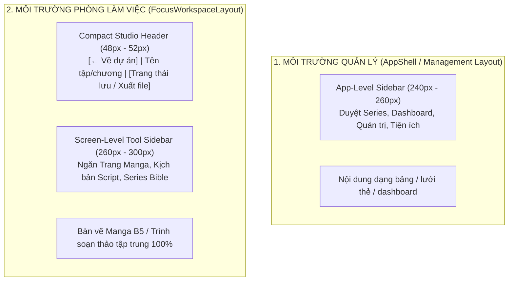

# QUY ƯỚC CHUẨN THIẾT KẾ & KIẾN TRÚC SIDEBAR (PANELFORGE SIDEBAR SPECIFICATION)

> **Dự án:** PanelForge Manga Production Platform (`SEP490_FA26SE251`)  
> **Áp dụng:** Web Frontend (`panelforge-fe`), tham chiếu quy chuẩn Mobile (`panelforge-mobile`)  
> **Tiêu chuẩn tham chiếu:** UX Wayfinding Principles, Fitts's Law, WCAG 2.1 AA Accessibility, 8px Grid System.

---

## 1. NGUYÊN TẮC CỐT LÕI: "1 MÀN HÌNH – 1 VAI TRÒ ĐIỀU HƯỚNG DUY NHẤT"

Một trong những lỗi điều hướng nghiêm trọng nhất là để **Sidebar toàn hệ sinh thái (App Shell Nav)** và **Sidebar công cụ màn hình (Workspace Tool Sidebar)** cùng xuất hiện và tranh chấp không gian. Điều này gây bóp nghẹt khung vẽ Manga B5 (tỉ lệ 1:1.414) và làm phân tán sự tập trung của Artist / Writer.

PanelForge phân định ranh giới thành **2 chế độ Layout tách biệt**:



### Quy tắc định tuyến (Routing Rule):
1. **Chế độ Quản lý (`AppShell`):**
   * Chỉ có duy nhất Sidebar chính của ứng dụng (`AppShellSidebar`).
   * **Các màn hình áp dụng:** Studio Overview, Workspace Catalog, Producer Dashboard, My Work, Series Overview, Settings, Users & Roles, Public Catalog.
2. **Chế độ Phòng làm việc tập trung (`FocusWorkspaceLayout`):**
   * **Ẩn hoàn toàn `AppShellSidebar`**.
   * Thay thế bằng thanh tiêu đề gọn nhẹ (**Compact Studio Header, chiều cao h-12 ~ 48px**) ở đỉnh gồm: nút quay lại `← Về dự án`, đường dẫn Breadcrumb chương/tập, trạng thái đồng bộ lưu đám mây, các nút hành động cốt lõi (Lưu, Phê duyệt, Xuất bản B5).
   * Dành trọn vẹn chiều rộng màn hình cho **Sidebar công cụ chuyên biệt của màn hình đó** (ví dụ: `ArtistCanvaSidebar` chứa Pages/Script/Bible) và **Khung vẽ chính (Canvas Surface)**.
   * **Các màn hình áp dụng:** `ArtistDeskView`, `ArtistWorkspaceView`, `ScriptEditorView`, `LettererDeskView`, `TaskEditorView`, `ReviewView`.

---

## 2. THÔNG SỐ KÍCH THƯỚC, TỈ LỆ & LƯỚI CĂN CHỈNH (SIZING & 8PX GRID)

| Thành phần / Trạng thái | Kích thước chuẩn | Chi tiết kỹ thuật & CSS Utility |
|---|---|---|
| **Expanded Width (Mở rộng)** | **256px (`w-64`)** | Cố định 256px (hoặc 240px-260px), vừa vặn cho Icon 20px + Label tiếng Việt/Anh + Badge trạng thái không bị tràn dòng. |
| **Collapsed Width (Mini-Rail)** | **64px (`w-16`)** | Cố định 64px, Icon trung tâm 20-24px, padding 20px mỗi bên, hỗ trợ Tooltip khi di chuột. |
| **Drawer công cụ (Desk Drawer)** | **280px - 320px** | Dành cho nội dung phức tạp hơn (danh sách trang Manga kèm thumbnail, trích đoạn kịch bản thoại). |
| **Chiều cao mục (Item Height)** | **40px - 44px (`h-10` / `h-11`)** | Đạt chuẩn kích thước bấm/chạm tối thiểu (Touch target) theo Fitts's Law. |
| **Padding nội bộ mục (Item Padding)** | **`px-4 py-2.5` (16px / 10px)** | Căn chỉnh chuẩn 16px hai bên nhãn chữ theo lưới 8px. |
| **Khoảng cách Icon - Nhãn** | **`gap-3` (12px)** | Giữ icon thẳng cột với tiêu đề nhóm danh mục. |
| **Khoảng cách phân nhóm** | **`mt-6` (24px)** | Khoảng đệm giữa các cụm danh mục nghiệp vụ khác nhau. |
| **Tiêu đề nhóm (Category Header)** | **`text-[11px] font-semibold tracking-wider uppercase`** | Là chỉ dấu phân nhóm (Marker), không phải liên kết có thể bấm. |
| **Màn hình Mobile (< 768px)** | **Slide-over Drawer** | Ẩn hoàn toàn sidebar cố định; kích hoạt qua Drawer trượt từ mép trái khi bấm Hamburger. |

---

## 3. PHÂN CẤP THÔNG TIN (VISUAL HIERARCHY - 3 TẦNG)

Mọi Sidebar phải được tổ chức mạch lạc theo 3 tầng sau:

### Tầng 1: Điều hướng chính (Primary Navigation)
* **Số lượng:** Tối đa **5 – 7 mục cốt lõi** theo vai trò người dùng (Producer, Artist, Writer, Letterer, Editor).
* **Kiểu chữ:** Kích thước `14px` (`text-sm`), Font weight `font-medium` (500), khi Active chuyển thành `font-semibold` (600).
* **Vị trí:** Nằm ở phần trên của Sidebar.

### Tầng 2: Nhóm chuyên môn (Secondary Navigation / Categories)
* Đặt dưới tiêu đề nhóm viết hoa (`TIỆN ÍCH SẢN XUẤT`, `XUẤT BẢN & PHÁT HÀNH`,...).
* Các mục phụ hoặc nhánh con thụt lề nhẹ `pl-8` hoặc phân nhóm rõ ràng bằng khoảng đệm `mt-5`.

### Tầng 3: Nhóm tiện ích hệ thống (Utility Items - Ghim đáy)
* **Bao gồm:** Cài đặt (Settings), Hồ sơ / Đăng xuất (Profile / Logout), Thông báo, Phím tắt, Trợ giúp, Audit Logs.
* **Quy chuẩn bố cục:**
  * Được ghim cố định ở **đáy Sidebar (`border-t border-[#D8D2C5] shrink-0 p-3`)**.
  * Khu vực menu chính ở giữa có thanh cuộn riêng (`flex-1 overflow-y-auto min-h-0`). Khi danh sách menu dài ra, các tiện ích đáy **luôn luôn hiển thị cố định**, không bị trôi khỏi màn hình.

---

## 4. QUY CHUẨN TRẠNG THÁI TƯƠNG TÁC (INTERACTIVE STATES)

Hệ thống trạng thái tương tác phản hồi rõ ràng theo chuẩn nhận diện PanelForge:

```
[ Default State ]  -> Màu chữ dịu (text-[#57534E]), nền trong suốt
[ Hover State ]    -> Nền soft warm tint (bg-[#F3F0E9] hoặc bg-[#EAE5D9]), text-[#1C1917]
[ Active State ]   -> Nền nhấn ấm áp (bg-[#FFF2E6]), vạch trái cam đất (border-l-4 border-[#C2410C]), text-[#C2410C] hoặc text-[#1C1917] font-semibold
[ Focus State ]    -> Vòng viền Focus Ring 2px độ tương phản cao (focus-visible:outline-2 focus-visible:outline-[#C2410C])
```

1. **Active State (Trạng thái trang hiện tại):**
   * Người dùng phải nhận biết vị trí của mình **trong vòng 0.5 giây** khi nhìn vào màn hình.
   * Kết hợp cả màu nền nổi bật nhẹ, vạch chỉ báo biên trái và icon chuyển sang thể đậm/nổi.
2. **Hover State:**
   * Thay đổi nền dịu dàng, thời gian chuyển đổi `transition-colors duration-150`.
3. **Focus State (Accessibility WCAG 2.1 AA):**
   * Bắt buộc có `focus-visible:outline-2 focus-visible:outline-[#C2410C] focus-visible:outline-offset-1`.
   * Cho phép duyệt toàn bộ danh sách menu chỉ bằng bàn phím (`Tab` và `Enter/Space`).

---

## 5. QUY CHUẨN BIỂU TƯỢNG (ICONOGRAPHY) & NHÃN CHỮ (LABELS)

* **Biểu tượng bổ trợ nhãn chữ:** Tuyệt đối không dùng Icon-only ở chế độ Sidebar mở rộng (tránh việc người dùng phải "đoán mò" chức năng).
* **Đồng nhất Icon Set:** 100% sử dụng icon từ `lucide-react`.
* **Kích thước Icon:** Đồng nhất `w-5 h-5` (20px) hoặc `w-[18px] h-[18px]`, nét vẽ `stroke-[1.75]`.
* **Chế độ Mini-Rail (Thu gọn):**
  * Chỉ hiển thị icon ở chính giữa cột `w-16`.
  * **Bắt buộc có Tooltip nổi** xuất hiện khi di chuột hoặc focus để đọc được nhãn đầy đủ.

---

## 6. CƠ CHẾ THU GỌN & BỘ NHỚ TRẠNG THÁI (COLLAPSIBILITY & PERSISTENCE)

1. **Chuyển đổi êm ái:** Thời lượng transition `200ms - 300ms` với `ease-in-out`.
2. **Nút kích hoạt rõ ràng:** Icon `PanelLeftClose` (khi mở) và `PanelLeftOpen` (khi đóng) đặt trên thanh header hoặc đỉnh sidebar.
3. **Bộ nhớ phiên (Persistence):**
   * Lưu trạng thái thu gọn vào `localStorage.getItem('pf.sidebar.collapsed')`.
   * Khi reload trang hoặc di chuyển giữa các trang quản lý, giao diện giữ nguyên tùy chọn thu gọn/mở rộng của người dùng.

---

## 7. BẢNG CHECKLIST NGHIỆM THU ĐẠT CHUẨN SIDEBAR (7-POINT AUDIT)

| # | Tiêu chí nghiệm thu | Cách kiểm chứng thực tế | Tiêu chuẩn đạt |
|:---:|---|---|:---:|
| **1** | **Nguyên tắc 1 Sidebar** | Mở Bàn vẽ Artist Desk hoặc Script Editor. | Không còn Sidebar toàn hệ thống; chỉ có thanh Compact Header và Sidebar công cụ của bàn vẽ. |
| **2** | **Nhận diện Active trong 2s** | Liếc nhìn Sidebar trong 2 giây. | Trang hiện tại được làm nổi bật rõ ràng qua nền ấm và viền chỉ báo. |
| **3** | **Giới hạn Primary Items** | Đếm số lượng mục điều hướng chính theo từng vai trò. | Không quá 7 mục chính trong 1 nhóm vai trò. |
| **4** | **Phản hồi tương tác** | Rê chuột và dùng phím `Tab` duyệt menu. | Có hiệu ứng hover dịu và viền `focus-visible` tương phản cao. |
| **5** | **Icon kèm Nhãn chữ** | Kiểm tra chế độ mở rộng của Sidebar. | Mọi mục đều có icon đi kèm chữ rõ ràng, không bị tràn dòng. |
| **6** | **Cuộn độc lập & Ghim đáy** | Thu nhỏ chiều cao trình duyệt và cuộn danh sách menu. | Khu vực tiện ích (Cài đặt / Đăng xuất) luôn ghim cố định ở đáy, không bị cuộn mất. |
| **7** | **Lưu trạng thái thu gọn** | Bấm nút thu gọn Sidebar sang dạng mini-rail rồi F5 lại trang. | Trạng thái thu gọn `w-16` được giữ nguyên từ `localStorage`. |
