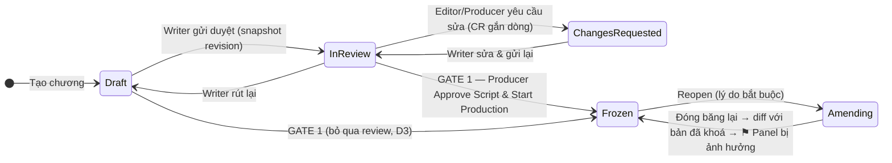

# 01 · KỊCH BẢN — SOẠN → DUYỆT → KHOÁ → SỬA MUỘN (`SCR`)

> **Spec:** Module 1 (soạn kịch bản, Gate 1), Module 4 (mở lại / sửa muộn), §1.2 (Trang → Panel → Nội dung), §5.2.
> **Thay cho:** `note/SCRIPT_FLOW_REFACTOR_PLAN.md` (ID `S0-01..S6-02`), plan tổng P4-01; liên quan P1-01/P1-02. Bỏ hẳn `SCRIPT_END_TO_END_REFACTOR_MASTER_PLAN.md`, `PAGE_BASED_SCRIPT_EDITOR_AND_DYNAMIC_ENTITY_LINKING_PLAN.md`.
> **Repo:** `PanelForge_FA26SE251` (chính), `panelforge-fe` (chính). Mobile không ảnh hưởng.
> **Phụ thuộc:** SCR-08 làm cùng [REL-01](06_RELEASE_PLAN.md) (ChapterStatus). Phần giao Page của Gate 1 ở [ASG-01](03_ASSIGNMENT_PLAN.md).

---

## 1. Hiện trạng đã có (không làm lại)

| Hạng mục | Bằng chứng |
|---|---|
| Writer soạn kịch bản, lưu theo Scene, revision append-only | `Features/ScriptLines/*` (`BatchSaveScriptLinesCommand`, `RestoreScriptRevisionCommand`), `ContentRevision` |
| `@Tên` → liên kết Bible / tạo Stub | `LinkBibleEntriesCommand`, `BibleEntry.CreateStub`, FE `@tiptap/extension-mention` |
| Đóng băng kịch bản + Bible Gate (chỉ `@Tag` phải CanonLocked) | `Chapters/Commands/FreezeScript/FreezeScriptCommands.cs`, `CheckChapterBibleGateQuery` |
| Mở lại: Writer yêu cầu → Producer duyệt/từ chối; Producer mở trực tiếp **bắt buộc lý do** + audit `UNFREEZE_SCRIPT` | `RequestScriptReopenCommand`, `ApproveScriptReopenCommand`, `UnfreezeChapterScriptCommand` (P0-03, commit `c8dc9c2`) |
| Sửa dòng đã gắn Panel → cờ ⚑ + bóng thoại `isStale` + Keep/Rework | `Assignment.FlagScriptImpact`, `GetPageSnapshotQueryHandler`, `ResolveImpactReviewCommand` |
| Lưu cấu trúc Page/Panel từ kịch bản trong một transaction | `SyncScriptStructureCommand` (commit `f95369e`) |

## 2. Vấn đề còn lại

| # | Vấn đề | Bằng chứng | Hậu quả |
|---|---|---|---|
| V1 | Không có trạng thái kịch bản (chỉ `IsScriptFrozen` + `ScriptReopenStatus`) | `Chapter.cs` | UI tự suy luận; không chặn sửa khi đang duyệt |
| V2 | Duyệt kịch bản đi nhờ pipeline Assignment, stage Script tự duyệt | `CreateSeriesCommand.cs:142` (`isApprovalGate: false`), `SubmitAssignmentCommand.cs:70` | Màn Editor duyệt kịch bản gần như vô dụng; trái spec ("Script ngoài Assignment") |
| V3 | Freeze không yêu cầu kịch bản đã duyệt / hết ChangeRequest | `FreezeScriptCommands.cs:43-73` | Khoá được kịch bản đang bị trả về |
| V4 | **Bug:** Unfreeze trực tiếp không chạy phân tích ảnh hưởng khi đóng băng lại | `FreezeScriptCommands.cs:76` chỉ chạy khi `ScriptReopenStatus == Approved` | Panel vẽ theo thoại cũ không bị ⚑ |
| V5 | Phân tích ảnh hưởng dựa trên timestamp | `FreezeScriptCommands.cs:80` | Sửa rồi hoàn tác vẫn bị tính; dòng xoá mềm không bị tính |
| V6 | Loại dòng không lưu trong DB; Trang/Panel/SFX mã hoá bằng chữ, FE đoán bằng regex | `scriptFlowAdapter.ts:561-680` | Dễ vỡ; BE không kiểm được BR-05 |
| V7 | Speaker nhúng trong chuỗi `Tên: "..."`, không có nhãn quần chúng | `composeSpeakerLine` (`scriptFlowAdapter.ts:336`) | Lettering phải tách chuỗi |
| V8 | Hai cơ chế khoá trùng: `Chapter.IsScriptFrozen` và `ChapterScript.IsLocked` | `ChapterScript.cs` | Nguồn sự thật mập mờ |
| V9 | Revision theo Scene, không có "bản đã khoá" cấp chương | `ContentRevision.SceneId` | Không so được bản khoá với bản sửa |
| V10 | Lưu nhiều request rời theo Scene | `ScriptEditorView.tsx` (~25 lời gọi service) | Lưu dở dang khi lỗi giữa chừng |
| V11 | Code FE chết | `comic-editor/ComicScriptEditor` + `versioning/*`, `script/storyboard/*`, `machines/chapterScriptMachine.ts` | Agent dễ sửa nhầm |
| V12 | `ScriptEditorView.tsx` > 3.200 dòng | — | Khó sửa an toàn |

## 3. Thiết kế đích

### 3.1 Máy trạng thái kịch bản (tách khỏi `ChapterStatus`)



| Trạng thái | Writer sửa? | Ghi chú |
|---|---|---|
| `Draft` | ✅ | Auto-save |
| `InReview` | ❌ | Bản đang duyệt bất biến; CR gắn `ScriptLineId` |
| `ChangesRequested` | ✅ | Writer xử lý CR rồi gửi lại |
| `Frozen` | ❌ | Mọi vai trò chỉ đọc; Artist bắt đầu vẽ |
| `Amending` | ✅ (chỉ Writer) | Sản xuất hình vẫn chạy |

`Chapter.Status = PreProduction` khi kịch bản lần đầu ở `Draft/InReview/ChangesRequested`; Gate 1 chuyển `PreProduction → InProduction` cùng lúc `→ Frozen`. `Amending` không đưa chương về `PreProduction`.

### 3.2 Cấu trúc dữ liệu

```
Chapter
 ├─ Page ─ Panel (+ Direction: ghi chú góc máy, MỚI)
 │          └─ ScriptLine (PanelId = neo chính)
 │               • Kind: Action | Dialogue | Thought | Narration | Sfx   (MỚI)
 │               • Text (gộp DialogueText/StageDirection)
 │               • SpeakerCharacterId? (@Tag)  • SpeakerLabel? ("Lính gác 1", MỚI)
 └─ Scene (giữ, 1 Scene mặc định ẩn mỗi chương — D2)
```

`Kind` → loại bóng (BR-05): Dialogue→SPEECH, Thought→THOUGHT, Narration→NARRATION_BOX, Sfx→SOUND_EFFECT, Action→không bóng.

### 3.3 Phiên bản & khoá

- Revision cấp chương: `ContentRevision` với `Kind = ChapterScript`, `SceneId` = scene ẩn; payload cả cây Page→Panel→Line; bỏ qua nếu hash không đổi.
- `Chapter.FrozenScriptRevisionId` + `ScriptContentHash` trỏ đúng bản đã khoá.
- `ScriptReopen` append-only (Id, ChapterId, Reason, RequestedById/At, DecidedById/At, Decision, BaselineRevisionId) thay 4 cột `ScriptReopen*`.
- Đóng băng lại: diff baseline ↔ hiện tại theo `ScriptLineId` → `FlagImpactedWorkAsync` (sửa V4, V5).
- Bỏ `ChapterScript.IsLocked/Lock/Unlock` (V8).

### 3.4 API đích (`/api/chapters/{chapterId}/script`)

| Method | Route | Vai trò | Use case |
|---|---|---|---|
| GET | `/script` | Thành viên | Cây kịch bản + `scriptStatus`, `revisionId`, `frozenRevisionId`, CR mở |
| PUT | `/script` | Writer (Producer nếu chưa có Writer) | Lưu cả cây trong 1 transaction, `expectedRevisionId` (BR-11) |
| POST | `/script/submit` · `/withdraw` | Writer | Draft/ChangesRequested ↔ InReview |
| POST | `/script/request-changes` | Editor, Producer | InReview → ChangesRequested |
| POST | `/script/approve` | Producer | Gate 1 → Frozen (+ giao Page, ASG-01) |
| POST | `/script/reopen-requests`, `/{id}/decision`, `/reopen`, `/refreeze` | Writer / Producer | Mở lại & đóng băng lại |
| GET | `/script/revisions`, `/{id}`, `/diff?from&to` | Thành viên | Lịch sử & so sánh |

Endpoint cũ (`freeze-script`, `unfreeze-script`, `*-script-reopen`, `scenes/*`, `script-lines/*`, `pages/sync-script-structure`) chạy song song, `[Obsolete]`, gỡ ở SCR-23.

### 3.5 Quyết định

| ID | Câu hỏi | Khuyến nghị / Kết quả |
|---|---|---|
| D1 ✅ | Bỏ stage "Script" khỏi pipeline? | **Bỏ.** Duyệt bằng `ScriptStatus` trên Chương; người viết chính = `Chapter.WriterUserId?` |
| D2 ✅ | Scene nullable hay Scene ẩn? | **Đã chốt 2026-11-12: Scene mặc định ẩn**, `scene_id` giữ NOT NULL (`SceneId` dùng ở ~140 file, cả AI workflow) |
| D3 ✅ | Gate 1 bắt buộc qua `InReview`? | **Không**, nhưng chặn khi còn CR kịch bản mở |
| D4 ✅ | Writer sửa khi `InReview`? | **Không** (phải Withdraw về Draft) |
| D5 ✅ | Giữ `ChapterScript` (RawText)? | **Bỏ** entity và bảng (backend chỉ ghi `RawText` trong `BatchSaveScriptLinesCommand`, không chỗ nào đọc) |
| D6 ✅ | Dữ liệu cũ (tiêu đề Trang/Panel dạng chữ, speaker nhúng trong thoại) | **Không chuyển đổi.** Bám luồng mới; dữ liệu demo/seed định dạng mới nạp sau. Không giữ code đọc định dạng cũ; migration chỉ cần đúng schema |

---

## 4. Task

### Phase A — Sửa lỗi & dọn dẹp, không đổi hợp đồng (làm ngay)

#### SCR-01 · Unfreeze trực tiếp phải kích hoạt phân tích ảnh hưởng (V4) — BE · ❌ · cũ S0-01
- [ ] `Chapter.UnfreezeScript(userId, reason)`: đặt `ScriptReopenStatus = Approved`, `ScriptReopenRequestedAt = now`, `ScriptReopenReason = reason`.
- [ ] `UnfreezeChapterScriptCommandHandler` truyền lý do vào domain (lý do đã bắt buộc từ P0-03).
- [ ] Test: Unfreeze → sửa dòng đã neo Panel có Assignment Approved → Freeze → `HasScriptImpact = true`.
- **DoD:** cả hai đường mở lại đều gắn ⚑ khi đóng băng lại.

#### SCR-02 · Freeze chặn khi còn ChangeRequest kịch bản mở (V3) — BE · ❌ · cũ S0-02
- [ ] Đếm `ChangeRequests` của chương có `ScriptLineId != null` và `Status ∈ {Open, Resolved}` → 409 kèm số lượng.
- [ ] Test 409.

#### SCR-03 · Xoá code FE chết (V11) — FE · ❌ · cũ S0-03
- [ ] Grep xác nhận không còn import rồi xoá: `roles/writer/components/script/flow/comic-editor/{ComicScriptEditor.tsx, sampleScript.ts, versioning/, nodes/, extensions/, index.ts}` (**giữ** `comicCounting.ts`), `roles/writer/components/script/storyboard/`, `roles/writer/machines/chapterScriptMachine.ts` + file `.test.*` tương ứng.
- [ ] `thumbnail-studio/` chỉ giữ phần `ScriptEditorView` dùng.
- [ ] `typecheck`, `i18n:check` (gỡ key không còn dùng).

### Phase B — Mô hình dữ liệu (V6, V7, D2, D6)

#### SCR-04 · `ScriptLineKind`, `Text`, `SpeakerLabel` — DB + BE · ❌ · cũ S1-01
- [ ] Enum `ScriptLineKind`: `Action = 1, Dialogue = 2, Thought = 3, Narration = 4, Sfx = 5`.
- [ ] `ScriptLine`: thêm `Kind` (bắt buộc, không suy từ dữ liệu cũ — D6), `SpeakerLabel` (≤100), `Text`. `DialogueText/StageDirection` chỉ giữ để code cũ biên dịch tới khi chuyển xong, xoá ở SCR-23.
- [ ] Luật domain: `Action` không có speaker; `Dialogue/Thought` cho phép `SpeakerCharacterId`, `SpeakerLabel` hoặc trống (đám đông).
- [ ] Migration `AddScriptLineKind`, `db/check_db_sync.ps1`; DTO thêm `kind`, `speakerLabel`.

#### SCR-05 · Scene mặc định ẩn mỗi chương (D2) — BE · ❌ · cũ S1-02
- [ ] `Scene.CreateDefault(chapterId)`; `CreateChapterCommand` tạo kèm.
- [ ] `EnsureDefaultAsync(db, chapterId)` để mọi command kịch bản lấy Scene mặc định (không nhận SceneId từ client).
- [ ] UI không hiển thị Scene; không hỗ trợ chương nhiều Scene (D6).

#### ~~SCR-06 · Backfill dữ liệu cũ~~ — ⛔ Huỷ theo D6 · cũ S1-03
- Không chuyển đổi dữ liệu cũ. Dữ liệu demo/seed định dạng mới nạp bằng task riêng (xem cuối Phase G).

<!-- Nội dung cũ giữ để tra cứu, không làm:
- [ ] `BackfillScriptStructureCommand(ChapterId?)`, idempotent: dòng `^(TRANG|PAGE)\s*\d+` → đảm bảo `Page`, xoá mềm dòng; `^PANEL\s*\d+\.\d+` → đảm bảo `Panel`, phần sau `:` vào `Panel.Direction`; dòng còn lại suy `Kind`, tách `Tên: "..."`; neo `PanelId` theo thứ tự.
- [ ] Ghi một `ContentRevision` "Backfill V2.6", không sửa revision cũ; log dòng không nhận diện được.
-->

#### SCR-07 · `Panel.Direction` — DB + BE · ❌ · cũ S1-04
- [ ] Cột nullable ≤1000 ký tự, `PanelDto.direction`.

### Phase C — Vòng đời kịch bản (V1, V2, V3, D1, D3, D4)

#### SCR-08 · `ScriptStatus` + domain methods — BE · ❌ · cũ S2-01 · **làm cùng REL-01**
- [ ] Enum `ScriptStatus`: `Draft = 1, InReview = 2, ChangesRequested = 3, Frozen = 4, Amending = 5`.
- [ ] `Chapter`: `ScriptStatus`, `ScriptSubmittedRevisionId?`, `FrozenScriptRevisionId?`, `WriterUserId?`; methods `SubmitScript`, `WithdrawScript`, `RequestScriptChanges`, `ApproveScript`, `ReopenScript`, `RefreezeScript` (sai trạng thái → `InvalidOperationException` → 409).
- [ ] `IsScriptFrozen` thành thuộc tính tính toán; migration chỉ thêm cột mặc định `Draft` (D6: không map trạng thái dữ liệu cũ).
- [ ] Unit test mọi chuyển trạng thái.

#### SCR-09 · `ScriptReopen` append-only — DB + BE · ❌ · cũ S2-02
- [ ] Entity + bảng `script_reopens`. Không chuyển dữ liệu 4 cột `ScriptReopen*` (D6); xoá cột cũ ở SCR-23.

#### SCR-10 · Commands vòng đời (`Features/Scripts/Commands/*`) — BE · ❌ · cũ S2-03
- [ ] `SubmitScriptCommand` (chụp revision, thông báo Editor + Producer), `WithdrawScriptCommand`.
- [ ] `RequestScriptChangesCommand` (≥1 CR mở hoặc comment; BR-06: người yêu cầu ≠ Writer).
- [ ] `ApproveScriptCommand` = **Gate 1 phần kịch bản**: Bible Gate, ≥1 Page & ≥1 dòng, 0 CR kịch bản mở → `Frozen` + hash; gọi logic giao Page của ASG-01 nếu đã có.
- [ ] `RequestScriptReopenCommand`, `DecideScriptReopenCommand`, `ReopenScriptCommand` → `Amending`, baseline = bản khoá.
- [ ] `RefreezeScriptCommand`: diff theo `ScriptLineId` → `FlagImpactedWorkAsync` → `Frozen`; xác minh có Notification cho Artist/Letterer bị ảnh hưởng (plan tổng M4-04 🔍).
- [ ] Mỗi command có test (thành công + 403 + 409).

#### SCR-11 · Luật quyền sửa kịch bản — BE · ❌ · cũ S2-04
- [ ] Viết lại `ScriptLineRules.AuthorizeAsync` theo `ScriptStatus` + `Chapter.WriterUserId`.
- [ ] Producer chỉ sửa khi chưa có Writer (BR-07/23); xác minh 403 khi Producer sửa thoại (plan tổng M1-04 🔍).
- [ ] Test ma trận vai trò × trạng thái.

#### SCR-12 · Gỡ stage Script khỏi pipeline (D1) — BE + DB · ❌ · cũ S2-05
- [ ] `CreateSeriesCommand` / `MasterDataSeeder` / `PipelineTemplate`: bỏ stage `script` cho Series mới.
- [ ] Không migrate Assignment stage Script cũ (D6). Code không còn tạo/đọc Assignment Script; Producer chỉ định Writer qua `Chapter.WriterUserId` (thêm vào form tạo/sửa chương).
- [ ] Rà `SubmitAssignmentCommand`, `GetEditorReviewQueueQuery:217`, `StageProgressRules` bỏ nhánh script; query mới `GetScriptReviewQueueQuery`.

### Phase D — Lưu cả tài liệu & lịch sử cấp chương (V9, V10)

#### SCR-13 · `GetChapterScriptQuery` — BE · ❌ · cũ S3-01
- [ ] Trả `pages[].panels[].lines[]`, `scriptStatus`, `revisionId`, `frozenRevisionId`, `openChangeRequests[]`.

#### SCR-14 · `SaveChapterScriptCommand` (PUT cả cây) — BE · ❌ · cũ S3-02
- [ ] Một transaction: upsert Page/Panel (không xoá Page/Panel có artwork, trả cảnh báo), upsert/xoá mềm dòng theo Id client, Bible links, @stub.
- [ ] `expectedRevisionId` lệch → 409; hash không đổi → không tạo revision.
- [ ] Tái dùng `ScriptLineRules.ValidateContent/ValidateSpeakerAsync/ValidateBibleEntriesAsync/SetBibleLinksAsync`, `ReworkApprovedLetteringAsync`, logic tạo Page/Panel của `SyncScriptStructureCommand`.
- [ ] Test: lưu 2 lần cùng nội dung → 1 revision; xung đột → 409; Amending sửa dòng có bóng → Lettering Approved → ReworkRequired.

#### SCR-15 · Lịch sử & so sánh — BE · ❌ · cũ S3-03
- [ ] `GetScriptRevisionsQuery`, `GetScriptRevisionQuery`, `DiffScriptRevisionsQuery` (added/changed/removed theo `ScriptLineId`), `RestoreScriptRevisionCommand` cấp chương → n+1 (BR-08).

#### SCR-16 · Bỏ `ChapterScript` (D5) — BE + DB · ❌ · cũ S3-04
- [ ] Xác minh chỉ `BatchSaveScriptLinesCommand:172` còn ghi; bỏ ghi, xoá entity + migration.

### Phase E — API

#### SCR-17 · `ScriptsController` — BE · ❌ · cũ S4-01
- [ ] Route bảng 3.4, `[RequireWorkspaceRole]` theo spec §5.1, đủ 400/403/404/409.
- [ ] `[Obsolete]` endpoint cũ, chuyển sang command mới nếu cùng nghĩa.
- [ ] Bàn giao hợp đồng (AGENTS.md §3.7): ví dụ JSON cho FE.

### Phase F — Frontend

#### SCR-18 · Service & types — FE · ❌ · cũ S5-01
- [ ] `services/script.service.ts`; types `ChapterScriptDto`, `ScriptLineKind`, `ScriptStatus` khớp DTO BE.

#### SCR-19 · Adapter tường minh — FE · ❌ · cũ S5-02
- [ ] `scriptFlowAdapter.ts`: `scriptTreeToDoc` / `docToScriptTree` theo `kind`; **xoá** `composeSpeakerLine`/`splitSpeakerLine` và regex đoán loại khối (D6).
- [ ] Test round-trip (viết, chạy khi user yêu cầu).

#### SCR-20 · Tách `ScriptEditorView` — FE · ❌ · cũ S5-03 + UI GĐ7
- [ ] `hooks/useScriptDocument.ts` (tải, debounce PUT, xử lý 409: hiện so sánh/tải lại — tham khảo ý tưởng "conflict merge" Lucian #149), `hooks/useScriptLifecycle.ts` (`availableActions` theo trạng thái + vai trò), `components/script/ScriptStatusBar.tsx` (dùng `ReasonForm` cho reopen).
- [ ] `ScriptEditorView.tsx` chỉ còn bố cục, < 800 dòng (mục tiêu chung UIQ: < 600).
- [ ] Bố cục 3 cột: bối cảnh (Story Arc, Outline) / soạn thảo / ngăn Consistency (Blocking, Warning) — bấm finding cuộn tới dòng và viền cam (từ `UI_REFACTOR_CHECKLIST` B1).
- [ ] Rà copy `AiScriptConvertModal` (29 chỗ chữ nhỏ) theo UIQ.
- [ ] Mọi chuỗi mới vào `locales/{vi,en}`; tuân `DESIGN_RULES.md`.

#### SCR-21 · Màn Editor duyệt kịch bản — FE · ❌ · cũ S5-04
- [ ] `ScriptReviewView.tsx` đọc `GET /script`, CR gắn dòng, nút "Yêu cầu sửa" → `request-changes`; Producer thấy nút Gate 1. Bỏ `openReview/approveAssignment` cho kịch bản.
- [ ] Hàng đợi Editor dùng `GetScriptReviewQueueQuery`.

#### SCR-22 · Diff & lịch sử — FE · ❌ · cũ S5-05
- [ ] `ScriptHistoryModal.tsx` dùng `/script/revisions` + `/script/diff`; hiển thị "khác bản đã khoá" khi `Amending`.

### Phase G — Gỡ phần cũ & tài liệu

#### SCR-23 · Gỡ endpoint/cột cũ — BE + FE + DB · ❌ · cũ S6-01
- [ ] Khi FE không còn gọi: xoá endpoint/command cũ (`FreezeChapterScriptCommand`, `UnfreezeChapterScriptCommand`, `*ScriptReopenCommand`, `BatchSaveScriptLinesCommand`, `SyncScriptStructureCommand`), cột `ScriptReopen*`, `DialogueText/StageDirection`.

#### SCR-24 · Tài liệu — Docs · ❌ · cũ S6-02
- [ ] Viết lại `PanelForge_FA26SE251/docs/domain/CHAPTER_AND_SCRIPT_SPECIFICATION.md` §2.1–2.3; cập nhật `.agents/CODEBASE_MAP.md` dòng "Script & Lời thoại".

> **Ngoài phạm vi (D6):** dữ liệu demo/seed định dạng mới (Page/Panel thật, `Kind`, `SpeakerLabel`, `ScriptStatus`) nạp sau bằng task riêng. Dữ liệu kịch bản cũ trong DB dev có thể hiển thị sai — chấp nhận được.

---

## 5. Thứ tự, rủi ro, BR

```
Phase A (độc lập) ─► B ─► C ─► D ─► E ─► F ─► G   (tất cả D1–D6 đã chốt, sẵn sàng làm)
                          ▲
           REL-01 (ChapterStatus.PreProduction) làm cùng SCR-08
```
C và D song song được sau B nếu không cùng sửa `ScriptLineRules.cs` (SCR-11 làm trước). FE (F) bắt đầu sau E; SCR-18/19 có thể làm trên mock DTO.

| Rủi ro | Giảm thiểu |
|---|---|
| Dữ liệu kịch bản cũ hiển thị sai (D6 không chuyển đổi) | Chấp nhận; nạp seed mới sau, không viết code tương thích định dạng cũ |
| Vỡ AI workflow (theo Scene) | Scene ẩn (D2) |
| FE/BE lệch lúc chuyển | Endpoint cũ chạy song song tới SCR-23 |
| Mất dữ liệu khi gỡ cột | Chỉ gỡ ở SCR-23; migration có `Down` |

**BR:** BR-01/08 · BR-05 · BR-06 · BR-07/23 · BR-11 · BR-18 · BR-21/30.

## 6. Changelog

| Ngày | Task | Trạng thái | Nhánh / Commit | Ghi chú |
|---|---|---|---|---|
| 2026-11-12 | — | Lập kế hoạch | — | Từ `SCRIPT_FLOW_REFACTOR_PLAN.md` |
| 2026-11-12 | D2 | ✅ Chốt | — (tài liệu) | Scene mặc định ẩn; thay P4-01 của plan tổng |
| 2026-11-12 | D1, D3–D6 | ✅ Chốt | — (tài liệu) | Bỏ stage Script · Gate 1 không bắt buộc qua duyệt · không sửa khi InReview · bỏ `ChapterScript` · không chuyển dữ liệu cũ → huỷ SCR-06 |
| 2026-11-12 | — | Chuyển sang bộ plan module | — | Đánh lại ID `S*` → `SCR-*` |
