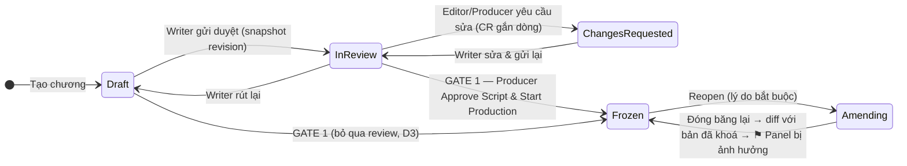

# 01 · KỊCH BẢN — SOẠN → DUYỆT → KHOÁ → SỬA MUỘN (`SCR`)

> **Spec:** Module 1 (soạn kịch bản, Gate 1), Module 4 (mở lại / sửa muộn), §1.2 (Trang → Panel → Nội dung), §5.2.
> **Thay cho:** `note/SCRIPT_FLOW_REFACTOR_PLAN.md` (ID `S0-01..S6-02`), plan tổng P4-01; liên quan P1-01/P1-02. Bỏ hẳn `SCRIPT_END_TO_END_REFACTOR_MASTER_PLAN.md`, `PAGE_BASED_SCRIPT_EDITOR_AND_DYNAMIC_ENTITY_LINKING_PLAN.md`.
> **Repo:** `PanelForge_FA26SE251` (chính), `panelforge-fe` (chính). Mobile không ảnh hưởng.
> **Phụ thuộc:** SCR-08 làm cùng [REL-01](06_RELEASE_PLAN.md) (ChapterStatus). Phần giao Page của Gate 1 ở [ASG-01](03_ASSIGNMENT_PLAN.md).

---

## 1. Hiện trạng đã có (không làm lại)

| Hạng mục | Bằng chứng |
|---|---|
| Writer soạn kịch bản, lưu theo Scene, revision append-only | `Features/ScriptLines/*` (`BatchSaveScriptLinesCommand`, `RestoreScriptRevisionCommand`), `ContentRevision` |
| `@Tên` → liên kết Bible / tạo Stub | `LinkBibleEntriesCommand`, `BibleEntry.CreateStub`, FE `@tiptap/extension-mention` |
| Đóng băng kịch bản + Bible Gate (chỉ `@Tag` phải CanonLocked) | `Chapters/Commands/FreezeScript/FreezeScriptCommands.cs`, `CheckChapterBibleGateQuery` |
| Mở lại: Writer yêu cầu → Producer duyệt/từ chối; Producer mở trực tiếp **bắt buộc lý do** + audit `UNFREEZE_SCRIPT` | `RequestScriptReopenCommand`, `ApproveScriptReopenCommand`, `UnfreezeChapterScriptCommand` (P0-03, commit `c8dc9c2`) |
| Sửa dòng đã gắn Panel → cờ ⚑ + bóng thoại `isStale` + Keep/Rework | `Assignment.FlagScriptImpact`, `GetPageSnapshotQueryHandler`, `ResolveImpactReviewCommand` |
| Lưu cấu trúc Page/Panel từ kịch bản trong một transaction | `SyncScriptStructureCommand` (commit `f95369e`) |

## 2. Vấn đề còn lại

| # | Vấn đề | Bằng chứng | Hậu quả |
|---|---|---|---|
| V1 | Không có trạng thái kịch bản (chỉ `IsScriptFrozen` + `ScriptReopenStatus`) | `Chapter.cs` | UI tự suy luận; không chặn sửa khi đang duyệt |
| V2 | Duyệt kịch bản đi nhờ pipeline Assignment, stage Script tự duyệt | `CreateSeriesCommand.cs:142` (`isApprovalGate: false`), `SubmitAssignmentCommand.cs:70` | Màn Editor duyệt kịch bản gần như vô dụng; trái spec ("Script ngoài Assignment") |
| V3 | Freeze không yêu cầu kịch bản đã duyệt / hết ChangeRequest | `FreezeScriptCommands.cs:43-73` | Khoá được kịch bản đang bị trả về |
| V4 | **Bug:** Unfreeze trực tiếp không chạy phân tích ảnh hưởng khi đóng băng lại | `FreezeScriptCommands.cs:76` chỉ chạy khi `ScriptReopenStatus == Approved` | Panel vẽ theo thoại cũ không bị ⚑ |
| V5 | Phân tích ảnh hưởng dựa trên timestamp | `FreezeScriptCommands.cs:80` | Sửa rồi hoàn tác vẫn bị tính; dòng xoá mềm không bị tính |
| V6 | Loại dòng không lưu trong DB; Trang/Panel/SFX mã hoá bằng chữ, FE đoán bằng regex | `scriptFlowAdapter.ts:561-680` | Dễ vỡ; BE không kiểm được BR-05 |
| V7 | Speaker nhúng trong chuỗi `Tên: "..."`, không có nhãn quần chúng | `composeSpeakerLine` (`scriptFlowAdapter.ts:336`) | Lettering phải tách chuỗi |
| V8 | Hai cơ chế khoá trùng: `Chapter.IsScriptFrozen` và `ChapterScript.IsLocked` | `ChapterScript.cs` | Nguồn sự thật mập mờ |
| V9 | Revision theo Scene, không có "bản đã khoá" cấp chương | `ContentRevision.SceneId` | Không so được bản khoá với bản sửa |
| V10 | Lưu nhiều request rời theo Scene | `ScriptEditorView.tsx` (~25 lời gọi service) | Lưu dở dang khi lỗi giữa chừng |
| V11 | Code FE chết | `comic-editor/ComicScriptEditor` + `versioning/*`, `script/storyboard/*`, `machines/chapterScriptMachine.ts` | Agent dễ sửa nhầm |
| V12 | `ScriptEditorView.tsx` > 3.200 dòng | — | Khó sửa an toàn |

## 3. Thiết kế đích

### 3.1 Máy trạng thái kịch bản (tách khỏi `ChapterStatus`)



| Trạng thái | Writer sửa? | Ghi chú |
|---|---|---|
| `Draft` | ✅ | Auto-save |
| `InReview` | ❌ | Bản đang duyệt bất biến; CR gắn `ScriptLineId` |
| `ChangesRequested` | ✅ | Writer xử lý CR rồi gửi lại |
| `Frozen` | ❌ | Mọi vai trò chỉ đọc; Artist bắt đầu vẽ |
| `Amending` | ✅ (chỉ Writer) | Sản xuất hình vẫn chạy |

`Chapter.Status = PreProduction` khi kịch bản lần đầu ở `Draft/InReview/ChangesRequested`; Gate 1 chuyển `PreProduction → InProduction` cùng lúc `→ Frozen`. `Amending` không đưa chương về `PreProduction`.

### 3.2 Cấu trúc dữ liệu

```
Chapter
 ├─ Page ─ Panel (+ Direction: ghi chú góc máy, MỚI)
 │          └─ ScriptLine (PanelId = neo chính)
 │               • Kind: Action | Dialogue | Thought | Narration | Sfx   (MỚI)
 │               • Text (gộp DialogueText/StageDirection)
 │               • SpeakerCharacterId? (@Tag)  • SpeakerLabel? ("Lính gác 1", MỚI)
 └─ Scene (giữ, 1 Scene mặc định ẩn mỗi chương — D2)
```

`Kind` → loại bóng (BR-05): Dialogue→SPEECH, Thought→THOUGHT, Narration→NARRATION_BOX, Sfx→SOUND_EFFECT, Action→không bóng.

### 3.3 Phiên bản & khoá

- Revision cấp chương: `ContentRevision` với `Kind = ChapterScript`, `SceneId` = scene ẩn; payload cả cây Page→Panel→Line; bỏ qua nếu hash không đổi.
- `Chapter.FrozenScriptRevisionId` + `ScriptContentHash` trỏ đúng bản đã khoá.
- `ScriptReopen` append-only (Id, ChapterId, Reason, RequestedById/At, DecidedById/At, Decision, BaselineRevisionId) thay 4 cột `ScriptReopen*`.
- Đóng băng lại: diff baseline ↔ hiện tại theo `ScriptLineId` → `FlagImpactedWorkAsync` (sửa V4, V5).
- Bỏ `ChapterScript.IsLocked/Lock/Unlock` (V8).

### 3.4 API đích (`/api/chapters/{chapterId}/script`)

| Method | Route | Vai trò | Use case |
|---|---|---|---|
| GET | `/script` | Thành viên | Cây kịch bản + `scriptStatus`, `revisionId`, `frozenRevisionId`, CR mở |
| PUT | `/script` | Writer (Producer nếu chưa có Writer) | Lưu cả cây trong 1 transaction, `expectedRevisionId` (BR-11) |
| POST | `/script/submit` · `/withdraw` | Writer | Draft/ChangesRequested ↔ InReview |
| POST | `/script/request-changes` | Editor, Producer | InReview → ChangesRequested |
| POST | `/script/approve` | Producer | Gate 1 → Frozen (+ giao Page, ASG-01) |
| POST | `/script/reopen-requests`, `/{id}/decision`, `/reopen`, `/refreeze` | Writer / Producer | Mở lại & đóng băng lại |
| GET | `/script/revisions`, `/{id}`, `/diff?from&to` | Thành viên | Lịch sử & so sánh |

Endpoint cũ (`freeze-script`, `unfreeze-script`, `*-script-reopen`, `scenes/*`, `script-lines/*`, `pages/sync-script-structure`) chạy song song, `[Obsolete]`, gỡ ở SCR-23.

### 3.5 Quyết định

| ID | Câu hỏi | Khuyến nghị / Kết quả |
|---|---|---|
| D1 ✅ | Bỏ stage "Script" khỏi pipeline? | **Bỏ.** Duyệt bằng `ScriptStatus` trên Chương; người viết chính = `Chapter.WriterUserId?` |
| D2 ✅ | Scene nullable hay Scene ẩn? | **Đã chốt 2026-11-12: Scene mặc định ẩn**, `scene_id` giữ NOT NULL (`SceneId` dùng ở ~140 file, cả AI workflow) |
| D3 ✅ | Gate 1 bắt buộc qua `InReview`? | **Không**, nhưng chặn khi còn CR kịch bản mở |
| D4 ✅ | Writer sửa khi `InReview`? | **Không** (phải Withdraw về Draft) |
| D5 ✅ | Giữ `ChapterScript` (RawText)? | **Bỏ** entity và bảng (backend chỉ ghi `RawText` trong `BatchSaveScriptLinesCommand`, không chỗ nào đọc) |
| D6 ✅ | Dữ liệu cũ (tiêu đề Trang/Panel dạng chữ, speaker nhúng trong thoại) | **Không chuyển đổi.** Bám luồng mới; dữ liệu demo/seed định dạng mới nạp sau. Không giữ code đọc định dạng cũ; migration chỉ cần đúng schema |
| D7 ✅ | Suy nghĩ (Thought) chọn thế nào khi gõ? | **Đã chốt 2026-11-13:** hậu tố `(nghĩ)` ở ô người nói đổi `kind` → `Thought`; thêm `Ctrl+3`. Không tạo ô nhập riêng |
| D8 ✅ | Giữ cú pháp gõ tắt `@Tên: "..."`, `SFX:`, `Caption:`, ký tự mồi `#`/`-` + Tab? | **Đã chốt 2026-11-13: bỏ** trong editor (thay bằng H.1 + phím tắt + menu `/`); cú pháp chữ chỉ còn ở luồng dán/chuyển đổi `AiScriptConvertModal` |
| D9 ✅ | Ngưỡng cảnh báo mật độ | **Đã chốt 2026-11-13 (Warning, không chặn):** > 7 panel/trang · > 3 bóng thoại/panel · > 25 chữ/bóng thoại · panel không có Action |
| D10 ✅ | Kéo thả sắp xếp Page/Panel trong Board view khi nào? | **Đã chốt 2026-11-13:** chỉ khi `Draft`/`ChangesRequested`/`Amending`; Panel đã có artwork thì hỏi xác nhận và gắn ⚑ như sửa muộn |
| D12 ✅ | Luồng nộp kịch bản Writer → Editor → Start Production | **User chốt 2026-11-13:** `ScriptStatus` chỉ còn `Draft ↔ InReview → Frozen` (Producer `Unfreeze` có lý do: `Frozen → Draft`). Bỏ `ChangesRequested` và `Amending`. `InReview` khoá sửa; **chỉ Writer** được `Recall` về `Draft` — Editor/Producer không đẩy kịch bản về Draft. Editor **chỉ góp ý theo dòng**, không đổi trạng thái, **không bắt buộc** trước Gate 1. Producer bấm **Start Production** khi `InReview` → `Frozen` + `ChapterStatus PreProduction → InProduction` (`PreProduction` là mặc định khi tạo chương). Bỏ duyệt kịch bản qua Assignment, bỏ Bible Gate `@Tag` lúc freeze (D11), bỏ tự dựng trang lúc freeze, hash theo `Kind/Text/SpeakerLabel` + Trang/Panel. Writer nào trong studio cũng soạn/nộp được (chưa cần `WriterUserId`); giao trang (ASG-01) làm sau. Thay thế §3.1 và D3/D4 ở các điểm khác nhau |
| D11 ✅ | Editor kịch bản theo bảng H.1 riêng hay bám WriterSolo? Có liên kết Series Bible trong kịch bản? | **User chốt 2026-11-13:** editor gõ **giống WriterSolo** (luật đo trực tiếp, thay bảng H.1), kịch bản là **chữ thuần, không liên kết Series Bible** (bỏ `@mention`, ô chọn người nói từ Bible, `speakerCharacterId` luôn null), xây lại không tương thích dữ liệu cũ. D7 giữ dưới dạng Parens `(nghĩ)`. ⚠️ Lệch đặc tả master Module 1 (`@Bible` trong ACTION_DIRECTION, stub `@Tên_Mới`, Bible Gate chỉ xét `@Tag`) — chưa sửa đặc tả |

---

## 4. Task

### Phase A — Sửa lỗi & dọn dẹp, không đổi hợp đồng (làm ngay)

#### SCR-01 · Unfreeze trực tiếp phải kích hoạt phân tích ảnh hưởng (V4) — BE · ❌ · cũ S0-01
- [ ] `Chapter.UnfreezeScript(userId, reason)`: đặt `ScriptReopenStatus = Approved`, `ScriptReopenRequestedAt = now`, `ScriptReopenReason = reason`.
- [ ] `UnfreezeChapterScriptCommandHandler` truyền lý do vào domain (lý do đã bắt buộc từ P0-03).
- [ ] Test: Unfreeze → sửa dòng đã neo Panel có Assignment Approved → Freeze → `HasScriptImpact = true`.
- [ ] **(Rà soát 2026-11-13, xác nhận lỗi)** `FreezeChapterScriptCommandHandler` chỉ gọi `FlagImpactedWorkAsync` khi `ScriptReopenStatus == Approved` (`FreezeScriptCommands.cs:69`), mà `UnfreezeScript` (đường chính V2.6) không đặt cờ này → sửa kịch bản sau khi Producer mở lại rồi chốt lại **không gắn ⚑ Panel nào**, `IMPACT_FLAGS` ở Gate 3 luôn 0.
- [ ] Dò ảnh hưởng bằng diff theo `ScriptLineId` giữa `ScriptVersion` của lần chốt trước (`ScriptContentHash` / bản Frozen) và bản chốt lại, thay cho lọc `ScriptLine.UpdatedAt >= since` hiện tại (bỏ sót dòng bị xoá và dòng thêm mới vào Panel đã vẽ). Cần lưu id phiên bản đã chốt (`FrozenScriptRevisionId`, SCR-08).
- **DoD:** cả hai đường mở lại đều gắn ⚑ khi đóng băng lại, kể cả khi dòng bị xoá/thêm.

#### SCR-02 · Freeze chặn khi còn ChangeRequest kịch bản mở (V3) — BE · ❌ · cũ S0-02
- [ ] Đếm `ChangeRequests` của chương có `ScriptLineId != null` và `Status ∈ {Open, Resolved}` → 409 kèm số lượng.
- [ ] Test 409.

#### SCR-03 · Xoá code FE chết (V11) — FE · ❌ · cũ S0-03
- [ ] Grep xác nhận không còn import rồi xoá: `roles/writer/components/script/flow/comic-editor/{ComicScriptEditor.tsx, sampleScript.ts, versioning/, nodes/, extensions/, index.ts}` (**giữ** `comicCounting.ts`), `roles/writer/components/script/storyboard/`, `roles/writer/machines/chapterScriptMachine.ts` + file `.test.*` tương ứng.
- [ ] `thumbnail-studio/` chỉ giữ phần `ScriptEditorView` dùng.
- [ ] (Rà soát 2026-11-13) `chapterScriptMachine.ts` xác nhận không còn import ở đâu, vẫn giữ luật cũ `canFreeze = isBibleGatePassed` → xoá để không ai dựa vào.
- [ ] `typecheck`, `i18n:check` (gỡ key không còn dùng).

### Phase B — Mô hình dữ liệu (V6, V7, D2, D6)

#### SCR-04 · `ScriptLineKind`, `Text`, `SpeakerLabel` — DB + BE · ✅ · cũ S1-01
- [x] Enum `ScriptLineKind`: `Action = 1, Dialogue = 2, Thought = 3, Narration = 4, Sfx = 5`.
- [x] `ScriptLine`: thêm `Kind` (bắt buộc, không suy từ dữ liệu cũ — D6), `SpeakerLabel` (≤100), `Text`. `DialogueText/StageDirection` chỉ giữ để code cũ biên dịch tới khi chuyển xong, xoá ở SCR-23.
- [x] Luật domain: `Action` không có speaker; `Dialogue/Thought` cho phép `SpeakerCharacterId`, `SpeakerLabel` hoặc trống (đám đông).
- [x] Migration `AddScriptLineKindAndPanelDirection`, `db/check_db_sync.ps1`; DTO thêm `kind`, `speakerLabel`.

#### SCR-05 · Scene mặc định ẩn mỗi chương (D2) — BE · ✅ · cũ S1-02
- [x] `Scene.CreateDefault(chapterId)`; `CreateChapterCommand` tạo kèm.
- [x] `EnsureDefaultAsync(db, chapterId)` để mọi command kịch bản lấy Scene mặc định (không nhận SceneId từ client).
- [x] UI không hiển thị Scene; không hỗ trợ chương nhiều Scene (D6).

#### ~~SCR-06 · Backfill dữ liệu cũ~~ — ⛔ Huỷ theo D6 · cũ S1-03
- Không chuyển đổi dữ liệu cũ. Dữ liệu demo/seed định dạng mới nạp bằng task riêng (xem cuối Phase G).

<!-- Nội dung cũ giữ để tra cứu, không làm:
- [ ] `BackfillScriptStructureCommand(ChapterId?)`, idempotent: dòng `^(TRANG|PAGE)\s*\d+` → đảm bảo `Page`, xoá mềm dòng; `^PANEL\s*\d+\.\d+` → đảm bảo `Panel`, phần sau `:` vào `Panel.Direction`; dòng còn lại suy `Kind`, tách `Tên: "..."`; neo `PanelId` theo thứ tự.
- [ ] Ghi một `ContentRevision` "Backfill V2.6", không sửa revision cũ; log dòng không nhận diện được.
-->

#### SCR-07 · `Panel.Direction` — DB + BE · ✅ · cũ S1-04
- [x] Cột nullable ≤1000 ký tự, `PanelDto.direction`.
- [x] `PUT /api/panels/{panelId}/direction` (UpdatePanelDirectionCommand).

### Phase C — Vòng đời kịch bản (V1, V2, V3, D1, D3, D4)

> **D12 (2026-11-13) đã làm phần cốt lõi của Phase C** — BE `d136057`, `9059e5a`; FE `e98d8ad`:
> `ScriptStatus` Draft ↔ InReview → Frozen, `ChapterStatus.PreProduction` mặc định, `submit-script` / `recall-script` (chỉ Writer),
> `freeze-script` = Bắt đầu sản xuất (cần InReview, chương → InProduction), Unfreeze → Draft, khoá sửa khi InReview/Frozen,
> bỏ Bible Gate `@Tag` + tự dựng trang lúc freeze, hash theo Trang/Panel/Kind/Text. Góp ý theo dòng: SCR-37.
> Các mục bên dưới ghi theo thiết kế cũ; phần trái D12 (`ChangesRequested`, `Amending`, `RequestScriptChanges`) bỏ.
> ✅ Test BE đã cập nhật (SCR-38, `aeebf65`): 1206/1206 pass.

#### SCR-08 · `ScriptStatus` + domain methods — BE · 🟡 (theo D12, thiếu `FrozenScriptRevisionId`, `WriterUserId`) · cũ S2-01 · **làm cùng REL-01**
- [ ] Enum `ScriptStatus`: `Draft = 1, InReview = 2, ChangesRequested = 3, Frozen = 4, Amending = 5`.
- [ ] `Chapter`: `ScriptStatus`, `ScriptSubmittedRevisionId?`, `FrozenScriptRevisionId?`, `WriterUserId?`; methods `SubmitScript`, `WithdrawScript`, `RequestScriptChanges`, `ApproveScript`, `ReopenScript`, `RefreezeScript` (sai trạng thái → `InvalidOperationException` → 409).
- [ ] `IsScriptFrozen` thành thuộc tính tính toán; migration chỉ thêm cột mặc định `Draft` (D6: không map trạng thái dữ liệu cũ).
- [ ] Unit test mọi chuyển trạng thái.

#### SCR-09 · `ScriptReopen` append-only — DB + BE · ❌ · cũ S2-02
- [ ] Entity + bảng `script_reopens`. Không chuyển dữ liệu 4 cột `ScriptReopen*` (D6); xoá cột cũ ở SCR-23.
- [ ] **Câu hỏi 25 đã chốt (2026-11-13): bỏ luồng Writer xin mở lại.** Chỉ Producer *Mở lại* kèm lý do (`Frozen → Draft`). Gỡ `RequestScriptReopen`/`ApproveScriptReopen`/`RejectScriptReopen` (domain, handler, 3 endpoint `request|approve|reject-script-reopen`, `chapter.service.ts` FE, enum `ScriptReopenStatus`); `script_reopens` chỉ ghi lịch sử các lần Producer mở lại (người, lúc, lý do, bản Frozen trước đó). Writer muốn sửa thì nhắn Producer ngoài hệ thống hoặc qua góp ý.

#### SCR-10 · Commands vòng đời (`Features/Scripts/Commands/*`) — BE · ❌ · cũ S2-03
- [ ] `SubmitScriptCommand` (chụp revision, thông báo Editor + Producer), `WithdrawScriptCommand`.
- [ ] `RequestScriptChangesCommand` (≥1 CR mở hoặc comment; BR-06: người yêu cầu ≠ Writer).
- [ ] `ApproveScriptCommand` = **Gate 1 phần kịch bản**: Bible Gate, ≥1 Page & ≥1 dòng, 0 CR kịch bản mở → `Frozen` + hash; gọi logic giao Page của ASG-01 nếu đã có.
- [ ] `RequestScriptReopenCommand`, `DecideScriptReopenCommand`, `ReopenScriptCommand` → `Amending`, baseline = bản khoá.
- [ ] `RefreezeScriptCommand`: diff theo `ScriptLineId` → `FlagImpactedWorkAsync` → `Frozen`; xác minh có Notification cho Artist/Letterer bị ảnh hưởng (plan tổng M4-04 🔍).
- [ ] Mỗi command có test (thành công + 403 + 409).

#### SCR-11 · Luật quyền sửa kịch bản — BE · ❌ · cũ S2-04
- [ ] Viết lại `ScriptLineRules.AuthorizeAsync` theo `ScriptStatus` + `Chapter.WriterUserId`.
- [ ] Producer chỉ sửa khi chưa có Writer (BR-07/23); xác minh 403 khi Producer sửa thoại (plan tổng M1-04 🔍).
- [ ] Test ma trận vai trò × trạng thái.
- [ ] **(Rà soát 2026-11-13, xác nhận lệch BR-07)** BE `ScriptLineRules.AuthorizeAsync` ghi "Producer luôn được" → Producer sửa/xoá dòng kịch bản bất kỳ lúc nào; spec BR-07 và §5.1 yêu cầu Producer chỉ đọc (403). **Câu hỏi 24 đã chốt (2026-11-13): theo spec, Producer chỉ đọc** → mọi lệnh sửa/xoá/sắp xếp dòng, Page, Panel của kịch bản trả 403 với Producer; Producer vẫn được góp ý, Bắt đầu sản xuất, Mở lại. Bỏ dòng "Producer chỉ sửa khi chưa có Writer" ở trên và ghi chú "Producer sửa được" ở SCR-12 / comment `ScriptEditorView.tsx:272`.
- [ ] [BE] Vai trò khác Writer/Producer đang đi qua `AiWorkflowFacts.EvaluateAssignmentAsync` (có việc là sửa được) → Artist/Letterer/Editor phải luôn 403 với lệnh sửa dòng kịch bản (spec §5.1: chỉ đọc / Editor chỉ góp ý).
- [ ] [FE] `ScriptEditorView.tsx:274` `canEditScript = !effectiveRole || PRODUCER || WRITER`: khi chưa xác định được vai trò lại **mở quyền sửa** (fail-open) → đổi thành chỉ đúng vai trò được phép; đồng bộ với quyết định câu hỏi 24.

#### SCR-12 · Gỡ stage Script khỏi pipeline (D1) — BE + DB · 🟡 · cũ S2-05
- [x] `CreateSeriesCommand` / `MasterDataSeeder`: bỏ stage `script` cho Series mới (BE `5e55c97`). Template đã seed trong DB cũ giữ nguyên (D6).
- [x] `GetEditorReviewQueueQuery` bỏ Assignment stage `script` và slug `script` khỏi Gate 1. FE gỡ ngăn yêu cầu sửa theo Assignment và chặn "Writer được giao" ở `ScriptEditorView` (FE `eda8d4f`).
- [ ] ~~`Chapter.WriterUserId`~~ — không cần: studio chỉ có một Writer (user chốt khi bỏ mục 4).
- [ ] Rà `SubmitAssignmentCommand`, `StageProgressRules` bỏ nhánh script; `PipelineDefinition.CreateDefaultMangaPipeline` (đã `[Obsolete]`) còn stage Script.

### Phase D — Lưu cả tài liệu & lịch sử cấp chương (V9, V10)

#### SCR-13 · `GetChapterScriptQuery` — BE · ❌ · cũ S3-01
- [ ] Trả `pages[].panels[].lines[]`, `scriptStatus`, `revisionId`, `frozenRevisionId`, `openChangeRequests[]`.

#### SCR-14 · `SaveChapterScriptCommand` (PUT cả cây) — BE · ❌ · cũ S3-02
- [ ] Một transaction: upsert Page/Panel (không xoá Page/Panel có artwork, trả cảnh báo), upsert/xoá mềm dòng theo Id client, tham chiếu bôi đen `refs[]` của dòng (Q19/2A), `Panel.Direction`; cuối transaction chạy `RecomputeChapterCastAsync` + chụp `ScriptVersion` như `CommitScriptVersion` hiện tại ([BIB-12](02_BIBLE_PLAN.md)). Đây là phương án **3B** — gộp 4 request lưu của FE thành một; trước khi có, BIB-12 tính lại ở `CommitScriptVersion` (3A).
- [ ] `expectedRevisionId` lệch → 409; hash không đổi → không tạo revision.
- [ ] Tái dùng `ScriptLineRules.ValidateContent`, xử lý `refs` của BIB-12 (thay `ValidateSpeakerAsync/ValidateBibleEntriesAsync/SetBibleLinksAsync` — gỡ ở BIB-17), khớp người nói theo `speaker_label` (`SpeakerResolver`), `ReworkApprovedLetteringAsync`, logic tạo Page/Panel của `SyncScriptStructureCommand`.
- [ ] Test: lưu 2 lần cùng nội dung → 1 revision; xung đột → 409; Amending sửa dòng có bóng → Lettering Approved → ReworkRequired.

#### SCR-15 · Lịch sử & so sánh — BE · ❌ · cũ S3-03
- [ ] **Nguồn duy nhất là `ScriptVersion` (Q25)** — đã có `GetScriptVersions/GetScriptVersion/GetScriptWorkingCopy`; thêm `DiffScriptVersionsQuery` (theo khoá dòng, kèm thay đổi tham chiếu và bản Bible của Q24).
- [ ] `RestoreScriptVersionCommand(chapterId, versionId)` — chỉ Writer, kịch bản chưa `Frozen`: dựng lại dòng, Trang/Panel, tham chiếu bôi đen, lựa chọn bản Bible từ snapshot của bản cũ rồi **commit bản mới n+1** (BR-08, không sửa bản cũ), chạy `ChapterCastService.RecomputeAsync`. Không khôi phục từ bản loại `AiProposal`.

#### SCR-16 · Bỏ `ChapterScript` (D5) — BE + DB · ❌ · cũ S3-04
- [ ] Xác minh chỉ `BatchSaveScriptLinesCommand:172` còn ghi; bỏ ghi, xoá entity + migration.

### Phase E — API

#### SCR-17 · `ScriptsController` — BE · ❌ · cũ S4-01
- [ ] Route bảng 3.4, `[RequireWorkspaceRole]` theo spec §5.1, đủ 400/403/404/409.
- [ ] `[Obsolete]` endpoint cũ, chuyển sang command mới nếu cùng nghĩa.
- [ ] Bàn giao hợp đồng (AGENTS.md §3.7): ví dụ JSON cho FE.

### Phase F — Frontend

#### SCR-18 · Service & types — FE · ✅ · cũ S5-01
- [x] `types/pipeline.ts`, `services/scriptLine.service.ts`, `services/panel.service.ts`: types `ScriptLineKind`, `ScriptLineDto`, `PanelDto.direction`, `UpdatePanelDirectionRequest` khớp DTO BE.

#### SCR-19 · Adapter tường minh — FE · ✅ · cũ S5-02
- [x] `scriptFlowAdapter.ts`: `scenesToTipTapDoc` / `extractScriptLinesFromDoc` theo schema `kind`, `speakerLabel`, `text`, `direction`.
- [x] Test round-trip pass 18/18 tests.

#### SCR-20 · Tách `ScriptEditorView` — FE · ❌ · cũ S5-03 + UI GĐ7
- [ ] `hooks/useScriptDocument.ts` (tải, debounce PUT, xử lý 409: hiện so sánh/tải lại — tham khảo ý tưởng "conflict merge" Lucian #149), `hooks/useScriptLifecycle.ts` (`availableActions` theo trạng thái + vai trò), `components/script/ScriptStatusBar.tsx` (dùng `ReasonForm` cho reopen).
- [ ] `ScriptEditorView.tsx` chỉ còn bố cục, < 800 dòng (mục tiêu chung UIQ: < 600).
- [ ] Bố cục 3 cột: bối cảnh (Story Arc, Outline) / soạn thảo / ngăn Consistency (Blocking, Warning) — bấm finding cuộn tới dòng và viền cam (từ `UI_REFACTOR_CHECKLIST` B1).
- [ ] Rà copy `AiScriptConvertModal` (29 chỗ chữ nhỏ) theo UIQ.
- [ ] Mọi chuỗi mới vào `locales/{vi,en}`; tuân `DESIGN_RULES.md`.

#### SCR-21 · Màn Editor duyệt kịch bản — FE · ❌ · cũ S5-04
- [ ] `ScriptReviewView.tsx` đọc `GET /script`, CR gắn dòng, nút "Yêu cầu sửa" → `request-changes`; Producer thấy nút Gate 1. Bỏ `openReview/approveAssignment` cho kịch bản.
- [ ] Hàng đợi Editor dùng `GetScriptReviewQueueQuery`.

#### SCR-22 · Diff & lịch sử — FE · ❌ · cũ S5-05
- [ ] `ScriptHistoryModal.tsx` dùng `/script/revisions` + `/script/diff`; hiển thị "khác bản đã khoá" khi `Amending`.

### Phase G — Gỡ phần cũ & tài liệu

#### SCR-23 · Gỡ endpoint/cột cũ — BE + FE + DB · ❌ · cũ S6-01
- [ ] Khi FE không còn gọi: xoá endpoint/command cũ (`FreezeChapterScriptCommand`, `UnfreezeChapterScriptCommand`, `*ScriptReopenCommand`, `BatchSaveScriptLinesCommand`, `SyncScriptStructureCommand`), cột `ScriptReopen*`, `DialogueText/StageDirection`; `ContentRevision` loại `Script` và `ScriptLineRules.RecordRevisionAsync` (Q25 — giữ bảng cho Layout/ImagePrompt); `Submission.ScriptRevisionIds` giữ cột để đọc dữ liệu cũ, không ghi mới.

#### SCR-24 · Tài liệu — Docs · ❌ · cũ S6-02
- [ ] Viết lại `PanelForge_FA26SE251/docs/domain/CHAPTER_AND_SCRIPT_SPECIFICATION.md` §2.1–2.3; cập nhật `.agents/CODEBASE_MAP.md` dòng "Script & Lời thoại".

> **Ngoài phạm vi (D6):** dữ liệu demo/seed định dạng mới (Page/Panel thật, `Kind`, `SpeakerLabel`, `ScriptStatus`) nạp sau bằng task riêng. Dữ liệu kịch bản cũ trong DB dev có thể hiển thị sai — chấp nhận được.

### Phase H — Trải nghiệm gõ kịch bản Graphic Novel (UI/UX + logic soạn thảo)

> **Nguồn:** walkthrough template Graphic Novel của WriterSolo (2026-11-13) đối chiếu với editor hiện tại `ScreenplayFlowEditor.tsx` (1.390 dòng) + `nodes/ScriptLineBlockNode.ts` (821 dòng).
> **Nguyên tắc:** học luồng gõ bằng bàn phím của WriterSolo, tránh các lỗi đã thấy ở đó, không chép giao diện. Phase H chỉ làm **sau SCR-04, SCR-07, SCR-19** (cần `Kind`, `Panel.Direction`, adapter tường minh); SCR-25 (luật gõ dạng hàm thuần) làm trước được trên mock.

#### H.0 Đối chiếu

| Hạng mục | WriterSolo (quan sát) | PanelForge hiện tại | Hướng đích |
|---|---|---|---|
| Chuyển loại dòng | Page→Enter→Panel→Enter→Action; Action→Enter→Action; **Tab**→Character→Enter→Dialogue | Enter trên dòng nội dung luôn ra Action; Tab xoay vòng Action→Dialogue→Caption→SFX; Page/Panel tạo bằng `#`/`!`/`-`/`"` + Tab (khó nhớ) | Bảng chuyển trạng thái tường minh (H.1), không phụ thuộc ký tự mồi |
| Thoại | Tên và thoại **cùng dòng**, 2 cột | Đã có lưới 2 cột (`script-line grid`), nhưng speaker chỉ gán được bằng regex `@Tên: "..."` lúc Enter (`ScriptLineBlockNode.ts:730`) | ~~Ô người nói riêng, gợi ý từ Bible~~ → dòng Character gõ tay (D11, SCR-27 huỷ); gợi ý tên/bí danh Bible khi gõ ở BIB-16 |
| Đánh số | PAGE n / PANEL n tự đánh số, header tự đếm `PANELS: n` | Tự đánh số `1.1, 1.2` nhưng số nằm **trong text** (`" Panel 1.2: [Toàn cảnh]`) | Số là nhãn không sửa được; text của dòng Panel là `Panel.Direction` |
| Tiêu đề panel | Lỗi dính chữ `PANEL 1WIDE SHOT…` | Nhãn và mô tả lẫn trong một chuỗi | Nhãn và mô tả là 2 vùng tách biệt |
| Toolbar loại dòng | Bấm nút làm **mất focus** editor, không có tooltip phím tắt | Palette nổi + dock dưới | Nút giữ focus (`onMouseDown` preventDefault), tooltip ghi phím tắt |
| Caption / SFX | Nhãn `CAPTION:` / `SFX:` tự sinh | Nhãn `Dẫn truyện` / `SFX` tự sinh; SFX bị bọc `* … *` vào text | Nhãn tự sinh, text sạch (không chèn ký tự trang trí vào dữ liệu) |
| Thống kê | Có, nhưng tính `CAPTION`, `SFX:KRAKOOM` là "nhân vật nói" | Chưa có thống kê kịch bản | Thống kê theo `Kind` + cảnh báo mật độ chữ cho truyện tranh (H.4) |
| Chế độ xem | Page / Cards / Mind Map, Filter theo loại dòng | Dải trang thu nhỏ ở dock; `storyboard/`, `thumbnail-studio/` dùng một phần | Kịch bản + Bảng trang (thẻ Page→Panel, kéo sắp xếp) + Lọc |
| Xuất | PDF, DOCX, Fountain, Final Draft, CSV… | Chưa có xuất kịch bản | PDF/DOCX kịch bản + CSV lời thoại cho Letterer |
| Lưu | Lưu file thủ công, cảnh báo đỏ | Auto-save debounce + bản nháp `localStorage` | Giữ; thêm trạng thái lưu rõ ràng + xử lý 409 (SCR-20) |
| Bỏ qua | ReadAloud, Gender/Bechdel, Ruler, 17 template screenplay | — | Không làm (không phục vụ sản xuất truyện tranh) |

#### H.1 Luật gõ đích

| Đang ở | Enter | Tab | Shift+Tab | Enter trên dòng trống |
|---|---|---|---|---|
| Page | Panel mới (số kế tiếp) | — | — | — |
| Panel (ô mô tả) | Action | — | — | Action |
| Action | Action | Ô người nói (Dialogue) | — | Panel mới |
| Ô người nói | Ô thoại cùng dòng | Ô thoại | Đổi về Action | Đổi về Action |
| Dialogue / Thought | Ô người nói mới (gợi ý người nói trước đó luân phiên) | Narration | Ô người nói | Action |
| Narration | Narration | SFX | Dialogue | Action |
| SFX | SFX | Action | Narration | Action |

Phím tắt: `Ctrl+Enter` Panel mới · `Ctrl+Shift+Enter` Trang mới · `Ctrl+1..5` Action/Dialogue/Thought/Narration/SFX · `/` mở menu loại dòng ở đầu dòng trống · `Alt+↑/↓` di chuyển dòng/panel. Không còn `@` gợi ý Bible (D11/Q16): Writer bôi đen đoạn chữ trên dòng Action/Caption/SFX để gắn tham chiếu Bible ([BIB-16](02_BIBLE_PLAN.md)); ô người nói gợi ý tên/bí danh Bible khi gõ. Dán văn bản tự do vẫn đi qua `AiScriptConvertModal`.

#### SCR-25 · Luật gõ dạng hàm thuần (`scriptGrammar.ts`) — FE · ✅ (làm lại theo D11)
- [x] [FE] `flow/grammar/scriptGrammar.ts`: `onEnter`, `onTab`, `onShiftTab`, `completeCharacterName`, `isThoughtParens` — luật đo trên WriterSolo 2026-11-13 (Enter: Page→Panel→Action→Action, Character/Parens→Dialogue, Dialogue/Caption/SFX→Action; Tab dòng trống đổi loại, dòng có chữ chèn Character/Parens bên dưới). Bỏ Transition/Scene heading khỏi vòng Tab.
- [x] [FE] Test luật (`scriptGrammar.test.ts`, viết, chưa chạy).

#### SCR-26 · Editor gõ kiểu WriterSolo — FE · ✅ (làm lại theo D11, FE `30b975a`)
- [x] [FE] `nodes/ScriptLineBlockNode.ts`: một node `scriptLine` với `el` ∈ page · panel · action · character · parens · dialogue · caption · sfx; nhãn `TRANG n - PANEL: k`, `PANEL n`, `DẪN TRUYỆN:`, `SFX:` là decoration (chữ lưu luôn sạch); Ctrl+1..8 đổi loại dòng; gợi ý tên nhân vật dạng chữ mờ `(Enter)` lấy từ tên đã dùng.
- [x] [FE] `ScreenplayFlowEditor.tsx` viết lại: thanh loại dòng giữ focus + tooltip phím tắt, Ctrl+S lưu, cảnh báo rời trang khi chưa lưu. Gỡ `@mention`, `SpeakerPickerPopover`, AI convert, regex đoán loại dòng.
- [x] [FE] `scriptFlowAdapter.ts` viết lại: `scriptToDoc` / `docToScript`. Character + Parens + Dialogue → một dòng `Dialogue` (`SpeakerLabel` = `TÊN` hoặc `TÊN (PARENS)`), Parens `nghĩ` → `Thought`; chữ dòng Panel → `Panel.Direction`.
- [x] [FE] `ScriptEditorView.handleSaveScript`: một batch vào Scene mặc định → `syncScriptStructure` → `updatePanelDirection`.
- [x] [FE] Test keymap + adapter (viết, chưa chạy). Chưa thử trong app.

#### SCR-27 · Ô người nói — FE · ⛔ Huỷ theo D11
- Thay bằng dòng Character gõ tay + gợi ý tên kiểu WriterSolo (SCR-26). Code ô chọn người nói từ Bible đã gỡ.

#### SCR-28 · Tiêu đề Trang/Panel: nhãn tự sinh + mô tả riêng — FE · ❌
- [ ] [FE] `PanelHeading` hiển thị nhãn `PANEL 2.3` không sửa được + vùng nhập `Panel.Direction` (góc máy/khung hình, placeholder "Toàn cảnh, góc thấp…"). Không còn text `" Panel 1.2: [Toàn cảnh]`.
- [ ] [FE] `PageHeading`: `TRANG 3 · 4 panel · 62 chữ thoại`; cảnh báo khi vượt ngưỡng D9 (vd > 7 panel/trang).
- [ ] [FE] Đánh số lại khi chèn/xoá/di chuyển (giữ `renumberEditorState`, chuyển sang đọc attr thay vì parse chuỗi).
- **Phụ thuộc:** SCR-07, SCR-26.

#### SCR-29 · Thanh loại dòng giữ focus + gợi ý phím tắt — FE · ❌
- [ ] [FE] Hợp nhất palette nổi và dock dưới thành một thanh loại dòng: Trang · Panel · Hành động · Thoại · Suy nghĩ · Dẫn truyện · SFX. Nút hiện trạng thái loại dòng đang đứng, `onMouseDown={e => e.preventDefault()}` để không mất focus, `title`/tooltip ghi phím tắt.
- [ ] [FE] Menu `/` ở đầu dòng trống (cùng danh sách, lọc theo gõ).
- [ ] [FE] Theo `DESIGN_RULES.md` + checklist UIQ §5; chuỗi vào `locales/{vi,en}`.
- **Phụ thuộc:** SCR-26.

#### SCR-30 · Bảng trang (Board view) — FE · ❌
- [ ] [FE] Chế độ xem thứ hai cạnh "Kịch bản": mỗi Page là một cột thẻ Panel (Direction, số dòng thoại, người nói, thumbnail nếu có — tái dùng `thumbnail-studio/ThumbnailCard`). Kéo thả đổi thứ tự Panel trong/giữa trang, Page giữa các trang (LexoRank) — chỉ khi `Draft`/`ChangesRequested`/`Amending` (D10).
- [ ] [FE] Bấm thẻ → cuộn editor tới Panel. Thay dải trang ở dock bằng mục lục trang có số panel (giữ ý tưởng hiện có).
- [ ] [FE] Gỡ phần `storyboard/` không còn dùng sau khi Board view thay thế (gộp với SCR-03).
- **Phụ thuộc:** SCR-28, SCR-14 (lưu cả cây).

#### SCR-31 · Lọc & tìm — FE · ❌
- [ ] [FE] Lọc theo `kind` (chỉ thoại / chỉ SFX / chỉ dẫn truyện) và theo nhân vật (dòng của @Tên); dòng bị lọc thu gọn, không xoá.
- [ ] [FE] Tìm & thay thế trong chương (không thay trong `@mention` đã liên kết, báo số chỗ bỏ qua).
- **Phụ thuộc:** SCR-26.

#### SCR-32 · Thống kê & cảnh báo mật độ — FE (+ BE nếu cần) · ❌
- [ ] [FE] Ngăn "Thống kê": số trang, panel/trang, dòng theo `kind`, số chữ thoại theo nhân vật, nhân vật xuất hiện theo trang. **Chỉ Dialogue/Thought tính là nhân vật nói** (tránh lỗi WriterSolo).
- [ ] [FE] Cảnh báo truyện tranh (ngưỡng D9): chữ/bóng thoại, bóng thoại/panel, panel/trang, panel không có Action. Đưa vào ngăn Consistency hiện có (`ConsistencyFindingsDrawer.tsx`) mức Warning; bấm → cuộn tới dòng (SCR-20).
- **Phụ thuộc:** SCR-26, SCR-28.

#### SCR-33 · Xuất kịch bản — BE + FE · ❌
- [ ] [BE] `GET /api/chapters/{chapterId}/script/export?format=pdf|docx|csv` từ `GetChapterScriptQuery`; PDF/DOCX theo định dạng comic script (TRANG / PANEL + Direction / TÊN ⇥ thoại / DẪN TRUYỆN: / SFX:); CSV lời thoại cho Letterer: `page,panel,order,kind,speaker,text,lineId`.
- [ ] [FE] Nút "Xuất" trong thanh trạng thái kịch bản; mọi vai trò thành viên được xuất.
- **Hợp đồng API:** BE ghi trước khi FE làm (README §2.2).
- **Phụ thuộc:** SCR-13, SCR-17.

#### SCR-34 · Ảnh tham chiếu theo Panel — FE · ❌
- [ ] [FE] Nút "Ảnh tham chiếu" trên `PanelHeading`: dán/kéo ảnh hoặc mở `QuickSketchModal` hiện có; hiển thị thumbnail nhỏ cạnh nhãn Panel và trong Board view. Không tạo loại dòng "Image" riêng (khác WriterSolo).
- [ ] 🔍 Xác minh API lưu thumbnail Panel hiện có trước khi làm; thiếu thì thêm sub-task [BE] vào task này.
- **Phụ thuộc:** SCR-28.

#### SCR-35 · Ghi chú Writer không in — FE · ⏸️
- [ ] [FE] Ghi chú bên lề theo dòng (không vào bản xuất, không vào Lettering), khác ChangeRequest. Hoãn tới khi SCR-25..32 xong; cân nhắc dùng chung comment của REV.

#### SCR-37 · Góp ý theo dòng trên kịch bản (D12) — DB + BE + FE · ✅ (BE `9059e5a`, FE `e98d8ad`)
- [x] [DB][BE] `ScriptComment` (bảng `script_comments`): Editor/Producer thêm, Writer hoặc người viết đánh dấu đã xử lý, mọi thành viên đọc; không đổi trạng thái kịch bản, không cần Assignment.
- **Hợp đồng API:** `GET /api/chapters/{id}/script-comments` → `ScriptCommentDto[]` · `POST /api/chapters/{id}/script-comments` `{ sceneId?, scriptLineId?, quotedText?, body }` (Editor/Producer; 400 rỗng/quá 2000 ký tự, 403 vai trò khác) · `POST .../script-comments/{commentId}/resolve` (Writer hoặc tác giả; 403/404).
- [x] [FE] `ScriptReviewView` viết lại theo trạng thái kịch bản + góp ý lưu ngay (bỏ duyệt/trả bài qua Assignment); `EditorDeskView` có mục "Kịch bản chờ duyệt"; `ScriptEditorView` hiện góp ý chưa xử lý cho Writer.

#### SCR-38 · Cập nhật test BE theo `PreProduction` mặc định — BE · ✅ (BE `aeebf65`)
- [x] [BE] Helper `ChapterTestState.InProduction()` đặt chương đã qua Gate 1 (giữ kịch bản Draft) cho test về sản xuất / duyệt / phát hành; test Gate 1 dùng luồng thật Gửi duyệt → Bắt đầu sản xuất.
- [x] [BE] `ScriptLifecycleTests` theo Lưu = commit / Gửi duyệt = push: sửa khi InReview, gửi lại giữ bản trước để so sánh, Bắt đầu sản xuất bị từ chối khi bản live khác bản đã gửi, Frozen khoá sửa.
- [x] [BE] Kèm sửa test lệch do thay đổi khác: pipeline dự phòng 6 stage (SCR-12), Scene mặc định khi tạo chương (SCR-05), Concept trước khi xác nhận nhân vật Bible. **1206/1206 test pass.**

#### SCR-36 · Dọn prototype `flow/writesolo/` — FE · ❌
- [ ] [FE] `flow/writesolo/{ScriptEditorWorkspace.tsx, writeSoloExtensions.ts, SeriesBibleContextSidebar.tsx, sampleScript.ts, index.ts}` không được import ở đâu (grep 2026-11-13). Lấy ý tưởng còn dùng được cho SCR-26/29 rồi xoá cùng đợt SCR-03.

#### SCR-39 · Đồng bộ tài liệu & comment theo D12 (InReview vẫn sửa) — Docs + BE · ❌ · rà soát 2026-11-13
- [ ] [Docs] Hàng D12 ở §3.5 bảng quyết định và mục 21 plan tổng ghi "`InReview` khoá sửa", trái với Q15 / mục 22 và code (`Chapter.ScriptLockReason` chỉ khoá `Frozen`) → sửa thành "InReview: Writer vẫn sửa và lưu, Editor đọc bản đã gửi".
- [ ] [Docs] D10, SCR-30 và mục 19 plan tổng còn nhắc `ChangesRequested` / `Amending` (đã bỏ theo D12) → đổi điều kiện kéo thả thành "khi `Draft` hoặc `InReview`".
- [ ] [Docs] SCR-08 và SCR-10 còn checklist theo thiết kế cũ (`ChangesRequested`, `Amending`, `ApproveScriptCommand` có Bible Gate) → viết lại phần chưa làm theo D12 và kết quả câu hỏi mở 23.
- [ ] [BE] Comment sai: `ScriptStatus.cs` ("Writer nộp… kịch bản khoá sửa"), summary `SubmitScriptCommand` ("kịch bản khoá sửa"); comment lỗi mã hoá trong `ScriptLineRules.RecordRevisionAsync` ("Quy chu?n…").
- [ ] [BE] Ghi rõ vai trò của hai hệ phiên bản đang chạy song song: `ContentRevision` (theo Scene, dùng cho AI/khôi phục) và `ScriptVersion` (theo chương, dùng cho gửi duyệt/chốt). Chốt hệ nào là nguồn cho phân tích ảnh hưởng (SCR-01) và lịch sử (SCR-15); hệ còn lại gỡ ở SCR-23.
  - ✅ **Đã chốt Q25 (2026-11-14):** `ScriptVersion` là nguồn duy nhất (lịch sử, gửi duyệt, Gate 1, snapshot, lần nộp, phân tích ảnh hưởng SCR-01); `ContentRevision` loại Script gỡ ở SCR-23. Xem SCR-40, SCR-41.


#### SCR-40 · Đề xuất AI thành phiên bản `AiProposal` (Q25) — DB + BE + FE · ❌
- [ ] [DB] `script_versions` thêm `kind` (`Commit` | `AiProposal`, mặc định `Commit`), `source_suggestion_id UUID NULL`, `from_proposal_version_id UUID NULL`. Bản `AiProposal` không tính vào chuỗi gửi duyệt, diff giữa hai lần gửi, chống trùng mã băm.
- [ ] [BE] Luồng AI kịch bản (`ReviewSuggestionCommand` và các lệnh AI Writer) **không ghi thẳng `ScriptLine`/`ContentRevision`** nữa: tạo `ScriptVersion` `AiProposal` (snapshot hàng như bản thường) và trả Id.
- [ ] [BE] `GET .../script-versions/{id}/compare-working-copy` (hoặc dùng diff có sẵn) để FE so đề xuất với bản hiện tại.
- [ ] [FE] Màn đề xuất AI: xem bản đề xuất cạnh bản hiện tại, chấp nhận toàn bộ / từng dòng / bỏ; dòng chấp nhận được áp vào tài liệu editor (đánh dấu thay đổi chưa lưu); bấm **Lưu** → commit kèm `fromProposalVersionId`.
- [ ] Test: đề xuất AI không đổi kịch bản chính, không gửi duyệt được, không tạo mục Bible; chấp nhận rồi Lưu → commit có `from_proposal_version_id`.

#### SCR-41 · Báo phiên bản mới khi Bắt đầu sản xuất & lưu bản chốt (Q26) — BE + FE · ❌
- [ ] [BE] `FreezeChapterScriptCommand` nhận `expectedSubmittedVersionId`; con trỏ `last_submitted_version_id` khác → `409 SCRIPT_VERSION_OUTDATED` kèm `{ latestVersion, previousVersion }` để FE hiện thay đổi. Giữ luật cũ: bản hiện tại ≠ bản đã gửi → 409.
- [ ] [DB + BE] `chapters.frozen_script_version_id UUID NULL` ghi khi chốt; mở lại không xoá (lịch sử), chốt lại ghi bản mới. `ChapterSnapshotBuilder` và lần nộp của Artist ghi bản này thay `ContentRevision` (xem [BIB-14](02_BIBLE_PLAN.md), [REL-02](06_RELEASE_PLAN.md)).
- [ ] [BE] Thông báo Producer khi Writer gửi duyệt / gửi lại (đã có) kèm số phiên bản.
- [ ] [FE] Màn Gate 1 / `ScriptReviewView`: gửi `expectedSubmittedVersionId`; nhận 409 → hộp "Có phiên bản mới vX" + diff + nút "Chốt vX"; khi đang mở màn mà có lần gửi mới (thông báo hoặc nạp lại định kỳ) thì hiện dải cảnh báo.
- [ ] Test: Producer xem v1, Writer gửi v2 → chốt v1 bị 409 kèm v2; chốt v2 thành công, `frozen_script_version_id = v2`.
---

## 5. Thứ tự, rủi ro, BR

```
Phase A (độc lập) ─► B ─► C ─► D ─► E ─► F ─► G   (tất cả D1–D6 đã chốt, sẵn sàng làm)
                          ▲
           REL-01 (ChapterStatus.PreProduction) làm cùng SCR-08
```
C và D song song được sau B nếu không cùng sửa `ScriptLineRules.cs` (SCR-11 làm trước). FE (F) bắt đầu sau E; SCR-18/19 có thể làm trên mock DTO.

Phase H: `SCR-25` (làm ngay, mock) ─► `SCR-26` (cần SCR-19) ─► `SCR-27`, `SCR-28`, `SCR-29`, `SCR-31` ─► `SCR-30`, `SCR-32`, `SCR-34`; `SCR-33` sau SCR-13/17; `SCR-36` cùng đợt SCR-03. D7–D10 đã chốt (2026-11-13).

| Rủi ro | Giảm thiểu |
|---|---|
| Dữ liệu kịch bản cũ hiển thị sai (D6 không chuyển đổi) | Chấp nhận; nạp seed mới sau, không viết code tương thích định dạng cũ |
| Vỡ AI workflow (theo Scene) | Scene ẩn (D2) |
| FE/BE lệch lúc chuyển | Endpoint cũ chạy song song tới SCR-23 |
| Mất dữ liệu khi gỡ cột | Chỉ gỡ ở SCR-23; migration có `Down` |

**BR:** BR-01/08 · BR-05 · BR-06 · BR-07/23 · BR-11 · BR-18 · BR-21/30.

## 6. Changelog

| Ngày | Task | Trạng thái | Nhánh / Commit | Ghi chú |
|---|---|---|---|---|
| 2026-11-14 | SCR-15, SCR-23, SCR-39, SCR-40, SCR-41 | Lập kế hoạch | — (chỉ tài liệu) | Q25/Q26 từ VERSION_REVIEW: `ScriptVersion` nguồn duy nhất, đề xuất AI là `AiProposal`, khôi phục = commit mới, báo phiên bản mới khi chốt, `frozen_script_version_id` |
| 2026-11-12 | — | Lập kế hoạch | — | Từ `SCRIPT_FLOW_REFACTOR_PLAN.md` |
| 2026-11-12 | D2 | ✅ Chốt | — (tài liệu) | Scene mặc định ẩn; thay P4-01 của plan tổng |
| 2026-11-12 | D1, D3–D6 | ✅ Chốt | — (tài liệu) | Bỏ stage Script · Gate 1 không bắt buộc qua duyệt · không sửa khi InReview · bỏ `ChapterScript` · không chuyển dữ liệu cũ → huỷ SCR-06 |
| 2026-11-12 | — | Chuyển sang bộ plan module | — | Đánh lại ID `S*` → `SCR-*` |
| 2026-11-13 | SCR-25..SCR-36 | Lập kế hoạch | — (tài liệu) | Phase H: trải nghiệm gõ Graphic Novel, đối chiếu walkthrough WriterSolo; chờ chốt D7–D10 |
| 2026-11-13 | D7–D10 | ✅ Chốt | — (tài liệu) | Theo khuyến nghị: `(nghĩ)` → Thought · bỏ cú pháp gõ tắt trong editor · ngưỡng 7 panel/trang, 3 bóng/panel, 25 chữ/bóng (Warning) · kéo thả chỉ khi Draft/ChangesRequested/Amending. Phase H sẵn sàng |
| 2026-11-13 | D12, SCR-08 (🟡), SCR-37 | ✅ | BE `d136057`, `9059e5a`; FE `e98d8ad` | Luồng Writer gửi duyệt → Editor góp ý → Producer bắt đầu sản xuất; build BE + FE thành công; test để bước push (SCR-38) |
| 2026-11-13 | D11, SCR-25, SCR-26, SCR-27 | ✅ / ⛔ | FE `trungkien` `30b975a` | Xây lại editor Writer theo luật đo trên WriterSolo, kịch bản chữ thuần không liên kết Bible; SCR-27 huỷ. Typecheck, i18n, eslint sạch; test viết nhưng chưa chạy; chưa thử trong app. SCR-28 (nhãn Panel + Direction) và SCR-29 (thanh loại dòng) đã có phần lớn qua SCR-26 |
