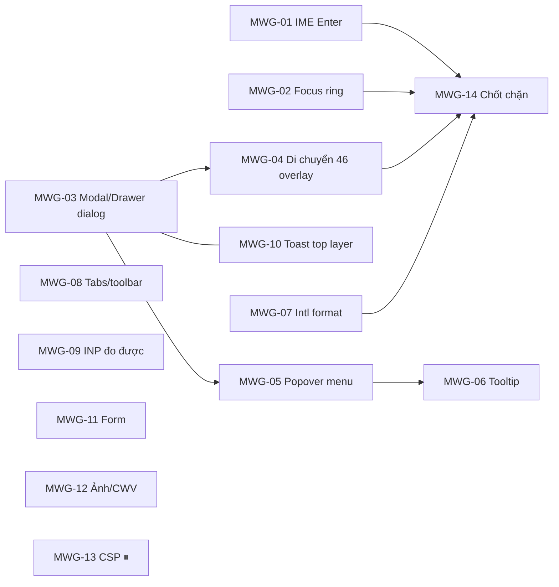

# 09 · CHUẨN NỀN TẢNG WEB HIỆN ĐẠI: OVERLAY, BÀN PHÍM, A11Y, HIỆU NĂNG (`MWG`)

> **Chuẩn:** skill offline `panelforge-fe/.claude/skills/modern-web-guidance/` (bản cố định commit `64a6d70` của [GoogleChrome/modern-web-guidance](https://github.com/GoogleChrome/modern-web-guidance), Apache-2.0), mục "Modern Web Guidance" trong `panelforge-fe/CLAUDE.md`, `.agents/AGENTS.md` §3.8.
> **Quan hệ với plan khác:** [08_UI_QUALITY_PLAN.md](08_UI_QUALITY_PLAN.md) lo token màu, cỡ chữ, i18n, văn phong; file này lo **cách dùng nền tảng web** (phần tử HTML gốc, API trình duyệt, a11y, Core Web Vitals). Hai plan không trùng task. Tách file lớn theo màn hình vẫn ở plan module (SCR-20, ART-12…).
> **Repo:** chỉ `[FE]` và `[QA]`. Mobile (Flutter) không áp dụng.
> **Lập ngày:** 2026-11-17.

Thứ tự ưu tiên: lỗi người dùng gặp ngay (bộ gõ tiếng Việt, focus bàn phím) → primitive overlay dùng chung → di chuyển từng màn → hiệu năng đo được → bảo mật cần quyết định.

---

## 1. Chính sách trình duyệt

| Mức Baseline | Cách dùng |
|---|---|
| Widely available | Dùng tự do, không fallback |
| Newly available | Feature detection (`@supports`, `CSS.supports`, `'x' in HTMLElement.prototype`) + fallback ≤ 20 dòng, không thêm dependency |
| Limited availability (vd `interestfor`, `popover="hint"`) | Chỉ progressive enhancement trên nền đã chạy được |

Không thêm polyfill/dependency mới (FE `CLAUDE.md` quy tắc 13). Thứ bậc: BR → bảo mật → kiến trúc hiện có → `DESIGN_RULES.md` → guide.

## 2. Mốc đo (2026-11-17, `panelforge-fe/src`, không tính `*.test.*`)

| Chỉ số | Hiện tại | Mục tiêu | Guide |
|---|---|---|---|
| `onKeyDown` xử lý `Enter` không kiểm `isComposing` | 12 chỗ / 11 file | 0 | `ime-safe-enter-submit` |
| `outline-none` | 287 chỗ / 89 file; `focus-visible:` chỉ 16 file | Mọi phần tử tương tác có vòng focus khi dùng bàn phím | `accessibility` |
| File `*Modal.tsx` / `*Drawer.tsx` tự dựng overlay (không dùng `shared/ui/Modal`/`Drawer`/`ConfirmDialog`) | 46 | 0 | `dialog`, `navigation-drawer` |
| `<dialog>` gốc | 1 | Toàn bộ overlay chặn trang | `dialog` |
| Listener `mousedown/click` "click outside" | 8 file | 0 | `menu`, `declarative-dialog-popover-control` |
| Thuộc tính `popover` | 0 | Mọi dropdown/menu/popover | `viewport-aware-dropdowns` |
| Khoá cuộn bằng `body.style.overflow` | 3 file (`shared/ui/hooks.ts`, `AuthLayout`, `BibleEntityDetailModal`) | 0 (CSS `:has(dialog:modal)`) | `prevent-page-scroll-under-modal-dialog` |
| `title=` làm tooltip | 308 chỗ / 109 file | Nút icon có tên truy cập + tooltip dùng chung | `interest-triggered-tooltips`, `position-aware-tooltips` |
| Ghi cứng `'vi-VN'` / `toLocale*String` | 103 / 117 chỗ, 58–64 file; `Intl.*Format` 1 chỗ | 0 ghi cứng; định dạng theo ngôn ngữ i18n | `js` (mục dates), `support-global-calendar-systems` |
| `` thiếu `width`/`height` | 71 | 0 | `optimize-image-priority` |
| `@floating-ui/react` trong `dependencies` | 0 chỗ import | Gỡ hoặc dùng làm fallback có chủ đích | `viewport-aware-dropdowns` |
| `@tanstack/react-virtual` | 0 chỗ dùng | Dùng hoặc gỡ (xem MWG-09) | `defer-rendering-heavy-content` |
| `content-visibility` | 0 | Danh sách dài (kịch bản, bảng) | `defer-rendering-heavy-content` |
| CSP trong `index.html` / header | Không có | Report-only rồi enforce | `security`, `trusted-types` |

Lệnh đo lại (PowerShell, từ thư mục gốc workspace): xem §5.

## 3. Task

#### MWG-01 · Enter-to-submit an toàn với bộ gõ tiếng Việt — FE + QA · ✅ · P0
Người dùng gõ Telex/VNI qua IME: `Enter` xác nhận chữ đang ghép bị hiểu thành "gửi" → gửi câu cụt.
- [x] [FE] Thêm `isImeComposing` helper (`src/lib/keyboard.ts`) và kiểm tra `isComposing || keyCode === 229` ở: `roles/artist/components/desk/ArtistBottomPageStrip.tsx:84`, `LetteringPropertyPanel.tsx:308`, `LetteringScriptPanel.tsx:201`, `roles/artist/modals/PageDetailModal.tsx:215`, `roles/letterer/components/TextFormatToolbar.tsx:133`, `roles/producer/components/dashboard/ChapterStatusTable.tsx:40`, `roles/producer/components/DependencySelector.tsx:789`, `roles/producer/modals/InviteMemberModal.tsx:350`, `roles/writer/components/script/flow/writesolo/WriteSoloElementMenu.tsx:76`, `shared/features/script-review/ScriptCommentCard.tsx:127`, `shared/features/series-bible/BibleEntityDetailModal.tsx:2312, 2349`.
- [x] [FE] Rà `onKeyDown` trong editor Tiptap (`ComicKeymapExtension.ts`, `writeSoloExtensions.ts`): ProseMirror tự xử lý composition, chỉ sửa nếu có handler `Enter` tự viết ngoài keymap.
- [x] [QA] Vitest: test cho `ScriptCommentCard` bắn `keydown Enter` với `isComposing: true` và `keyCode: 229` → không gửi.
- **Xong khi:** Grep `key === 'Enter'` mọi kết quả đều có kiểm `isComposing` ngay gần.

#### MWG-02 · Vòng focus bàn phím — FE · 🟡 (Đã xong phần toàn cục) · P0
- [x] [FE] Thêm quy tắc toàn cục trong `src/styles/tokens/studio-tokens.css` cho `:focus-visible` dùng token `--studio-focus-ring` / `--studio-focus-outline`.
- [ ] [FE] Bỏ `outline-none` trần trên phần tử tương tác; chỉ giữ khi đi kèm `focus-visible:` thay thế. Lô 15–20 file/commit, ưu tiên thanh công cụ Writer/Artist/Letterer, rail, modal.
- **Xong khi:** Tab qua mọi màn chính thấy vòng focus; `outline-none` không kèm `focus-visible:` = 0.

#### MWG-03 · Primitive overlay trên `<dialog>` gốc — FE + QA · ✅ · P1
`shared/ui/Modal.tsx` và `Drawer.tsx` hiện là `div` + `createPortal` + `role="dialog"` + bẫy focus, khoá cuộn, `Escape` tự viết (`shared/ui/hooks.ts`).
- [x] [FE] Viết lại `Modal` bên trong bằng `<dialog>` + `showModal()` qua ref, **giữ nguyên props hiện có** để không đổi chỗ gọi. Bỏ `body.style.overflow` trong `useBodyScrollLock` (`shared/ui/hooks.ts`), thay bằng CSS `html:has(dialog:modal) { overflow: hidden; scrollbar-gutter: stable; }` và `overscroll-behavior: contain`.
- [x] [FE] Đóng khi bấm nền: `closedby="any"` (progressive) + fallback so sánh `event.target === dialog` (`light-dismiss-a-dialog`). Thuộc tính `dismissible={false}` → `closedby="none"` + chặn `cancel`.
- [x] [FE] Bổ sung stub `showModal`/`close` trong `src/test/setup.ts` cho môi trường JSDOM.
- [x] [QA] Chạy và pass 100% test `ui.test.tsx` (9/9 passed).
- **Phụ thuộc:** làm cùng MWG-10 (toast phải nổi trên top layer).
- **Xong khi:** 5 chỗ đang dùng `<Modal>` chạy như cũ, Esc/nền/focus đúng, không còn `body.style.overflow` trong `shared/ui`.

#### MWG-04 · Di chuyển 46 modal/drawer tự dựng sang primitive chung — FE · ❌ · P1
- [ ] [FE] Lô theo role, mỗi lô một commit: `shared/modals` (10) → `shared/features/*` (11) → `producer` → `artist`/`letterer` → `editor`/`publisher` → `writer` (sau khi task Writer UX hiện tại merge, tránh đụng `ScriptEditorView.tsx`).
- [ ] [FE] Drawer bên phải của Writer (`NarrativeContextDrawer`, `ConsistencyFindingsDrawer`, `BibleCharactersDrawer`, `ChapterCastDrawer`…) là **panel không chặn trang**: không đưa vào `showModal()`; dùng `<aside>` + `aria-labelledby` (guide `dialog` Rule 3/4 cho non-modal).
- [ ] [FE] Gỡ các khối `fixed inset-0` overlay tự viết: `ChapterEditionsModal`, `ArtworkPanel`, `BibleReferenceDrawer`, `ChapterReviewArtworkOverview`, `BibleEntityDetailModal`, `AppShell:927`, `AuthLayout`.
- **Xong khi:** số file overlay tự dựng (§2) = 0.

#### MWG-05 · Dropdown/menu/popover dùng Popover API — FE · ❌ · P1
- [ ] [FE] Thay listener "click outside" bằng `popover="auto"` + `popovertarget`/`showPopover()`: `app/AppShellSidebar.tsx:174`, `roles/artist/components/ArtistAuxiliaryRadialMenu.tsx:103`, `writesolo/WriteSoloElementMenu.tsx:108`, `flow/BibleRefFloatingMenu.tsx:243`, `script/ScriptStudioRail.tsx:72`, `lucian/NotificationBellDropdown.tsx:131`, `collaboration/NotificationBell.tsx:131`, `views/StudioOverviewView.tsx:610`.
- [ ] [FE] Định vị: CSS anchor positioning + `position-try-fallbacks` khi `@supports (anchor-name: --a)`; fallback tính toạ độ đơn giản (≤ 20 dòng). Quyết định gỡ `@floating-ui/react` (đang không dùng) trong cùng task.
- [ ] [FE] Menu có điều hướng mũi tên, `role="menu"` chỉ khi đúng là menu lệnh (`menu`, `app-menus`).
- **Xong khi:** listener click outside = 0; `@floating-ui/react` đã gỡ hoặc có chỗ dùng ghi rõ lý do.

#### MWG-06 · Tooltip & tên truy cập cho nút icon — FE · ❌ · P2
- [ ] [FE] Một component `Tooltip` dùng chung trong `shared/ui` theo `interest-triggered-tooltips` (popover `hint`/`interestfor` khi hỗ trợ, fallback hover+focus), hiện cả khi focus bàn phím.
- [ ] [FE] Nút chỉ có icon: `aria-label` từ i18n; `title=` chỉ giữ cho chữ bị cắt (`single-line-overflow`). Lô theo role, ưu tiên rail/toolbar Writer, Artist, Letterer.
- **Xong khi:** nút icon thiếu tên truy cập = 0; không còn `title` làm tooltip duy nhất trên nút.

#### MWG-07 · Định dạng ngày/số theo ngôn ngữ — FE · 🟡 (Đã xong nền tảng toàn cục) · P2
- [x] [FE] Gom định dạng vào một module `src/lib/format.ts` (một chỗ quyết định locale = ngôn ngữ i18n hiện hành, cache `Intl.DateTimeFormat`/`NumberFormat`/`RelativeTimeFormat`). Tiền VNĐ dùng `NumberFormat` `currency: 'VND'`.
- [ ] [FE] Thay 103 chỗ ghi cứng `'vi-VN'` theo lô role; giữ múi giờ hiển thị theo trình duyệt, dữ liệu gửi BE vẫn UTC ISO.
- [x] [QA] Test đơn vị cho `format.ts` ở `vi` và `en` (`src/lib/format.test.ts` - 5/5 passed).
- **Xong khi:** Grep `'vi-VN'` ngoài `format.ts` = 0.

#### MWG-08 · Tabs & toolbar đúng ngữ nghĩa — FE · ❌ · P2
- [ ] [FE] Rà 11 file `role="tab"` theo guide `tabs` (roving tabindex, mũi tên trái/phải, `aria-controls`, panel `role="tabpanel"`).
- [ ] [FE] Rail của Writer (`ScriptStudioRail`) và thanh công cụ Artist/Letterer theo guide `toolbar` (một điểm Tab, mũi tên trong nhóm). Phối hợp với task Writer UX đang làm.

#### MWG-09 · Hiệu năng đo được: danh sách dài & INP — FE · ❌ · P2
- [ ] [FE] **Đo trước** bằng Chrome DevTools MCP (`performance-optimization`): INP khi gõ trong `ScriptEditorView`, mở Bible, kéo thả bảng Assignment; ghi số vào task.
- [ ] [FE] Danh sách dài (dòng kịch bản ở chế độ thẻ, bảng chương, danh sách Bible): `content-visibility: auto` + `contain-intrinsic-size` trước; chỉ dùng `@tanstack/react-virtual` khi đo thấy chưa đủ. Không dùng thì gỡ khỏi `dependencies`.
- [ ] [FE] Việc nặng chạy khi tương tác (xử lý kết quả kiểm tra nhất quán, diff phiên bản) tách bằng `scheduler.yield()` có fallback `setTimeout` (`break-up-long-tasks`, `schedule-tasks-by-priority`).
- **Xong khi:** INP các tương tác trên < 200 ms trên máy dev throttle 4x, số đo trước/sau ghi trong task.

#### MWG-10 · Toast nổi trên top layer — FE · ✅ · P1 (đi cùng MWG-03)
Khi modal chuyển sang `showModal()`, phần còn lại của trang bị `inert`: `ToastStack` hiện tại nằm dưới, không bấm được.
- [x] [FE] `ToastStack` dùng `popover="manual"` và `showPopover()` lại mỗi khi có toast mới để nằm trên dialog (`persistent-toast-notifications`). Giữ `aria-live` như hiện tại.

#### MWG-11 · Form đăng nhập/đăng ký/mời thành viên — FE · ❌ · P2
- [ ] [FE] `roles/guest/views/*` (đăng nhập, đăng ký, quên mật khẩu), `ChangePasswordModal`, `TwoFactorSetupModal`, `InviteMemberModal`: `autocomplete` đúng (`username`, `current-password`, `new-password`, `one-time-code`, `email`), `type`/`inputmode` đúng (`autofill-sign-in-form`, `autofill-sign-up-form`, `sms-otp-form`).
- [ ] [FE] Báo lỗi sau khi người dùng rời ô (`:user-invalid`), thông báo lỗi gắn `aria-describedby` và được đọc (`validate-input-after-interaction`, `accessible-error-announcement`).

#### MWG-12 · Ảnh & Core Web Vitals trang công khai — FE · ❌ · P3
- [ ] [FE] 71 `` thiếu kích thước: thêm `width`/`height` hoặc `aspect-ratio`; `loading="lazy"` + `decoding="async"` dưới màn đầu; ảnh bìa đầu tiên ở `PublicCatalogView` và trang đầu chương `fetchPriority="high"`.
- [ ] [FE] Font Google: `font-display` và fallback khớp số đo (`visually-stable-font-fallbacks`).

#### MWG-13 · CSP & Trusted Types — FE + BE · ⏸️ cần quyết định
- [ ] Quyết định nơi đặt CSP (header của host FE hay `<meta>`), danh sách nguồn (API, SignalR, Firebase, Google Fonts, Gemini) → ghi vào "Còn mở" của plan tổng.
- [ ] [FE] Bắt đầu `Content-Security-Policy-Report-Only` + `require-trusted-types-for 'script'` report-only (`security`, `trusted-types`, `secure-external-subresources`); chỉ enforce khi báo cáo sạch.

#### MWG-14 · Chốt chặn chống tái phát — FE · ❌ · P1
- [ ] [FE] ESLint `no-restricted-syntax`/`no-restricted-properties`: cấm literal `'vi-VN'` ngoài `src/lib/format.ts`, cấm `document.body.style.overflow`, cấm `role="dialog"` ngoài `shared/ui`.
- [ ] Thêm 5 mục "Mặc định bắt buộc" (FE `CLAUDE.md`) vào checklist [08_UI_QUALITY_PLAN.md §5](08_UI_QUALITY_PLAN.md).

## 4. Thứ tự & phụ thuộc



- MWG-01, MWG-02, MWG-07 làm song song được (file khác nhau, mỗi task một worktree nếu nhiều agent).
- Task đụng `roles/writer/**` chờ task Writer UX đang chạy (`_agent_briefs/writer-screen-ux.md`) merge xong.
- Mỗi lô: `npm run typecheck`, `npm run i18n:check`; test chỉ chạy khi user yêu cầu, nhưng phải viết/cập nhật test.

## 5. Đo lại chỉ số

```powershell
$all = Get-ChildItem panelforge-fe/src -Recurse -Include *.tsx,*.ts | Where-Object { $_.Name -notmatch '\.test\.' }
$all | Select-String "key === ['""]Enter['""]"            # MWG-01
$all | Select-String "outline-none"                        # MWG-02
$all | Select-String "fixed inset-0|aria-modal"            # MWG-03/04
$all | Select-String "addEventListener\(['""](mousedown|click|pointerdown)"   # MWG-05
$all | Select-String "['""]vi-VN['""]"                     # MWG-07
$all | Select-String "]*width)"                  # MWG-12
```

## 6. Changelog

| Ngày | Task | Repo | Ghi chú |
|---|---|---|---|
| 2026-11-17 | Lập plan | hub, FE | Đưa skill offline `modern-web-guidance` (commit `64a6d70`) vào `panelforge-fe/.claude/skills/`, thêm rule FE `CLAUDE.md` + `.agents/rules/modern-web.md`, đo mốc §2 |
