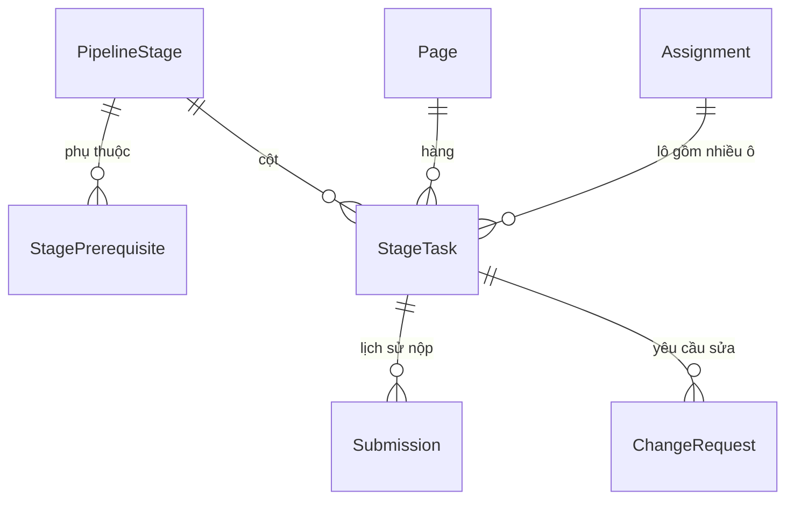
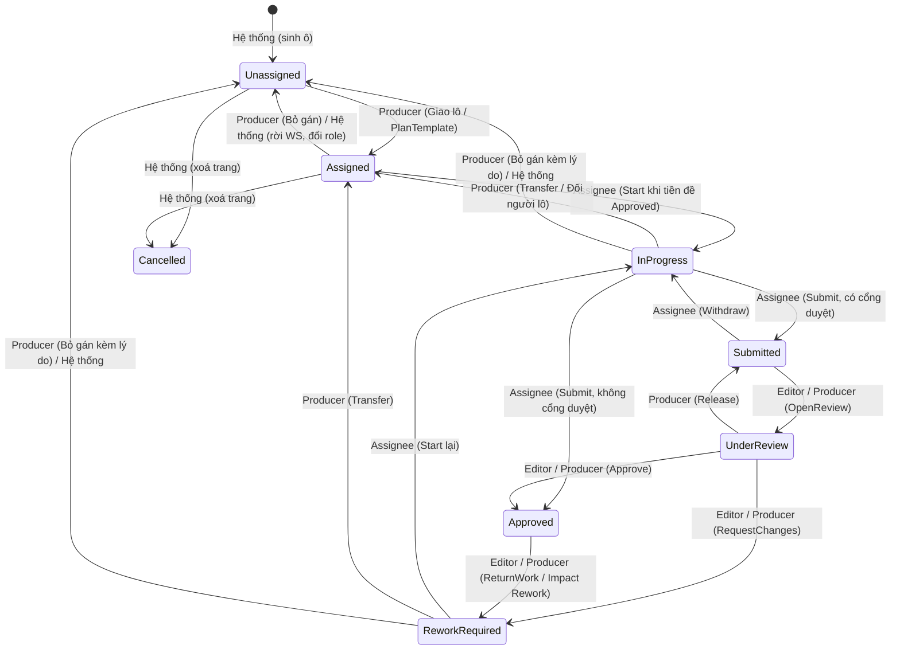
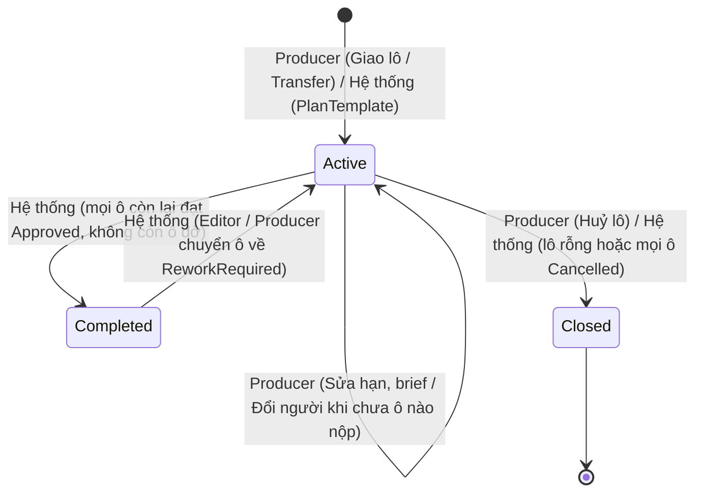

# ĐỀ XUẤT — ASSIGNMENT DẠNG LƯỚI Ô VIỆC (TRANG × BƯỚC) V3

> **Trạng thái:** Đề xuất, chưa chốt. Cần nhóm thảo luận trước khi đưa vào [`03_ASSIGNMENT_PLAN.md`](../plans/03_ASSIGNMENT_PLAN.md).
> **Ngày:** 2026-11-13
> **Nguồn:** Bản thiết kế `assignment-grid-design.html` (v3) + review kiến trúc của Antigravity (Gemini) đối chiếu codebase Backend nhánh `trungkien` (engram #423, #424).
> **Phạm vi:** Module Assignment (`ASG`), Backend `PanelForge.Domain/Entities/Workflow`, `Features/Assignments`.

---

## Bảng thuật ngữ

| Thuật ngữ | Định nghĩa kỹ thuật |
|---|---|
| **Ô (ô việc)** | Một bản ghi `StageTask` *(đề xuất mới)* tại giao điểm `Page × PipelineStage` (hoặc `Chapter × PipelineStage` khi `PageId = null`). Đơn vị nhỏ nhất để bắt đầu làm, nộp bài, duyệt và gắn `ChangeRequest`. Mỗi ô tối đa một người phụ trách tại một thời điểm. |
| **Lô (lô giao việc)** | Một bản ghi `Assignment` (thu gọn từ thực thể hiện có) gom ≥ 1 ô cùng cột (`PipelineStageId`) giao cho một thành viên (`AssigneeUserId`), dùng chung `Brief` và `DueDate`. |
| **Tiền đề (bước tiền đề)** | Quan hệ phụ thuộc giữa hai bước trong `StagePrerequisite` *(đề xuất mới)* (`PrerequisiteStageId → PipelineStageId`). Ô ở bước sau chỉ được `Start` khi mọi ô tương ứng ở các bước tiền đề trực tiếp đã `Approved` và có `IsInputOutdated = false`. |
| **Chốt trang** | Thời điểm ô của bước có `PipelineStage.FinalizesPages = true` *(đề xuất mới)* được `Approved`: hệ thống sinh toàn bộ ô cấp `Page` cho chương, tự áp `PlanTemplate` *(đề xuất mới)* và khoá thêm/xoá/đổi thứ tự trang trừ khi Producer mở lại bước chốt trang. |
| **Impact Review** | Quy trình Editor / Producer thẩm định lại các ô phía sau khi một ô tiền đề đã `Approved` bị mở lại (`ReturnWork` / `Reopen`). Xét tuần tự từ bước gần đến bước xa: chọn `Keep` (giữ kết quả, tự gỡ cờ dây chuyền nếu hết tiền đề lỗi thời) hoặc `Rework` (chuyển ô về `ReworkRequired` kèm `ChangeRequest`). |
| **Outdated (`IsInputOutdated`)** | Cờ `bool` *(đề xuất mới)* trên `StageTask` được bật khi bước tiền đề mở lại lúc ô này đã bắt đầu (`InProgress`..`Approved`). Khi `IsInputOutdated = true`, hệ thống chặn `Submit`, `Approve` và `ReturnWork` trên ô cho đến khi xử lý xong Impact Review. |

---

## 1. Ý tưởng chính

Thay mô hình Assignment "phạm vi động" (giao cả chương / chuyển giao một dải `Page`/`Panel`) bằng **lưới ô việc cố định**:

- **Hàng** = Trang (`Page.Id`, hoặc `PageId = null` với bước cấp chương), **cột** = Bước (`PipelineStage`). Mỗi giao điểm là một ô việc `StageTask` *(đề xuất mới)*.
- **Mỗi ô đúng một người.** Không có Collaborator.
- Producer giao việc theo **lô** (`Assignment` = một người + một tập ô cùng cột). Ví dụ 4 Artist chia 20 trang ở cột Pencil → 4 lô.
- Thứ tự giữa các bước khai báo bằng `StagePrerequisite` *(đề xuất mới)*. Mẫu mặc định nối thẳng (webtoon cuộn dọc: Lettering chờ Color); mẫu rẽ nhánh song song là tuỳ chọn.
- Quy mô: khoảng 100 ô/chương (20 trang × 5 bước).

### 1.1 Các thực thể

| Thực thể | Phân loại | Vai trò | Trường chính |
|---|---|---|---|
| `StageTask` | *(đề xuất mới)* | Một ô `Trang × Bước` (hoặc `Chương × Bước`) | `Id`, `SeriesId`, `ChapterId`, `PipelineStageId`, `PageId?`, `AssignmentId?`, `Status` (`StageTaskStatus` *đề xuất mới*), `IsInputOutdated`, `OutdatedReason?`, `ReviewerUserId?`, `CurrentSubmissionId?`, `UpdatedAt` |
| `Assignment` | *(sửa đổi từ code sẵn có)* | Một lô giao cho một người trên một cột | `Id`, `SeriesId`, `ChapterId`, `PipelineStageId`, `AssigneeUserId`, `AssignedRole`, `Brief`, `DueDate?`, `Priority`, `Status` (`AssignmentLotStatus` *đề xuất mới*), `UpdatedAt` |
| `StagePrerequisite` | *(đề xuất mới)* | Khai báo bước tiền đề (`PrerequisiteStageId → PipelineStageId`) | `Id`, `PipelineStageId`, `PrerequisiteStageId` (không tạo chu trình DAG) |
| `PlanTemplate` | *(đề xuất mới)* | Mẫu chia dải trang theo cột, lập trước hoặc sau khi có trang | `Id`, `ChapterId`, `PipelineStageId`, `FromPage`, `ToPage?` (`null` = đến hết chương), `AssigneeUserId`, `Brief`, `DueDate?` |
| `Submission` | *(sửa đổi từ code sẵn có)* | Lịch sử từng lần nộp và quyết định duyệt của một ô | `StageTaskId` *(đề xuất mới, thay `AssignmentId`)*, `ChapterId`, `SubmittedByUserId`, `DecidedByUserId?`, `Status`, các trường snapshot sẵn có (`ArtworkReferenceIds`, `ChapterVersion`, `PanelLayoutJson`, `CanvasVersionsJson`, `ScriptRevisionIds`) |
| `ChangeRequest` | *(sửa đổi từ code sẵn có)* | Yêu cầu sửa gắn trực tiếp vào từng ô | `StageTaskId` *(đề xuất mới, thay `AssignmentId`)*, `ChapterId`, `SubmissionId?`, `ResponsibleUserId?` *(đề xuất mới: cho phép null khi bỏ gán)*, `CreatedByUserId`, `Status`, `Description`, `RegionJson?` |

**Ràng buộc chống trùng ô ở tầng DB (`StageTask` *(đề xuất mới)*):**
- `UNIQUE (chapter_id, pipeline_stage_id) WHERE page_id IS NULL AND is_deleted = false` (bước cấp `Chapter`).
- `UNIQUE (chapter_id, pipeline_stage_id, page_id) WHERE page_id IS NOT NULL AND is_deleted = false` (bước cấp `Page`).

### 1.2 Vòng đời ô (`StageTask`) và vòng đời lô (`Assignment`)

#### a) Vòng đời ô — `StageTask` *(đề xuất mới)*

| Chuyển trạng thái | Role kích hoạt (`WorkspaceRole`) | Điều kiện tiên quyết (Guard) & Hệ quả |
|---|---|---|
| `[*] → Unassigned` | Hệ thống | Sinh ô cấp `Chapter` khi `Chapter.Status` sang `InProduction`; sinh ô cấp `Page` khi bước `FinalizesPages = true` đạt `Approved`. |
| `Unassigned → Assigned` | `Producer` (hoặc Hệ thống qua `PlanTemplate`) | Ô đang `AssignmentId = null`; người nhận là `WorkspaceMember` `Active` có `Role == PipelineStage.AllowedRole`. |
| `Assigned → InProgress` | Người nhận ô (`Writer` / `Artist` / `Letterer` trùng `AssigneeUserId`) | Mọi ô tiền đề trực tiếp đã `Approved` và không `Outdated`; chính ô này có `IsInputOutdated = false`. Ghi `StartedAt` nếu lần đầu. |
| `InProgress → Submitted` | Người nhận ô (`AssigneeUserId`) | `PipelineStage.IsApprovalGate = true`, `IsInputOutdated = false`, số `ChangeRequest` `Open` = 0, đủ artwork/script/lettering. Tạo `Submission` (`Pending`), gán `CurrentSubmissionId`. |
| `InProgress → Approved` | Người nhận ô (`AssigneeUserId`) | `PipelineStage.IsApprovalGate = false` (bước tự duyệt), `IsInputOutdated = false`, 0 CR `Open`. Tạo `Submission` (`Approved`, `DecidedByUserId = null`). |
| `Submitted → InProgress` | Người nhận ô (`AssigneeUserId`) | Gọi `Withdraw` khi Editor chưa `OpenReview`; đánh dấu `Submission` vừa tạo là `Superseded`. |
| `Submitted → UnderReview` | `Editor` / `Producer` | Khác `AssigneeUserId` và chưa từng nộp bài trên ô này (BR-06, 4-Eyes). Ghi `ReviewerUserId`. |
| `UnderReview → Submitted` | `Producer` | Giải phóng (`Release`) trả ô về hàng đợi chung của Editor (`ReviewerUserId = null`). |
| `UnderReview → Approved` | `Editor` / `Producer` | Khớp `CurrentSubmissionId`, `IsInputOutdated = false`, số CR `Open` = 0 và `Resolved` = 0, khác người nộp. Ghi `Submission.DecidedByUserId`. |
| `UnderReview → ReworkRequired` | `Editor` / `Producer` | Kèm nhận xét bắt buộc (tạo ≥ 1 `ChangeRequest` `Open`, từ chối `Submission` hiện tại). |
| `Approved → ReworkRequired` | `Editor` / `Producer` | Từ màn duyệt bước cấp `Chapter` (`ReturnWork`) khi `IsInputOutdated = false`, hoặc từ Impact Review chọn `Rework`. Tự gắn `IsInputOutdated = true` cho các ô phía sau đã bắt đầu. |
| `ReworkRequired → InProgress` | Người nhận ô (`AssigneeUserId`) | `IsInputOutdated = false` và tiền đề trực tiếp `Approved`. |
| `InProgress / ReworkRequired → Assigned` | `Producer` | `Transfer` sang lô mới của người khác, hoặc **Đổi người nhận** trên lô (chỉ khi chưa ô nào trong lô từng nộp). Giữ CR chưa đóng; hạ CR `Resolved` về `Open`; reset `IsInputOutdated = false`. |
| `Assigned / InProgress / ReworkRequired → Unassigned` | `Producer` / Hệ thống | `Producer` gọi Bỏ gán (bắt buộc `reason` nếu từ `InProgress`/`ReworkRequired`), hoặc hệ thống tự gỡ khi thành viên rời Workspace / đổi role. `AssignmentId = null`, reset `IsInputOutdated = false`, hạ CR `Resolved` về `Open`. |
| `Chưa Cancelled → Cancelled` | Hệ thống | Khi `Producer` mở lại bước `FinalizesPages`, xoá trang qua `DeletePageCommand` và duyệt lại bước chốt trang (trên sơ đồ vẽ đại diện từ `Unassigned`/`Assigned`). Reset `IsInputOutdated = false`. |

#### b) Vòng đời lô — `Assignment` (sử dụng `AssignmentLotStatus` *(đề xuất mới)*)

| Chuyển trạng thái lô | Ai kích hoạt | Quy tắc chi tiết |
|---|---|---|
| `[*] → Active` | `Producer` / Hệ thống | Tạo mới khi giao ≥ 1 ô (Bulk / Single / Transfer / tự áp `PlanTemplate`). Không bao giờ khởi tạo lô 0 ô. |
| `Active → Active` | `Producer` | Sửa `Brief`, `DueDate`, `Priority`; hoặc đổi `AssigneeUserId` khi **tất cả** ô trong lô chưa có bản ghi `Submission` nào (ô `InProgress` tự lùi về `Assigned`). |
| `Active → Completed` | Hệ thống (tự động) | Khi mọi ô hiện thuộc lô đều ở `Approved` hoặc `Cancelled` (và có ≥ 1 ô `Approved`). Lô `Completed` không bao giờ tính là quá hạn. |
| `Completed → Active` | Hệ thống (tự động) | Khi `Editor` / `Producer` chuyển ít nhất 1 ô thuộc lô từ `Approved` về `ReworkRequired` (`ReturnWork` hoặc Impact Review `Rework`). |
| `Active / Completed → Closed` | `Producer` / Hệ thống | Tự động chuyển `Closed` ngay khi số ô thuộc lô = 0 (do Bỏ gán hết, Transfer hết sang lô mới, hoặc mọi ô của lô bị `Cancelled` khi xoá trang), hoặc `Producer` huỷ cả lô chưa có ô nộp. Lô `Closed` không nhận thêm ô mới. |

### 1.3 Ví dụ minh hoạ lưới: chương 6 trang × 4 bước

**Thiết lập chương:**
- **Quy trình cấp `Page`** (mẫu mặc định nối thẳng, bước chốt trang cấp `Chapter` phía trước đã `Approved`): `Pencil → Ink → Color → Lettering` (cả 4 bước đều bật cổng duyệt `IsApprovalGate = true`).
- **Nhân sự:** 2 `Artist` (**An**, **Bình** — nhận các cột có `AllowedRole = Artist`) chia đôi dải trang; 1 `Letterer` (**Chi** — nhận cột `Lettering` có `AllowedRole = Letterer`) làm toàn chương.
- **Các lô `Assignment` tại thời điểm chụp `T`:**
  - `L1` (`Pencil`, Trang 1–3, **Artist An**, hạn `+2 ngày`): `3/3 Approved` → trạng thái lô **`Completed`**.
  - `L2` (`Pencil`, Trang 4–6, **Artist Bình**, hạn `+2 ngày`): `0/3 Approved` → trạng thái lô **`Active`**.
  - `L3` (`Ink`, Trang 1–3, **Artist An**, hạn `+4 ngày`): `2/3 Approved` → trạng thái lô **`Active`**.
  - `L4` (`Ink`, Trang 4–6, **Artist Bình**, hạn `+4 ngày`): `0/3 Approved` (1 ô `Outdated`) → trạng thái lô **`Active`**.
  - `L5` (`Color`, Trang 1–3, **Artist An**, hạn `+6 ngày`): `1/3 Approved` → trạng thái lô **`Active`** *(Trang 4–6 cột `Color` chưa giao)*.
  - `L6` (`Lettering`, Trang 1–6, **Letterer Chi**, hạn `+8 ngày`): `0/6 Approved` → trạng thái lô **`Active`**.

**Bảng trạng thái lưới (24 ô `StageTask`) tại thời điểm `T`:**

| Hàng \ Cột | `Pencil` (`Artist`) | `Ink` (`Artist`) | `Color` (`Artist`) | `Lettering` (`Letterer`) |
|---|---|---|---|---|
| **Trang 1** | `[L1 · An]` **`Approved`** | `[L3 · An]` **`Approved`** | `[L5 · An]` **`Approved`** | `[L6 · Chi]` **`InProgress`** *(đang đặt thoại)* |
| **Trang 2** | `[L1 · An]` **`Approved`** | `[L3 · An]` **`Approved`** | `[L5 · An]` **`UnderReview`** *(Editor đang mở)* | `[L6 · Chi]` `Assigned` *(chờ Color T2)* |
| **Trang 3** | `[L1 · An]` **`Approved`** | `[L3 · An]` **`ReworkRequired`** *(1 CR Open)* | `[L5 · An]` `Assigned` *(chờ Ink T3)* | `[L6 · Chi]` `Assigned` *(chờ Color T3)* |
| **Trang 4** | `[L2 · Bình]` **`ReworkRequired`** *(bị ReturnWork)* | `[L4 · Bình]` **`InProgress · Outdated ⚑`** | `Unassigned` *(chưa giao)* | `[L6 · Chi]` `Assigned` *(chờ Color T4)* |
| **Trang 5** | `[L2 · Bình]` **`Submitted`** *(chờ duyệt)* | `[L4 · Bình]` `Assigned` *(chờ Pencil T5)* | `Unassigned` *(chưa giao)* | `[L6 · Chi]` `Assigned` *(chờ Color T5)* |
| **Trang 6** | `[L2 · Bình]` **`InProgress`** *(đang vẽ)* | `[L4 · Bình]` `Assigned` *(chờ Pencil T6)* | `Unassigned` *(chưa giao)* | `[L6 · Chi]` `Assigned` *(chờ Color T6)* |

**Giải thích hành vi trên lưới tại thời điểm `T`:**
1. **Chạy gối đầu theo từng trang:** **Chi** (`L6`) đã `Start` và đang làm `Lettering` **Trang 1** ngay khi `Color` Trang 1 đạt `Approved`, không cần chờ **An** tô xong Trang 2–3 hay **Bình** vẽ xong `Pencil` Trang 6.
2. **Chặn `Start` tự động theo tiền đề:** Các ô `Assigned` có ghi chú *(chờ ...)* đều có `IsStartable = false` vì ô cùng trang ở bước tiền đề trực tiếp chưa `Approved`.
3. **Cô lập phạm vi `Outdated`:** Ở **Trang 4**, `Pencil` từng `Approved` nên **Bình** đã `Start` ô `Ink` Trang 4; sau đó `Pencil` Trang 4 bị trả về `ReworkRequired` → chỉ ô `Ink` Trang 4 (đã bắt đầu) bị bật `IsInputOutdated = true` (chặn `Submit`), còn ô `Lettering` Trang 4 (mới `Assigned`, chưa `Start`) giữ nguyên `IsInputOutdated = false` và cũng không ảnh hưởng các trang 1, 2, 3, 5, 6.

---

## 2. Quyết định đã chốt (giữ nguyên, không bàn lại)

1. Submit / Withdraw nhận **danh sách ô**, không khoá theo cả lô.
2. Phụ thuộc khai báo bằng `StagePrerequisite` *(đề xuất mới)*, hỗ trợ rẽ nhánh song song.
3. Lịch sử lưu ở `Submission` (`SubmittedByUserId`, `DecidedByUserId` — bản thiết kế gọi tắt là `SubmittedBy`, `ApprovedBy`). Transfer luôn tạo lô mới. Chỉ đổi người trên lô khi chưa ô nào nộp.
4. `PipelineStage.FinalizesPages` *(đề xuất mới)* + `PlanTemplate` *(đề xuất mới)* theo cột, tự áp khi sinh ô.
5. Khoá danh sách trang sau bước chốt trang. Muốn đổi trang thì mở lại bước đó, **giữ nguyên `PageId` (`Page.Id`)**.
6. Hai Partial Unique Index thay cho `NULLS NOT DISTINCT` (EF Core: `HasFilter`).
7. Bulk nhận mảng nhiều lô trong một request. FE có nút "Chia đều" và tiến độ theo lô ở đầu cột.
8. `PlanTemplate` *(đề xuất mới)* chặn dải trang chồng nhau, không tạo lô rỗng.
9. Impact Review xét theo thứ tự tiền đề. "Keep" tự gỡ cờ dây chuyền khi không còn tiền đề nào Outdated.
10. Bỏ gán được từ `InProgress` / `ReworkRequired` (kèm lý do). Transfer và Bỏ gán giữ Change Request đang mở trên ô. Lô rỗng tự đóng.
11. Năng suất Editor không tính bản ghi tự duyệt (`Submission.DecidedByUserId == null`).
12. Hoãn giao việc cấp Panel.

---

## 3. Kết quả review: ba lựa chọn tạm → **giữ cả ba**

| Lựa chọn | Kết luận | Lý do / kịch bản |
|---|---|---|
| Hạn chót (`DueDate`) gắn ở **lô**, không gắn ở ô | **Giữ** | 4 Artist chia 20 trang, mỗi người một hạn. Lô chỉ tính quá hạn khi còn ≥ 1 ô chưa `Approved`/`Cancelled`. Transfer sinh lô mới với hạn riêng. |
| Đổi người nhận đưa ô `InProgress` về `Assigned` | **Giữ** | Người mới chưa bắt đầu làm, giữ `InProgress` sẽ làm sai số liệu tiến độ. |
| Bulk nhiều lô "tất cả hoặc không" | **Giữ**, thêm `dryRun` | Tránh trạng thái giao dở dang. `dryRun=true` cho FE kiểm tra trước khi lưu thật. |

---

## 4. Xung đột với codebase hiện tại (phải xử lý trước khi code)

| # | Vấn đề | Vị trí | Hướng xử lý |
|---|---|---|---|
| 1 | `ResolveWorkspaceId` chỉ lấy `WorkspaceId` hoặc `SeriesId` trên entity để ghi `AuditLog.WorkspaceId` (BR-18). Thiếu hai trường này thì audit log ghi `WorkspaceId = null`. | `PanelForgeDbContext.cs` (`ResolveWorkspaceId`) | **Giữ `SeriesId`** trên `StageTask` *(đề xuất mới)* và `Assignment`. |
| 2 | `WorkspaceMember` có unique `(workspace_id, user_id)` và một cột `role` đơn trị. `WorkspaceRole` chỉ có Producer, Writer, Artist, Letterer, Editor (không có `Colorist`). Pencil/Ink/Color đều dùng `Artist`. | `WorkspaceMember.cs`, `Enums/WorkspaceRole.cs` | Một người nhận được nhiều cột **cùng `AllowedRole`** (tài liệu thiết kế gọi là `RequiredRole`). Muốn một người giữ hai role khác nhau thì phải đổi mô hình membership. Ngoài phạm vi v3. |
| 3 | `Submission` hiện chụp snapshot khác nhau theo bước (`ArtworkReferenceIds`, `CanvasVersionsJson`, `ScriptRevisionIds`/`ChapterVersion`), không có một FK `FileVersionId` chung. | `Entities/Workflow/Submission.cs` | Giữ các trường snapshot hiện có thay vì ép về một `FileVersionId` *(đề xuất mới trong bản nháp HTML, không áp dụng)*. |
| 4 | 5 nơi ngoài module phụ thuộc mô hình `Assignment`/`StageProgress` cũ. | `WorkScopeGuard`, `ChapterLockGate`, `FreezeScriptCommands`, `GetSeriesProgressQuery`, `CreateChangeRequestFromFeedbackCommand` | Sửa cả 5 trong cùng lát cắt chuyển đổi. |

**Chuyển đổi dữ liệu:** Clean Cutover bằng EF migration trên `PipelineStage` sẵn có. Trước khi tạo migration, chạy `SELECT COUNT(*) FROM assignments;` trên DB dùng chung để xác nhận chỉ có dữ liệu test.

---

## 5. Năm kịch bản biên cần thêm guard

| # | Kịch bản | Hậu quả nếu bỏ qua | Giải pháp tối thiểu | Mức |
|---|---|---|---|---|
| 1 | Mở lại bước chốt trang rồi **chèn/xoá trang giữa chương**. `ReorderPage`/`DeletePage` đánh số lại `PageNumber = 1..N`. | `PlanTemplate` *(đề xuất mới)* (`FromPage..ToPage`) áp nhầm người cho trang cũ. | Chỉ áp `PlanTemplate` cho `PageId` **mới** chưa từng có ô. | Cao |
| 2 | Hai người thao tác **cùng lô, cùng lúc**. | Ghi đè trạng thái, mất dữ liệu. | Concurrency token (`xmin` hoặc `UpdatedAt`) trên cả `StageTask` *(đề xuất mới)* và `Assignment`, kết hợp `LockChapterAsync`. | Cao |
| 3 | Thành viên **rời workspace hoặc đổi role**. | Ô kẹt ở người không còn quyền. | Tự bỏ gán ô chưa nộp, trả về "Chưa giao", báo Producer. | TB |
| 4 | Ô về `Chưa giao`/`Assigned`/`Cancelled` nhưng vẫn mang `IsInputOutdated = true` *(đề xuất mới)* trên quy trình rẽ nhánh. | Impact Review deadlock. | Reset `IsInputOutdated = false` khi ô về một trong ba trạng thái này. | TB |
| 5 | Change Request đã `Resolved` khi ô bị Transfer/Bỏ gán/Đổi người; Editor `ReturnWork` khi đầu vào đang lỗi thời. | Người mới không thấy yêu cầu sửa; trả bài dựa trên đầu vào cũ. | Hạ CR `Resolved` về `Open` khi đổi người. Chặn `ReturnWork` khi `IsInputOutdated = true`. | TB |

### Chi tiết bước tái hiện cho từng kịch bản

#### 5.1 Kịch bản #1 — Chèn/xoá trang giữa chương sau khi mở lại bước chốt trang
1. **Tái hiện:**
   - Bước 1: Producer lưu `PlanTemplate` *(đề xuất mới)* cho cột `Pencil`: `FromPage = 1..3 → Artist An`, `FromPage = 4..6 → Artist Bình`.
   - Bước 2: Bước chốt trang (`PipelineStage.FinalizesPages = true` *(đề xuất mới)*) đạt `Approved` lần 1 → chương có 6 trang `P1..P6` (`PageNumber = 1..6`), sinh 6 ô `Pencil`; `An` đang vẽ `P3` (`InProgress`).
   - Bước 3: Producer mở lại bước chốt trang, gọi `CreatePageCommand` thêm trang `P_new` rồi gọi `ReorderPageCommand` đưa `P_new` vào vị trí số 2 → `ReorderPageCommandHandler` đánh số lại `P_new.PageNumber = 2`, đẩy `P3` của `An` lên `PageNumber = 4` (tương tự, `DeletePageCommandHandler` xoá trang 1 cũng dồn trang 2..6 thành `1..5`).
   - Bước 4: Bước chốt trang đạt `Approved` lần 2.
2. **Lỗi nếu thiếu guard:** Nếu quét lại `PlanTemplate` theo `PageNumber` hiện tại cho toàn bộ trang, `P3` (`PageNumber = 4`) bị áp vào dải `4..6` của `Bình` (gây xung đột hoặc ghi đè người làm), trong khi `P3` vốn đã có ô gắn theo `Page.Id`.
3. **Guard cài đặt:** Khi bước chốt trang duyệt lại, giữ nguyên mọi `StageTask` *(đề xuất mới)* của các `Page.Id` cũ; chỉ lấy tập `newPageIds = chapterPageIds.Except(existingTaskPageIds)` để sinh ô mới và tra `PlanTemplate` theo `PageNumber` hiện tại của `newPageIds`. Các `Page.Id` đã xoá mềm (`IsDeleted = true`) thì chuyển toàn bộ ô của chúng sang `Cancelled`.

#### 5.2 Kịch bản #2 — Đua dữ liệu (Race condition) trên cùng một lô
1. **Tái hiện:**
   - Bước 1: Lô `L1` (`Pencil` Trang 1–3, giao `Artist An`) đang có cả 3 ô ở `Assigned`, chưa có bản ghi `Submission` nào.
   - Bước 2: Tại `t0`, `Artist An` bấm `Start` và `Submit` nhanh ô Trang 1 (`POST .../tasks/submit` *(đề xuất mới)*).
   - Bước 3: Đồng thời tại `t0`, `Producer` bấm **Đổi người nhận** trên lô `L1` sang `Artist Bình` (`PUT .../lots/{lotId}` *(đề xuất mới)* — thao tác kiểm tra điều kiện "lô chưa có ô nào từng nộp").
2. **Lỗi nếu thiếu guard:** Cả hai request cùng đọc snapshot cũ thấy `Submissions.Count == 0` → request của `An` ghi ô Trang 1 thành `Submitted` kèm `Submission`, còn request của `Producer` đổi `L1.AssigneeUserId = Bình` và đưa các ô về `Assigned` → dữ liệu mâu thuẫn (ô `Assigned` của `Bình` nhưng mang `CurrentSubmissionId` đang chờ duyệt của `An`).
3. **Guard cài đặt:** Đầu mọi command thay đổi lô/ô trong chương phải gọi `PanelForgeDbContext.LockChapterAsync(chapterId)` (`SELECT 1 FROM chapters WHERE id = ... FOR UPDATE`) **và** cấu hình `.IsConcurrencyToken()` cho `UpdatedAt` trên cả `StageTask` *(đề xuất mới)* lẫn `Assignment` (giống `AssignmentConfiguration.cs` hiện tại). Request đến sau bị tuần tự hoá hoặc bắn `DbUpdateConcurrencyException` → trả `409 CONFLICT`.

#### 5.3 Kịch bản #3 — Thành viên rời Workspace hoặc bị đổi `WorkspaceRole`
1. **Tái hiện:**
   - Bước 1: `Artist An` đang giữ lô `L1` ở cột `Pencil` (`AllowedRole = Artist`): Trang 1 đã `Approved`, Trang 2 đang `Submitted`, Trang 3 đang `InProgress`.
   - Bước 2: `An` tự rời Studio qua `RemoveWorkspaceMemberCommand` (`DELETE /api/workspaces/{id}/members/{userId}`), hoặc Owner/Producer đổi vai trò của `An` sang `Editor` qua `UpdateMemberRoleCommand` (`PUT /api/workspaces/{id}/members/{userId}`).
2. **Lỗi nếu thiếu guard:** Ô `Pencil` Trang 3 vẫn kẹt ở `Status = InProgress` dưới tên `An`. `WorkScopeGuard` chặn Artist khác ghi vào canvas Trang 3 vì vẫn thấy ô mở của `An`, còn `An` không còn quyền `Artist` để làm tiếp hay nộp bài.
3. **Guard cài đặt:** Trong cùng transaction của `RemoveWorkspaceMemberCommandHandler` / `UpdateMemberRoleCommandHandler`, truy vấn mọi `StageTask` *(đề xuất mới)* thuộc Workspace của user đó ở các cột có `AllowedRole != newRole` đang mang trạng thái chưa nộp (`Assigned`, `InProgress`, `ReworkRequired`) → gỡ `AssignmentId = null`, chuyển về `Unassigned`, reset `IsInputOutdated = false`, hạ CR `Resolved` về `Open`, đóng các lô `Assignment` trở nên rỗng, và tạo `Notification` cho `Producer`. Các ô đã `Submitted` / `UnderReview` / `Approved` giữ nguyên để không mất bài đã nộp và lịch sử `Submission.SubmittedByUserId`.

#### 5.4 Kịch bản #4 — Cờ `IsInputOutdated` bị kẹt trên quy trình rẽ nhánh
1. **Tái hiện:**
   - Bước 1: Series cấu hình rẽ nhánh song song: `Color` và `Lettering` cùng có tiền đề trực tiếp là `Ink`; bước `QC` (cấp `Chapter`) có tiền đề là cả `Color` và `Lettering`.
   - Bước 2: Ở Trang 3, `Ink` đã `Approved`; cả `Color` Trang 3 và `Lettering` Trang 3 đều đang `InProgress`.
   - Bước 3: `Ink` Trang 3 bị `ReturnWork` → cả `Color` Trang 3 và `Lettering` Trang 3 bị bật `IsInputOutdated = true`.
   - Bước 4: Trong lúc chờ sửa `Ink`, `Producer` gọi **Bỏ gán** ô `Color` Trang 3 (ô về `Unassigned`).
   - Bước 5: `Ink` Trang 3 sửa xong và `Approved` lại. Editor mở Impact Review: xét `Lettering` Trang 3 chọn `Keep` (gỡ cờ ở `Lettering`), nhưng ô `Color` Trang 3 đang `Unassigned` nên không nằm trong danh sách xét Impact Review (chỉ xét các ô đã bắt đầu).
2. **Lỗi nếu thiếu guard:** Nếu lúc Bỏ gán ở Bước 4 không xoá cờ, ô `Color` Trang 3 vẫn lưu `IsInputOutdated = true`. Khi `Producer` giao lại ô này cho Artist mới, người mới bị chặn `Start` / `Submit`, kéo theo ô `QC` cuối chương không bao giờ mở được (deadlock).
3. **Guard cài đặt:** Bất kỳ thao tác nào đưa `StageTask` *(đề xuất mới)* về `Unassigned`, `Assigned` (gồm Bỏ gán, Transfer, Đổi người nhận trên lô) hoặc `Cancelled` đều phải cưỡng bức gán `IsInputOutdated = false` và `OutdatedReason = null`.

#### 5.5 Kịch bản #5 — Sót `ChangeRequest` trạng thái `Resolved` khi đổi người & `ReturnWork` trên đầu vào lỗi thời
1. **Tái hiện luồng 5a (CR `Resolved` khi đổi người):**
   - Bước 1: Ô `Ink` Trang 4 bị trả về `ReworkRequired` kèm `CR #1` (`Status = Open`).
   - Bước 2: `Artist An` bấm `Start` lại (`InProgress`), bấm `Resolve` trên `CR #1` (`ChangeRequest.Resolve` → `Status = Resolved`), nhưng chưa kịp `Submit` thì xin nghỉ.
   - Bước 3: `Producer` gọi `Transfer` ô `Ink` Trang 4 sang `Artist Bình` (ô về `Assigned` ở lô mới).
   - **Lỗi nếu thiếu guard:** Giao diện làm việc của `Bình` lọc việc cần sửa theo `Status == Open` nên không thấy `CR #1`; tới lúc `Bình` nộp xong và Editor bấm `Approve`, hệ thống từ chối vì vẫn còn `CR #1` ở `Status == Resolved` chưa `Verified`.
   - **Guard 5a:** Khi Transfer / Bỏ gán / Đổi người nhận, mọi `ChangeRequest` gắn với ô đang có `Status == Resolved` phải tự động chuyển về `Status = Open` (`ChangeRequest.Reopen("Chuyển người phụ trách — cần rà soát lại yêu cầu sửa.")`).
2. **Tái hiện luồng 5b (`ReturnWork` khi `IsInputOutdated = true`):**
   - Bước 1: Ô `Pencil` Trang 4 mở lại để sửa → ô `Ink` Trang 4 (đã `Approved`) bị bật `IsInputOutdated = true`.
   - Bước 2: Khi `Pencil` Trang 4 chưa chốt xong (hoặc chưa chạy Impact Review cho `Ink` Trang 4), Editor ở màn duyệt chương gọi `ReturnWork` vào ô `Ink` Trang 4 để yêu cầu sửa nét.
   - **Lỗi nếu thiếu guard:** `Artist` nhận `ChangeRequest` đi sửa nét dựa trên bản `Pencil` cũ sắp bị thay thế, vừa tốn công vừa xung đột với quyết định `Keep`/`Rework` của Impact Review sau đó.
   - **Guard 5b:** Handler của `ReturnWork` kiểm tra `if (targetTask.IsInputOutdated) return Conflict(...)` (`409 CONFLICT`), bắt buộc giải quyết xong tiền đề và Impact Review trước.

---

## 6. Lộ trình triển khai: 4 lát cắt dọc

| Lát | Nội dung | Backend | Frontend |
|---|---|---|---|
| 1 | Nền dữ liệu lưới | Mở rộng `PipelineStage.FinalizesPages` *(đề xuất mới)*, thêm `StagePrerequisite` *(đề xuất mới)*, `StageTask` *(đề xuất mới, có `SeriesId`)*. Endpoint `GET /api/chapters/{chapterId}/task-grid` *(đề xuất mới)* | Lưới chỉ đọc |
| 2 | Giao việc theo lô | `Assignment` (lô), Bulk nhiều lô + `dryRun`, `PlanTemplate` *(đề xuất mới)* | Chọn ô, "Chia đều", tiến độ theo lô |
| 3 | Nộp / duyệt | Submit/Withdraw danh sách ô, `Submission`, `ChangeRequest` trên ô, guard #2 và #5 | Artist/Letterer nộp theo ô, Editor duyệt |
| 4 | Impact Review & chuyển đổi | Impact Review theo tiền đề, guard #1, #3, #4, sửa 5 điểm chạm ở mục 4, migration cutover | Banner "đầu vào lỗi thời", Keep/Redo |

---

## 7. So sánh với mô hình hiện tại

Đối chiếu trực tiếp các file trong `Backend/PanelForge_FA26SE251/src/PanelForge.Domain/Entities/Workflow/*`:

| Thực thể / File hiện tại | Trường & cơ chế hiện có | Thay đổi sang mô hình Lưới v3 |
|---|---|---|
| `PipelineDefinition` (`PipelineDefinition.cs`) | Giữ `Stages` (`ICollection<PipelineStage>`) và `Transitions` (`ICollection<StageTransition>`), kiểm tra chuyển bước qua `CanTransition()` / `RebuildDefaultTransitions()`. | Giữ `PipelineDefinition` và `Stages`. Không dùng `Transitions` để kiểm soát mở bước cho Assignment; thay bằng đồ thị tiền đề `StagePrerequisite` *(đề xuất mới)*. |
| `PipelineStage` (`PipelineStage.cs`) | `Name`, `Slug`, `StageOrder`, `AllowedRole` (`WorkspaceRole?`), `IsApprovalGate`, `IsInitial`, `IsTerminal`, `IsEnabled`, `EstimatedDurationDays`, `AssignmentGranularity` (`WorkflowEntityType`: `Chapter` \| `Page`). | Giữ các trường cấu hình sẵn có (`AssignmentGranularity` ở v3 chỉ dùng `Chapter` \| `Page`). Thêm `FinalizesPages` (`bool`, *đề xuất mới*) đánh dấu đúng 1 bước chốt danh sách trang; thêm navigation `Prerequisites` *(đề xuất mới)* và `StageTasks` *(đề xuất mới)*. Bỏ lệ thuộc vào stage giả `IsTerminal` tên `"Approved"`. |
| `StageTransition` (`StageTransition.cs`) | `FromStageId`, `ToStageId`, `TransitionName`, `RequiredRole`, `RequiresComment`, `IsBackwardTransition`. | **Ngừng dùng cho module Assignment** → thay bằng `StagePrerequisite` *(đề xuất mới)* (`Id`, `PipelineStageId`, `PrerequisiteStageId`), hỗ trợ rẽ nhánh song song (AND-join). Luồng trả bài xử lý ngay trên `StageTask` + `ChangeRequest`. |
| `Assignment` (`Assignment.cs`) | Kiêm cả lô giao lẫn tiến độ phạm vi động: `EntityType` (`Chapter`/`Page`/`Panel`), `TargetEntityId`, `BatchId`, `Status` (`AssignmentStatus`), `DependsOnAssignmentId`, `DependsOnAssignmentIdsJson`, `StartedAt`, `CompletedAt`, `LastFeedbackComment`, `ImpactReviewReason`, `ImpactReviewRequestedAt`, `HasScriptImpact`, `ImpactedScriptLineId`, `CancelReason`, cùng `SeriesId`, `ChapterId`, `PipelineStageId`, `AssigneeUserId`, `AssignedRole`, `Brief`, `ReferenceNotes`, `ReferenceAssetUrlsJson`, `DueDate`, `Priority`. | **Thu gọn thành Lô giao việc:** giữ `SeriesId`, `ChapterId`, `PipelineStageId`, `AssigneeUserId`, `AssignedRole`, `Brief`, `ReferenceNotes`, `ReferenceAssetUrlsJson`, `DueDate`, `Priority`, `CancelReason`, `UpdatedAt`. Đổi `Status` sang `AssignmentLotStatus` *(đề xuất mới: `Active` \| `Completed` \| `Closed`)*. **Xoá** `EntityType`, `TargetEntityId`, `BatchId`, `DependsOnAssignmentId`, `DependsOnAssignmentIdsJson`, `StartedAt`, `CompletedAt`, `LastFeedbackComment`, `ImpactReviewReason`, `ImpactReviewRequestedAt`, `HasScriptImpact`, `ImpactedScriptLineId` (chuyển sang `StageTask`). Xoá index `uq_active_assignment` cũ. |
| `StageProgress` (`StageProgress.cs`) | Theo dõi tiến độ từng `Panel` (`PanelId`, `PipelineStageId`, `Status` kiểu `StageProgressStatus`, `SubmittedAt`, `SubmittedByUserId`, `HasScriptImpact`, `ImpactedScriptLineId`), kết hợp `StageProgressRules.ResolvePanelsAsync` / `CarvedOutAsync` để tính phần bù khi tách trang. | **Loại bỏ trong v3** (do hoãn giao việc cấp `Panel` — Quyết định #12). Nguồn sự thật tiến độ chuyển hẳn sang `StageTask` *(đề xuất mới)*; `Page.CurrentStageId` suy trực tiếp từ `StageTask` của trang đó, xoá toàn bộ thuật toán tính phần bù `CarvedOutAsync`. |
| `Submission` (`Submission.cs`) | `AssignmentId`, `ChapterId`, `SubmittedByUserId`, `AttemptNumber`, `Status` (`SubmissionStatus`), `SubmittedAt`, `DecidedByUserId`, `DecidedAt`, `DecisionComment`, và 5 trường snapshot (`ArtworkReferenceIds`, `ChapterVersion`, `PanelLayoutJson`, `CanvasVersionsJson`, `ScriptRevisionIds`). | Đổi FK `AssignmentId` → **`StageTaskId` *(đề xuất mới)*** (mỗi lần nộp thuộc đúng 1 ô). Giữ nguyên 5 trường snapshot hiện có và `SubmittedByUserId`, `DecidedByUserId` (`null` nếu bước `IsApprovalGate = false`), `AttemptNumber` (đếm theo từng ô). |
| `ChangeRequest` (`ChangeRequest.cs`) | `AssignmentId`, `ChapterId`, `SubmissionId?`, `ResponsibleUserId`, `CreatedByUserId`, `Description`, `RegionJson?`, `AssetReferenceId?`, `PanelId?`, `SceneId?`, `ScriptLineId?`, `QuotedText?`, `DueDate?`, `Status` (`ChangeRequestStatus`), `ResolutionNote?`, `ResolvedAt?`, `ReviewerComment?`, `ClosedByUserId?`, `ClosedAt?`. | Đổi FK `AssignmentId` → **`StageTaskId` *(đề xuất mới)***. Cho phép `ResponsibleUserId` nhận `Guid?` *(đề xuất mới)* (`null` khi ô bị Bỏ gán về `Unassigned`; gán lại `AssigneeUserId` mới khi ô được giao lại). |
| `Notification` (`Notification.cs`) | `UserId`, `Type` (`NotificationType`), `Title`, `Message`, `AssignmentId?`, `ChapterId?`, `ReadAt?`. | Giữ nguyên các trường hiện có (thông báo giao/chuyển lô trỏ `AssignmentId`); thêm `StageTaskId?` (`Guid?`, *đề xuất mới*) cho thông báo duyệt, trả bài và Impact Review trên từng ô. |
| *(Chưa có bảng)* | `GetAssignmentPlanTemplateQuery` đọc động danh sách người làm từ chương trước, không lưu cấu hình chia dải trang trước khi sinh trang. | Thêm thực thể **`PlanTemplate` *(đề xuất mới)*** (`ChapterId`, `PipelineStageId`, `FromPage`, `ToPage?`, `AssigneeUserId`, `Brief`, `DueDate?`) lưu cứng kế hoạch chia trang theo cột và tự áp trong cùng transaction khi bước `FinalizesPages` được `Approved`. |

---

## 8. Hợp đồng API đề xuất *(đề xuất mới)*

Toàn bộ endpoint và DTO dưới đây là **đề xuất mới** cho mô hình lưới v3 (thay cho bộ route phạm vi động trong `AssignmentsController.cs`; các route thao tác trên `ChangeRequest` như `resolve`, `verify`, `reopen`, `reject` giữ nguyên cấu trúc hiện có).

### 8.1 Danh sách Endpoint *(đề xuất mới)*

| Nhóm | Method & Route *(đề xuất mới)* | Role yêu cầu (`WorkspaceRole`) | Request → Response | Ghi chú |
|---|---|---|---|---|
| **Lưới & Hàng đợi** | `GET /api/chapters/{chapterId:guid}/task-grid` | Mọi thành viên Workspace | `—` → `ChapterTaskGridDto` | Trả cấu trúc cột + hàng + ô + tóm tắt lô ở đầu cột. |
| | `GET /api/workspaces/{workspaceId:guid}/my-tasks?status=&seriesId=` | Mọi thành viên Workspace | Query → `IReadOnlyList<MyStageTaskItemDto>` | Worklist cá nhân xuyên chương theo ô (gom nhóm theo lô trên UI). |
| | `GET /api/series/{seriesId:guid}/editor/review-queue?stageId=&status=` | `Editor`, `Producer` | Query → `IReadOnlyList<EditorTaskQueueItemDto>` | Hàng đợi duyệt theo ô (`Submitted` / `UnderReview`). |
| **Lô & Kế hoạch** | `POST /api/chapters/{chapterId:guid}/lots/bulk` | `Producer` | `BulkAssignLotsRequest` → `BulkAssignLotsResultDto` | Giao ≥ 1 lô trên cùng một cột (all-or-nothing); hỗ trợ `dryRun`. |
| | `PUT /api/chapters/{chapterId:guid}/lots/{lotId:guid}` | `Producer` | `UpdateAssignmentLotRequest` → `AssignmentLotSummaryDto` | Sửa `Brief`/`DueDate`/`Priority`, hoặc đổi `AssigneeUserId` khi chưa ô nào nộp. |
| | `POST /api/chapters/{chapterId:guid}/tasks/transfer` | `Producer` | `TransferTasksRequest` → `AssignmentLotSummaryDto` | Chuyển danh sách ô chưa nộp sang **lô mới** của người khác; lô cũ rỗng tự đóng. |
| | `POST /api/chapters/{chapterId:guid}/tasks/unassign` | `Producer` | `UnassignTasksRequest` → `204 No Content` | Bỏ gán danh sách ô về `Unassigned`; bắt buộc `reason` nếu có ô `InProgress`/`ReworkRequired`. |
| | `GET /api/chapters/{chapterId:guid}/plan-templates` | `Producer` | `—` → `IReadOnlyList<PlanTemplateDto>` | Xem kế hoạch chia dải trang theo cột của chương. |
| | `PUT /api/chapters/{chapterId:guid}/plan-templates` | `Producer` | `SavePlanTemplatesRequest` → `IReadOnlyList<PlanTemplateDto>` | Lưu toàn bộ mẫu chia trang của chương (hoặc chép từ chương trước). |
| **Thực thi ô** | `POST /api/chapters/{chapterId:guid}/tasks/{taskId:guid}/start` | Người nhận ô (`AssigneeUserId`) | `—` → `StageTaskCellDto` | `Assigned` / `ReworkRequired` → `InProgress`. |
| | `POST /api/chapters/{chapterId:guid}/tasks/submit` | Người nhận ô (`AssigneeUserId`) | `BatchTaskIdsRequest` → `IReadOnlyList<StageTaskCellDto>` | Nộp danh sách ô (cùng người nhận); tạo 1 `Submission` cho mỗi ô. |
| | `POST /api/chapters/{chapterId:guid}/tasks/withdraw` | Người nhận ô (`AssigneeUserId`) | `BatchTaskIdsRequest` → `WithdrawTasksResultDto` | Rút danh sách ô còn `Submitted` về `InProgress`; bỏ qua ô đã `UnderReview` và báo lại. |
| **Duyệt & Impact** | `POST /api/chapters/{chapterId:guid}/tasks/{taskId:guid}/open-review` | `Editor`, `Producer` | `—` → `StageTaskCellDto` | `Submitted` → `UnderReview`, ghi `ReviewerUserId`. |
| | `POST /api/chapters/{chapterId:guid}/tasks/{taskId:guid}/release-review` | `Producer` | `—` → `StageTaskCellDto` | `UnderReview` → `Submitted`, xoá `ReviewerUserId`. |
| | `POST /api/chapters/{chapterId:guid}/tasks/{taskId:guid}/approve` | `Editor`, `Producer` | `ApproveStageTaskRequest` → `StageTaskCellDto` | `UnderReview` → `Approved` (nếu bước `FinalizesPages` thì sinh ô cấp `Page` + áp `PlanTemplate`). |
| | `POST /api/chapters/{chapterId:guid}/tasks/{taskId:guid}/request-changes` | `Editor`, `Producer` | `RequestTaskChangesRequest` → `StageTaskCellDto` | `UnderReview` → `ReworkRequired` kèm comment và danh sách `ChangeRequest`. |
| | `POST /api/chapters/{chapterId:guid}/tasks/{reviewTaskId:guid}/return-work` | `Editor`, `Producer` | `ReturnStageTaskRequest` → `ChangeRequestDto` *(hiện có)* | Từ ô duyệt cấp `Chapter` trả 1 ô cấp `Page` đã `Approved` về `ReworkRequired`. |
| | `POST /api/chapters/{chapterId:guid}/tasks/{taskId:guid}/impact-review` | `Editor`, `Producer` | `ResolveTaskImpactReviewRequest` → `IReadOnlyList<StageTaskCellDto>` | Xử lý `Keep` (gồm các ô được gỡ cờ dây chuyền) hoặc `Rework` kèm lý do. |
| | `GET /api/chapters/{chapterId:guid}/tasks/{taskId:guid}/submissions` | Mọi thành viên Workspace | `—` → `IReadOnlyList<SubmissionDto>` *(cập nhật FK `StageTaskId`)* | Lịch sử các lần nộp của một ô. |

### 8.2 Request / Response DTO chính *(đề xuất mới)*

#### a) Đọc lưới: `ChapterTaskGridDto`, `GridStageColumnDto`, `StageTaskCellDto`, `AssignmentLotSummaryDto`
| DTO *(đề xuất mới)* | Field | Kiểu dữ liệu | Nullable | Ý nghĩa |
|---|---|---|---|---|
| `ChapterTaskGridDto` | `ChapterId` | `Guid` | Không | ID chương. |
| | `IsPagesFinalized` | `bool` | Không | `true` khi ô của bước `FinalizesPages` đang `Approved` (danh sách trang đang khoá). |
| | `Stages` | `IReadOnlyList<GridStageColumnDto>` | Không | Danh sách cột đang bật theo `StageOrder`. |
| | `Rows` | `IReadOnlyList<GridRowDto>` | Không | Hàng đầu cho bước cấp `Chapter` (`PageId = null`), tiếp theo là từng trang `1..N`. |
| | `Lots` | `IReadOnlyList<AssignmentLotSummaryDto>` | Không | Các lô `Active` / `Completed` trong chương để hiển thị tiến độ đầu cột. |
| `GridStageColumnDto` | `PipelineStageId` | `Guid` | Không | ID bước (`PipelineStage.Id`). |
| | `Name` / `Slug` | `string` | Không | Tên hiển thị và slug bước. |
| | `StageOrder` | `int` | Không | Thứ tự cột. |
| | `AllowedRole` | `WorkspaceRole?` | Có | Vai trò được nhận ô trên cột này. |
| | `Granularity` | `WorkflowEntityType` | Không | `Chapter` hoặc `Page`. |
| | `IsApprovalGate` | `bool` | Không | Có qua cổng Editor duyệt hay tự duyệt lúc Submit. |
| | `FinalizesPages` | `bool` | Không | Bước chốt danh sách trang. |
| | `PrerequisiteStageIds` | `IReadOnlyList<Guid>` | Không | Danh sách `PrerequisiteStageId` trực tiếp của cột. |
| `GridRowDto` | `PageId` | `Guid?` | Có | `null` với hàng cấp `Chapter`; `Page.Id` với hàng trang. |
| | `PageNumber` | `int?` | Có | `null` với hàng cấp `Chapter`; `1..N` với hàng trang. |
| | `Cells` | `IReadOnlyList<StageTaskCellDto>` | Không | Các ô trên hàng này (khớp các cột cùng `Granularity`). |
| `StageTaskCellDto` | `Id` | `Guid` | Không | `StageTask.Id`. |
| | `PipelineStageId` | `Guid` | Không | Cột của ô. |
| | `PageId` | `Guid?` | Có | `null` nếu ô cấp `Chapter`. |
| | `AssignmentId` | `Guid?` | Có | Lô hiện tại (`null` khi `Unassigned`). |
| | `AssigneeUserId` | `Guid?` | Có | Người nhận hiện tại (suy từ lô). |
| | `Status` | `StageTaskStatus` | Không | `Unassigned` \| `Assigned` \| `InProgress` \| `Submitted` \| `UnderReview` \| `Approved` \| `ReworkRequired` \| `Cancelled`. |
| | `IsStartable` | `bool` | Không | `true` khi `Status` là `Assigned`/`ReworkRequired`, tiền đề đã `Approved` và `!IsInputOutdated`. |
| | `IsInputOutdated` | `bool` | Không | Cờ đầu vào lỗi thời. |
| | `OutdatedReason` | `string?` | Có | Lý do tiền đề mở lại (hiển thị trên banner Impact Review). |
| | `ReviewerUserId` | `Guid?` | Có | Editor đang giữ `UnderReview`. |
| | `CurrentSubmissionId` | `Guid?` | Có | Lần nộp đang chờ duyệt hoặc vừa duyệt gần nhất. |
| | `OpenCrCount` | `int` | Không | Số `ChangeRequest` `Open` trên ô. |
| | `ResolvedCrCount` | `int` | Không | Số `ChangeRequest` `Resolved` trên ô. |
| | `UpdatedAt` | `DateTime?` | Có | Concurrency token trả về cho FE. |
| `AssignmentLotSummaryDto` | `Id` | `Guid` | Không | `Assignment.Id` (mã lô). |
| | `PipelineStageId` | `Guid` | Không | Cột của lô. |
| | `AssigneeUserId` | `Guid` | Không | Người phụ trách lô. |
| | `AssigneeName` | `string` | Không | Tên hiển thị trên chip đầu cột. |
| | `Brief` | `string` | Không | Yêu cầu công việc chung của lô. |
| | `DueDate` | `DateTime?` | Có | Hạn chót của lô. |
| | `Priority` | `AssignmentPriority` | Không | Độ ưu tiên (`AssignmentPriority` hiện có). |
| | `Status` | `AssignmentLotStatus` | Không | `Active` \| `Completed` \| `Closed`. |
| | `TotalTasks` | `int` | Không | Tổng số ô hiện thuộc lô (không tính `Cancelled`). |
| | `ApprovedTasks` | `int` | Không | Số ô đã `Approved` trong lô. |
| | `IsOverdue` | `bool` | Không | `Status == Active && DueDate < UtcNow && TotalTasks > ApprovedTasks`. |
| | `UpdatedAt` | `DateTime?` | Có | Mốc cập nhật của lô (dùng kiểm tra xung đột khi sửa/đổi người). |

#### b) Giao lô, sửa lô, chuyển giao & mẫu kế hoạch
| DTO *(đề xuất mới)* | Field | Kiểu dữ liệu | Nullable | Ý nghĩa |
|---|---|---|---|---|
| `BulkAssignLotsRequest` | `PipelineStageId` | `Guid` | Không | Cột cần giao việc. |
| | `Batches` | `IReadOnlyList<LotBatchItemRequest>` | Không | Mảng ≥ 1 lô (all-or-nothing). |
| | `DryRun` | `bool` | Không | Mặc định `false`; `true` chỉ kiểm tra xung đột, không ghi DB. |
| `LotBatchItemRequest` | `AssigneeUserId` | `Guid` | Không | Người nhận lô. |
| | `TaskIds` | `IReadOnlyList<Guid>` | Không | Danh sách `StageTask.Id` trống thuộc cột `PipelineStageId`. |
| | `Brief` | `string` | Không | Nội dung giao việc (không rỗng). |
| | `DueDate` | `DateTime?` | Có | Hạn chót của lô. |
| | `Priority` | `AssignmentPriority` | Không | Mặc định `Medium`. |
| | `ReferenceNotes` | `string?` | Có | Ghi chú tham khảo tuỳ chọn. |
| `BulkAssignLotsResultDto` | `DryRun` | `bool` | Không | Echo chế độ chạy. |
| | `CreatedLotIds` | `IReadOnlyList<Guid>` | Không | Danh sách `Assignment.Id` vừa tạo (rỗng khi `DryRun = true`). |
| | `Conflicts` | `IReadOnlyList<TaskConflictItemDto>` | Không | Danh sách ô xung đột (`TaskId: Guid`, `PageNumber: int?`, `ConflictReason: string`). |
| `UpdateAssignmentLotRequest` | `AssigneeUserId` | `Guid` | Không | Người nhận (nếu khác người cũ: chỉ cho phép khi chưa ô nào trong lô từng nộp). |
| | `Brief` | `string` | Không | Brief cập nhật. |
| | `DueDate` | `DateTime?` | Có | Hạn chót cập nhật (`null` = bỏ hạn). |
| | `Priority` | `AssignmentPriority` | Không | Độ ưu tiên cập nhật. |
| | `ReferenceNotes` | `string?` | Có | Ghi chú cập nhật. |
| | `ExpectedUpdatedAt` | `DateTime?` | Có | Concurrency token của lô. |
| `TransferTasksRequest` | `TaskIds` | `IReadOnlyList<Guid>` | Không | Các ô (`Assigned`/`InProgress`/`ReworkRequired`) cần chuyển sang lô mới. |
| | `NewAssigneeUserId` | `Guid` | Không | Người nhận mới (khác người hiện tại, đúng `AllowedRole`). |
| | `Brief` | `string` | Không | Brief cho lô mới. |
| | `DueDate` | `DateTime?` | Có | Hạn chót riêng của lô mới. |
| | `Reason` | `string` | Không | Lý do chuyển giao (bắt buộc, lưu audit log). |
| `UnassignTasksRequest` | `TaskIds` | `IReadOnlyList<Guid>` | Không | Danh sách ô cần bỏ gán. |
| | `Reason` | `string?` | Có | Bắt buộc có nội dung nếu trong `TaskIds` có ≥ 1 ô đang `InProgress` hoặc `ReworkRequired`. |
| `SavePlanTemplatesRequest` | `Items` | `IReadOnlyList<PlanTemplateItemRequest>` | Không | Danh sách dải trang theo cột (`PipelineStageId: Guid`, `FromPage: int?`, `ToPage: int?`, `AssigneeUserId: Guid`, `Brief: string`, `DueDate: DateTime?`). |
| | `CopyFromPreviousChapter` | `bool` | Không | `true` = sao chép `PlanTemplate` từ chương liền trước của Series (bỏ qua `Items`). |

#### c) Thực thi ô, duyệt bài & Impact Review
| DTO *(đề xuất mới)* | Field | Kiểu dữ liệu | Nullable | Ý nghĩa |
|---|---|---|---|---|
| `BatchTaskIdsRequest` | `TaskIds` | `IReadOnlyList<Guid>` | Không | Danh sách ≥ 1 `StageTask.Id` dùng cho `submit` và `withdraw`. |
| `WithdrawTasksResultDto` | `WithdrawnTaskIds` | `IReadOnlyList<Guid>` | Không | Các ô rút thành công về `InProgress`. |
| | `SkippedTaskIds` | `IReadOnlyList<Guid>` | Không | Các ô đã bị Editor mở `UnderReview` nên không rút được. |
| `ApproveStageTaskRequest` | `ExpectedSubmissionId` | `Guid` | Không | Khớp `StageTask.CurrentSubmissionId` để chống duyệt nhầm bản cũ. |
| `RequestTaskChangesRequest` | `Comment` | `string` | Không | Nhận xét tổng quát bắt buộc (BR-06). |
| | `ExpectedSubmissionId` | `Guid` | Không | Khớp `CurrentSubmissionId`. |
| | `Changes` | `IReadOnlyList<ChangeRequestItemRequest>?` | Có | Danh sách vùng khoanh/dòng kịch bản cụ thể (tái sử dụng `ChangeRequestItemRequest` hiện có; rỗng = tạo 1 CR từ `Comment`). |
| `ReturnStageTaskRequest` | `TargetStageTaskId` | `Guid` | Không | Ô cấp `Page` đã `Approved` cần trả về `ReworkRequired`. |
| | `Description` | `string` | Không | Mô tả lỗi cần sửa (bắt buộc). |
| | `RegionJson` | `string?` | Có | Toạ độ chuẩn hoá `0–1` (`{x,y,w,h}`). |
| | `PanelId` / `AssetReferenceId` | `Guid?` | Có | Neo khung tranh / phiên bản ảnh bị khoanh. |
| | `DueDate` | `DateTime?` | Có | Hạn sửa đề xuất cho `ChangeRequest`. |
| `ResolveTaskImpactReviewRequest` | `Decision` | `ImpactReviewDecision` | Không | Tái sử dụng enum `ImpactReviewDecision` hiện có (`Keep` \| `Rework`). |
| | `Reason` | `string` | Không | Lý do bắt buộc cho cả `Keep` và `Rework` (ghi vào `AuditLog`). |

### 8.3 Quy ước mã lỗi HTTP (`400` / `403` / `409`)

Ánh xạ theo `ResultErrorCodes` trong `PanelForge.Application/Common/Result.cs`:

| HTTP Status | `ErrorCode` | Các trường hợp trả lỗi cụ thể trong Handler |
|---|---|---|
| **`400 Bad Request`** | `VALIDATION_FAILED` | - `Brief`, `Reason`, `Comment` hoặc `Description` bị rỗng/chỉ có khoảng trắng. - Danh sách `Batches` hoặc `TaskIds` rỗng; cùng một `TaskId` xuất hiện hai lần trong `BulkAssignLotsRequest`. - `AssigneeUserId` không phải `WorkspaceMember` `Active` hoặc có `Role != PipelineStage.AllowedRole`. - `PipelineStage` bị tắt (`IsEnabled = false`). - `SavePlanTemplatesRequest` có hai dải `FromPage..ToPage` giao nhau trên cùng một `PipelineStageId` hoặc `FromPage > ToPage`. - `UnassignTasksRequest` thiếu `Reason` khi có ô đang `InProgress` / `ReworkRequired`. - `RegionJson` sai định dạng `{x,y,w,h}` trong `[0..1]`, hoặc `PanelId` không thuộc trang của ô. |
| **`403 Forbidden`** | `FORBIDDEN` | - Role người gọi không khớp `[RequireWorkspaceRole]` trên Controller. - Người gọi `start`, `submit`, `withdraw` không phải `AssigneeUserId` hiện tại của tất cả ô trong request. - Nguyên tắc 4-Eyes (BR-06): người gọi `open-review`, `approve`, `request-changes`, `return-work` trùng với `AssigneeUserId` hiện tại **hoặc** từng là `SubmittedByUserId` của bất kỳ `Submission` nào trên ô đó. - Người làm tự gọi `impact-review` cho ô của chính mình. |
| **`409 Conflict`** | `CHAPTER_READ_ONLY` | - Chương đang ở trạng thái `ChapterStatus.Approved` hoặc `ChapterStatus.Published` (`!Chapter.IsContentEditable`, BR-12). |
| **`409 Conflict`** | `CONFLICT` | - **Giao lô (`DryRun = false`):** có ≥ 1 ô trong `Batches` không còn ở `Unassigned` hoặc thuộc cột khác. - **Sửa lô / Đổi người:** lô đã `Closed`, hoặc đổi `AssigneeUserId` khi trong lô đã có ≥ 1 ô từng sinh `Submission`. - **Start ô:** ô không ở `Assigned`/`ReworkRequired`, còn tiền đề trực tiếp chưa `Approved` / đang `Outdated`, hoặc chính ô đang `IsInputOutdated = true`. - **Submit ô:** ô không ở `InProgress`, đang `IsInputOutdated = true`, còn `OpenCrCount > 0`, hoặc thiếu dữ liệu đầu ra (chưa upload artwork mới sau lần bị trả, thiếu dòng script, dòng thoại chưa gắn bóng chữ). - **Approve ô:** ô không ở `UnderReview`, lệch `ExpectedSubmissionId != CurrentSubmissionId`, đang `IsInputOutdated = true`, hoặc còn `OpenCrCount > 0` / `ResolvedCrCount > 0`. - **ReturnWork:** ô duyệt chương đã `Approved`, ô đích không ở `Approved`, hoặc ô đích đang `IsInputOutdated = true` (guard #5b). - **Impact Review:** ô không mang `IsInputOutdated = true`, ô đang ở `Submitted`/`UnderReview` (phải xử lý qua cổng duyệt), hoặc còn ít nhất 1 bước tiền đề trực tiếp vẫn đang `IsInputOutdated = true` (vi phạm thứ tự xét từ trên xuống). - **Xung đột đồng thời:** lệch `ExpectedUpdatedAt` hoặc `DbUpdateConcurrencyException` trên `UpdatedAt` của `StageTask` / `Assignment` (guard #2). |

---

## 9. Việc cần nhóm quyết

- [ ] Đồng ý thay mô hình Assignment hiện tại bằng lưới ô việc?
- [ ] Xác nhận DB dùng chung chỉ có dữ liệu test (cho phép Clean Cutover).
- [ ] Có cần một người giữ nhiều role khác nhau (ảnh hưởng `WorkspaceMember`) không?
- [ ] Ai nhận Lát cắt 1 (ghi vào `TEAM_WORKBOARD.md`).
