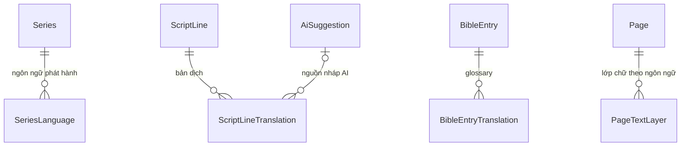
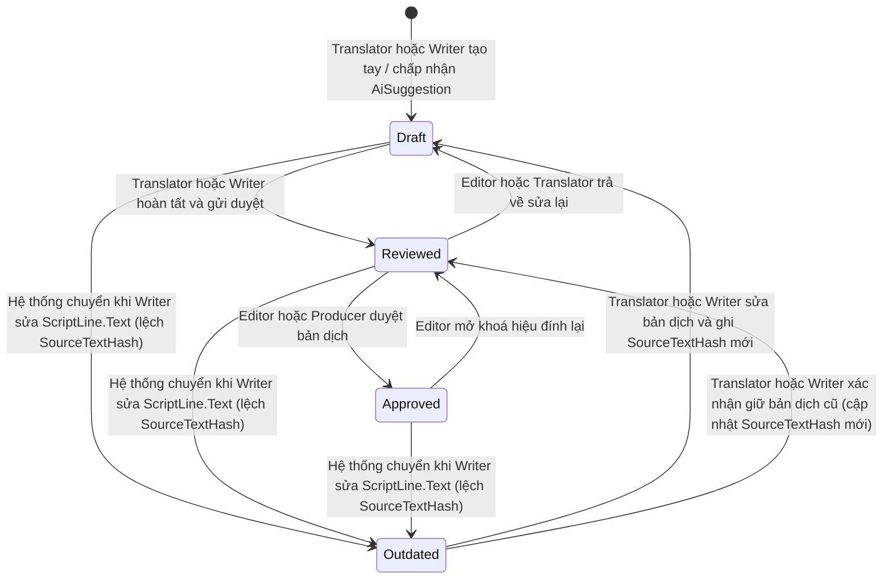
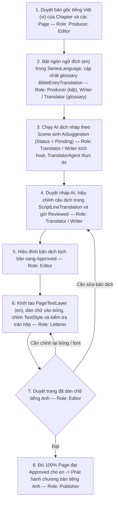

# ĐỀ XUẤT — SẢN XUẤT TRUYỆN ĐA NGÔN NGỮ (LOCALIZATION PIPELINE)

> **Trạng thái:** Đề xuất chi tiết kỹ thuật (Sẵn sàng ước lượng & hiện thực). Chưa có trong Master Spec V2.6.
> **Ngày:** 2026-11-13
> **Nguồn:** Phân tích kiến trúc của Antigravity (Gemini) đối chiếu codebase Backend nhánh `trungkien` (engram #422). Các khẳng định về code đã được đối chiếu trực tiếp với `Domain/Entities/Content/{Series,ScriptLine,Page,ElementState,TextStyle}.cs`, `Domain/Entities/Ai/AiSuggestion.cs`, `PanelForge.AI/Agents/WriterAgent.cs`.
> **Lưu ý:** Đây là **dịch nội dung truyện** (lời thoại, dẫn truyện, SFX trên trang), khác với i18n giao diện VI/EN của Frontend (`src/locales/*`).

---

## 1. Bài toán

Một series sản xuất bằng **ngôn ngữ gốc tiếng Việt**, Producer duyệt bản gốc. Sau đó Producer, Writer và Publisher muốn phát hành thêm tiếng Anh, Nhật, Hàn… mà:

- không vẽ lại tranh, không nhân bản `Chapter` / `Page` / `Panel`;
- giữ nhất quán tên nhân vật, thuật ngữ giữa các ngôn ngữ;
- biết bản dịch nào đã lỗi thời khi bản gốc bị sửa;
- không làm rối lưới giao việc Trang × Bước (xem [ASSIGNMENT_GRID_V3_PROPOSAL.md](ASSIGNMENT_GRID_V3_PROPOSAL.md)).

---

## 2. Phương án: B — một chương, tách text theo ngôn ngữ

| Tiêu chí | A. Mỗi ngôn ngữ một bản sao chapter | **B. Một chapter, text tách theo ngôn ngữ (chọn)** |
|---|---|---|
| Artwork / `Panel` | Nhân bản theo số ngôn ngữ | Dùng chung một bản (`ElementState.AssetId` chung trên `Page` gốc) |
| Sửa tranh gốc | Phải sửa N bản | Sửa một lần trên `Page` gốc |
| Theo dõi bản dịch lỗi thời | Khó, không liên kết với dòng gốc | Có, qua `SourceTextHash` (đề xuất mới) |
| Độ phức tạp | Đơn giản lúc đầu, nặng về sau | Thêm 4 thực thể, tách biệt khỏi Marten event stream của `Page` |

### Hướng thiết kế đề xuất (chưa chốt — cần nhóm duyệt)

1. **Một `Chapter` / `Page` / `Panel` duy nhất:** Không nhân bản cây nội dung gốc; chỉ tách bản dịch kịch bản và lớp chữ trên trang theo `LanguageCode`.
2. **Phát hiện lỗi thời bằng `SourceTextHash` (đề xuất mới):** Đối chiếu băm SHA-256 với `ScriptLine.Text`, không cần background job đồng bộ.
3. **AI dịch nháp đi qua `AiSuggestion`:** Tuân thủ BR-02 — AI chỉ tạo đề xuất `Pending`, người duyệt mới ghi vào bảng dịch, không ghi đè trực tiếp.
4. **Không trộn vào Marten stream gốc:** Lớp chữ của ngôn ngữ đích lưu tách theo `(PageId, LanguageCode)`, không đẩy event vào stream của `Page` gốc.
5. **Lưới giao việc dùng bộ lọc ngôn ngữ:** Không nhân số cột theo số ngôn ngữ trên lưới chính.

---

## 3. Mô hình dữ liệu đề xuất



| Thực thể (đề xuất mới) | Mục đích | Khoá chính & Unique Index |
|---|---|---|
| `SeriesLanguage` | Danh sách ngôn ngữ của `Series`, đánh dấu ngôn ngữ gốc | PK `Id`; Unique `(SeriesId, LanguageCode)`; Filtered Unique `(SeriesId) WHERE IsSource = true` |
| `ScriptLineTranslation` | Bản dịch của từng `ScriptLine` theo ngôn ngữ đích | PK `Id`; Unique `(ScriptLineId, LanguageCode)` |
| `BibleEntryTranslation` | Glossary: tên nhân vật, địa danh, đạo cụ, đại từ theo ngôn ngữ | PK `Id`; Unique `(BibleEntryId, LanguageCode)` |
| `PageTextLayer` | Lớp phần tử chữ & bố cục bóng thoại theo ngôn ngữ trên từng `Page` | PK `Id`; Unique `(PageId, LanguageCode)` |

### Đặc tả chi tiết từng thực thể (đề xuất mới)

Tất cả thực thể cấp bảng dưới đây kế thừa `BaseEntity` có sẵn (cung cấp `Id: Guid`, `UpdatedAt: DateTime?`...). Các enum mới lưu dạng `string` trong PostgreSQL (EF Core `.HasConversion<string>()`).

#### A. `SeriesLanguage` (đề xuất mới — thuộc `PanelForge.Domain.Entities.Content`)

| Tên trường | Kiểu C# | Nullable | Ràng buộc / Quan hệ FK |
|---|---|---|---|
| `Id` | `Guid` | Không | PK (kế thừa `BaseEntity`) |
| `SeriesId` | `Guid` | Không | FK → `Series.Id` (`ON DELETE CASCADE`) |
| `LanguageCode` | `string` | Không | `varchar(10)`, chuẩn BCP-47 chữ thường (`"vi"`, `"en"`, `"ja"`, `"ko"`) |
| `IsSource` | `bool` | Không | Mặc định `false`. Filtered Unique Index đảm bảo mỗi `Series` có tối đa 1 dòng `IsSource = true` |
| `Status` | `SeriesLanguageStatus` (đề xuất mới) | Không | Enum: `Draft`, `InProgress`, `Published`, `Archived` |
| `DefaultFontFamily` | `string?` | Có | `varchar(100)`. Phải thuộc tập font hợp lệ của `LanguageCode`; `null` = dùng mặc định hệ thống |
| `ReadingDirectionOverride` | `ReadingDirection?` | Có | Dùng lại enum thật `ReadingDirection`; `null` = kế thừa `Series.ReadingDirection` |

- **Unique Index:** `UX_SeriesLanguage_Series_Lang` trên `(SeriesId, LanguageCode)` và `UX_SeriesLanguage_OneSource` trên `(SeriesId) WHERE IsSource = true`.
- **Navigation bổ sung vào `Series.cs`:** `ICollection<SeriesLanguage> Languages` (đề xuất mới).

#### B. `ScriptLineTranslation` (đề xuất mới — thuộc `PanelForge.Domain.Entities.Content`)

| Tên trường | Kiểu C# | Nullable | Ràng buộc / Quan hệ FK |
|---|---|---|---|
| `Id` | `Guid` | Không | PK (kế thừa `BaseEntity`) |
| `ScriptLineId` | `Guid` | Không | FK → `ScriptLine.Id` (`ON DELETE CASCADE`) |
| `LanguageCode` | `string` | Không | `varchar(10)`. Chỉ tạo cho ngôn ngữ đích (`IsSource = false`) đã bật trong `SeriesLanguage` |
| `Text` | `string` | Không | `max length 2000`, đã `Trim()`, không rỗng. Dịch từ `ScriptLine.Text` |
| `SpeakerLabelOverride` | `string?` | Có | `max length 100` (khớp giới hạn `ScriptLine.SpeakerLabel`). Chỉ dùng khi `ScriptLine.SpeakerCharacterId == null` |
| `SourceTextHash` | `string` | Không | `char(64)`, SHA-256 hex chữ thường của `ScriptLine.Text` tại thời điểm lưu bản dịch |
| `Status` | `TranslationStatus` (đề xuất mới) | Không | Enum: `Draft`, `Reviewed`, `Approved`, `Outdated` |
| `SourceAiSuggestionId` | `Guid?` | Có | FK → `AiSuggestion.Id` (`ON DELETE SET NULL`), truy vết nguồn gốc AI (BR-02) |
| `TranslatedByUserId` | `Guid` | Không | ID người tạo/cập nhật bản dịch gần nhất |
| `ReviewedByUserId` | `Guid?` | Có | ID `Editor` / `Producer` duyệt bản dịch |
| `ReviewedAt` | `DateTime?` | Có | Thời điểm duyệt (UTC) |
| `TranslatorNote` | `string?` | Có | `max length 500`, ghi chú ngữ cảnh cho `Editor` / `Letterer` |

- **Unique Index:** `UX_ScriptLineTranslation_Line_Lang` trên `(ScriptLineId, LanguageCode)`.
- **Index truy vấn:** `IX_ScriptLineTranslation_Lang_Status` trên `(LanguageCode, Status)`.

#### C. `BibleEntryTranslation` (đề xuất mới — thuộc `PanelForge.Domain.Entities.Bible`)

| Tên trường | Kiểu C# | Nullable | Ràng buộc / Quan hệ FK |
|---|---|---|---|
| `Id` | `Guid` | Không | PK (kế thừa `BaseEntity`) |
| `BibleEntryId` | `Guid` | Không | FK → `BibleEntry.Id` (`ON DELETE CASCADE`) |
| `LanguageCode` | `string` | Không | `varchar(10)` |
| `TranslatedName` | `string` | Không | `max length 200`, không rỗng (tên nhân vật, địa danh, đạo cụ ở ngôn ngữ đích) |
| `Pronouns` | `string?` | Có | `max length 100` (cách xưng hô/đại từ nhân xưng ở ngôn ngữ đích, vd `"he/him"`, `"sensei"`) |
| `TranslationNote` | `string?` | Có | `max length 1000`, quy tắc dịch thuật ngữ và giọng điệu cho Translator & AI |
| `UpdatedByUserId` | `Guid` | Không | ID người cập nhật gần nhất |

- **Unique Index:** `UX_BibleEntryTranslation_Entry_Lang` trên `(BibleEntryId, LanguageCode)`.

#### D. `PageTextLayer` & `LocalizedElementState` (đề xuất mới — thuộc `PanelForge.Domain.Entities.Content`)

`PageTextLayer` lưu trong PostgreSQL qua EF Core (không ghi vào Marten event stream của `Page`), chứa cột `jsonb` `Elements` ánh xạ sang danh sách `LocalizedElementState` (đề xuất mới) có cấu trúc tương thích trực tiếp với `ElementState` hiện có.

**Bảng `PageTextLayer` (đề xuất mới):**

| Tên trường | Kiểu C# | Nullable | Ràng buộc / Quan hệ FK |
|---|---|---|---|
| `Id` | `Guid` | Không | PK (kế thừa `BaseEntity`) |
| `PageId` | `Guid` | Không | FK → `Page.Id` (`ON DELETE CASCADE`) |
| `LanguageCode` | `string` | Không | `varchar(10)`, chỉ áp dụng cho ngôn ngữ `IsSource = false` |
| `Status` | `PageLocalizationStatus` (đề xuất mới) | Không | Enum: `NotStarted`, `Lettering`, `ReadyForReview`, `Approved` |
| `Version` | `int` | Không | Mặc định `1`, tăng `1` mỗi lần sửa (optimistic concurrency cấp layer) |
| `Elements` | `List<LocalizedElementState>` (đề xuất mới) | Không | Lưu `jsonb`, mặc định `[]` |
| `LastLetteredByUserId` | `Guid?` | Có | ID `Letterer` thao tác gần nhất |
| `ApprovedByUserId` | `Guid?` | Có | ID `Editor` / `Producer` duyệt trang ngôn ngữ đích |
| `ApprovedAt` | `DateTime?` | Có | Thời điểm duyệt trang (UTC) |

- **Unique Index:** `UX_PageTextLayer_Page_Lang` trên `(PageId, LanguageCode)`.

**Cấu trúc phần tử `LocalizedElementState` (đề xuất mới — lưu trong `PageTextLayer.Elements`):**

| Tên trường | Kiểu C# | Nullable | Ràng buộc & đối chiếu `ElementState.cs` |
|---|---|---|---|
| `ElementId` | `Guid` | Không | Định danh duy nhất trong phạm vi `PageTextLayer` |
| `SourceElementId` | `Guid?` | Có | Trỏ về `ElementState.ElementId` trên `Page` gốc; `null` nếu Letterer thêm bóng/chú thích SFX riêng cho ngôn ngữ đích |
| `ElementType` | `string` | Không | Chỉ nhận giá trị thuộc `Page.TextElementTypes` (`"SPEECH_BALLOON"`, `"THOUGHT_BALLOON"`, `"NARRATION_BOX"`, `"SOUND_EFFECT"`) |
| `PanelId` | `Guid?` | Có | FK logic → `Panel.Id` (khớp `ElementState.PanelId`) |
| `ScriptLineId` | `Guid?` | Có | FK logic → `ScriptLine.Id`. Unique trong các phần tử `!IsRemoved` của cùng `PageTextLayer` (giữ luật BR-05 như `Page.DuplicateBindingCode`) |
| `SpeakerId` | `Guid?` | Có | FK logic → `BibleEntry.Id` (khớp `ElementState.SpeakerId`) |
| `ZIndex` | `int` | Không | Thứ tự chồng lớp (khớp `ElementState.ZIndex`) |
| `X`, `Y`, `Width`, `Height` | `double` | Không | `Width > 0`, `Height > 0` — toạ độ/kích thước bóng của riêng ngôn ngữ đích |
| `Rotation` | `double` | Không | Góc xoay theo độ, mặc định `0` |
| `RenderedText` | `string?` | Có | Văn bản thực tế vẽ trong bóng của ngôn ngữ đích (khởi tạo từ `ScriptLineTranslation.Text`) |
| `AppliedTranslationHash` | `string?` | Có | `char(64)`, SHA-256 của `ScriptLineTranslation.Text` lúc đổ vào bóng, dùng để phát hiện khi Translator sửa lại bản dịch sau khi Letterer đã dàn chữ |
| `Style` | `TextStyle?` | Có | Tái sử dụng trực tiếp record thật `TextStyle` (`FontFamily`, `FontSize`, `BalloonShape`, `TailX`, `TailY`...) |
| `ReadingOrder` | `int?` | Có | `>= 1` hoặc `null` (khớp `ElementState.ReadingOrder`) |
| `OverflowAckReason` | `string?` | Có | `max length 500`, lý do xác nhận tràn chữ theo BR-20 (tự reset về `null` khi đổi `Width`, `Height`, `RenderedText`, hoặc `Style`) |
| `IsRemoved` | `bool` | Không | Mặc định `false` (xoá mềm giống `ElementState.IsRemoved`) |
| `Version` | `int` | Không | Mặc định `1`, tăng `1` sau mỗi lần sửa phần tử để kiểm tra xung đột theo BR-11 |

---

### 3.1 Phát hiện bản dịch lỗi thời: `SourceTextHash`

#### Quy tắc chuẩn hoá & thuật toán băm (`SourceTextHasher` — đề xuất mới)

Chỉ băm trường **`ScriptLine.Text`** (không băm `DialogueText`/`StageDirection` vốn chỉ giữ tương thích ngược tới SCR-23; không băm `LineOrder` hay `PanelId` vì sắp xếp lại dòng hoặc phân trang lại qua `ScriptLine.AssignToPanel` không làm đổi nghĩa câu thoại).

Các bước chuẩn hoá trước khi băm:
1. Nếu `text` là `null` hoặc chỉ chứa khoảng trắng → coi là chuỗi rỗng `""`.
2. Chuẩn hoá Unicode về **NFC** (`NormalizationForm.FormC`) để đồng nhất ký tự tiếng Việt dựng sẵn và tổ hợp dấu.
3. Chuẩn hoá ký tự xuống dòng: thay `"\r\n"` và `"\r"` thành `"\n"`.
4. `Trim()` đầu/cuối chuỗi; trên từng dòng, gộp chuỗi nhiều dấu cách/tab liên tiếp (`[ \t]+`) thành đúng 1 dấu cách `" "` (giữ nguyên `\n` giữa các dòng).
5. Mã hoá UTF-8 (`Encoding.UTF8.GetBytes`) và băm bằng **SHA-256** (`SHA256.HashData`), xuất chuỗi **64 ký tự hex chữ thường**.

```csharp
// SourceTextHasher.cs (đề xuất mới)
public static class SourceTextHasher
{
    public static string Compute(string? text)
    {
        if (string.IsNullOrWhiteSpace(text))
            return Convert.ToHexString(SHA256.HashData([])).ToLowerInvariant();

        var normalized = text.Normalize(NormalizationForm.FormC)
            .Replace("\r\n", "\n")
            .Replace('\r', '\n')
            .Trim();

        var lines = normalized.Split('\n')
            .Select(line => Regex.Replace(line.Trim(), @"[ \t]+", " "));
        var canonical = string.Join('\n', lines);

        var bytes = Encoding.UTF8.GetBytes(canonical);
        return Convert.ToHexString(SHA256.HashData(bytes)).ToLowerInvariant();
    }
}
```

#### Cơ chế đối chiếu (Read-time + Write-time)

- **Lúc lưu bản dịch:** Ghi `SourceTextHash = SourceTextHasher.Compute(scriptLine.Text)`.
- **Lúc đọc (Read-time):** Query đối chiếu `SourceTextHasher.Compute(scriptLine.Text) != translation.SourceTextHash` để trả cờ `IsOutdated = true` tức thì mà không phụ thuộc background job.
- **Lúc sửa kịch bản gốc (Write-time):** Trong command handler gọi `ScriptLine.UpdateContent(...)`, tính hash mới `newHash`. Mọi `ScriptLineTranslation` của `ScriptLine.Id` có `SourceTextHash != newHash` được chuyển `Status = TranslationStatus.Outdated`.

#### Ví dụ minh hoạ khi Writer sửa 1 dòng

1. **Tạo dòng gốc (`vi`):** `Writer` tạo `ScriptLine` với `Kind = ScriptLineKind.Dialogue`, `Text = "Chạy mau! Cổng dịch chuyển sắp đóng rồi!"`.
   - Chuẩn hoá giữ nguyên chuỗi → giả sử `SourceTextHasher.Compute(Text)` sinh mã 64 ký tự hex `H_v1`.
2. **Dịch & duyệt (`en`):** `Translator` lưu `ScriptLineTranslation` (`LanguageCode = "en"`, `Text = "Run! The portal is about to close!"`, `SourceTextHash = H_v1`), `Editor` duyệt `Status = Approved`.
3. **Tình huống A — `Writer` chỉ sửa dư khoảng trắng:** `Writer` lưu `"  Chạy mau!   Cổng dịch chuyển sắp đóng rồi! "`.
   - Chuỗi sau chuẩn hoá không đổi → hash vẫn bằng `H_v1` → bản dịch `en` **giữ nguyên `Approved`**, không báo lỗi thời giả.
4. **Tình huống B — `Writer` đổi nội dung câu thoại:** `Writer` gọi `UpdateContent` sửa `Text` thành `"Đừng chạy! Cổng dịch chuyển là cái bẫy!"`.
   - Hash mới `H_v2 != H_v1` → bản dịch `en` tự động chuyển `Status` từ `Approved` sang `Outdated` và nổi cảnh báo vàng trên màn dịch song song cũng như trên `PageTextLayer` của `Letterer`.
   - `Translator` sửa lại thành `"Don't run! The portal is a trap!"` → hệ thống cập nhật `SourceTextHash = H_v2`, đưa `Status` về `Draft` (hoặc `Reviewed` khi gửi duyệt).

---

### 3.2 Glossary lấy từ Series Bible

- `BibleEntryTranslation` (đề xuất mới) mở rộng `BibleEntry` hiện có (nhân vật, địa danh, đạo cụ đã khoá Canon trong `SeriesBible`).
- Khi hiển thị tên người nói của `ScriptLine`:
  - Nếu `ScriptLine.SpeakerCharacterId != null`: ưu tiên lấy `BibleEntryTranslation.TranslatedName` theo `(SpeakerCharacterId, LanguageCode)`; nếu chưa dịch thì fallback về tên gốc trên `BibleEntry`.
  - Nếu `ScriptLine.SpeakerCharacterId == null` và có `ScriptLine.SpeakerLabel` (nhân vật quần chúng): dùng `ScriptLineTranslation.SpeakerLabelOverride`.

---

### 3.3 Vòng đời `ScriptLineTranslation`



| Chuyển trạng thái | Tác nhân thực hiện | Điều kiện nghiệp vụ |
|---|---|---|
| `[*] → Draft` | `Translator` (đề xuất mới) / `Writer` | Nhập bản dịch thủ công hoặc chấp nhận đề xuất từ `AiSuggestion` |
| `Draft → Reviewed` | `Translator` / `Writer` | `Text` không rỗng và `SourceTextHash` khớp với `ScriptLine.Text` hiện tại |
| `Reviewed → Approved` | `Editor` / `Producer` | Đã kiểm tra thuật ngữ glossary và ngữ cảnh cảnh truyện |
| `Reviewed / Approved → Draft / Reviewed` | `Editor` / `Translator` | Trả về chỉnh sửa câu chữ |
| `* → Outdated` | Hệ thống (khi `Writer` gọi `ScriptLine.UpdateContent`) | `SourceTextHasher.Compute(scriptLine.Text) != translation.SourceTextHash` |
| `Outdated → Draft / Reviewed` | `Translator` / `Writer` | Lưu bản dịch mới (hoặc xác nhận chỉ sửa lỗi chính tả câu gốc không đổi nghĩa), ghi đè `SourceTextHash` hiện hành |

---

### 3.4 Tích hợp AI dịch nháp với `AiSuggestion` và Agent hiện có

Đối chiếu trực tiếp `WriterAgent.cs` và `AiSuggestion.cs`, luồng AI dịch nháp tái sử dụng nguyên khung hạ tầng `AgentRunner` + `PromptLibrary` + `OutputParser` + `AiSuggestion` mà không tạo đường tắt ghi thẳng DB:

1. **Tác nhân AI (`TranslatorAgent` — đề xuất mới tại `PanelForge.AI/Agents/TranslatorAgent.cs`):**
   - Nạp prompt tĩnh qua `PromptLibrary.Load("translator")` (đề xuất mới) và nhận `AgentRunner` qua DI giống hệt `WriterAgent`.
   - **Ngữ cảnh đầu vào (`TranslationAgentContext` — đề xuất mới):**
     - Thông tin bộ truyện & cảnh: `SourceLanguageCode`, `TargetLanguageCode`, `Series.Genre`, `Series.ReadingDirection`, `Series.StoryArc`, `SceneHeading`, `SceneSummary`.
     - **Glossary rút gọn theo `Scene`:** Truy vấn các `BibleEntry` liên quan tới `Scene` (qua `ScriptLine.SpeakerCharacterId` và `ScriptLine.BibleLinks`) kèm `BibleEntryTranslation` (`TranslatedName`, `Pronouns`, `TranslationNote`).
     - **Danh sách `ScriptLine` nguồn:** `Id`, `LineOrder`, `Kind`, mã nhân vật từ `KeyMaps.CharactersByCode`, `SpeakerLabel`, `Text`, và `SourceTextHash` tính tại thời điểm gọi. Các dòng `ScriptLineKind.Action` được đưa vào prompt để AI hiểu hành động nhân vật nhưng đánh dấu `[context-only]` nếu không gắn lên bóng chữ trên trang.
   - **Parse & Validate (`OutputParser.Parse<TranslatorOutput>` — đề xuất mới):**
     - Kiểm tra mọi `scriptLineId` model trả về phải thuộc tập `ScriptLine.Id` của `Scene` đầu vào (chặn hallucination ID tương tự cách `WriterAgent.Parse` chặn `unknownSpeakers`).
     - Kiểm tra không bỏ trống `translatedText` cho các dòng thoại (`Dialogue`, `Thought` hoặc dòng gắn `PanelId`).
     - Đóng gói thành `TranslationDraft` (đề xuất mới), đính kèm sẵn `sourceTextHash` của từng dòng gốc lúc bắt đầu chạy.

2. **Lưu đề xuất vào `AiSuggestion` (có sẵn tại `Domain/Entities/Ai/AiSuggestion.cs`):**
   - Bổ sung giá trị `Translation` (đề xuất mới) vào enum `AiSuggestionKind`.
   - Gọi `AiSuggestion.Create(...)` hiện có với:
     - `WorkspaceId`, `SeriesId`, `ChapterId`, `SceneId`: điền đầy đủ theo `Scene` đang dịch (cả 4 trường đều đã có sẵn trên `AiSuggestion`).
     - `Kind`: `AiSuggestionKind.Translation` (đề xuất mới); `Status`: `AiSuggestionStatus.Pending`.
     - `PayloadJson`: chuỗi JSON bất biến tuần tự hoá bằng `AiJson.Serialize` chứa `targetLanguageCode` và mảng `{ scriptLineId, translatedText, speakerLabelOverride, sourceTextHash, translatorNote }`; `PayloadHash`: SHA-256 của `PayloadJson`.
     - `BibleRevisionIdsJson`: danh sách revision ID của các `BibleEntry` đã nạp vào glossary.
     - `HasBlockingFindings`: `false` (hoặc `true` nếu validator phát hiện bản dịch làm mất tên riêng bắt buộc trong glossary).

3. **Người duyệt đề xuất (`AiSuggestion.Decide`):**
   - Khi `Translator` / `Writer` bấm chấp nhận đề xuất trên UI, handler gọi `aiSuggestion.Decide(...)` chuyển khỏi `AiSuggestionStatus.Pending` (đúng luật bất biến 1 lần quyết định trong `AiSuggestion.cs`), rồi tạo/cập nhật các dòng `ScriptLineTranslation` tương ứng với:
     - `SourceAiSuggestionId = aiSuggestion.Id`,
     - `SourceTextHash = item.SourceTextHash` từ `PayloadJson` (nếu trong lúc chờ người duyệt mà `Writer` đã sửa `ScriptLine.Text`, `SourceTextHash` vừa lưu sẽ khác hash hiện tại của `ScriptLine.Text` → dòng đó tự động hiện cảnh báo `Outdated` ngay lập tức),
     - `Status = TranslationStatus.Draft` để người dịch kiểm tra trước khi bấm gửi `Reviewed`.

---

## 4. Ai làm gì

| Role | Trách nhiệm trong localization |
|---|---|
| **Producer** | Duyệt bản gốc tiếng Việt. Bật ngôn ngữ mới cho series (`SeriesLanguage` — đề xuất mới). Giao việc dịch và lettering. |
| **Writer / Translator** | Dịch `ScriptLine` (có thể nhận nháp từ AI qua `AiSuggestion`), duy trì glossary `BibleEntryTranslation` (đề xuất mới). `WorkspaceRole` lưu dạng string trong DB nên thêm `WorkspaceRole.Translator` (đề xuất mới) hay cho `Writer` kiêm đều tương thích ngược. |
| **Letterer** | Dàn chữ trên `PageTextLayer` (đề xuất mới) của từng ngôn ngữ: chỉnh cỡ bóng thoại khi câu dài/ngắn, đổi `TextStyle`, xử lý tràn chữ và SFX. Không sửa đè artwork gốc. |
| **Editor** | Hiệu đính `ScriptLineTranslation` (`Reviewed → Approved`) và duyệt `PageTextLayer` đã dàn chữ theo từng ngôn ngữ. |
| **Publisher** | Phát hành từng ngôn ngữ độc lập khi 100% `Page` của `Chapter` ở ngôn ngữ đó đạt `PageLocalizationStatus.Approved`. |

### 4.1 Luồng sản xuất end-to-end theo Role



### 4.2 Trách nhiệm chi tiết của Letterer

1. **Bóng thoại dùng chung khung hay riêng theo ngôn ngữ?**
   - **Bóng thoại vector của Canvas (`TextStyle.BalloonShape` là `null` mặc định hoặc `"oval"`, `"cloud"`, `"spiky"`, `"box"`):** Khung bóng **tách riêng theo từng ngôn ngữ** trong `PageTextLayer.Elements` (đề xuất mới). Khi khởi tạo `PageTextLayer` cho `en`, hệ thống sao chép toạ độ (`X`, `Y`, `Width`, `Height`, `Rotation`, `ZIndex`, `Style`) từ các `ElementState` gốc thuộc `Page.TextElementTypes` sang `LocalizedElementState`, gán `SourceElementId = element.ElementId` và đổ `ScriptLineTranslation.Text` vào `RenderedText`. `Letterer` co giãn bóng tiếng Anh độc lập mà không phát sinh `ElementMovedEvent` hay `ElementStyleUpdatedEvent` trên `Page` gốc.
   - **Bóng thoại vẽ sẵn trong tranh (`TextStyle.BalloonShape == "none"`):** Theo quy ước sẵn có trong `TextStyle.cs`, `"none"` nghĩa là chỉ đặt hộp chữ lọt lòng vào bóng mà Artist đã vẽ cứng trên ảnh `AssetId`. Trường hợp này **khung bóng vật lý dùng chung trên tranh**, `Letterer` chỉ được chỉnh hộp chữ (`X`, `Y`, `Width`, `Height`), cỡ chữ `FontSize` và ngắt dòng trong lòng bóng trắng có sẵn. *Khuyến nghị sản xuất:* Các series nhắm tới đa ngôn ngữ nên để Artist xuất artwork sạch bóng (clean art) và tạo bóng bằng vector trên Canvas.

2. **Liên hệ với `ElementState` hiện có trên `Page`:**
   - Mọi phần tử không thuộc `Page.TextElementTypes` (tranh `AssetId`, khung `Panel`) chỉ lưu một lần trong `Page.Elements` của Marten event stream.
   - Khi hiển thị Canvas hoặc render ảnh xuất bản cho ngôn ngữ `L`:
     - Nếu `L` là ngôn ngữ gốc (`IsSource == true`): đọc `Page.Elements` hiện hành (không đổi code cũ).
     - Nếu `L` là ngôn ngữ đích (`IsSource == false`): hợp nhất **(phần tử không phải chữ từ `Page.Elements`)** + **(phần tử `!IsRemoved` từ `PageTextLayer(PageId, L).Elements`)**, sắp xếp theo `ZIndex`.
   - Nếu `Page` gốc xoá mềm một bóng thoại (`ElementState.IsRemoved == true`) hoặc đổi `ScriptLineId`, UI đối chiếu qua `LocalizedElementState.SourceElementId` để báo cảnh báo đồng bộ cho `Letterer` thay vì tự động xoá mất công dàn chữ của ngôn ngữ đích.

3. **Xử lý văn bản tràn bóng (Overflow — áp dụng BR-20):**
   - Khi dịch từ tiếng Việt sang tiếng Anh, độ dài câu thường tăng 15–30%. Khi hộp chữ báo tràn trên Canvas, `Letterer` xử lý theo thứ tự ưu tiên:
     1. **Nới khung bóng / chỉnh kiểu chữ:** Tăng `Width`, `Height` (nếu dùng bóng vector và không che chi tiết quan trọng của tranh), hoặc giảm `TextStyle.FontSize` (không thấp hơn `TextStyle.MinFontSize = 14`), giảm `LineHeight` (trong ngưỡng `0.8..2.5`).
     2. **Yêu cầu biên tập gọn câu (Copyfitting):** Trả dòng `ScriptLineTranslation` về `Translator` / `Writer` kèm ghi chú giới hạn ký tự để viết gọn lại.
     3. **Xác nhận tràn chữ có chủ đích (BR-20):** Nếu hiệu ứng chữ cố ý vượt viền bóng, `Letterer` bắt buộc nhập `OverflowAckReason` (tối đa 500 ký tự, giống `Page.AcknowledgeOverflow`). Mọi thao tác sửa `Width`, `Height`, `RenderedText` hoặc `Style` sau đó đều tự động xoá `OverflowAckReason = null` (đúng hành vi trong `Page.cs` dòng 423, 448, 470). `Editor` bị chặn duyệt trang nếu còn phần tử tràn chữ chưa có `OverflowAckReason`.

4. **Xử lý SFX (Sound Effects):**
   - **SFX dạng phần tử chữ (`ElementType == "SOUND_EFFECT"` trong `Page.TextElementTypes`):** Dịch và chỉnh trực tiếp trên `PageTextLayer` (đổi `RenderedText`, chọn font như `"Bangers"`, chỉnh `Color`, `StrokeColor`, `StrokeWidth`, `Rotation`). Không đụng vào artwork.
   - **SFX vẽ chết trong artwork (baked-in trên ảnh `AssetId`):** Không sửa đè file ảnh gốc `AssetId`. Xử lý theo 2 mức:
     - **Mức 1 — Chú thích phụ cạnh SFX gốc (chuẩn MVP):** `Letterer` thêm một `LocalizedElementState` mới (`SourceElementId = null`, `ElementType = "SOUND_EFFECT"`, `BalloonShape = "none"`) cỡ nhỏ kèm viền chữ `StrokeColor` tương phản đặt sát chữ tượng thanh gốc.
     - **Mức 2 — Che nền bằng hộp/nhãn đè (`FillOpacity = 1`) hoặc tách layer SFX ngay từ khâu Artist:** Quy định Artist không vẽ chữ SFX cứng vào file tranh mà đặt thành phần tử `"SOUND_EFFECT"` trên `Page` ngay từ bản gốc tiếng Việt.

---

## 5. Gắn vào lưới giao việc Trang × Bước

- Không thêm cột cho mỗi ngôn ngữ vào lưới chính (tránh lưới phình thành 20 trang × 5 bước × N ngôn ngữ).
- Dùng **bộ lọc ngôn ngữ** trên lưới: chọn `en` thì lưới hiện các bước localization (`Dịch` → `Lettering` → `Duyệt`) của ngôn ngữ đó trên cùng các hàng `Page`.
- Luồng localization của một `Page` chỉ mở khi bản gốc của trang đó đã được duyệt.

---

## 6. Ràng buộc kỹ thuật đã kiểm tra trong code

| Phát hiện | Vị trí | Ảnh hưởng & Hướng xử lý |
|---|---|---|
| `TextStyle.AllowedFonts` chỉ cho 4 font Latin: `Be Vietnam Pro`, `Mali`, `Patrick Hand`, `Bangers`. | `Domain/Entities/Content/TextStyle.cs` | Tách danh sách font hợp lệ theo `LanguageCode` (bổ sung font CJK khi mở rộng Nhật/Hàn/Trung) hoặc truyền tập font cho phép vào hàm validate theo ngôn ngữ. |
| Chưa hỗ trợ chữ dọc (`writing-mode: vertical-rl`). | Canvas / `TextStyle.cs` | Tiếng Anh/Hàn ngang dùng ngay được; tiếng Nhật truyền thống cần thêm cờ hướng chữ trong `TextStyle` ở giai đoạn sau. |
| `Page` dùng event sourcing qua Marten (`MartenPageRepository`, `PageProjection`). | `Domain/Entities/Content/Page.cs`, `Infrastructure/Persistence/EventStore/` | `PageTextLayer` (đề xuất mới) khoá theo `(PageId, LanguageCode)` lưu bảng EF Core + `jsonb`, tách khỏi event stream của `Page` gốc. |
| `Series` chưa có trường ngôn ngữ. | `Domain/Entities/Content/Series.cs` | Thêm `SeriesLanguage` (đề xuất mới); migration gán mặc định 1 dòng `LanguageCode = "vi"`, `IsSource = true` cho các `Series` hiện có. |
| `ScriptLine` đang giữ song song `Text`, `DialogueText`, `StageDirection` (chờ xoá ở SCR-23). | `Domain/Entities/Content/ScriptLine.cs` | `SourceTextHash` chỉ tính trên `ScriptLine.Text` (trường chuẩn đã được gán `resolvedText` trong `Create` và `UpdateContent`). |
| `AiSuggestion` đã có đủ `WorkspaceId`, `SeriesId`, `ChapterId`, `SceneId`, `PayloadJson`, `Decide(...)`. | `Domain/Entities/Ai/AiSuggestion.cs` | Dùng lại nguyên bảng `AiSuggestion`, chỉ cần thêm giá trị `Translation` (đề xuất mới) vào `AiSuggestionKind`. |
| `WorkspaceRole` không có `Translator`. | `Domain/Enums/WorkspaceRole.cs` | Thêm `Translator` (đề xuất mới) vào enum hoặc để `Writer` kiêm nhiệm. |

---

## 7. Phạm vi MVP gợi ý (nếu chỉ làm ~20% để demo)

1. `SeriesLanguage` + `ScriptLineTranslation` (đề xuất mới) với `SourceTextHash` (cờ `Outdated` tự động khi sửa `ScriptLine.Text`).
2. Màn dịch song song theo `Chapter` / `Scene`: cột gốc tiếng Việt | cột bản dịch, nút **"AI dịch nháp"** qua `TranslatorAgent` (đề xuất mới) + `AiSuggestion`.
3. `PageTextLayer` (đề xuất mới) cho **một ngôn ngữ đích (tiếng Anh `en`)** tận dụng 4 font Latin sẵn có trong `TextStyle.AllowedFonts`. **Hoãn** tiếng Nhật chữ dọc, font CJK và retouch SFX vẽ chết trong tranh.
4. Reader chọn ngôn ngữ (`vi` / `en`) khi đọc `Chapter` đã phát hành ngôn ngữ tương ứng.

---

## 8. Hợp đồng API đề xuất

Tất cả endpoint và DTO dưới đây là **(đề xuất mới)**, đặt dưới cơ chế kiểm tra quyền theo `WorkspaceRole` ở tầng Application/API hiện hành.

### 8.1 Danh sách Endpoint

| Nhóm | Method & Route (đề xuất mới) | Mục đích | Role được phép |
|---|---|---|---|
| **Ngôn ngữ Series** | `GET /api/series/{seriesId}/languages` | Lấy danh sách `SeriesLanguage` kèm tiến độ dịch & duyệt trang | Thành viên `Workspace` |
| | `POST /api/series/{seriesId}/languages` | Bật ngôn ngữ mới (hoặc thiết lập ngôn ngữ gốc) cho `Series` | `Producer` |
| | `PATCH /api/series/{seriesId}/languages/{languageCode}` | Đổi `DefaultFontFamily`, `ReadingDirectionOverride`, `Status` | `Producer` (`Publisher` được chuyển `Published`) |
| **Glossary** | `GET /api/series/{seriesId}/bible/translations?lang={languageCode}` | Lấy danh sách `BibleEntry` kèm bản dịch `BibleEntryTranslation` | Thành viên `Workspace` |
| | `PUT /api/bible-entries/{bibleEntryId}/translations/{languageCode}` | Tạo/cập nhật thuật ngữ, tên nhân vật theo ngôn ngữ | `Producer`, `Writer`, `Translator`*, `Editor` |
| **Dịch kịch bản** | `GET /api/chapters/{chapterId}/translations/{languageCode}` | Lấy toàn bộ `Scene` → `ScriptLine` gốc + `ScriptLineTranslation` + cờ `IsOutdated` | Thành viên `Workspace` |
| | `PUT /api/script-lines/{scriptLineId}/translations/{languageCode}` | Lưu nháp (`Draft`) hoặc gửi duyệt (`Reviewed`) một dòng thoại | `Writer`, `Translator`*, `Editor` |
| | `POST /api/script-lines/{scriptLineId}/translations/{languageCode}/review` | Duyệt (`Approved`) hoặc trả về (`Draft`) bản dịch dòng thoại | `Editor`, `Producer` |
| **AI dịch nháp** | `POST /api/scenes/{sceneId}/translations/{languageCode}/ai-draft` | Chạy `TranslatorAgent` tạo `AiSuggestion` (`Status = Pending`) cho `Scene` | `Writer`, `Translator`*, `Producer` |
| | `POST /api/ai-suggestions/{suggestionId}/apply-translations` | Gọi `AiSuggestion.Decide(...)` và ghi các dòng được duyệt vào `ScriptLineTranslation` (`Draft`) | `Writer`, `Translator`* |
| **Lettering đa ngôn ngữ** | `GET /api/pages/{pageId}/text-layers/{languageCode}` | Tải `PageTextLayer` kèm phần tử tranh của `Page` gốc & cảnh báo lệch hash | Thành viên `Workspace` |
| | `POST /api/pages/{pageId}/text-layers/{languageCode}/init` | Khởi tạo `PageTextLayer` bằng cách clone khung chữ từ `Page.Elements` + đổ bản dịch | `Letterer`, `Producer` |
| | `PUT /api/pages/{pageId}/text-layers/{languageCode}/elements/{elementId}` | Thêm/sửa toạ độ, kích thước, `RenderedText`, `TextStyle`, `ReadingOrder` (kèm `ExpectedVersion`) | `Letterer` |
| | `DELETE /api/pages/{pageId}/text-layers/{languageCode}/elements/{elementId}` | Xoá mềm phần tử chữ (`IsRemoved = true`) trên lớp ngôn ngữ | `Letterer` |
| | `POST /api/pages/{pageId}/text-layers/{languageCode}/elements/{elementId}/acknowledge-overflow` | Xác nhận cảnh báo tràn chữ kèm lý do theo BR-20 | `Letterer` |
| | `POST /api/pages/{pageId}/text-layers/{languageCode}/status` | `Letterer` nộp duyệt (`ReadyForReview`) hoặc `Editor` duyệt/trả về (`Approved` / `Lettering`) | `Letterer` (nộp), `Editor` / `Producer` (duyệt) |
| **Phát hành & Đọc** | `POST /api/chapters/{chapterId}/publish/{languageCode}` | Kiểm tra đủ 100% `PageTextLayer` đạt `Approved` và phát hành ngôn ngữ đó | `Publisher`, `Producer` |
| | `GET /api/reader/chapters/{chapterId}?lang={languageCode}` | Trả dữ liệu đọc chương theo ngôn ngữ đã `Published` | Public / `Reader` |

*(\* `Translator` là `WorkspaceRole` đề xuất mới; nếu nhóm chốt không tách role thì quyền này gộp vào `Writer`.)*

### 8.2 Các DTO chính (đề xuất mới)

```csharp
// 1. Bật ngôn ngữ mới cho Series
public sealed record AddSeriesLanguageRequest(
    string LanguageCode,
    bool IsSource = false,
    string? DefaultFontFamily = null,
    ReadingDirection? ReadingDirectionOverride = null);

// 2. Màn dịch song song: trả về dòng gốc + bản dịch + trạng thái lỗi thời
public sealed record ScriptLineTranslationItemDto(
    Guid ScriptLineId,
    int LineOrder,
    ScriptLineKind Kind,
    string? SourceText,
    string CurrentSourceTextHash,
    Guid? SpeakerCharacterId,
    string? TranslatedSpeakerName,   // suy từ BibleEntryTranslation hoặc SpeakerLabelOverride
    Guid? TranslationId,
    string? TranslatedText,
    string? SavedSourceTextHash,
    string? Status,                  // Draft | Reviewed | Approved | Outdated | null (chưa dịch)
    bool IsOutdated,                 // CurrentSourceTextHash != SavedSourceTextHash
    Guid? SourceAiSuggestionId,
    string? TranslatorNote);

// 3. Lưu / gửi duyệt 1 dòng dịch
public sealed record UpsertScriptLineTranslationRequest(
    string Text,
    string? SpeakerLabelOverride,
    string? TranslatorNote,
    bool SubmitForReview = false);

// 4. Yêu cầu AI dịch nháp 1 Scene
public sealed record CreateAiTranslationDraftRequest(
    string? StyleInstruction = null,
    bool OnlyMissingOrOutdated = true);

// 5. Cập nhật phần tử chữ trên PageTextLayer (tái sử dụng record TextStyle có sẵn)
public sealed record UpsertLocalizedElementRequest(
    string ElementType,
    Guid? SourceElementId,
    Guid? PanelId,
    Guid? ScriptLineId,
    Guid? SpeakerId,
    int ZIndex,
    double X,
    double Y,
    double Width,
    double Height,
    double Rotation,
    string? RenderedText,
    TextStyle? Style,
    int? ReadingOrder,
    int? ExpectedVersion);
```

---

## 9. Rủi ro & câu hỏi mở

### 9.1 Rủi ro kỹ thuật & vận hành

| Rủi ro | Mức độ | Biện pháp giảm thiểu |
|---|---|---|
| **Bản gốc thay đổi cấu trúc trang sau khi đã dàn chữ ngôn ngữ đích** (thêm/xoá bóng trên `Page` gốc, gộp/tách `ScriptLine`, phân trang lại `AssignToPanel`) | Cao | Chỉ mở bước `Lettering` ngôn ngữ đích sau khi trang gốc đã duyệt. Nếu trang gốc buộc phải mở khoá sửa lại, đối chiếu `SourceElementId` + `ScriptLineId` để đánh dấu phần tử lệch trên `PageTextLayer` thay vì xoá tự động. |
| **Độ nở văn bản (Text Expansion) gây tràn bóng hàng loạt** (tiếng Anh dài hơn tiếng Việt ~15–30%, đặc biệt trong khung hẹp Webtoon dọc) | Trung bình | Khuyến khích dùng bóng vector (`BalloonShape != "none"`), cung cấp cảnh báo giới hạn ký tự gợi ý ngay ở màn dịch song song và chặn duyệt trang vi phạm BR-20 chưa có `OverflowAckReason`. |
| **`TextStyle.Validated()` từ chối font ngoài Latin** | Trung bình | Khi mở rộng ngoài tiếng Anh (Nhật/Hàn/Trung), refactor `TextStyle.AllowedFonts` thành bảng ánh xạ font hợp lệ theo `LanguageCode` mà vẫn giữ tập 4 font hiện tại cho `"vi"` và `"en"`. |
| **Nhiễu ngữ cảnh & chi phí token khi gọi AI dịch chương có Bible lớn** | Thấp | Chỉ lọc các `BibleEntry` xuất hiện trong `Scene` (`SpeakerCharacterId` + `BibleLinks`) trước khi truyền vào `TranslatorAgent`. |
| **Pipeline xuất ảnh phẳng (Flattened Render) cho Reader** | Trung bình | Nếu Reader hiển thị ảnh trang đã gộp chữ thay vì chồng lớp DOM trên trình duyệt, bước xuất ảnh khi `Publisher` phát hành cần chạy riêng cho từng cặp `(ChapterId, LanguageCode)` lưu theo khóa asset riêng. |

### 9.2 Câu hỏi mở cần chốt trước khi code

1. **Bản đã phát hành bị sửa câu gốc:** Khi một chương tiếng Anh đã `Published` mà `Writer` sửa lại `ScriptLine.Text` tiếng Việt (làm `ScriptLineTranslation` chuyển sang `Outdated`), Reader vẫn đọc bản snapshot tiếng Anh đã phát hành gần nhất hay ẩn tạm thời bản tiếng Anh? *(Đề xuất: giữ snapshot đã phát hành cho Reader cho tới khi `Publisher` phát hành bản cập nhật mới).*
2. **Duyệt từng phần `AiSuggestion`:** Cho phép `Translator` tích chọn chấp nhận từng dòng trong một `AiSuggestion` của `Scene`, hay chấp nhận toàn bộ `Scene` vào trạng thái `Draft` rồi sửa tay các dòng chưa ưng ý? *(Đề xuất: gọi `AiSuggestion.Decide` một lần cho cả `Scene` để đổ vào `Draft`, sau đó sửa/xoá từng dòng trên `ScriptLineTranslation` nhằm giữ nguyên thiết kế bất biến của `AiSuggestion`).*
3. **Phạm vi dịch theo `ScriptLineKind`:** Các dòng `ScriptLineKind.Action` (mô tả hành động cho Artist, không gắn vào bóng chữ trên `Page`) có bắt buộc dịch để đạt 100% tiến độ không? *(Đề xuất: tiến độ bắt buộc chỉ tính trên các dòng `Dialogue`, `Thought` hoặc dòng đang gắn vào phần tử chữ trên `Page`; dòng `Action` chỉ hiển thị làm ngữ cảnh tham khảo cho `Translator` và AI).*
4. **Quyền duyệt ở studio nhỏ:** Khi workspace ít người không có riêng `Editor`, `Producer` có được kiêm toàn bộ thao tác duyệt `ScriptLineTranslation` (`Approved`) và `PageTextLayer` (`Approved`) không? *(Đề xuất: Có — giống ma trận quyền ở mục 9.1).*

---

## 10. Việc cần nhóm quyết

- [ ] Có đưa localization vào phạm vi đồ án (Master Spec V2.6) không?
- [ ] Thêm role `WorkspaceRole.Translator` (đề xuất mới) hay để `Writer` kiêm nhiệm?
- [ ] Ngôn ngữ đích cho demo (đề xuất: tiếng Anh `en`).
- [ ] Làm sau hay song song với Assignment lưới ô việc?
