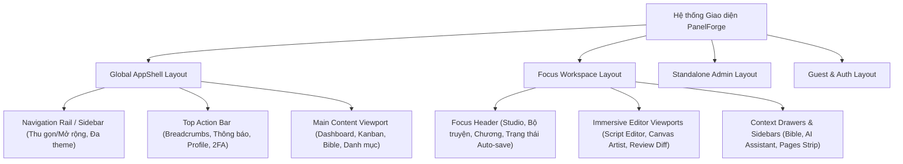
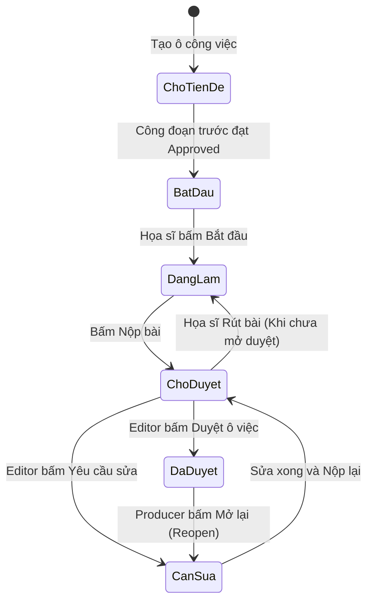
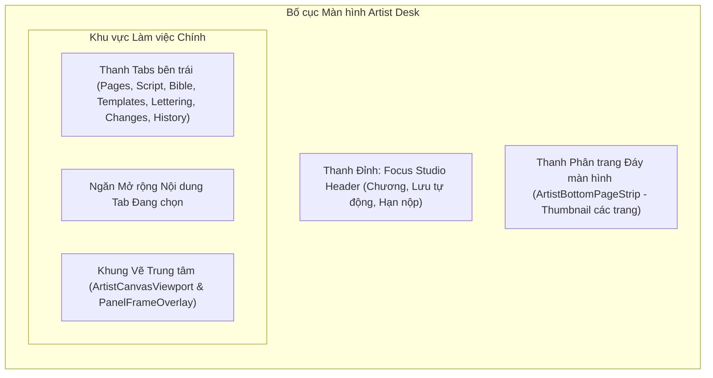

# BÁO CÁO TOÀN DIỆN VỀ GIAO DIỆN NGƯỜI DÙNG (UI/UX) - PANELFORGE SYSTEM
> **Mã tài liệu:** `PF-DOC-UI-REPORT-2026`  
> **Phiên bản hệ thống:** PanelForge Studio v2.6 (Multi-Role AI Comic/Manga Pipeline)  
> **Nguồn tri thức tập trung (SSOT):** `panelforge-hub/docs/spec/UI_CURRENT_SCREENS_REPORT.md`  
> **Đối tượng áp dụng:** Ban Quản Trị, Product Owner, Tech Lead, Frontend/Backend Engineers, UI/UX Designers.

---

## MỤC LỤC TỔNG QUAN

1. [Kiến trúc Giao diện & Hệ thống Điều hướng (UI Layout & Navigation Architecture)](#1-kiến-trúc-giao-diện--hệ-thống-điều-hướng)
2. [Nhóm Màn hình Công khai & Xác thực (Public & Auth Screens)](#2-nhóm-màn-hình-công-khai--xác-thực)
3. [Cổng Quản trị Hệ thống Toàn cục (Global System Admin Portal)](#3-cổng-quản-trị-hệ-thống-toàn-cục-admin)
4. [Không gian Làm việc Cấp Studio (Studio Hub & Workspace Level)](#4-không-gian-làm-việc-cấp-studio)
5. [Không gian Quản lý & Điều phối Bộ truyện (Series Production & Pipeline)](#5-không-gian-quản-lý--điều-phối-bộ-truyện)
6. [Bàn Làm việc Chuyên sâu Theo Vai trò (Dedicated Role Desks)](#6-bàn-làm-việc-chuyên-sâu-theo-vai-trò)
   - 6.1 [Writer: Bàn Kịch bản Manga & Comic (Script Editor View)](#61-writer-bàn-kịch-bản-manga--comic)
   - 6.2 [Artist: Bàn Vẽ Kỹ thuật số & Phân khung (Artist Desk View)](#62-artist-bàn-vẽ-kỹ-thuật-số--phân-khung)
   - 6.3 [Letterer: Bàn Xử lý Lời thoại & Thoại bóng (Letterer Desk View)](#63-letterer-bàn-xử-lý-lời-thoại--thoại-bóng)
   - 6.4 [Editor: Bàn Thẩm định & Kiểm duyệt Chất lượng (Editor Desk & Review Views)](#64-editor-bàn-thẩm-định--kiểm-duyệt-chất-lượng)
7. [Cổng Xuất bản & Doanh thu (Publisher Portal & Export Management)](#7-cổng-xuất-bản--doanh-thu-publisher)
8. [Màn hình Phân tích Độc giả (Reader Analytics)](#8-màn-hình-phân-tích-độc-giả-reader-stats)
9. [Màn hình Cá nhân, Thông báo & Các Hộp thoại Dùng chung (Shared & User Modals)](#9-màn-hình-cá-nhân-thông-báo--hộp-thoại-dùng-chung)
10. [Bảng Ma trận Phân quyền & Khả năng Truy cập UI](#10-bảng-ma-trận-phân-quyền--khả-năng-truy-cập-ui)

---

## 1. KIẾN TRÚC GIAO DIỆN & HỆ THỐNG ĐIỀU HƯỚNG

PanelForge sử dụng kiến trúc giao diện phân cấp linh hoạt, tối ưu hóa cho từng trạng thái tập trung của người dùng:

### 1.1. Hệ thống Khung giao diện (Layouts)
1. **Global AppShell (`AppShell.tsx`):**
   - **Thanh bên (Sidebar / Navigation Rail):** Cung cấp các menu chức năng theo vai trò. Hỗ trợ 4 giao diện chủ đề màu sắc: *Mực đậm (Ink)*, *Giấy sáng (Paper)*, *Biển đêm (Ocean)*, *Tím bản thảo (Plum)*. Có thể ghim cố định hoặc thu gọn thành icon rail để giải phóng diện tích hiển thị.
   - **Menu chuyển đổi Bộ truyện (Series Switcher):** Cho phép nhảy nhanh giữa các bộ truyện trong cùng một Studio.
   - **Thanh công cụ đỉnh trang:** Hiển thị vị trí ngữ cảnh hiện tại (Breadcrumbs), biểu tượng Thông báo với badge chưa đọc, lối tắt phím `Ctrl + K` (Command Palette), nút kích hoạt xác thực 2 bước (2FA), và Menu tài khoản người dùng (Đổi mật khẩu, Hồ sơ, Đăng xuất).
2. **Focus Workspace Layout (`FocusWorkspaceLayout.tsx`):**
   - Khung giao diện chuyên dụng không có thanh điều hướng bên (AppShell Sidebar bị ẩn hoàn toàn) nhằm tối đa hóa diện tích 100% chiều rộng màn hình cho công tác vẽ tranh (Artist Desk), gõ kịch bản (Script Editor), hoặc đối soát bản thảo (Review View).
   - Thanh đỉnh tinh gọn (Focus Header Bar): Hiển thị tiêu đề chương, trạng thái lưu tự động (Saving/Saved), các bước sản xuất (Stages: Script -> Layout -> Inking -> Lettering), nút quay về bàn điều phối chung.
3. **Standalone Admin Layout:**
   - Dành riêng cho vai trò `ADMINISTRATOR` quản trị hệ thống độc lập, với cơ chế bảo vệ phiên và quản lý tài nguyên máy chủ.

---

## 2. NHÓM MÀN HÌNH CÔNG KHAI & XÁC THỰC

### 2.1. Trang đích Giới thiệu (Landing Page)
- **Đường dẫn URL:** `/`
- **Vai trò truy cập:** Khách vãng lai (Guest / Chưa đăng nhập).
- **Mục đích:** Giới thiệu nền tảng biên soạn và xuất bản truyện tranh tích hợp trí tuệ nhân tạo PanelForge.
- **Các thành phần giao diện & Nút bấm:**
  - `Đăng nhập` (Login): Chuyển đến trang đăng nhập tài khoản.
  - `Đăng ký ngay` (Register / Get Started): Mở luồng tạo tài khoản mới.
  - `Khám phá Danh mục` (Explore Public Catalog): Dẫn tới trang đọc truyện công khai.
  - Hero Section & Tính năng cốt lõi: Giới thiệu 4 trụ cột công nghệ (Studio Workflow, AI Assistant, Series Bible Lore Consistency, Multi-format B5/Webtoon Export).

### 2.2. Trang Đăng nhập (Login Page)
- **Đường dẫn URL:** `/login`
- **Vai trò truy cập:** Khách / Người dùng chưa đăng nhập.
- **Mục đích:** Xác thực người dùng qua Email/Mật khẩu hoặc Nhà cung cấp dịch vụ xã hội.
- **Các thành phần giao diện & Nút bấm:**
  - Ô nhập liệu: `Email`, `Mật khẩu` (kèm icon ẩn/hiện mật khẩu).
  - Checkbox: `Ghi nhớ thiết bị này` (Remember Device - duy trì phiên đăng nhập sau khi tắt trình duyệt).
  - Nút bấm `Đăng nhập`: Gửi yêu cầu xác thực API và nhận Access Token.
  - Nút `Đăng nhập bằng Google`: Kích hoạt cửa sổ xác thực Firebase Google OAuth.
  - Liên kết `Quên mật khẩu?` & `Chưa có tài khoản? Đăng ký ngay`.

### 2.3. Trang Đăng ký (Register Page)
- **Đường dẫn URL:** `/register`
- **Vai trò truy cập:** Khách vãng lai.
- **Mục đích:** Tạo tài khoản định danh mới trong hệ sinh thái PanelForge.
- **Các thành phần giao diện & Nút bấm:**
  - Ô nhập liệu: `Họ và tên`, `Email`, `Mật khẩu`, `Xác nhận mật khẩu`.
  - Checkbox xác nhận: `Đồng ý với Điều khoản dịch vụ & Chính sách bảo mật`.
  - Nút `Tạo tài khoản`: Đăng ký người dùng mới với vai trò mặc định `USER`.
  - Nút `Đăng ký nhanh bằng Google`.

### 2.4. Trang Danh mục Truyện Công khai (Public Catalog)
- **Đường dẫn URL:** `/catalog`
- **Vai trò truy cập:** Mọi đối tượng (Public / Khách / Thành viên).
- **Mục đích:** Thư viện duyệt và đọc các bộ truyện tranh đã được duyệt và chính thức xuất bản.
- **Các thành phần giao diện, Tabs & Nút bấm:**
  - Thanh tìm kiếm: Tìm nhanh theo tiêu đề truyện hoặc tác giả.
  - Bộ lọc thể loại (Genre Filter Tabs): `Tất cả`, `Action`, `Fantasy`, `Sci-Fi`, `Slice of Life`, `Mystery`,...
  - Thẻ truyện (Series Card): Ảnh bìa, Tên truyện, Tác giả/Studio, Thể loại, Tóm tắt, Số chương đã phát hành.
  - Nút `Đọc ngay` (Read): Chuyển đến màn hình đọc chương truyện.
  - Nút `Về Studio / Bàn làm việc`: Điều hướng trở lại trang làm việc nội bộ nếu đã đăng nhập.

### 2.5. Trang Xem trước Thẩm định Độc lập cho Khách (Public Guest Preview)
- **Đường dẫn URL:** `/review/invite/:token` (hỗ trợ chuyển hướng từ `/preview/:token`)
- **Vai trò truy cập:** Bất kỳ ai sở hữu liên kết mã bảo mật (Secure Token - Không yêu cầu đăng nhập tài khoản).
- **Mục đích:** Cho phép tác giả gửi bản thảo chương truyện cho đối tác, nhà tài trợ hoặc độc giả kiểm thử đọc trước mà không làm lộ dữ liệu nội bộ.
- **Các thành phần giao diện & Nút bấm:**
  - Trình duyệt xem trang truyện (Single-page view hoặc Webtoon vertical scroll).
  - Thanh điều khiển: Nút `Trang trước` (Previous), `Trang sau` (Next), Chọn trang (Jump to page).
  - Chế độ đọc: `Fit Width` (Khớp chiều rộng) / `Fit Screen` (Toàn màn hình).
  - Dấu ấn bảo mật: Watermark bản quyền bảo vệ tác quyền.

---

## 3. CỔNG QUẢN TRỊ HỆ THỐNG TOÀN CỤC (`/admin`)

- **Đường dẫn URL:** `/admin` (tham số điều hướng tab: `/admin?tab=<tab_name>`)
- **Vai trò truy cập:** Chỉ dành riêng cho `ADMINISTRATOR`.
- **Mục đích:** Quản lý hạ tầng hệ thống, cấu hình hạn mức AI, phân quyền người dùng, và giám sát an ninh.

| Tên Tab | Chức năng chi tiết | Nút bấm & Thao tác tương tác |
| :--- | :--- | :--- |
| **1. Tổng quan (`dashboard`)** | Xem chỉ số vận hành tổng thể: Tổng số tài khoản, Studio hoạt động, Tổng số chương hoàn thành, Tỷ lệ gọi AI thành công, Trạng thái tài nguyên máy chủ. | • Nút `Làm mới số liệu` • Nút chọn phạm vi thời gian (Hôm nay, 7 ngày, 30 ngày) • Lối tắt truy cập nhanh vào Quản lý User và Cấu hình AI. |
| **2. Người dùng & Phân quyền (`users`)** | Quản lý toàn bộ danh sách tài khoản: Tra cứu, đổi vai trò hệ thống (`USER`, `PUBLISHER`, `ADMINISTRATOR`), cấp quyền tạo Studio (`canCreateStudio`). | • Ô `Tìm kiếm người dùng` (Tên, Email) • Bộ lọc `Vai trò hệ thống` • Nút `Phân quyền` (Sửa Role/Quyền tạo Studio) • Nút `Khóa tài khoản` / `Mở khóa` • Nút `Đặt lại mật khẩu`. |
| **3. Cấu hình AI & Quota (`ai-config`)** | Thiết lập các mô hình trí tuệ nhân tạo (Gemini, Claude, GPT), đặt giới hạn hạn ngạch token theo người dùng/Studio, bật/tắt tính năng gợi ý kịch bản và nhận diện khung hình. | • Nút `Lưu cấu hình AI` • Dropdown chọn mô hình mặc định cho từng công đoạn • Thanh trượt điều chỉnh Quota Token hàng tháng • Nút `Kiểm tra kết nối API Key`. |
| **4. Lưu trữ & Sao lưu (`storage`)** | Quản lý dung lượng lưu trữ đám mây, các bucket ảnh gốc và bản sao lưu (Backup & Disaster Recovery). | • Nút `Tạo bản sao lưu tức thì` • Nút `Dọn dẹp ảnh nháp/rác` • Bảng theo dõi dung lượng từng Studio. |
| **5. Chính sách Phiên (`session-policy`)** | Thiết lập thời gian sống của phiên đăng nhập (Session TTL), kiểm soát đăng nhập đồng thời, chính sách bắt buộc xác thực 2 bước (2FA). | • Nút `Cập nhật chính sách an ninh` • Toggle kích hoạt bắt buộc 2FA toàn hệ thống • Cài đặt số phút tự động đăng xuất khi không thao tác. |
| **6. Nhật ký Kiểm toán (`audit`)** | Ghi nhận và truy vết toàn bộ các thao tác nhạy cảm: Đổi quyền, xoá dữ liệu, xuất file, đăng nhập thất bại. | • Ô tìm kiếm từ khóa log • Bộ lọc `Khoảng thời gian` và `Mức độ nghiêm trọng` (Info, Warning, Danger) • Nút `Xuất báo cáo Audit Log (CSV/JSON)`. |
| **7. Thống kê Toàn sàn (`analytics`)** | Biểu đồ theo dõi tổng lưu lượng độc giả đọc truyện trên toàn hệ thống và mức tiêu thụ tài nguyên. | • Nút chọn khoảng thời gian phân tích • Biểu đồ lượt đọc theo giờ/ngày • Top truyện thịnh hành. |

---

## 4. KHÔNG GIAN LÀM VIỆC CẤP STUDIO

### 4.1. Danh sách Không gian Làm việc (Workspace Shelf)
- **Đường dẫn URL:** `/workspaces`
- **Vai trò truy cập:** Tất cả tài khoản đã đăng nhập (`USER`, `PRODUCER`, `WRITER`, `ARTIST`,...).
- **Mục đích:** Nơi người dùng lựa chọn Không gian làm việc (Studio) mình tham gia hoặc tạo Không gian làm việc mới.
- **Các thành phần giao diện, Tabs & Nút bấm:**
  - Ô tìm kiếm Studio & Bộ lọc sắp xếp: Theo ngày tạo, Hoạt động gần nhất, Theo tên A-Z.
  - Thẻ Không gian làm việc (Studio Card):
    - Hiển thị: Tên Studio, Ảnh đại diện/Cover, Vai trò của người dùng tại Studio (Ví dụ: `PRODUCER`, `EDITOR`), Số thành viên, Số bộ truyện hiện có.
    - Nút bấm trực tiếp trên thẻ: `Vào Studio` (Truy cập vào tổng quan Studio).
  - Nút `Tạo Studio mới` (Chỉ hiển thị nếu tài khoản có cờ `canCreateStudio`): Mở Modal `CreateWorkspaceModal` nhập tên Studio, mô tả, ảnh đại diện.
  - Nút `Đổi ảnh bìa Studio` (Dành cho chủ sở hữu Studio).

### 4.2. Tổng quan Studio (Studio Overview)
- **Đường dẫn URL:** `/workspaces/:workspaceId/overview` (hoặc `/series`)
- **Vai trò truy cập:** Mọi thành viên thuộc Studio đó.
- **Mục đích:** Trung tâm điều hành cấp xưởng vẽ, quản trị các đầu truyện và nhân sự trong xưởng.

| Tên Tab | Chức năng chi tiết | Nút bấm & Thao tác tương tác |
| :--- | :--- | :--- |
| **1. Bộ truyện (`series`)** | Hiển thị tất cả các tác phẩm truyện tranh thuộc quyền sở hữu của Studio, phân nhóm theo trạng thái sản xuất. | • Ô tìm kiếm tên bộ truyện • Bộ lọc trạng thái: `Tất cả`, `Đang sản xuất`, `Đã hoàn thành`, `Bản nháp` • Nút `+ Tạo Series mới` (Mở `CreateSeriesModal`): Nhập tên truyện, thể loại, khổ in B5/Webtoon, tải ảnh bìa (`CoverPickerModal`), mô tả tóm tắt • Nút trên thẻ Series: `Vào làm việc` (Chuyển sang Bảng sản xuất), `Sửa thông tin Series` (`EditSeriesModal`), `Cấu hình Pipeline` (`SeriesPipelineModal`), `Quản lý Khung mẫu` (`SeriesPresetsModal`). |
| **2. Thành viên (`members`)** | Quản lý đội ngũ nhân sự trong xưởng vẽ: Danh sách họa sĩ, biên kịch, biên tập viên, nhà sản xuất. | • Nút `+ Mời thành viên` (`InviteMemberModal`): Điền Email và gán vai trò (`PRODUCER`, `WRITER`, `ARTIST`, `LETTERER`, `EDITOR`) • Nút `Sửa quyền truy cập` (`EditMemberAccessModal`): Thay đổi vai trò hoặc cấp quyền riêng • Nút `Xóa khỏi Studio` (Thu hồi quyền thành viên) • Nút `Nhật ký hoạt động Studio` (`WorkspaceAuditModal`). |

---

## 5. KHÔNG GIAN QUẢN LÝ & ĐIỀU PHỐI BỘ TRUYỆN

### 5.1. Bảng Điều khiển Bộ truyện (Series Dashboard)
- **Đường dẫn URL:** `/workspaces/:workspaceId/series/:seriesId/dashboard`
- **Vai trò truy cập:** Toàn bộ thành viên được gán vào bộ truyện.
- **Mục đích:** Cung cấp bức tranh toàn cảnh về tiến độ, hạn chót và sức khỏe của dự án truyện tranh.
- **Các thành phần giao diện & Nút bấm:**
  - Khối chỉ số chính: Tổng tiến độ (%), Số chương đã hoàn thành / Tổng số chương, Số trang đã nghiệm thu, Số ngày còn lại đến hạn nộp (Deadline countdown).
  - Biểu đồ tiến độ công đoạn: Tỷ lệ hoàn thành qua 4 cổng chất lượng (Script -> Sketch/Storyboard -> Inking -> Lettering).
  - Khối Phân công công việc (Team Workload): Tải công việc hiện tại của từng họa sĩ/biên kịch.
  - Nút `Chuyển đến Kịch bản`: Nhảy nhanh tới bàn viết kịch bản.
  - Nút `Mở Bảng Sản xuất`: Vào Ma trận điều phối công việc.
  - Bảng ghi nhận Provenance Hash & Trợ lý AI đang hoạt động.

### 5.2. Quản lý Chương (Producer Chapter Management)
- **Đường dẫn URL:** `/workspaces/:workspaceId/series/:seriesId/chapters`
- **Vai trò truy cập:** `PRODUCER`, `EDITOR`, `ADMINISTRATOR` (các vai trò khác có quyền xem).
- **Mục đích:** Quản trị vòng đời từng chương truyện từ lúc khởi tạo đến lúc hoàn thiện để xuất bản.
- **Bảng dữ liệu & Các Cột:**
  - Cột hiển thị: Số thứ tự chương, Tiêu đề chương, Tiến độ hoàn thành, Trạng thái vòng đời (`PreProduction` - Tiền kỳ, `InProduction` - Đang vẽ, `ChapterApproved` - Đã nghiệm thu Gate 3, `HandedOffAndPublished` - Đã bàn giao xuất bản), Ngày dự kiến xong.
- **Hệ thống Nút bấm & Modals:**
  - Nút `+ Tạo chương mới` (Mở `CreateChapterModal`): Nhập số tập, số chương, tên chương, số trang dự kiến, hạn hoàn thành, định hướng nội dung.
  - Nút `Kích hoạt Sản xuất` (`StartProductionModal`): Chuyển trạng thái chương từ Tiền kỳ sang Sản xuất sau khi kịch bản đã được duyệt.
  - Nút `Phân công nhân sự chương` (`ChapterAssignmentsModal`): Gán nhanh danh sách họa sĩ, thợ thoại, biên tập cho toàn chương.
  - Nút `Quản lý Ấn bản / Bản dịch` (`ChapterEditionsModal`): Thêm ấn bản ngôn ngữ (Tiếng Việt, Tiếng Anh, Tiếng Nhật,...).
  - Nút `Tạo liên kết đọc thử` (`PreviewLinksModal`): Sinh đường link Token bảo mật gửi cho đối tác/khách mời.
  - Nút `Truy xuất Nguồn gốc` (`ChapterProvenanceModal`): Kiểm tra chuỗi Hash SHA-256 xác thực bản quyền tranh vẽ.
  - Nút `Xóa chương` (`TypeToConfirmModal`): Yêu cầu gõ chính xác tên chương để tránh xóa nhầm dữ liệu.

### 5.3. Ma trận Điều phối Sản xuất Manga (Task Grid Matrix V3 / Production Board)
- **Đường dẫn URL:** `/workspaces/:workspaceId/series/:seriesId/workspace`
- **Vai trò truy cập:** Tất cả các vai trò kỹ thuật trong xưởng.
- **Mục đích:** Trung tâm điều phối trực quan dạng ma trận Lưới (Trang x Công đoạn) hoặc Thẻ Kanban, quản lý trạng thái từng ô công việc (Task Cell).

- **Thanh Công cụ Đỉnh (Board Header):**
  - Dropdown chọn Chương truyện (`Chapter Select`).
  - Nút `Xem đồ thị phụ thuộc` (`DependencyGraphModal`): Trực quan hóa luồng dữ liệu giữa các công đoạn.
  - Bộ lọc thành viên nhận việc (Filter by Assignee).
- **Các Nút bấm Thao tác Trực tiếp trên Ô Công việc (Task Cell Actions):**
  - Nút `Bắt đầu` (Play): Chuyển trạng thái từ Chờ tiền đề sang Đang thực hiện (In Progress). Bị vô hiệu hóa nếu công đoạn trước chưa duyệt.
  - Nút `Nộp` (Submit): Chuyển bài lên hàng chờ duyệt cho Editor.
  - Nút `Rút bài` (Withdraw): Cho phép người làm rút lại bài đã nộp nếu Editor chưa mở phiên thẩm định.
  - Nút `Duyệt` (Approve): Dành cho Editor/Producer xác nhận ô việc đạt chuẩn chất lượng.
  - Nút `Yêu cầu sửa` (Request Changes): Mở form nhập nhận xét bắt buộc, trả bài về trạng thái Cần sửa (Needs Revision).
  - Nút `Nhả khóa duyệt` (Release Review Lock): Người duyệt nhả quyền để trả ô về cho kiểm duyệt viên khác xử lý.
  - Nút `Gỡ khóa duyệt` (Force Release Review): Dành riêng cho Producer can thiệp khi Editor giữ khóa quá lâu.
  - Nút `Mở lại` (Reopen): Producer mở lại một ô đã duyệt để chỉnh sửa bổ sung kèm lý do.
  - Nút `Đổi người` (Reassign): Producer thay đổi nhân sự phụ trách khi ô chưa nộp.
  - Nút `Lịch sử nộp` (Submission History): Mở khay xem lại từng lần nộp, số ảnh đính kèm và nút `Xem lại` (Replay submission snapshot).
  - Cụm nút `Impact Review` (Dành cho Producer khi có cảnh báo *Đầu vào lỗi thời*): Nút `Giữ kết quả` (Keep) hoặc `Làm lại` (Rework).

### 5.4. Không gian Công việc của Tôi (My Work & Review)
- **Đường dẫn URL:** `/workspaces/:workspaceId/series/:seriesId/my-work`
- **Vai trò truy cập:** Tất cả thành viên.
- **Mục đích:** Danh sách công việc cá nhân hóa, giúp nghệ sĩ và kiểm duyệt viên tập trung vào đúng nhiệm vụ của mình.

| Tên Tab | Chức năng chi tiết | Nút bấm & Thao tác tương tác |
| :--- | :--- | :--- |
| **1. Việc của tôi (`mine`)** | Liệt kê tất cả các ô công việc hoặc lô giao việc (Lots) được gán trực tiếp cho người dùng hiện tại. | • Bộ lọc trạng thái: `Đang làm`, `Cần sửa`, `Chờ duyệt`, `Hoàn thành` • Nút `Mở bàn làm việc`: Tự động nhận diện công đoạn để mở đúng *Script Editor*, *Artist Desk*, hoặc *Letterer Desk* • Nút `Nộp bài nhanh`. |
| **2. Cần thẩm định (`review`)** | Dành cho Editor và Producer: Danh sách các ô công việc thành viên khác đã nộp đang chờ được phê duyệt. | • Nút `Mở thẩm định`: Chuyển thẳng vào màn hình ReviewView • Nút `Duyệt nhanh` (Quick Approve) • Cảnh báo thời gian chờ duyệt. |
| **3. Toàn bộ chương (`all`)** | Toàn bộ danh sách nhiệm vụ trong chương hiện tại để đối chiếu chéo tiến độ. | • Xem tiến độ tổng quan • Tìm kiếm tên nhiệm vụ hoặc người phụ trách. |
| **4. Toàn Studio (`studio`)** | Tổng hợp công việc của người dùng trên toàn bộ các bộ truyện thuộc Studio. | • Chuyển nhanh giữa các bộ truyện • Lọc theo ngày đến hạn (Sắp trễ hạn / Quá hạn). |

### 5.5. Cơ sở Tri thức Thế giới Bộ truyện (Series Bible - Canon Hub)
- **Đường dẫn URL:** `/workspaces/:workspaceId/series/:seriesId/bible`
- **Vai trò truy cập:** Toàn bộ thành viên (Writer/Producer có quyền tạo mới, Editor có quyền duyệt).
- **Mục đích:** Kho lưu trữ tri thức chính thống (Canon SSOT) về nhân vật, địa danh, đạo cụ và quy chuẩn nghệ thuật nhằm đảm bảo tính nhất quán tuyệt đối của bộ truyện.

| Tên Tab | Chức năng chi tiết | Nút bấm & Thao tác tương tác |
| :--- | :--- | :--- |
| **1. Tất cả (`all`)** | Xem toàn bộ các thực thể tri thức trong kho dữ liệu Canon của bộ truyện. | • Ô tìm kiếm từ khóa, mã thực thể • Bộ lọc trạng thái: `Tất cả`, `Chính thức (Canon)`, `Bản nháp / Đang chờ duyệt` • Nút `+ Thêm thực thể mới` (Mở Modal tạo hồ sơ). |
| **2. Nhân vật (`characters`)** | Hồ sơ nhân vật: Tên, mã định danh, vai trò (Chính, phụ, phản diện), ngoại hình, tính cách, bảng biểu cảm và ảnh mẫu (Character Sheet). | • Nút `Xem hồ sơ chi tiết` • Nút `Chỉnh sửa hồ sơ` • Nút `Tải lên ảnh mẫu đối chiếu (Turnaround/Expressions)` • Nút `Xóa thực thể`. |
| **3. Địa điểm (`locations`)** | Bối cảnh thế giới: Thành phố, kiến trúc, bản đồ, góc máy tham khảo và ánh sáng môi trường. | • Nút `Thêm địa điểm` • Nút xem ảnh phối cảnh tham khảo. |
| **4. Thuật ngữ & Đạo cụ (`terminology`)** | Vũ khí, công nghệ, hệ thống phép thuật, tổ chức, các quy tắc vật lý trong thế giới truyện. | • Nút tra cứu định nghĩa nhanh • Nút liên kết quan hệ giữa các thực thể. |
| **5. Phong cách Mỹ thuật (`style`)** | Quy chuẩn đồ họa: Bảng màu chính, kích thước lề xén B5/A5, quy định phân bố sắc độ tram (Screentone), quy tắc vẽ viền (Line weight). | • Nút `Tải file Preset bảng màu` • Nút `Cập nhật quy chuẩn kỹ thuật`. |
| **6. Duyệt Đề xuất (`review`)** | Dành cho Editor/Producer: Thẩm định các thực thể mới do Writer/Artist đề xuất phát sinh trong quá trình sáng tác. | • Nút `Phê duyệt thành Canon` (Approve Entity) • Nút `Yêu cầu chỉnh sửa đề xuất` • Nút `Từ chối đề xuất`. |

---

## 6. BÀN LÀM VIỆC CHUYÊN SÂU THEO VAI TRÒ

### 6.1. Writer: Bàn Kịch bản Manga & Comic
#### A. Màn hình Chọn Chương Kịch bản (`ScriptChapterSelectionView`)
- **Đường dẫn URL:** `/workspaces/:workspaceId/series/:seriesId/script`
- **Mục đích:** Hiển thị danh mục các chương truyện và trạng thái kịch bản hiện tại.
- **Thành phần & Nút bấm:**
  - Danh sách thẻ chương kèm trạng thái: `Chưa có kịch bản`, `Bản nháp (Draft)`, `Đang chờ duyệt (In Review)`, `Đã nghiệm thu (Approved)`.
  - Nút `Viết kịch bản`: Mở trực tiếp trình biên kịch `ScriptEditorView` với chương được chọn.
  - Nút `Xem kịch bản đã duyệt`: Mở chế độ chỉ đọc.

#### B. Trình Biên soạn Kịch bản Chuyên sâu (`ScriptEditorView`)
- **Đường dẫn URL:** `/workspaces/:workspaceId/series/:seriesId/script/editor?chapterId=...`
- **Mục đích:** Môi trường soạn thảo kịch bản chuyên dụng chuẩn Manga/Comic (Page -> Panel -> Balloon -> SFX -> Visual Direction).
- **Thanh công cụ Soạn thảo (Formatting & Flow Toolbar):**
  - Nút `+ Thêm Trang (Page)`: Tạo trang truyện mới vào kịch bản.
  - Nút `+ Thêm Khung hình (Panel)`: Thêm khung hình vào trang đang chọn.
  - Nút `+ Thêm Thoại (Dialogue)`: Thêm câu thoại nhân vật, tự động gán bóng thoại tương ứng.
  - Nút `+ Thêm Hiệu ứng âm thanh (SFX)`: Thêm từ tượng thanh (Onomatopoeia) đi kèm chỉ dẫn hiển thị.
  - Nút `+ Thêm Mô tả Cảnh (Action/Direction)`: Ghi chú chỉ đạo diễn xuất và góc máy cho Họa sĩ.
  - Nút `Di chuyển Lên/Xuống` (Grip Vertical Drag-and-drop): Sắp xếp lại thứ tự các panel hoặc câu thoại.
- **Các Ngăn Chức năng Kéo ra (Drawers & Panels):**
  - **Narrative Context Drawer (`NarrativeContextDrawer`):** Thiết lập mục tiêu tự sự của chương, nhịp độ kịch tính (Pacing), diễn biến cảm xúc chủ đạo, và phân vai nhân vật tham gia chương (`ChapterCast`).
  - **Consistency Findings Drawer (`ConsistencyFindingsDrawer`):** Hiển thị các cảnh báo tự động do Trí tuệ Nhân tạo đối soát kịch bản với Series Bible (Cảnh báo: Nhân vật dùng sai vũ khí, xưng hô không khớp, bối cảnh mâu thuẫn).
  - **Trợ lý AI Biên kịch (`AiAssistPanel`):**
    - Nút `Gợi ý lời thoại tiếp theo`.
    - Nút `Mở rộng mô tả phân cảnh`.
    - Nút `Viết lại ngắn gọn chuẩn ô thoại manga`.
    - Nút `Chấp nhận gợi ý` (Tự động ghi nhận vào Working Copy).
  - **Lịch sử Phiên bản Kịch bản (`ScriptVersionHistory`):** Xem lại các bản lưu tự động (Working Copies) và bản đã xuất bản, nút `Khôi phục phiên bản này` (Rollback).
  - **Bảng Thẩm định Kịch bản (`ScriptReviewSidePanel`):** Hiển thị phản hồi, ghi chú và các câu hỏi của Editor để Writer phản hồi.
- **Cụm Nút Thao tác Cuối (Header / Footer Actions):**
  - Nút `Lưu bản nháp` (Save Draft / Tự động lưu).
  - Nút `Gửi duyệt Kịch bản` (Submit Script for Review): Khóa bản thảo và đẩy sang bàn thẩm định của Editor.
  - Nút `Trạng thái Kịch bản`: Xem chi tiết quá trình duyệt của Biên tập viên.

---

### 6.2. Artist: Bàn Vẽ Kỹ thuật số & Phân khung
#### A. Màn hình Chọn Chương Vẽ (`ArtistChapterSelectionView`)
- **Đường dẫn URL:** `/workspaces/:workspaceId/series/:seriesId/artist`
- **Mục đích:** Danh sách các chương và tiến độ hoàn thành các trang vẽ của từng công đoạn (Chì, Mực, Hoàn thiện).
- **Nút bấm:** Nút `Mở Bàn vẽ` dẫn trực tiếp tới trang đang làm việc.

#### B. Bàn Vẽ Kỹ thuật số Tập trung (`ArtistDeskView`)
- **Đường dẫn URL:** `/workspaces/:workspaceId/series/:seriesId/artist/desk?chapterId=...&page=...`
- **Mục đích:** Không gian làm việc đồ họa toàn diện dựa trên nền tảng Canvas HTML5/Konva, phục vụ vẽ tranh, cắt khung và dàn trang.

- **Thanh Công cụ Thao tác trên Khung vẽ (Canvas Viewport Toolbar):**
  - Công cụ `Chọn (Select)`: Di chuyển, phóng to, thu nhỏ khung hình và vật thể.
  - Công cụ `Bút vẽ / Brush`: Phác thảo nhanh ý tưởng bố cục.
  - Công cụ `Cắt Khung (Panel Splitter / Cutter)`: Kéo thả đường cắt ngang/dọc để chia khung tranh manga theo tỷ lệ.
  - Công cụ `Thước đo & Lưới gióng (Rulers & Guides)`: Hiển thị đường gióng an toàn và lề xén chuẩn B5 (Bleed / Safe zone).
  - Cụm nút `Thu/Phóng (Zoom In/Out)`, `Khớp khung nhìn (Fit to Screen)`, `Khôi phục tỷ lệ 100%`.
  - Nút `Hoàn tác (Undo)` & `Làm lại (Redo)`.
- **7 Tabs tại Thanh bên (Artist Canva Sidebar):**

| Tên Tab | Biểu tượng & Chức năng | Nút bấm & Thao tác tương tác |
| :--- | :--- | :--- |
| **1. Trang (`pages`)** | Quản lý danh sách toàn bộ các trang trong chương truyện đang vẽ. | • Nút `+ Thêm trang mới` • Nút `Đổi thứ tự trang` • Nút `Xóa trang` • Bộ chọn công đoạn trang (`Stage`: Sketch, LineArt, Inking, Final). |
| **2. Kịch bản (`script`)** | Khay hiển thị kịch bản đồng bộ thời gian thực theo đúng trang và khung hình đang thao tác trên canvas. | • Nút `Sao chép lời thoại` • Nút `Xem toàn bộ kịch bản chương` • Đánh dấu câu thoại đã được vẽ khung. |
| **3. Tra cứu Bible (`bible`)** | Tra cứu tức thời ngoại hình nhân vật, góc mặt, đạo cụ và bối cảnh từ Series Bible mà không cần rời màn hình vẽ. | • Ô tìm kiếm thực thể Bible • Nút `Kéo thả ảnh mẫu vào Canvas` (Làm lớp ảnh tham khảo mờ - Reference Overlay). |
| **4. Mẫu Khung (`templates`)** | Thư viện mẫu khung tranh manga phổ biến (3-khung dọc, 4-khung hài Yonkoma, Action chéo góc, Splash page). | • Nút `Áp dụng mẫu bố cục vào trang` • Nút `Nhận diện khung tự động từ ảnh phác thảo` (AI Auto-detect Panels). |
| **5. Thoại & Chữ (`lettering`)** | Hỗ trợ họa sĩ xem trước vị trí đặt bóng thoại sơ bộ để căn chỉnh khoảng trống nhân vật hợp lý. | • Nút `Đặt bóng thoại nháp` • Chọn kích cỡ bóng thoại. |
| **6. Yêu cầu Sửa (`changes`)** | Danh sách các ghi chú, nhận xét yêu cầu sửa do Biên tập viên gửi về kèm vị trí khoanh vùng chính xác trên trang. | • Danh sách các điểm cần sửa (Change Requests) • Nút `Định vị đến khung hình lỗi` • Nút `Đánh dấu đã sửa xong (Mark as Resolved)`. |
| **7. Lịch sử (`history`)** | Danh mục các phiên bản lưu của trang vẽ (Canvas Versions). | • Nút `Xem trước phiên bản cũ` • Nút `Khôi phục về bản vẽ này` (Rollback). |

- **Thanh Phân trang Nhanh dưới đáy (`ArtistBottomPageStrip`):** Dải ảnh thu nhỏ (Thumbnails) của toàn bộ các trang trong chương, cho phép click để chuyển trang tức thì.
- **Nút Hành động Chính:** Nút `Lưu bản vẽ (Save)`, Nút `Nộp duyệt Trang (Submit for Review)`.

---

### 6.3. Letterer: Bàn Xử lý Lời thoại & Thoại bóng
#### A. Màn hình Chọn Chương Gắn Thoại (`LettererChapterSelectionView`)
- **Đường dẫn URL:** `/workspaces/:workspaceId/series/:seriesId/letterer`
- **Mục đích:** Danh sách các chương đã hoàn thành khâu Inking chuyển sang khâu gắn thoại (Lettering Stage).
- **Nút bấm:** Nút `Mở bàn gắn thoại` để vào không gian xử lý lời thoại.

#### B. Không gian Làm việc của Chuyên viên Gắn thoại (`LettererDeskView`)
- **Đường dẫn URL:** Tích hợp trực tiếp tại `ArtistDeskView` với chế độ ưu tiên lớp phủ bóng thoại (`LetteringBalloonOverlay`).
- **Mục đích:** Đặt bóng thoại, tạo kiểu chữ nghệ thuật, hiệu ứng âm thanh (SFX) và căn chỉnh typography chuyên nghiệp cho manga.
- **Bảng Điều khiển Thuộc tính Chữ (`LetteringPropertyPanel`):**
  - **Kiểu Dáng Bóng Thoại (Balloon Types):**
    - `Normal (Thoại chuẩn)`: Hình bầu dục/oval viền mượt.
    - `Shout (Hét lớn / Tức giận)`: Hình viền gai nhọn, viền dày.
    - `Whisper (Thì thầm)`: Viền nét đứt (Dashed stroke).
    - `Thought (Suy nghĩ nội tâm)`: Hình đám mây bồng bềnh kèm các chấm tròn phụ.
    - `Narrative Box (Hộp dẫn truyện)`: Hình chữ nhật góc vuông.
  - **Thuộc tính Typography Manga:**
    - Dropdown chọn Phông chữ: Hỗ trợ các font manga bản quyền như *AnimeAce*, *ComicCraft*, *CCWildWords*, *MangaMaster*.
    - Cỡ chữ (Font size), Khoảng cách dòng (Line height), Khoảng cách ký tự (Letter spacing).
    - Hướng viết chữ: Hỗ trợ viết Ngang (Horizontal) và Viết Dọc (Vertical Manga chuẩn Nhật Bản).
    - Màu chữ, Màu viền nét (Stroke color), Độ dày nét viền (Stroke width), Đổ bóng (Drop shadow).
- **Thao tác Đồng bộ Lời thoại:**
  - Nút `Điền tự động từ Kịch bản (Auto-fill from Script)`: Tự động gắp các câu thoại trong Scene đưa vào từng bóng thoại tương ứng.
  - Thư viện Hiệu ứng Âm thanh (`SFX Library`): Chèn nhanh các chữ tượng thanh vẽ tay (BÙM, ROẸT, BANG,...).
- **Nút Hoàn thành:** Nút `Nộp duyệt khâu Thoại (Submit Lettering for Review)`.

---

### 6.4. Editor: Bàn Thẩm định & Kiểm duyệt Chất lượng
#### A. Bàn Tổng hợp Thẩm định của Biên tập viên (`EditorDeskView`)
- **Đường dẫn URL:** `/workspaces/:workspaceId/series/:seriesId/editor/desk`
- **Vai trò truy cập:** `EDITOR`, `PRODUCER`, `ADMINISTRATOR`.
- **Mục đích:** Cổng tiếp nhận toàn bộ các sản phẩm (Kịch bản, Trang vẽ, Bóng thoại, Thực thể Bible) nộp lên từ các khâu để tiến hành nghiệm thu.
- **Bộ lọc Hàng chờ (Queue Filters):**
  - **Cổng chất lượng (Quality Gate Filter):** `Tất cả`, `Gate 1 (Phác thảo / Chì / Storyboard)`, `Gate 2 (Mực / Hoàn thiện / Thoại)`.
  - **Trạng thái (Status Filter):** `Tất cả`, `Mới nộp (Submitted)`, `Đang thẩm định (UnderReview)`.
  - Ô tìm kiếm theo tên chương, trang, hoặc người nộp.
- **Các Khối Kiểm duyệt Nổi bật & Nút bấm:**
  - **Khối Kịch bản Chờ duyệt (`Scripts in Review`):** Cảnh báo danh sách các chương có kịch bản mới nộp. Nút `Duyệt kịch bản ngay` chuyển sang `ScriptReviewView`.
  - **Khối Đề xuất Canon Bible Chờ duyệt (`Pending Bible Concepts`):** Cảnh báo nhân vật/địa danh mới cần xác thực. Nút `Duyệt Series Bible`.
  - **Danh sách Hàng đợi Thẩm định Tranh (`Task Grid Review Queue`):**
    - Hiển thị: Chương, Trang số, Công đoạn, Người nộp, Số lần nộp lại, Trạng thái cảnh báo (Đầu vào lỗi thời).
    - Nút `Mở thẩm định chi tiết`: Khóa phiên duyệt và chuyển sang `ReviewView`.
    - Nút `Duyệt nhanh (Quick Approve)`: Nghiệm thu tức thì nếu bài nộp đã đạt chuẩn.
    - Nút `Từ chối nhanh (Quick Reject)`: Mở form nhập lý do từ chối.

#### B. Màn hình Thẩm định Chi tiết Bản vẽ (`ReviewView`)
- **Đường dẫn URL:** `/workspaces/:workspaceId/series/:seriesId/review/:taskId`
- **Mục đích:** Không gian đối soát đồ họa chi tiết cao, hỗ trợ so sánh phiên bản và khoanh vùng lỗi trực quan.
- **Khu vực Trình diễn Bản vẽ (`ArtworkCanvas`):**
  - Công cụ phóng to, thu nhỏ, xoay trang.
  - **Công cụ Khoanh vùng Lỗi Trực quan (Pinpoint Visual Bounding Box):** Kéo chuột vẽ hình chữ nhật bao quanh vùng vẽ bị lỗi (sai tỷ lệ mắt, vẽ nhầm vũ khí) để gắn nhận xét chính xác tại tọa độ đó.
  - **Thanh trượt So sánh Phiên bản (Before-After Diff Slider):** Đặt bản nộp mới và bản nộp cũ cạnh nhau để kiểm tra xem nghệ sĩ đã sửa đúng các yêu cầu trước đó hay chưa.
- **Các Tabs Thẩm định bên phải:**
  - **Tab 1: Nhận xét & Yêu cầu Sửa (`ArtworkNotesTab`):**
    - Danh sách các yêu cầu sửa đổi cũ và trạng thái đã khắc phục.
    - Danh sách các điểm khoanh vùng mới tạo trong phiên hiện tại.
    - Ô nhập ghi chú chi tiết cho từng điểm khoanh vùng.
  - **Tab 2: Kiểm tra Tính nhất quán Hình ảnh AI (`VisualChecksTab`):**
    - Báo cáo phân tích AI về độ sai lệch hình học và ngoại hình nhân vật so với Canon Bible.
    - Nút `Chấp nhận sai lệch` hoặc `Đánh dấu vi phạm bắt buộc sửa`.
- **Thanh Quyết định Cuối trang (`DecisionBar`):**
  - Nút `Phê duyệt (Approve)`: Nghiệm thu bài nộp, mở khóa tiền đề cho công đoạn tiếp theo.
  - Nút `Yêu cầu chỉnh sửa (Request Changes)`: Mở form bắt buộc nhập lý do và yêu cầu cụ thể, trả bài về cho họa sĩ kèm theo toàn bộ các điểm khoanh vùng.
  - Nút `Nhả khóa duyệt`: Trả phiên duyệt về trạng thái mở cho người khác.

#### C. Màn hình Thẩm định Kịch bản Chi tiết (`ScriptReviewView`)
- **Đường dẫn URL:** `/workspaces/:workspaceId/series/:seriesId/chapters/:chapterId/script/review`
- **Mục đích:** So sánh, đối chiếu và phản biện nội dung kịch bản văn học của chương truyện.
- **Các Tabs Chức năng:**
  - **Tab 1: Bình luận (`comments`):** Bôi đen đoạn văn bản hoặc chọn câu thoại để thêm bình luận phản hồi cho biên kịch.
  - **Tab 2: So sánh Lịch sử (`changes`):** Công cụ `ScriptVersionDiff` đánh dấu màu xanh lá (nội dung mới thêm) và màu đỏ (nội dung đã xóa) giữa hai phiên bản kịch bản nộp liên tiếp.
  - **Tab 3: Kiểm tra Logic (`checks`):** Tổng hợp các phát hiện mâu thuẫn cốt truyện từ hệ thống kiểm tra logic.
- **Thao tác Nghiệm thu:** Nút `Phê duyệt Kịch bản` (Chuyển chương sang sẵn sàng sản xuất) hoặc Nút `Yêu cầu Sửa Kịch bản`.

---

## 7. CỔNG XUẤT BẢN & DOANH THU (PUBLISHER)

### 7.1. Cổng Quản lý Xuất bản Toàn diện (`PublisherDeskView`)
- **Đường dẫn URL:** `/workspaces/:workspaceId/series/:seriesId/publishing` hoặc `/publisher/desk`
- **Vai trò truy cập:** `PUBLISHER`, `PRODUCER`, `ADMINISTRATOR`.
- **Mục đích:** Kiểm tra điều kiện nghiệm thu toàn diện và phát hành chương truyện ra thị trường.
- **Bộ lọc & Tabs:**
  - Bộ lọc liên Studio (Cross-Studio) và Bộ lọc Bộ truyện.
  - Tab `Đã nghiệm thu (approved)`: Các chương đã vượt qua toàn bộ Gate 1, Gate 2, Gate 3, sẵn sàng đưa lên kệ.
  - Tab `Đã xuất bản (published)`: Các chương đang được mở bán hoặc đọc công khai.
  - Tab `Tất cả (all)`: Toàn bộ danh mục chương bàn giao.
- **Nút bấm Hành động:**
  - Nút `Xuất bản Ngay (Publish Now)`: Đưa chương truyện lên danh mục công khai hoặc ứng dụng đọc.
  - Nút `Lên lịch phát hành (Schedule Release)`: Đặt ngày giờ tự động mở chương.
  - Nút `Thu hồi / Gỡ xuất bản (Unpublish)`.

### 7.2. Xuất Bản Tệp In ấn & Kỹ thuật số (`ExportView`)
- **Đường dẫn URL:** `/workspaces/:workspaceId/series/:seriesId/export`
- **Vai trò truy cập:** `PRODUCER`, `ADMINISTRATOR`.
- **Mục đích:** Đóng gói chương truyện thành các định dạng tệp tiêu chuẩn cho nhà in hoặc nền tảng số.
- **Các Tùy chọn Định dạng Xuất bản (Export Presets):**
  - `B5 Tankōbon Master (PDF)`: Khổ in truyện tranh tiêu chuẩn Nhật Bản (600 DPI, có vạch lề xén Bleed & Crop Marks).
  - `A5 Comic Digest (PDF)`: Khổ truyện phổ thông (300/600 DPI).
  - `TIFF Production Package`: Tệp ảnh nén lossless nguyên gốc phân giải cao dùng cho in offset công nghiệp.
  - `Digital Webtoon Strip (JPEG/WebP)`: Ghép toàn bộ các trang thành dải cuộn dọc liền mạch theo chuẩn di động.
  - `E-Book Archive (CBZ/CBR)`: Tệp nén truyện tranh số cho các thiết bị đọc e-reader.
- **Nút bấm Thao tác:**
  - Nút `Bắt đầu Xuất file (Export Chapter Bundle)`: Gửi yêu cầu vào hàng đợi xử lý ngầm trên máy chủ.
  - Bảng danh sách tệp xuất (`Export Jobs List`): Theo dõi trạng thái dựng tệp, dung lượng và nút `Tải xuống (Download)`.

### 7.3. Cổng Doanh thu & Cấu hình Thương mại (`PublisherRevenueView`)
- **Đường dẫn URL:** `/publisher/revenue`
- **Vai trò truy cập:** Chỉ dành riêng cho `PUBLISHER`.
- **Mục đích:** Quản lý doanh số bán chương, quản lý giao dịch VietQR, và cấu hình ngân hàng Studio.
- **Các Thành phần & Nút bấm:**
  - **Khối Thống kê Doanh thu (KPI Cards):** Tổng doanh thu toàn hệ thống (VNĐ), Doanh thu mở khóa chương, Số giao dịch nạp chờ duyệt, Tổng lượt đọc.
  - Bộ lọc Studio và Ô tìm kiếm bộ truyện.
  - Bảng doanh thu theo từng tác phẩm: Số chương tính phí, Doanh thu luỹ kế, Lượt xem.
  - Nút `Chi tiết Doanh số Bộ truyện`: Mở màn hình `PublisherSeriesInsightsView` phân tích biểu đồ doanh thu theo ngày.
  - Nút `Cài đặt Giá Chương`: Mở màn hình `PublisherChapterManageView` để thiết lập số tiền/xu cần trả cho từng chương.
  - Nút `Cấu hình Tài khoản Ngân hàng`: Mở màn hình `PublisherBankSettingsView` cài đặt thông tin thụ hưởng VietQR cho từng Studio.

---

## 8. MÀN HÌNH PHÂN TÍCH ĐỘC GIẢ (READER STATS)

- **Đường dẫn URL:** `/workspaces/:workspaceId/reader-stats`
- **Vai trò truy cập:** `PRODUCER`, `PUBLISHER`, `ADMINISTRATOR`.
- **Mục đích:** Cung cấp thông tin chi tiết về hành vi đọc của người dùng để đội ngũ sản xuất tối ưu hóa nhịp truyện.
- **Các Thành phần Giao diện & Biểu đồ:**
  - Thống kê lượt đọc: Tổng số lượt đọc (Total Views), Độc giả định danh duy nhất (Unique Readers).
  - Thời gian dừng lại trên từng trang (Time spent per page): Giúp phát hiện trang truyện nào thu hút độc giả nhất hoặc trang nào bị lướt qua quá nhanh.
  - Biểu đồ tỷ lệ rơi rụng (Drop-off Rate): Tỷ lệ độc giả thoát truyện giữa chừng qua từng chương.
  - Đánh giá và Phản hồi (Reader Ratings & Reviews).

---

## 9. MÀN HÌNH CÁ NHÂN, THÔNG BÁO & HỘP THOẠI DÙNG CHUNG

### 9.1. Hồ sơ Cá nhân (`UserProfileView`)
- **Đường dẫn URL:** `/profile`
- **Vai trò truy cập:** Mọi người dùng đã đăng nhập.
- **Mục đích:** Quản lý thông tin tài khoản cá nhân, bảo mật và hình đại diện.
- **Thành phần & Nút bấm:**
  - Ô sửa `Họ và tên`, `Email hiển thị`, `Tiểu sử (Bio)`.
  - Bộ chọn ảnh đại diện (Avatar Uploader): Nút `Tải ảnh mới` và `Xóa ảnh đại diện`.
  - Nút `Thiết lập Xác thực 2 bước (2FA)`: Mở `TwoFactorSetupModal`.
  - Nút `Đổi mật khẩu`: Mở `ChangePasswordModal`.
  - Nút `Lưu thay đổi hồ sơ`.
  - Nút `Đăng xuất khỏi hệ thống`.

### 9.2. Trung tâm Thông báo (`NotificationCenterView`)
- **Đường dẫn URL:** `/notifications`
- **Vai trò truy cập:** Mọi người dùng đã đăng nhập.
- **Mục đích:** Nhận các cảnh báo quan trọng về phân công việc, yêu cầu chỉnh sửa, kết quả duyệt và lời mời Studio.
- **Bộ lọc & Nút bấm:**
  - Tabs bộ lọc: `Tất cả thông báo` và `Chưa đọc`.
  - Nút `Đánh dấu tất cả là đã đọc`.
  - Nút `Xóa toàn bộ thông báo`.
  - Thẻ thông báo tương tác: Click vào thẻ để nhảy trực tiếp đến nhiệm vụ hoặc Studio liên quan.

### 9.3. Các Hộp thoại Dùng chung (Global Modals)
1. **Hộp thoại Cài đặt 2FA (`TwoFactorSetupModal`):** Hiển thị mã QR và khóa bí mật để liên kết ứng dụng Google Authenticator / Authy, kèm ô nhập mã OTP 6 số để kích hoạt bảo mật 2 lớp.
2. **Hộp thoại Đổi Mật khẩu (`ChangePasswordModal`):** Nhập mật khẩu hiện tại, mật khẩu mới và xác nhận mật khẩu mới.
3. **Thanh Lệnh Nhanh (`CommandPalette` - Phím tắt `Ctrl + K`):** Hộp thoại tìm kiếm thông minh giúp nhảy nhanh đến bất kỳ bộ truyện, chương, bàn vẽ hay mở các cài đặt mà không cần qua menu.
4. **Hộp thoại Lịch sử Studio (`WorkspaceAuditModal`):** Tra cứu dòng thời gian các sự kiện diễn ra bên trong Studio (Thêm thành viên, xóa chương, đổi quyền).

---

## 10. BẢNG MA TRẬN PHÂN QUYỀN & KHẢ NĂNG TRUY CẬP UI

| Màn hình / Tính năng | ADMINISTRATOR | PUBLISHER | PRODUCER | WRITER | ARTIST | LETTERER | EDITOR |
| :--- | :---: | :---: | :---: | :---: | :---: | :---: | :---: |
| **Cổng Quản trị Toàn cục (`/admin`)** | **Toàn quyền** | Không | Không | Không | Không | Không | Không |
| **Danh sách Studio (`/workspaces`)** | Xem/Quản trị | Xem | **Toàn quyền** | Xem/Tham gia | Xem/Tham gia | Xem/Tham gia | Xem/Tham gia |
| **Tổng quan Studio (`/overview`)** | Xem/Quản trị | Xem | **Toàn quyền** | Xem | Xem | Xem | Xem |
| **Quản lý Chương (`/chapters`)** | Toàn quyền | Xem | **Toàn quyền** | Xem | Xem | Xem | Duyệt |
| **Ma trận Sản xuất (`/workspace`)** | Toàn quyền | Xem | **Điều phối** | Làm/Nộp | Làm/Nộp | Làm/Nộp | Thẩm định |
| **Việc của Tôi (`/my-work`)** | Xem | Không | Quản lý | **Làm việc** | **Làm việc** | **Làm việc** | Thẩm định |
| **Series Bible (`/bible`)** | Toàn quyền | Xem | Phê duyệt | **Biên soạn** | Tra cứu | Tra cứu | Phê duyệt |
| **Bàn Kịch bản (`/script/editor`)** | Xem | Không | Xem | **Toàn quyền** | Tham chiếu | Tham chiếu | Góp ý/Duyệt |
| **Bàn Vẽ Họa sĩ (`/artist/desk`)** | Xem | Không | Xem | Tham chiếu | **Toàn quyền** | Tham chiếu | Thẩm định |
| **Bàn Gắn thoại (`/letterer`)** | Xem | Không | Xem | Không | Tham chiếu | **Toàn quyền** | Thẩm định |
| **Bàn Biên tập viên (`/editor/desk`)**| Xem | Không | Phối hợp | Xem góp ý | Xem góp ý | Xem góp ý | **Toàn quyền** |
| **Thẩm định Tranh (`/review/:taskId`)**| Toàn quyền | Không | Duyệt lại | Xem lỗi | Sửa lỗi | Sửa lỗi | **Nghiệm thu** |
| **Cổng Xuất bản (`/publishing`)** | Toàn quyền | **Chính** | Đề xuất | Không | Không | Không | Không |
| **Cổng Doanh thu (`/publisher/revenue`)**| Toàn quyền | **Toàn quyền**| Không | Không | Không | Không | Không |
| **Xuất File In (`/export`)** | Toàn quyền | Xem | **Thực thi** | Không | Không | Không | Không |
| **Thống kê Độc giả (`/reader-stats`)**| Toàn quyền | **Toàn quyền**| **Toàn quyền** | Không | Không | Không | Không |

---

> 📝 **Tài liệu được khởi tạo và lưu trữ chính thức tại:**  
> `panelforge-hub/docs/spec/UI_CURRENT_SCREENS_REPORT.md`  
> *Được chuẩn hóa theo Bộ quy chuẩn Kiến trúc PanelForge SSOT V2.6.*
