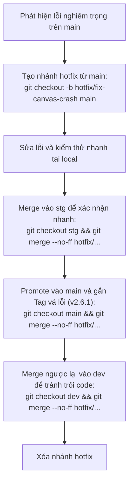

# QUY CHUẨN PHÂN NHÁNH VÀ QUY TRÌNH THĂNG CẤP (GIT BRANCHING & PROMOTION MODEL)

> **Dự án tốt nghiệp:** PanelForge – Nền tảng đồng sáng tác và quản lý sản xuất truyện tranh Manga hỗ trợ bởi AI Agent  
> **Mã nhóm:** FA26SE251 · **Học kỳ:** Fall 2026 – Spring 2027  
> **Áp dụng cho:** Toàn bộ thành viên phát triển (.NET Backend, React Frontend, Flutter Mobile) & Tất cả các AI Agents (Claude Code, Antigravity, Cursor, Codex).

---

## 1. TỔNG QUAN KIẾN TRÚC PHÂN NHÁNH (4-TIER BRANCHING ARCHITECTURE)

Hệ thống mã nguồn PanelForge áp dụng mô hình **Trunk-based kết hợp Promotion Gates có kiểm soát**, phân tách thành 4 cấp độ nhánh độc lập:

```mermaid
flowchart LR
    subgraph Tier1 ["Cấp 1: Feature / Personal Branches"]
        WB_Kien["trungkien"]
        WB_Minh["THBMinh"]
        WB_Danh["Danh"]
        WB_Hoa["CongHoa"]
        WB_Feature["feature/*"]
    end

    subgraph Tier2 ["Cấp 2: Integration Branch"]
        DEV["dev<br/>(Tích hợp liên tục & Build Gate)"]
    end

    subgraph Tier3 ["Cấp 3: Staging Branch"]
        STG["stg<br/>(Môi trường E2E / UAT / Pre-prod)"]
    end

    subgraph Tier4 ["Cấp 4: Production Branch"]
        MAIN["main<br/>(Phiên bản Stable & Release Tags)"]
    end

    WB_Kien -->|Fast Build Gate (Trực tiếp / PR)| DEV
    WB_Minh -->|Fast Build Gate (Trực tiếp / PR)| DEV
    WB_Danh -->|Fast Build Gate (Trực tiếp / PR)| DEV
    WB_Hoa -->|Fast Build Gate (Trực tiếp / PR)| DEV
    WB_Feature -->|Fast Build Gate (Trực tiếp / PR)| DEV

    DEV -->|Sprint Freeze & Staging Gate| STG
    STG -->|Lead Approval & Tagging| MAIN
```

### Bảng định nghĩa 4 cấp độ nhánh:

| Cấp độ | Tên nhánh | Mục đích sử dụng | Ai có quyền commit/merge? | Điều kiện bảo vệ (Protection) |
|---|---|---|---|---|
| **Cấp 1** | `{work-branch}`<br/>(`trungkien`, `THBMinh`, `Danh`, `feature/*`) | Không gian làm việc cá nhân của dev và AI Agent. Mọi dòng code, thử nghiệm, refactor diễn ra tại đây. | Thành viên sở hữu nhánh, AI Agent của máy đó. | Không push lên nhánh của người khác. Commit theo Conventional Commits. |
| **Cấp 2** | `dev` | Nhánh tích hợp chung (Development / Integration). Nơi các thành viên gộp code sau khi hoàn thành tính năng. | Cả nhóm. **Cho phép merge trực tiếp từ `{work-branch}` và push lên `dev` mà KHÔNG CẦN mở Pull Request**. | Phải pass Fast Build Gate trước khi merge. Chống xoá nhánh `dev`. |
| **Cấp 3** | `stg` | Nhánh môi trường Staging (Pre-production). Triển khai kiểm thử E2E, UAT, diễn tập demo đồ án, kiểm tra chéo BE-FE-Mobile. | Tech Lead / Repo Owner. | **PROTECTED.** Cấm commit code trực tiếp. Chỉ nhận promote từ `dev` (hoặc `hotfix/*`). |
| **Cấp 4** | `main` | Nhánh phát hành chính thức (Production). Chứa code ổn định nhất, phiên bản báo cáo/bảo vệ tốt nghiệp. | Tech Lead duy nhất. | **PROTECTED.** Cấm commit code trực tiếp. Chỉ nhận promote từ `stg`. Gắn thẻ phiên bản `vX.Y.Z`. |

---

## 2. QUY TRÌNH THĂNG CẤP VÀ CÁC CỔNG KIỂM SOÁT (PROMOTION GATES)

### 🔹 Giai đoạn 1: Từ `{work-branch}` vào `dev` (Tích hợp tính năng)
- **Khi nào thực hiện:** Khi thành viên hoàn thành một chức năng, màn hình, endpoint hoặc một sub-task lớn từ `note/plans/`.
- **Cổng kiểm soát (Gate 1 - Quality & Fast Build Gate):**
  1. Backend: `dotnet build PanelForge.slnx` phải thành công 100%, 0 error.
  2. Frontend: `npm run typecheck` và `npm run i18n:check` phải đạt 100%.
  3. Mobile: `flutter analyze` không có lỗi nghiêm trọng.
  4. Lịch sử commit tuân thủ `note/GIT_COMMIT_CONVENTION.md`.
  5. Xung đột mã nguồn (Merge conflicts) phải được giải quyết tại nhánh cá nhân trước khi merge.
- **Thực thi (Không bắt buộc mở Pull Request):**
  - **Cách 1: Sử dụng script tự động có kiểm định Fast Build (Khuyến nghị):**
    ```powershell
    powershell -File panelforge-hub/.agents/scripts/promote_branch.ps1 -From trungkien -To dev -Push
    ```
  - **Cách 2: Merge trực tiếp bằng Git CLI thủ công (sau khi đã build pass):**
    ```bash
    git checkout dev
    git pull origin dev
    git merge trungkien --no-ff -m "feat(integration): merge branch 'trungkien' into 'dev'"
    git push origin dev
    git checkout trungkien
    ```
  - **Cách 3: Qua GitHub Pull Request** (tùy chọn nếu thành viên có nhu cầu review đồng cấp qua web).

### 🔹 Giai đoạn 2: Từ `dev` vào `stg` (Đóng băng Sprint & Kiểm thử Staging)
- **Khi nào thực hiện:** Khi toàn bộ các tính năng trong Sprint hoặc Milestone đã được merge vào `dev`, chuẩn bị đưa lên môi trường Staging để kiểm thử chéo và diễn tập.
- **Cổng kiểm soát (Gate 2 - Staging Gate):**
  1. Toàn bộ API Contracts giữa Backend, Web Frontend và Flutter Mobile đã khớp nhau (đồng bộ Schema, DTOs).
  2. Hệ thống Database Migrations đã kiểm tra tính tương thích ngược, không có rủi ro mất dữ liệu.
  3. Được Tech Lead thẩm định.
  4. ❌ **QUY TẮC CỐT LÕI:** Tuyệt đối KHÔNG merge trực tiếp từ nhánh cá nhân (`trungkien`, `THBMinh`...) vào `stg`. Bắt buộc phải qua `dev` trước!
- **Thực thi (Dành riêng cho Lead):**
  ```powershell
  powershell -File panelforge-hub/.agents/scripts/promote_branch.ps1 -From dev -To stg -Push
  ```

### 🔹 Giai đoạn 3: Từ `stg` vào `main` (Phát hành chính thức - Production Release)
- **Khi nào thực hiện:** Khi phiên bản trên Staging đã trải qua kiểm thử thực tế (UAT), không còn lỗi Blocker hay Critical, sẵn sàng cho buổi báo cáo tiến độ / bảo vệ đồ án tốt nghiệp.
- **Cổng kiểm soát (Gate 3 - Release Gate):**
  1. Kiểm thử E2E trên Staging đạt 100% kịch bản chính (Core Flows CF1 – CF5).
  2. Tất cả tài liệu đặc tả và bảng theo dõi tiến độ (`TEAM_WORKBOARD.md`, `PANELFORGE_MASTER_SPECIFICATION_V2_6.md`) đã cập nhật khớp với code thực tế.
  3. Bắt buộc gắn thẻ phiên bản Release Tag theo chuẩn Semantic Versioning (`v1.0.0`, `v2.6.0`).
  4. ❌ **QUY TẮC CỐT LÕI:** Nhánh `main` CHỈ nhận promote từ `stg`. Tuyệt đối không merge từ `dev` hay nhánh cá nhân vào `main`.
- **Thực thi (Dành riêng cho Lead):**
  ```powershell
  powershell -File panelforge-hub/.agents/scripts/promote_branch.ps1 -From stg -To main -Tag "v2.6.0" -Push
  ```

---

## 3. NGUYÊN TẮC BẢO VỆ NHÁNH PROTECTED DÀNH CHO AI AGENT

AI Agent (Claude Code, Antigravity, Cursor, Codex) khi làm việc trong workspace PanelForge bắt buộc phải tuân theo **4 KHÔNG** sau:

1. 🚫 **KHÔNG BAO GIỜ code hoặc chạy `git commit` trực tiếp trên `dev`, `stg`, `main`:**
   - Đầu mỗi phiên làm việc, Agent phải chạy:
     ```powershell
     powershell -File panelforge-hub/.agents/scripts/work_branch.ps1 -Action get
     ```
   - Nếu thấy trạng thái `⚠️ PROTECTED!` (repo đang ở `dev`, `stg`, hoặc `main`), Agent **KHÔNG ĐƯỢC PHÉP CHỈNH SỬA CODE HOẶC COMMIT**. Phải chuyển ngay về `{work-branch}` bằng lệnh:
     `git -C <repo> checkout <work-branch>`.

2. 🚫 **KHÔNG BAO GIỜ tự ý chạy `git push` lên `dev`, `stg`, `main`:**
   - Lệnh `git push` lên các nhánh protected bị chặn tự động ở cấp độ Git hook (`pre-push`).
   - Agent chỉ push lên nhánh cá nhân `{work-branch}` khi và chỉ khi:
     - Đã hoàn thành trọn vẹn 1 module lớn.
     - HOẶC khi Người dùng ra lệnh rõ ràng bằng văn bản (*"push code"*, *"đẩy lên github"*).

3. 🚫 **KHÔNG BAO GIỜ dùng cờ ép buộc (`--force`, `-f`):**
   - Tuyệt đối cấm force push trên mọi nhánh chia sẻ (`dev`, `stg`, `main`).

4. 🚫 **KHÔNG BAO GIỜ chọn nhánh protected làm `{work-branch}`:**
   - Khóa cấu hình `panelforge.workBranch` chỉ được lưu tên nhánh cá nhân, script `work_branch.ps1` sẽ từ chối nếu truyền `main`, `stg`, hoặc `dev`.

---

## 4. QUY TRÌNH XỬ LÝ SỰ CỐ KHẨN CẤP (HOTFIX WORKFLOW)

Khi phát hiện lỗi nghiêm trọng trên `main` hoặc `stg` cần sửa gấp mà không thể chờ chu kỳ Sprint:



---

## 5. BẢNG TỔNG HỢP CÂU LỆNH THƯỜNG DÙNG

| Tác vụ | Câu lệnh chuẩn | Ghi chú |
|---|---|---|
| **Kiểm tra nhánh làm việc hiện tại** | `powershell -File panelforge-hub/.agents/scripts/work_branch.ps1 -Action get` | Bắt buộc chạy ở đầu phiên |
| **Thiết lập nhánh làm việc** | `powershell -File panelforge-hub/.agents/scripts/work_branch.ps1 -Action set -Branch <tên-nhánh>` | Chỉ chọn nhánh cá nhân |
| **Cài đặt lại Git Hooks bảo vệ** | `node panelforge-hub/scripts/install-hooks.mjs` | Tự động cài `commit-msg`, `post-commit`, `pre-push` |
| **Gộp nhánh cá nhân vào `dev`** | `powershell -File panelforge-hub/.agents/scripts/promote_branch.ps1 -From trungkien -To dev -Push` | Tự động chạy Fast Build Gate |
| **Thăng cấp từ `dev` lên `stg`** | `powershell -File panelforge-hub/.agents/scripts/promote_branch.ps1 -From dev -To stg -Push` | Chỉ chạy khi đóng Sprint |
| **Phát hành từ `stg` lên `main`** | `powershell -File panelforge-hub/.agents/scripts/promote_branch.ps1 -From stg -To main -Tag "v2.6.0" -Push` | Chỉ Tech Lead thực hiện |
| **Chạy thử nghiệm không đổi code** | Thêm switch `-DryRun` vào lệnh `promote_branch.ps1` | Kiểm tra luồng an toàn |
