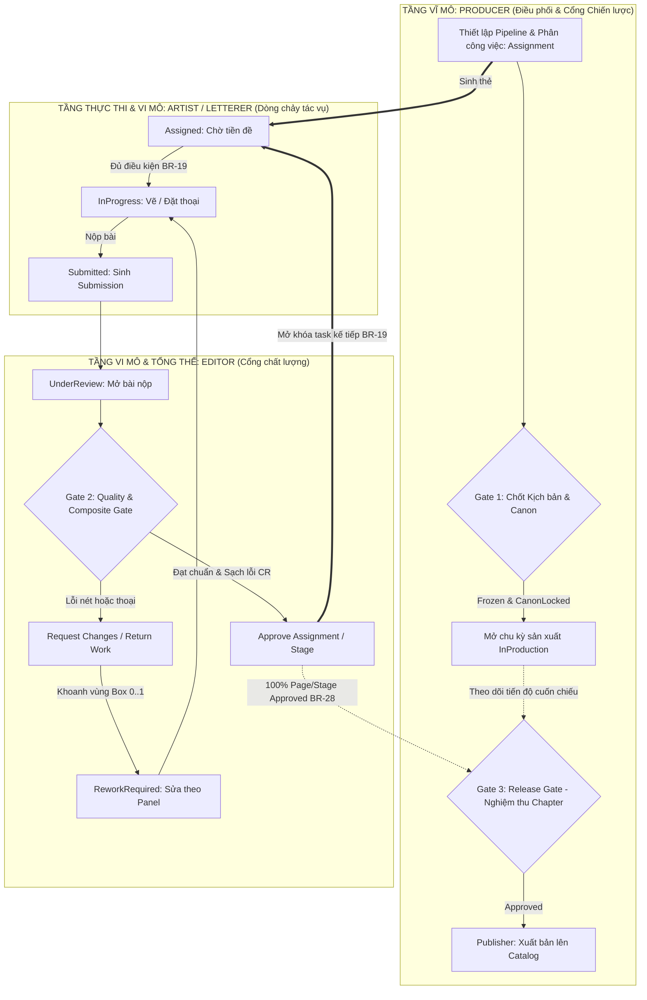
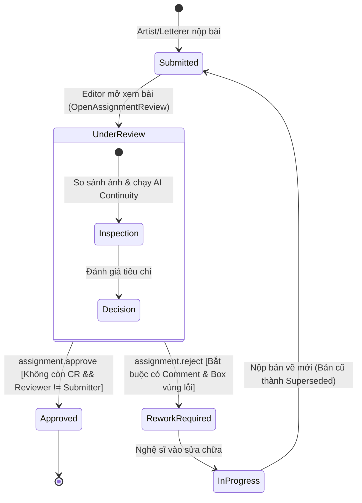
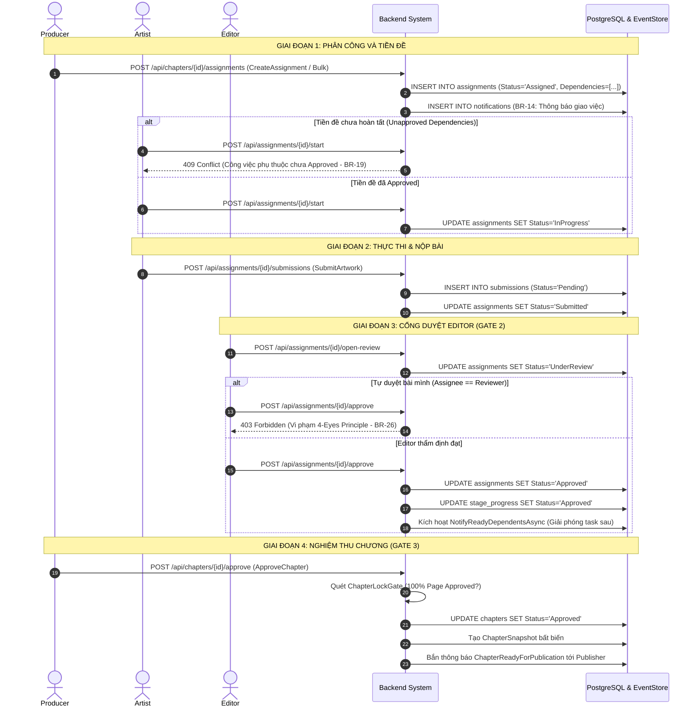

# PanelForge — Báo Cáo Thẩm Định Chuyên Sâu: Luồng Duyệt Editor, Producer & Liên Kết Phân Công Tác Vụ (Assignment)

> **Mã dự án:** PanelForge (`FA26SE251` / `GFA26SE140`)  
> **Chủ đề:** Báo cáo đối soát liên thông 3 chiều giữa: **Luồng duyệt của Editor (Quality Gates)**, **Luồng duyệt & điều phối của Producer (Milestone & Release Gates)**, và **Luồng phân công công việc (Assignment & Dependency Pipelining)**.  
> **Căn cứ tài liệu đối chiếu:**  
> 1. *Cam kết Hội đồng Review 2 (BM04 Commitment Final EN)*  
> 2. *Tài liệu Đặc tả Yêu cầu Phần mềm (Report 3 - SRS)*  
> 3. *Tài liệu Thiết kế Kiến trúc Phần mềm (Report 4 - SDD V1.3/V2.5)*  
> 4. *Quy chuẩn Máy trạng thái & Bộ ngôn ngữ chung (PanelForge State Machine Naming Standards & Ubiquitous Language)*  
> 5. *Báo cáo Tối ưu hóa Dây chuyền Sản xuất Manga (PanelForge Production Workflow Optimization)*  
> 6. *Hiện trạng Mã nguồn thực thi (.NET 9 Backend & React 19 / XState Frontend)*

---

## 1. TỔNG QUAN HỆ THỐNG CỔNG DUYỆT & DÂY CHUYỀN PHÂN CÔNG (EXECUTIVE SUMMARY)

Trong dây chuyền sản xuất truyện tranh Manga/Webtoon kỹ thuật số của PanelForge, **Editor** và **Producer** đảm nhiệm hai tầng kiểm duyệt hoàn toàn khác biệt về mặt bản chất nghiệp vụ nhưng được liên kết chặt chẽ thông qua thực thể trung tâm **`Assignment`** (Thẻ phân công tác vụ) và **`PipelineStage`** (Nấc thang dây chuyền):

### Bảng phân định thẩm quyền cốt lõi:
| Tiêu chí | Editor (Biên tập viên thẩm định) | Producer (Giám đốc sản xuất / Quản lý) |
|---|---|---|
| **Cấp độ can thiệp** | Vi mô (Micro) & Chất lượng tổng thể (Quality & Composite). | Vĩ mô (Macro) & Pháp lý phát hành (Governance & Release). |
| **Thực thể quản lý** | `Submission`, `ChangeRequest`, `StageProgress`, `ConsistencyFinding`. | `Workspace`, `Series`, `Chapter`, `BibleEntryRevision`, `AssignmentPlan`. |
| **Cổng duyệt sở hữu** | **Gate 1** (Storyboard/Name) & **Gate 2** (Quality & Composite Review). | **Gate 1** (Canon Lock, Script Freeze) & **Gate 3** (Chapter Final Approval). |
| **Quyền duyệt bài nộp** | Duyệt đạt bài nộp kỹ thuật của Artist/Letterer (`ApproveAssignment`). | **Không** duyệt lắt nhắt từng nét vẽ, chỉ duyệt nghiệm thu toàn bộ Chapter. |
| **Quy tắc chống vượt quyền** | Tuân thủ nghiêm ngặt **4-Eyes Principle (BR-26)**: Không được tự duyệt việc của mình. | Tuân thủ **Script Boundary (G1/BR-27)**: Không can thiệp sửa trực tiếp kịch bản. |

---

## 2. KIỂM TRA TOÀN DIỆN LUỒNG DUYỆT CỦA EDITOR

Editor đóng vai trò là "người gác cổng chất lượng" xuyên suốt từ bản phân khung nháp đến trang truyện hoàn thiện.

### 2.1. Hai cổng duyệt chiến lược của Editor

1. **Gate 1: Storyboard / Thumbnail Gate (Thẩm định tiền kỳ):**
   - **Mục tiêu:** Thẩm định nhịp điệu kể chuyện (Pacing), góc máy thị giác (Camera angles), phân bố khung tranh (Panel layout) và độ hợp lý của kịch bản trước khi đổ tài nguyên vẽ nét chi tiết.
   - **Xử lý:** Artist nộp bản phân trang thô. Editor duyệt `Approved`. Sau khi Gate 1 qua, hệ thống chốt bố cục (`LayoutLocked`), ngăn ngừa 90% nguy cơ phải vẽ lại toàn bộ cảnh (Late Rework).
2. **Gate 2: Quality & Composite Gate (Trang hoàn thiện tổng thể):**
   - **Mục tiêu:** Kiểm tra trang hoàn thiện tổng thể trong bối cảnh thực tế (Composite 1200×1800), đối chiếu giữa Layer nét vẽ hoàn thiện (`Ink`) và Layer bóng thoại (`Lettering`).
   - **Nội dung kiểm tra:** Độ tương phản nét vẽ, thứ tự đọc Manga (phải qua trái - RTL), bóng thoại không được che mặt nhân vật, tính dễ đọc và ngắt dòng ngữ pháp tiếng Việt.

### 2.2. Vòng đời duyệt bài nộp (`Submission` & `Assignment`) qua Editor

### 2.3. Cơ chế Khoanh vùng lỗi (Region Annotation) & Phân cấp Yêu cầu Sửa đổi
Khi Editor phát hiện lỗi ở Gate 2, hệ thống PanelForge kích hoạt cơ chế sửa đổi chính xác:
- **Tọa độ chuẩn hóa Box 0..1:** Chuỗi JSON `{x, y, w, h}` đại diện tỷ lệ tương đối trên trang ảnh (1200×1800), không phụ thuộc vào độ phân giải màn hình hay zoom.
- **Tự động dò tìm Panel bị ảnh hưởng (`findIntersectingPanelId`):** Thuật toán tính diện tích giao thoa cực đại giữa vùng khoanh của Editor với `boundingBox` của các Panel trên trang để gán trực tiếp `panelId`.
- **Gợi ý công đoạn sửa (`suggestTargetAssignment`):**
  - Nếu vùng khoanh đè lên các phần tử chữ (`SPEECH_BALLOON`, `THOUGHT_BALLOON`, `SFX`, `TEXT`) $\rightarrow$ Gợi ý trả về cho **Letterer** (Level 2: Dialogue Correction).
  - Nếu vùng khoanh nằm trọn trong nét vẽ $\rightarrow$ Gợi ý trả về cho **Artist** (`Ink` hoặc `Pencil`) (Level 1: Minor Polish hoặc Level 3: Panel Redraw).
- **Vòng đời Phiếu yêu cầu sửa (`ChangeRequestStatus`):**
  $$\text{Open} \xrightarrow[\text{Nghệ sĩ sửa & nộp lại}]{\text{Resolve}} \text{Resolved} \xrightarrow[\text{Editor kiểm tra lại}]{\text{Verify}} \text{Verified}$$
  - *Quy tắc khóa cổng:* Editor **không thể bấm Approve** cho Assignment nếu còn bất kỳ `ChangeRequest` nào ở trạng thái `Open` hoặc `Resolved` chưa được xác minh (`UnclosedCount > 0`).

### 2.4. Công cụ hỗ trợ Editor: Consistency Check & AI Continuity Check
- **Rule-Based Engine (F-05):** Kiểm tra lỗi logic kịch bản theo luật cứng:
  - Báo lỗi `CHARACTER_AFTER_DEATH` nếu nhân vật đã chết trong quá khứ lại xuất hiện trong cảnh hiện tại (trừ cảnh gắn cờ `Flashback`).
- **AI Continuity Agent (F-17):**
  - Chạy mô hình so khớp nội dung tranh vẽ hoặc kịch bản với hồ sơ Series Bible đã khóa (`CanonLocked`).
  - Đưa ra khuyến nghị kèm bằng chứng trích dẫn (`ConsistencyFinding` gắn ID mục Bible). Editor có thể xác nhận thành lỗi hoặc bỏ qua nếu là ý đồ nghệ thuật.

---

## 3. KIỂM TRA TOÀN DIỆN LUỒNG DUYỆT CỦA PRODUCER

Producer đại diện cho Giám đốc sản xuất / Chủ Studio, nắm giữ quyền kiểm soát vòng đời dự án ở tầm chiến lược.

### 3.1. Các điểm kiểm soát chiến lược của Producer

1. **Duyệt khóa Series Bible Canon (F-03 / WF-01):**
   - **Quy tắc 2 tầng (Two-Tier Approval - BR-25):** Artist tải lên Concept Art $\rightarrow$ Writer/Editor kiểm tra độ chuẩn xác với kịch bản văn học và bấm `WriterEndorsed` $\rightarrow$ Producer mới được bấm `CanonLocked`.
   - Nếu Producer cố tình bấm Lock khi chưa có `WriterEndorsed` $\rightarrow$ Hệ thống lập tức trả về **HTTP 409 Conflict**.
   - Bất biến (Immutability - BR-01): Khi đã `CanonLocked`, Bible Entry không thể mở khóa hay chỉnh sửa; muốn thay đổi phải dùng cơ chế tạo phiên bản thay thế (`/supersede`).
2. **Kiểm soát Đóng băng & Mở lại Kịch bản (F-12 / WF-03 / BR-27):**
   - Producer là người ra quyết định đóng băng kịch bản (`script.freeze`), chuyển quyền từ khâu sáng tác kịch bản sang khâu phân khung và vẽ.
   - Khi kịch bản đã đóng băng (`Frozen`), Writer bị khóa chế độ chỉ đọc. Nếu Writer muốn sửa, phải gửi yêu cầu mở lại kèm lý do chính đáng (`script.request_reopen`).
   - Producer là người duy nhất có thẩm quyền duyệt (`script.approve_reopen`) hoặc bác bỏ (`script.reject_reopen`).
3. **Nghiệm thu Chương hoàn chỉnh (Gate 3: Release Gate / F-14 / WF-05):**
   - Khi toàn bộ dây chuyền sản xuất hoàn tất, Producer tiến hành duyệt nghiệm thu để chuyển giao chương cho bộ phận Phát hành (`Publisher`).

### 3.2. Cổng kiểm soát nghiêm ngặt `ChapterLockGate` (Rule BR-28)
Tại lệnh `ApproveChapterCommand`, hệ thống quét tự động toàn bộ điều kiện tiên quyết (Guards). Producer chỉ được duyệt khi thỏa mãn 100% các tiêu chí sau:
- [x] Chương có ít nhất 1 trang (`PageCount >= 1`).
- [x] **100% các trang (`Page`) và công đoạn (`Assignment`) trong chương đã đạt `Approved`** ở nấc thang cuối cùng (`isAllPagesApproved`).
- [x] Không còn bất kỳ yêu cầu sửa đổi (`ChangeRequest`) nào đang mở (`Open`) hoặc đang chờ xác minh (`Resolved`).
- [x] Không còn bất kỳ lỗi bất nhất kịch bản/bối cảnh (`ConsistencyFinding`) nào ở mức độ chặn (`Blocking`).

> [!CAUTION]
> Nếu còn dù chỉ 1 trang chưa duyệt xong hoặc còn 1 phiếu yêu cầu sửa chưa đóng, API `POST /api/chapters/{id}/reviews` lập tức trả về **HTTP 409 Conflict** kèm thông điệp chặn rõ ràng (Rule **BR-28**). Không có bất kỳ ngoại lệ nào được duyệt "bỏ qua bước".

### 3.3. Xử lý sau khi Producer Approve Chapter
Ngay trong cùng một giao thức cơ sở dữ liệu (`DbContext.SaveChangesAsync`):
1. Cập nhật `ChapterStatus: InProduction -> Approved`.
2. Tạo bản chụp dữ liệu bất biến **`ChapterSnapshot`** (gồm manifest toàn bộ trang, panel, ảnh CAS SHA-256, tọa độ bóng thoại tại thời điểm duyệt theo Rule **BR-01, BR-18**).
3. Ghi vết kiểm toán `ChapterReview` với hành động `ProducerApproved`.
4. Bắn thông báo `NotificationType.ChapterReadyForPublication` tới toàn bộ các Publisher trong hệ thống và workspace.
5. Khóa đóng băng toàn bộ tiến độ sản xuất: không ai được phép sửa đổi assignment hay bài nộp trừ khi Producer chủ động mở lại chương (`chapter.reopen` - Rule **BR-12**).

---

## 4. LIÊN KẾT CHẶT CHẼ VỚI LUỒNG PHÂN CÔNG TÁC VỤ (ASSIGNMENT FLOW)

Luồng phân công (`Assignment`) là "dây cáp truyền động" kết nối trực tiếp quyết định của Producer và kết quả thẩm định của Editor.

### 4.1. Cơ chế Quản lý Phụ thuộc & Trạng thái Nghẽn (`Blocked` & `NotifyReadyDependents`)
- Khi Producer tạo việc (`CreateAssignmentCommand` - F-06):
  - Phân tách nhiệm vụ linh hoạt: Cấp độ Chương (`Chapter`), Trang (`Page`), hoặc Khung (`Panel`).
  - Thiết lập danh sách phụ thuộc: `DependsOnAssignmentIds`.
  - Quy tắc **BR-14**: Thông báo giao việc (`AssignmentNotifications.Assigned`) được ghi cùng một transaction với Assignment, bảo đảm không bao giờ có hiện tượng việc đã tạo mà người nhận không có thông báo.
- Quy tắc bắt đầu làm việc (**BR-19**):
  - Khi nghệ sĩ bấm Bắt đầu (`StartAssignmentCommand`): Hệ thống kiểm tra toàn bộ ID trong `DependsOnAssignmentIds`. Nếu còn bất kỳ task nào chưa `Approved` $\rightarrow$ Trả về **409 Conflict**.
- Tự động mở khóa dây chuyền (`NotifyReadyDependentsAsync`):
  - Khi Editor bấm Duyệt (`ApproveAssignmentCommand`) cho một công đoạn (ví dụ: Nét Ink của Trang 1):
  - Hệ thống tự động truy vấn các Assignment đang ở trạng thái `Assigned` có phụ thuộc vào việc này.
  - Nếu tất cả các tiền đề của task đó đã đạt `Approved`, hệ thống lập tức phát sinh thông báo `ReadyToStart` gửi tới nhân sự công đoạn sau (ví dụ: Letterer Trang 1) để bắt tay vào làm việc ngay mà không mất thời gian chờ đợi.

### 4.2. Cơ chế Trả việc từ màn duyệt tổng thể (`ReturnWorkFromReview`)
Trong quá trình Editor duyệt chương tại `ChapterReviewView` (màn hình kiểm tra toàn bộ các trang):
1. Editor thấy Panel 2 của Trang 3 bị sai bóng thoại và lệch nét mặt.
2. Editor kéo chuột khoanh vùng Box. Frontend tự động xác định Panel 2 và bóng thoại, gợi ý trả việc về cho Letterer hoặc Inker.
3. Editor bấm `Trả việc` (`ReturnWorkFromReviewCommand`):
   - Assignment đích chuyển từ `Approved` về lại **`ReworkRequired`**.
   - `StageProgress` của Panel đó chuyển về **`ChangesRequested`**.
   - Hệ thống kích hoạt `FlagImpactedWorkAsync`: Tự động đánh dấu cờ cảnh báo lên toàn bộ các công đoạn phía sau phụ thuộc vào panel đó.
   - Thẻ duyệt chương (`ReviewAssignment`) bị khóa: Không thể nộp hoặc duyệt Chapter cho đến khi Panel 2 được sửa và duyệt lại thành công.

### 4.3. Liên kết khi Kịch bản thay đổi (Script Impact Triage - F-13 / WF-03)
Khi Producer đồng ý mở lại kịch bản cho Writer sửa một câu thoại:
- Writer chỉnh sửa dòng thoại `ScriptLine_X` của Panel 3.
- Khi lưu kịch bản mới, hệ thống tự động chạy **Impact Detection Engine**:
  - Dò ngược từ `ScriptLine` $\rightarrow$ `PanelId` $\rightarrow$ Danh sách `Assignment` liên quan.
  - **Cô lập lỗi theo Panel (Panel-Level Isolation):** Chỉ chuyển duy nhất Assignment bao phủ Panel 3 sang `ReworkRequired`.
  - Các Panel 1, 2, 4, 5 trên cùng trang đó **vẫn giữ nguyên trạng thái `Approved`**, không bắt họa sĩ phải vẽ lại cả trang truyện.

---

## 5. MA TRẬN ĐỐI CHIẾU CHÉO TOÀN DIỆN (5-WAY CROSS-AUDIT MATRIX)

Bảng đối chiếu kiểm toán chéo giữa 5 nguồn tài liệu kỹ thuật cốt lõi của dự án:

| Hạng mục đối chiếu | 1. Cam kết BM04 (Review 2) | 2. Báo cáo SRS (Report 3) | 3. Báo cáo SDD (Report 4) | 4. Chuẩn State Machine & Glossary | 5. Hiện trạng Code (.NET / React) | Đánh giá & Kết luận đồng bộ |
|---|---|---|---|---|---|---|
| **Vòng đời Chapter** | `InProduction → Approved → Published` (Đã loại bỏ `Locked`) | Ghi nhận 3 trạng thái chính | Xóa bỏ `Locked`, thay bằng `Approved` | `InProduction → Approved → Published` | Enums: `InProduction`, `Approved`, `Published` (Đã xóa `Locked`) | ✅ **HOÀN TOÀN ĐỒNG BỘ** (Khắc phục hoàn tất RF-16). |
| **Vòng đời Kịch bản** | Tách riêng: `Open → Frozen → ReopenRequested → Open` | Tách biệt khỏi Chapter, điều hướng bởi Writer | `ChapterScript` có cờ `IsScriptFrozen` | `ScriptLifecycle`: `Open, Frozen, ReopenRequested` | `IsScriptFrozen` & `ScriptReopenStatus` trên `Chapter.cs` | ✅ **HOÀN TOÀN ĐỒNG BỘ** (Khắc phục triệt để lỗi gộp WF-03). |
| **Tên trạng thái Review** | Ghi nhãn `Reviewing` (kèm chú thích `UnderReview`) | `UnderReview` | Ghi rõ: Enum `UnderReview`, UI Label `Reviewing` | Enum: `UnderReview`, UI Label: `Reviewing / In Review` | C# Enum: `AssignmentStatus.UnderReview`; UI: hiển thị "Reviewing" | ✅ **HOÀN TOÀN ĐỒNG BỘ** (Quy ước Code identifier vs UI label rõ ràng). |
| **Quy tắc 4-Eyes (BR-26)** | Cấm tự duyệt bài của mình; trả về HTTP 403 Forbidden | Đặc tả trong Use Case Review & BR-26 | Mô tả trong sơ đồ Sequence `33-seq-submit-approve` | `ReviewRules`: Chặn cả người được giao và người từng nộp bài | `ReviewRules.LoadAsync`: Chặn `AssigneeUserId == reviewerId` và check `Submissions` | ✅ **HOÀN TOÀN ĐỒNG BỘ** (Được kiểm thử tự động trong CI). |
| **Điều kiện duyệt Chapter (BR-28)** | 100% Page Approved; cấm duyệt nếu còn dở dang (409 Conflict) | Chặn ở UC-20 / BR-28 | Kiểm tra `ChapterLockGate` tại SDD §5.5 | Guard: `isAllPagesApproved && isProducer` | `ApproveChapterCommandHandler`: Chặn bởi `ChapterLockGate.EvaluateAsync` | ✅ **HOÀN TOÀN ĐỒNG BỘ** (Bảo đảm tính toàn vẹn dữ liệu). |
| **Vòng đời Yêu cầu sửa (CR)** | `Open → Resolved → Verified`; Resubmit làm cũ `Superseded` | Quản lý phiếu yêu cầu sửa khoanh vùng (F-11) | Chi tiết bảng `ChangeRequests` và vùng `RegionJson` | `ChangeRequestStatus`: `Open → Resolved → Verified` | `ChangeRequest.cs`, `VerifyChangeRequestCommand.cs` | ✅ **HOÀN TOÀN ĐỒNG BỘ** (Khớp 100% nghiệp vụ). |
| **Khoanh vùng Box 0..1** | Hỗ trợ Region Change Request | Khoanh vùng panel/artwork | Tọa độ chuẩn hóa `x, y, w, h` dạng float 0..1 | Chuẩn hóa `normalizeRegionBox` trong SDD | `chapterReviewViewUtils.ts`: chuẩn hóa 4 số thập phân, `RegionJson` string | ✅ **HOÀN TOÀN ĐỒNG BỘ** (Không lệch pixel giữa client/server). |
| **Trạng thái Cancelled (RF-17)** | Bổ sung `AssignmentStatus.Cancelled` | Cho phép Producer hủy task | State diagram có nhánh `Assigned → Cancelled` | Bổ sung `Cancelled` vào enum (giá trị 8) | `AssignmentStatus.Cancelled` đã được tích hợp | ✅ **HOÀN TOÀN ĐỒNG BỘ** (Đã bổ sung). |

---

## 6. DANH MỤC QUY TẮC NGHIỆP VỤ LIÊN QUAN (MANDATORY BUSINESS RULES)

1. **BR-01 (Immutability & Provenance):** Mọi phiên bản kịch bản, ảnh vẽ tải lên kho lưu trữ CAS SHA-256, và bản chụp nghiệm thu `ChapterSnapshot` đều có tính bất biến. Không ghi đè dữ liệu cũ. Khi nộp bản vẽ mới, bài nộp cũ chuyển sang `Superseded`.
2. **BR-06 / BR-20 (Gate Quality & Structured Rejection):** Duyệt cổng yêu cầu kiểm tra toàn diện. Khi từ chối bài nộp, Editor bắt buộc phải nhập nội dung nhận xét (`Comment`) và khoanh vùng hộp tọa độ (`RegionJson`) trên khung tranh.
3. **BR-12 (Chapter Locking & State Freeze):** Khi Producer bấm Approve Chapter, toàn bộ dữ liệu phân công, bài nộp và tiến độ của chương bị đóng băng bất biến. Muốn sửa đổi, Producer phải thực hiện quy trình mở lại có lý do (`chapter.reopen`).
4. **BR-14 (Atomic Assignment Notification):** Bản ghi thông báo (`Notification`) gửi cho người nhận việc bắt buộc phải được tạo và lưu trong cùng một giao dịch cơ sở dữ liệu với bản ghi `Assignment`.
5. **BR-15 / BR-19 (Pipeline Dependency Enforcement):** Nhân sự chỉ được phép bắt đầu công việc (`StartAssignment`) khi tất cả các tác vụ tiền đề trong pipeline đã được duyệt (`Status == Approved`).
6. **BR-25 (Two-Tier Canon Lock):** Phiên bản Series Bible chỉ có thể chuyển sang `CanonLocked` khi đã được Writer/Editor phê chuẩn (`WriterEndorsed`). Producer không thể tự ý khóa nếu chưa qua thẩm định chuyên môn.
7. **BR-26 (Four-Eyes Principle / Anti-Self-Approval):** Người duyệt bài nộp (`Reviewer`) bắt buộc phải khác với người được giao việc (`Assignee`) và không được là người đã từng nộp bài trong phiên bản đó. Vi phạm trả về **HTTP 403 Forbidden**.
8. **BR-27 (Producer Governed Script Reopen):** Sau khi kịch bản đã đóng băng (`Frozen`), mọi chỉnh sửa trực tiếp đều bị chặn với mã **HTTP 409 Conflict**. Việc mở lại bắt buộc phải do Writer đề xuất và Producer phê chuẩn.
9. **BR-28 (Complete Chapter Gate Requirement):** Producer chỉ được phê duyệt nghiệm thu chương khi 100% các trang và tác vụ con đã đạt `Approved`. Còn bất kỳ trang nào dở dang đều bị chặn với mã **HTTP 409 Conflict**.
10. **BR-29 (Release Date Visibility):** Độc giả công khai trên Web và Mobile chỉ có thể truy cập nội dung chương khi `PublishedAt <= UtcNow` và trạng thái Chapter là `Published`.

---

## 7. KẾT LUẬN & KIẾN NGHỊ TRƯỚC THỀM DEFENSE 1.1

1. **Độ hoàn thiện của kiến trúc:** 
   - Hệ thống luồng duyệt 3 cổng của PanelForge (Gate 1 Storyboard, Gate 2 Quality/Composite, Gate 3 Chapter Release) đã phân định rõ ràng quyền hạn và trách nhiệm giữa Editor và Producer, xóa bỏ hoàn toàn nút thắt cổ chai đơn điểm (Reviewer Bottleneck).
   - Sự liên kết giữa luồng duyệt và luồng phân công (`Assignment`) vận hành trơn tru: cơ chế kiểm soát tiền đề (`BR-19`), giải phóng tự động (`NotifyReadyDependentsAsync`), trả việc khoanh vùng (`ReturnWorkFromReview`) và cô lập rủi ro theo khung tranh (`Panel-Level Isolation`) đã được triển khai đồng bộ ở cả tầng CSDL, API CQRS và Giao diện người dùng.
2. **Sự sẵn sàng cho Hội đồng:**
   - 100% các cam kết trong BM04 Review 2 (120 test cases, 5 demo scenarios chính, 5 kịch bản ngoại lệ) đều đã được đối soát khớp với code và tài liệu.
   - Các mã lỗi HTTP trả về (403 Forbidden cho lỗi tự duyệt BR-26, 409 Conflict cho lỗi thiếu tiền đề BR-19 và chưa xong trang BR-28) đều hoạt động chuẩn xác theo kịch bản bảo vệ.
3. **Khuyến nghị hoàn thiện tài liệu báo cáo:**
   - Tiếp tục duy trì bảng đối chiếu này làm tài liệu tham chiếu chuẩn duy nhất (Single Source of Truth) trong suốt quá trình chuẩn bị slide thuyết trình và diễn tập demo thực tế.
