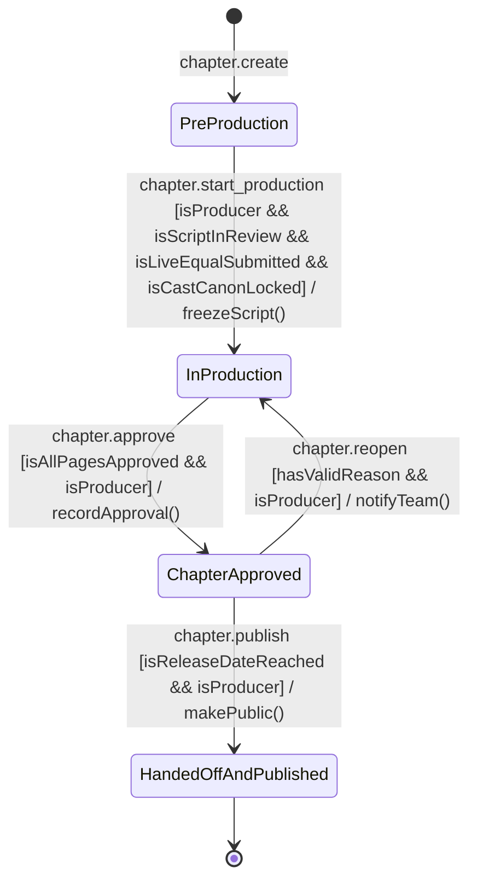
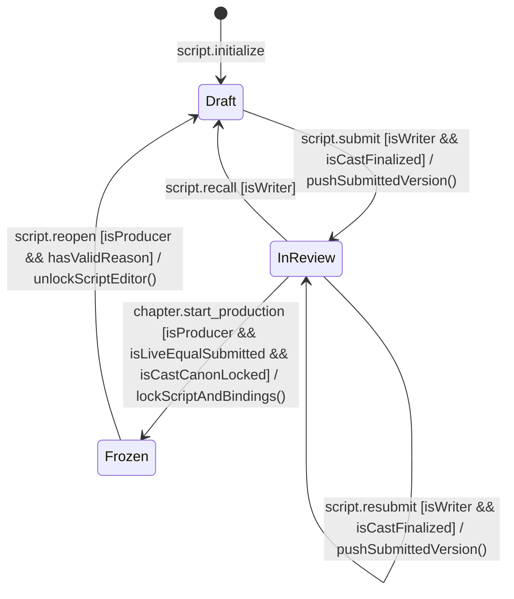
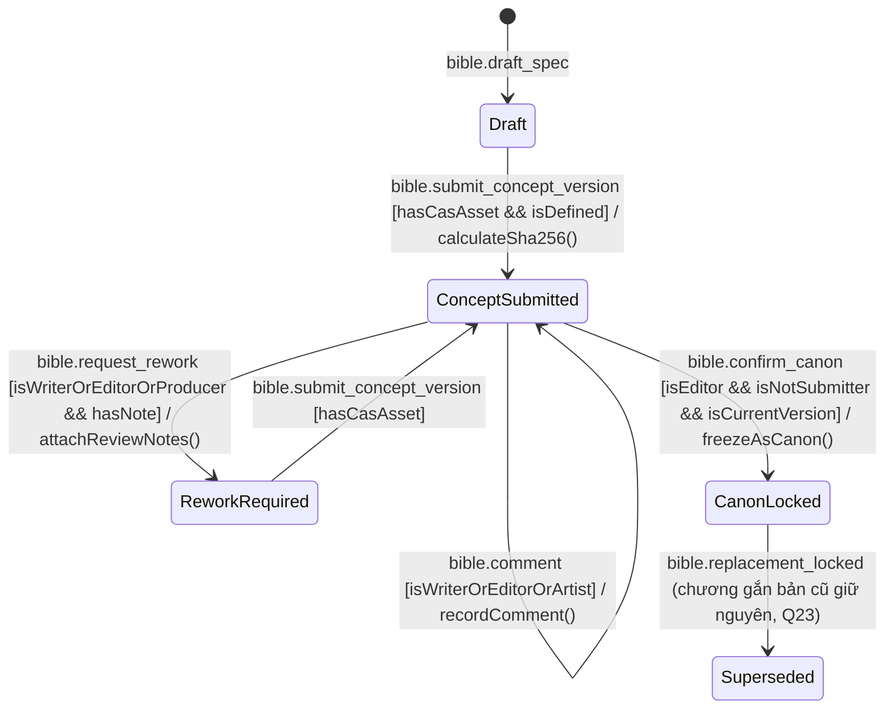
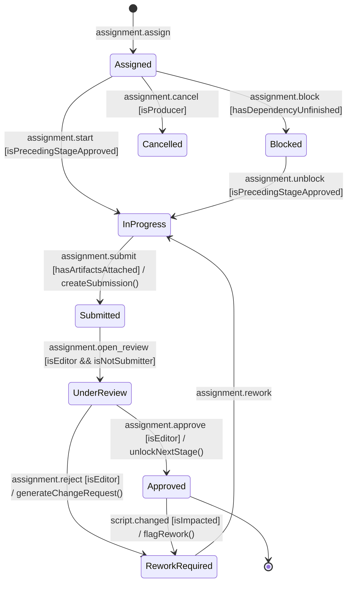

# PanelForge — Quy Chuẩn Đặt Tên State Machine & Khung Chuẩn Hóa Toàn Hệ Thống
*(State Machine Naming Conventions & System-Wide State Refactoring Guide)*

> **Dự án:** PanelForge Manga Production Platform (`FA26SE251` / `GFA26SE140`)  
> **Căn cứ lý thuyết:** Dựa trên chuẩn Statecharts (David Harel, 1987), hướng dẫn State Machine Naming của Stately.ai (Kevin, 2024: *"State Machines - What’s in a name?"*), và tài liệu Mô hình hóa hành vi đồ án tốt nghiệp SEP490 (FPT University).  
> **Phạm vi áp dụng:** Toàn bộ thành viên phát triển Backend (.NET 9), Frontend (React + XState v5), Mobile (Flutter), và nhóm biên soạn tài liệu kỹ thuật (Report 3 SRS, Report 4 SDD, BM04 Review).

---

## 1. TỔNG QUAN & TRIẾT LÝ: TẠI SAO TÊN GỌI TRONG STATE MACHINE LẠI QUAN TRỌNG?

Sơ đồ trạng thái (State Machine & Statechart) là công cụ trực quan hóa mạnh mẽ nhất để biểu diễn luồng nghiệp vụ phần mềm: những chiếc "hộp và mũi tên" thể hiện mối quan hệ ngữ nghĩa, thứ tự tuần tự và luồng điều khiển mà não người có thể nắm bắt tức thì.

Tuy nhiên, yếu tố quyết định một State Machine có thực sự dễ hiểu và vận hành chính xác hay không lại nằm ở **Chữ viết (Text)** — cụ thể là **Tên gọi (Names)** của các phần tử:
- Trong State Machine, **States, Events, Actions, Guards, Actors** không đơn thuần là nhãn trang trí trên bản vẽ mà được xuất trực tiếp thành **mã nguồn thực thi (Executable Code)**, bảng cơ sở dữ liệu và API schema.
- Tên gọi cẩu thả, mơ hồ hoặc sai từ loại sẽ dẫn đến bug logic, tranh cãi giữa các lập trình viên frontend/backend, và bị hội đồng chấm đồ án đánh giá thấp tính chuyên nghiệp.

> [!NOTE]
> Để đặt tên chuẩn xác cho State Machine, chúng ta phải giải quyết 2 câu hỏi cốt lõi:
> 1. **Ngữ nghĩa (Semantics):** Tôi nên đặt tên phần tử này là gì và bằng từ loại (Part of Speech) nào?
> 2. **Phong cách & Kiểu chữ (Style & Casing):** Tên đó nên được viết theo định dạng nào (`PascalCase`, `camelCase`, `dot.case`, v.v.) để đảm bảo tính trực quan và khả năng mở rộng code?

---

## 2. NGUYÊN TẮC NGỮ NGHĨA: ÁNH XẠ TỪ LOẠI VÀO PHẦN TỬ STATE MACHINE
*(Mapping Parts of Speech to State Machine Elements)*

Một phương pháp hữu hiệu được khuyến nghị bởi các chuyên gia Stately.ai là ánh xạ trực tiếp từng phần tử của State Machine sang các từ loại ngữ pháp tiếng Anh:

```
┌─────────────────────────────────────────────────────────────────────────────┐
│                       STATE MACHINE ANATOMY & GRAMMAR                       │
├────────────────────┬─────────────────────────────┬──────────────────────────┤
│ Thành phần         │ Từ loại ngữ pháp (Grammar)  │ Bản chất tư duy          │
├────────────────────┼─────────────────────────────┼──────────────────────────┤
│ 1. State           │ Danh từ hoặc Tính từ        │ Trạng thái/Tình trạng    │
│ 2. Event           │ Động từ (Chủ động/Quá khứ)  │ Sự kiện xảy ra kích hoạt │
│ 3. Action          │ Cụm động từ mệnh lệnh       │ Thao tác hệ thống làm    │
│ 4. Guard           │ Mệnh đề điều kiện / Boolean │ Vệ binh kiểm tra tiêu chí│
│ 5. Parent State    │ Danh từ ghép (Compound)     │ Ngữ cảnh / Vùng bao bọc  │
│ 6. Invoked Actor   │ Danh từ hoặc Động danh từ   │ Dịch vụ/Tiến trình ngầm  │
└────────────────────┴─────────────────────────────┴──────────────────────────┘
```

### 2.1. States: Luôn là Danh từ (Nouns) hoặc Tính từ / Phân từ (Adjectives / Participles)
- **Bản chất:** Đại diện cho chế độ hoạt động, trạng thái tồn tại hoặc chất lượng hiện tại của hệ thống tại một thời điểm.
- **Quy tắc:** Sử dụng Danh từ, Tính từ hoặc Quá khứ phân từ (-ed) mô tả thực thể đã ở trong tình trạng nào.
- **Ví dụ đúng:** `Idle`, `Loading`, `Authenticated`, `InProduction`, `Approved`, `Frozen`, `UnderReview`.
- **Cấm kỵ:** **Tuyệt đối không dùng động từ nguyên mẫu trần xì** làm tên State.
  - ❌ *Sai:* Đặt state tên là `Submit`, `Review`, `Lock`, `Export`. (Đây là hành vi, không phải trạng thái!).
  - ✅ *Đúng:* `Submitted`, `UnderReview` / `InReview`, `CanonLocked`, `Exporting` / `Exported`.

### 2.2. Events (Transitions): Luôn là Động từ (Verbs)
- **Bản chất:** Là các "cú hích" (triggers) từ bên ngoài hoặc từ đồng hồ hệ thống làm kích hoạt quá trình chuyển dịch trạng thái.
- **Quy tắc:** Đặt tên bằng động từ hoặc cụm động từ thể hiện một sự kiện vừa phát sinh hoặc người dùng vừa bấm.
- **Ví dụ đúng:** `submit`, `cancel`, `fail`, `approve`, `requestReopen`, `uploadAsset`.
- **Phân biệt Event vs State:**
  - Event: `submit` (người dùng bấm nộp bài) $\rightarrow$ Dẫn đến State: `Submitted` (bài nộp đang ở trạng thái đã nộp).
  - Event: `freeze` (Producer chốt kịch bản) $\rightarrow$ Dẫn đến State: `Frozen` (kịch bản đã đóng băng).

### 2.3. Actions: Cụm động từ chỉ mệnh lệnh (Verb Phrases)
- **Bản chất:** Là những tác vụ cụ thể mà máy trạng thái thực thi khi vào một state (`entry`), khi rời khỏi state (`exit`), hoặc diễn ra ngay trên đường chuyển dịch (`actions: [...]`).
- **Quy tắc:** Bắt đầu bằng động từ hành động chỉ rõ hệ thống sẽ làm gì với dữ liệu.
- **Ví dụ đúng:** `sendNotification`, `displayErrorToast`, `updateDatabase`, `lockCanvas`, `recordAuditTrail`, `generateWatermark`.

### 2.4. Guards: Tính từ hoặc Mệnh đề Tiền tố Boolean (Predicates)
- **Bản chất:** Là cổng điều kiện (Boolean check `true/false`) xác định xem một transition có được phép kích hoạt hay không.
- **Quy tắc:** Đặt tên giống như biến Boolean trong lập trình, sử dụng tiền tố `is...`, `has...`, `can...` hoặc dạng tính từ/phân từ.
- **Ví dụ đúng:** `isLoggedIn`, `hasValidData`, `isScriptFrozen`, `allPanelsApproved`, `hasEditorRole`, `isWithinDeadline`.

### 2.5. Parent States: Danh từ ghép (Compound Nouns)
- **Bản chất:** Là trạng thái cha bao bọc các trạng thái con (Nested / Hierarchical States) trong Statechart.
- **Quy tắc:** Dùng danh từ ghép để mô tả một giai đoạn lớn hoặc một phân hệ làm việc.
- **Ví dụ đúng:** `ScriptDrafting` (chứa các con `Editing`, `AiBrainstorming`), `QualityControl` (chứa `UnderReview`, `ChangeRequested`), `ViewingShoppingCart` (chứa `Empty`, `Populated`).

### 2.6. Invoked Actors / Services: Danh từ hoặc Động danh từ (Gerunds: `-ing`)
- **Bản chất:** Các service chạy ngầm được State Machine triệu hồi (như API call, background worker, AI model invocation).
- **Quy tắc:** Dùng danh từ hoặc động danh từ đuôi `-ing` mô tả chức năng của service đó.
- **Ví dụ đúng:** `fetchingData`, `userAuthentication`, `uploadingCasAsset`, `generatingAiPanel`, `runningConsistencyCheck`.

---

## 3. NGUYÊN TẮC THIẾT KẾ & VĂN PHONG (STYLE & DESIGN PRINCIPLES)

### 3.1. Nguyên tắc "Ngắn gọn nhưng tường minh" (Be Brief yet Specific — "Minimally Meaningful")
Tránh đặt tên chung chung như `State1`, `State2`, `EventA`, nhưng cũng tránh đặt tên quá dài dòng, rườm rà. Mỗi cái tên chỉ cần chứa lượng thông tin vừa đủ để không thể bị hiểu nhầm:

| Tên tồi (Quá generic / Rườm rà) | Tên chuẩn PanelForge (Minimally Meaningful) | Lý do |
|---|---|---|
| `State1` / `State_Awaiting_Approval` | `UnderReview` | Ngắn gọn, chuẩn ngôn ngữ công nghiệp. |
| `Closed` (quá mơ hồ, không rõ đóng cái gì) | `CanonLocked` | Làm rõ là mục Bible này đã bị khóa bất biến. |
| `Event_User_Pressed_Submit_Button` | `submit` hoặc `assignment.submit` | Bỏ bớt từ thừa, tập trung vào hành động. |
| `State_Doing_Drawing_And_Inking` | `InProgress` | Rõ ràng trạng thái đang tiến hành. |

### 3.2. Chuẩn hóa Định dạng Casing & Đột phá XState v5 `dot.case`

Trong lịch sử Statechart và lập trình hiện đại, các style casing sau được sử dụng:
- `PascalCase`: `InProduction`, `CanonLocked`, `UnderReview`
- `camelCase`: `inProduction`, `isScriptFrozen`, `sendNotification`
- `dot.case`: `chapter.approve`, `assignment.submit`, `script.reopen`
- `SCREAMING_SNAKE_CASE`: `ASSIGNMENT_SUBMITTED`, `CHAPTER_APPROVED` (phong cách Redux cũ)
- `Sentence case`: `In production`, `Under review` (nhãn hiển thị giao diện UI)

#### 🚀 Ưu thế vượt trội của `dot.case` cho Event Names trong XState v5:
Kể từ phiên bản XState v5 (2024), chuẩn `dot.case` (dạng `domain.action` hoặc `entity.event`) được khuyến nghị mạnh mẽ cho **Event Names** vì 2 lý do:
1. **Trực quan:** Phân biệt rõ rệt Event với State (`PascalCase`) và Action/Guard (`camelCase`).
2. **Hỗ trợ Wildcard Transitions:** Cho phép gom nhóm các sự kiện có cùng tiền tố để bắt lỗi, ghi log hoặc xử lý tập trung:

```typescript
// Ví dụ minh họa tính năng Wildcard Transitions với dot.case trong XState v5
states: {
  WorkingOnPanel: {
    on: {
      'assignment.submit': { target: 'UnderReview', actions: 'notifyEditor' },
      'assignment.save_draft': { actions: 'autoSaveCanvas' },
      // Wildcard transition: Bắt mọi event bắt đầu bằng assignment.* để ghi log
      'assignment.*': { actions: 'logAssignmentTelemetry' }
    }
  }
}
```

> [!CAUTION]
> **QUY TẮC BẤT DI BẤT DỊCH TỪ STATELY.AI:**
> - **ĐƯỢC DÙNG DẤU CHẤM (`.`)** cho **Event Names** (`chapter.approve`, `script.freeze`).
> - **TUYỆT ĐỐI KHÔNG ĐƯỢC DÙNG DẤU CHẤM (`.`)** trong **State Names** hoặc **Machine IDs** (vì dấu chấm trong State Machine đại diện cho đường dẫn phân cấp cha - con như `ParentState.ChildState`).

### 3.3. Nguyên tắc tương phản thị giác (Visual Contrast for Readability)
Đừng bao giờ dùng duy nhất một kiểu casing cho toàn bộ phần tử trong cùng một máy trạng thái (ví dụ: tất cả đều viết thường `lower case`, hoặc tất cả đều viết `UPPER_CASE`). Sự tương phản giữa các định dạng giúp người đọc (trên Canvas vẽ sơ đồ lẫn trong File mã nguồn) lập tức nhận ra vai trò của từng chữ:

- **State Name:** Viết hoa chữ cái đầu (`PascalCase`) $\rightarrow$ Thể hiện sự tĩnh tại, là các cột mốc.
- **Event Name:** Viết dạng `dot.case` (hoặc `camelCase`) $\rightarrow$ Thể hiện sự chuyển động, gọn ghẽ, năng động.
- **Guard:** Viết `camelCase` bắt đầu bằng `is...` / `has...` $\rightarrow$ Thể hiện câu hỏi điều kiện.
- **Action:** Viết `camelCase` bắt đầu bằng động từ $\rightarrow$ Thể hiện thao tác hàm.

### 3.4. Biết rõ đối tượng tiếp cận (Know Your Audience: Code vs UI)
- **Lập trình viên / Statechart Engine:** Cần tên định danh chính xác (Identifier) như `UnderReview`, `ReworkRequired`.
- **Người dùng cuối (Họa sĩ, Biên tập viên, Độc giả):** Cần nhãn giao diện hiển thị (Display Label) thân thiện, dễ đọc theo `Sentence case` hoặc `Title Case` như *"Under Review"*, *"Changes Requested"*, *"In Production"*.
- **Tài liệu học thuật (SRS/SDD):** Ghi rõ cả tên Enum kỹ thuật và nhãn hiển thị nghiệp vụ tương ứng: `UnderReview (Reviewing)`.

---

## 4. BẢNG MA TRẬN QUY CHUẨN ĐẶT TÊN ĐA NỀN TẢNG (PANELFORGE STACK)

Để chấm dứt hoàn toàn tình trạng "mỗi người một kiểu" giữa .NET, React, Flutter và Báo cáo, toàn bộ dự án PanelForge tuân thủ nghiêm ngặt ma trận quy chuẩn sau:

| Phần tử State Machine | Từ loại chuẩn | Backend (.NET 8 C#) | Frontend (XState v5 / TS) | UI Label (Màn hình) | UML / Mermaid (SDD & SRS) |
|---|---|---|---|---|---|
| **State** | Danh từ / Tính từ / Phân từ | `PascalCase` (Enum member) | `PascalCase` (State node key) | `Title Case` / `Sentence case` | `PascalCase` (State box) |
| **Event / Trigger** | Động từ (Chủ động/Quá khứ) | `PascalCase` (Domain Event class) | `dot.case` (`domain.action`) | Verb / Noun (Nút bấm UI) | `verb_or_event_name` / `dot.case` |
| **Guard / Condition** | Mệnh đề Boolean (`is/has/can`) | `PascalCase` (Predicate method) | `camelCase` (`isEligible`) | Văn bản điều kiện `[Condition]` | `[isConditionMet]` |
| **Action** | Cụm động từ hành động | `PascalCase` (Command/Handler) | `camelCase` (`sendAlert`) | Không hiển thị trực tiếp | `do / actionName()` |
| **Invoked Actor** | Danh từ / Động từ `-ing` | `PascalCase` (Background Worker) | `camelCase` (`fetchingAsset`) | Spinner loading text | `ActorName / Sub-process` |

---

## 5. REFACTOR & ÁP DỤNG TRỰC TIẾP VÀO HỆ THỐNG TRẠNG THÁI PANELFORGE

Dưới đây là kết quả refactor chuẩn hóa toàn bộ các State Machine nghiệp vụ trong hệ thống PanelForge theo đúng các nguyên tắc trên:

### 5.1. Chapter Lifecycle (`ChapterStatus`)
- **Thực thể sở hữu:** `Chapter`
- **Người quyết định (Actors):** `Producer`
- **Nguyên tắc refactor:** Gộp `Locked` vào `ChapterApproved` (Q1), dùng `HandedOffAndPublished` cho trạng thái bàn giao/phát hành của Chapter (`Published` nằm ở từng `ChapterEdition`), và không đưa trạng thái của kịch bản/vẽ vào Chapter.



#### Bảng chi tiết phần tử:
- **States (PascalCase, Adjective/Participle):**
  - `PreProduction`: Đang trong giai đoạn tiền kỳ (soạn kịch bản & Bible) trước Gate 1.
  - `InProduction`: Đang trong chu kỳ sản xuất nội dung vẽ và đặt thoại.
  - `ChapterApproved`: Đã được Producer nghiệm thu toàn bộ chất lượng tại Gate 3 (gộp `Locked` cũ, Q1).
  - `HandedOffAndPublished`: Đã bàn giao gói xuất bản và phát hành công khai cho độc giả (do Producer thực hiện, Q7).
- **Events (dot.case):**
  - `chapter.create`: Khởi tạo chương mới.
  - `chapter.start_production`: Producer duyệt Gate 1 (Script Freeze) chuyển sang sản xuất.
  - `chapter.approve`: Producer bấm nút nghiệm thu chương.
  - `chapter.reopen`: Producer mở lại chương để sửa đổi bổ sung.
  - `chapter.publish`: Producer phát hành chương (các ấn bản `ChapterEdition` mở bán theo giá Publisher đặt).
- **Guards (camelCase, boolean predicate):**
  - `isScriptInReview`, `isLiveEqualSubmitted`: kịch bản đang `InReview` và bản hiện tại trùng bản đã gửi (Q15).
  - `isCastCanonLocked`: mọi bản Bible chương dùng (bản của chương + bản theo Panel, trừ Quần chúng) đã `CanonLocked` (BR-35, Q23).
  - `isAllPagesApproved`: Tất cả các trang trong chương đã đạt stage cuối cùng.
  - `isReleaseDateReached`: Thời gian hiện tại đã vượt qua `releaseDate`.
  - `isProducer`: Người gọi lệnh có quyền Producer trên Workspace.
- **Actions (camelCase, verb phrase):**
  - `recordApproval`: Ghi nhận thời điểm và ID người duyệt.
  - `makePublic`: Bật cờ công khai trên Catalog API và gửi thông báo cho Reader.

---

### 5.2. Script Lifecycle (`ScriptStatus`, Q15)
- **Thực thể sở hữu:** `Chapter.ScriptStatus` (+ `ScriptVersion` bất biến cho mỗi lần lưu)
- **Người quyết định:** `Writer` (gửi / hủy gửi), `Producer` (bắt đầu sản xuất / mở lại)
- **Nguyên tắc refactor:** Tách bạch khỏi `ChapterStatus` và khỏi Assignment. Không có luồng Writer xin mở lại (bỏ `ScriptReopenStatus`).



#### Bảng chi tiết phần tử:
- **States:**
  - `Draft`: Writer viết; mỗi lần lưu tạo `ScriptVersion` (băm SHA-256).
  - `InReview`: Đã gửi; Editor đọc bản đã gửi và góp ý theo dòng; Writer vẫn sửa và gửi lại.
  - `Frozen`: Chỉ đọc; Bản đồ thực thể chương khoá cùng lúc (BR-35).
- **Events:** `script.submit`, `script.resubmit`, `script.recall`, `chapter.start_production`, `script.reopen`.
- **Guards:** `isWriter`, `isProducer`, `isLiveEqualSubmitted`, `isCastFinalized` (Q21/Q22: không còn mục nháp chưa định nghĩa mà không Quần chúng; mọi mục không Quần chúng có biến thể — mặc định hoặc Writer đã đổi), `isCastCanonLocked`, `hasValidReason`.
- **Actions:** `pushSubmittedVersion`, `lockScriptAndBindings`, `unlockScriptEditor`.

---

### 5.3. Series Bible Revision (`BibleRevisionStatus`)
- **Thực thể sở hữu:** `BibleEntryRevision` (Vòng đời thiết kế nhân vật, bối cảnh) + `BibleConceptVersion` (phiên bản concept bất biến) + `BibleConceptComment` (góp ý có trả lời)
- **Người quyết định:** `Artist` (nộp phiên bản concept), `Writer` / `Editor` (góp ý, yêu cầu vẽ lại), `Producer` (chỉ yêu cầu vẽ lại, Q22), `Editor` (xác nhận = khoá Canon) — Q20



#### Bảng chi tiết phần tử:
- **States:**
  - `Draft`: Bản nháp đặc tả bằng lời của Writer; mục tự tạo từ người nói / bôi đen mang cờ `IsStub` cho tới khi Writer viết định nghĩa (Q16).
  - `ConceptSubmitted`: Artist đã nộp một phiên bản concept (bất biến, số tăng dần, CAS SHA-256).
  - `ReworkRequired`: Thiết kế chưa đạt, Writer hoặc Editor yêu cầu Artist nộp phiên bản mới.
  - `CanonLocked`: Editor xác nhận đúng phiên bản đang nộp và khoá thành Canon (Bất biến, Q20). Không còn `WriterEndorsed`.
  - `Superseded`: Bản thay thế cùng biến thể (Writer tạo qua `/supersede`) đã được khoá; không chọn tay được nữa, chương đang gắn bản này vẫn dùng (không tự chuyển, Q23).
- **Events:**
  - `bible.submit_concept_version`, `bible.comment` (có `parentCommentId` để trả lời), `bible.request_rework`, `bible.confirm_canon`, `bible.supersede` (Writer tạo bản thay thế), `bible.replacement_locked`.
- **Guards:** `hasCasAsset`, `isDefined` (`!IsStub`), `isWriterOrEditor`, `isWriterOrEditorOrArtist`, `isWriterOrEditorOrProducer`, `isEditor`, `isNotSubmitter`, `isCurrentVersion`, `hasNote`.
- **Actions:** `calculateSha256`, `recordComment`, `attachReviewNotes`, `freezeAsCanon`.

---

### 5.4. Assignment Lifecycle (`AssignmentStatus`)
- **Thực thể sở hữu:** `Assignment` (Thẻ công việc phân công cho từng công đoạn vẽ/thoại)
- **Người quyết định:** `Artist`, `Letterer`, `Editor`, `Producer`



#### Bảng chi tiết phần tử:
- **States:**
  - `Assigned`: Đã giao cho nhân sự, chưa bấm bắt đầu.
  - `Blocked`: Tạm thời bị nghẽn do công đoạn trước chưa hoàn tất.
  - `InProgress`: Nhân sự đang thực hiện công việc trên canvas/phần mềm.
  - `Submitted`: Đã nộp bản vẽ hoàn chỉnh, sinh bản ghi Submission.
  - `UnderReview`: Editor đang mở xem xét thẩm định chất lượng (Mã enum: `UnderReview`, UI Label: *"Reviewing"*).
  - `Approved`: Bài nộp đạt chuẩn chất lượng, mở khóa công đoạn kế tiếp.
  - `ReworkRequired`: Bài nộp chưa đạt (hoặc kịch bản đổi khiến panel bị lỗi thời), cần sửa lại.
  - `Cancelled`: Task bị hủy bỏ hoặc phân công lại (Task **RF-17**, enum value = 8).
- **Events:**
  - `assignment.start`, `assignment.submit`, `assignment.open_review`, `assignment.approve`, `assignment.reject`, `assignment.cancel`.
- **Guards:**
  - `isPrecedingStageApproved`: Công đoạn trước đó đã đạt Approved (Rule **BR-15**).
  - `isEditor && isNotSubmitter`: Người duyệt phải là Editor và không được tự duyệt bài của chính mình (Rule **BR-26** 4-Eyes Principle).
  - `hasArtifactsAttached`: Bắt buộc phải có file hình ảnh hoặc asset hash hợp lệ đính kèm.
- **Actions:**
  - `createSubmission`, `generateChangeRequest`, `unlockNextStage`, `flagRework`.

---

### 5.5. Quality Control: Submissions & Change Requests
- **`SubmissionStatus`:**
  - States: `Pending` $\rightarrow$ `Approved` / `Rejected` / `Superseded` (bị thay thế khi có bản nộp mới).
  - Events: `submission.create`, `submission.accept`, `submission.reject`, `submission.supersede`.
- **`ChangeRequestStatus`:**
  - States: `Open` $\rightarrow$ `Resolved` (Artist đã sửa) $\rightarrow$ `Verified` (Editor xác nhận xong) / `Rejected` (Hủy yêu cầu).
  - Events: `cr.issue`, `cr.resolve`, `cr.verify`, `cr.dismiss`.

---

### 5.6. AI Multi-Agent Workflow Runs
- **`AiRunStatus` (Vòng đời tiến trình AI):**
  - States: `Queued` $\rightarrow$ `Running` $\rightarrow$ `WaitingForHuman` / `Completed` / `Failed` / `Interrupted`.
  - Events: `ai.enqueue`, `ai.start`, `ai.pause_for_human`, `ai.complete`, `ai.abort`.
- **`AiSuggestionStatus` (Đề xuất của AI):**
  - States: `Pending` $\rightarrow$ `Accepted` (chấp nhận) / `Rejected` (bác bỏ) / `ChangesRequested` (yêu cầu tạo lại).
  - Events: `suggestion.accept`, `suggestion.reject`, `suggestion.retry`.

---

## 6. DANH MỤC LỖI THƯỜNG GẶP & CÁCH SỬA (ANTI-PATTERNS & SOLUTIONS)

Trong quá trình bảo vệ đồ án tốt nghiệp, giảng viên thẩm định rất chú trọng tính logic của State Machine. Dưới đây là các lỗi kinh điển cần loại trừ ngay lập tức:

### ❌ Anti-pattern 1: Dùng động từ hành động làm tên State
- *Lỗi:* Đặt tên state là `Review`, `Lock`, `Submit`, `Check`.
- *Nguyên nhân:* Nhầm lẫn giữa hành động (Action/Event) với tình trạng hiện tại của thực thể.
- *Cách khắc phục:* Đổi sang Danh từ hoặc Quá khứ phân từ:
  - `Review` $\rightarrow$ `UnderReview` hoặc `InReview`
  - `Lock` $\rightarrow$ `CanonLocked`
  - `Submit` $\rightarrow$ `Submitted`

### ❌ Anti-pattern 2: Gộp vòng đời thực thể cha với thực thể con
- *Lỗi:* Ghi trạng thái `Chapter: InProduction -> Frozen -> Approved -> ReworkRequired`.
- *Nguyên nhân:* `Frozen` là của Kịch bản (`Script`), `ReworkRequired` là của Công việc (`Assignment`), không phải của Chương (`Chapter`).
- *Cách khắc phục:* Chia thành các máy trạng thái độc lập:
  - `ChapterStatus`: `PreProduction` $\rightarrow$ `InProduction` $\rightarrow$ `ChapterApproved` $\rightarrow$ `HandedOffAndPublished`.
  - `ScriptStatus`: `Draft` $\rightarrow$ `InReview` $\rightarrow$ `Frozen` (Producer mở lại → `Draft`).
  - `Page/Panel Stage`: `PencilInProgress` $\rightarrow$ `InkAndLetterTrack` $\rightarrow$ `CompositeUnderReview` $\rightarrow$ `PanelReworkRequired` $\rightarrow$ `Approved`.

### ❌ Anti-pattern 3: Đồng nhất casing một màu (Lack of Contrast)
- *Lỗi:* Viết tất cả bằng chữ thường: `state: inproduction`, `on: submit`, `guard: isvalid` trên sơ đồ báo cáo.
- *Nguyên nhân:* Khiến người đọc mỏi mắt, không phân biệt được đâu là điểm mốc (State), đâu là mũi tên (Event), đâu là điều kiện (Guard).
- *Cách khắc phục:* 
  - State: Viết hoa từng từ `InProduction`.
  - Event: Viết `chapter.approve` hoặc `Approve`.
  - Guard: Đặt trong ngoặc vuông `[isAllPagesApproved]`.

### ❌ Anti-pattern 4: Đặt tên sự kiện tối nghĩa
- *Lỗi:* `Event1`, `DoAction`, `ClickButton`, `State_Change_Trigger`.
- *Cách khắc phục:* Dùng chuẩn `dot.case` mang tính định danh miền rõ ràng: `script.freeze`, `assignment.submit`, `bible.lock_canon`.

---

## 7. CHECKLIST KIỂM ĐỊNH STATE MACHINE TRƯỚC KHI BẢO VỆ ĐỒ ÁN (DEFENSE CHECKLIST)

Mỗi khi thiết kế hoặc cập nhật bất kỳ máy trạng thái nào trong PanelForge, các thành viên nhóm cần đối chiếu 5 câu hỏi sau:

1. [ ] **Tính từ loại:** Tên State có phải là Danh từ / Tính từ / Phân từ không? (Có bị sót động từ nào như `Review`, `Submit`, `Lock` không?)
2. [ ] **Tính sở hữu thực thể:** State này có thực sự thuộc về vòng đời của thực thể hiện tại không, hay là của thực thể cha/con?
3. [ ] **Tính tương phản:** Sơ đồ vẽ ra có phân biệt rõ: Hộp State (`PascalCase`), Tên Event (`dot.case` hoặc Động từ), Điều kiện Guard (`[is...]`), Thao tác Action (`doSomething()`) không?
4. [ ] **Tính nhất quán giữa Code & Doc:** Giá trị enum trong C# (.NET) và TypeScript (React) có khớp 100% với bảng thuật ngữ trong tài liệu SDD và cam kết BM04 không?
5. [ ] **Cấm dấu chấm trong State:** Đã đảm bảo không có bất kỳ State Name nào chứa dấu chấm `.` chưa?

---

> **Tài liệu tham chiếu:**
> - [Stately.ai Blog - State Machines: What's in a name? (Kevin, 2024)](https://stately.ai/blog/2024-01-23-state-machines-whats-in-a-name)
> - [David Harel - Statecharts: A visual formalism for complex systems (1987)](https://www.inf.ed.ac.uk/teaching/courses/seoc/2005_2006/resources/statecharts.pdf)
> - [PanelForge Ubiquitous Language & State Glossary](./PanelForge_Ubiquitous_Language_and_State_Glossary.md)
