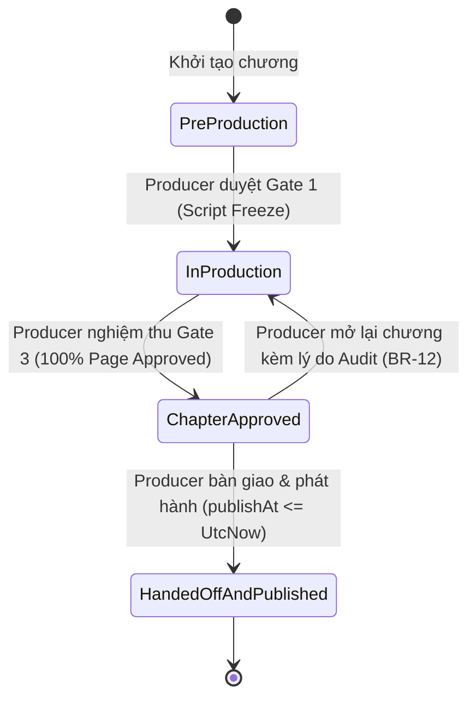
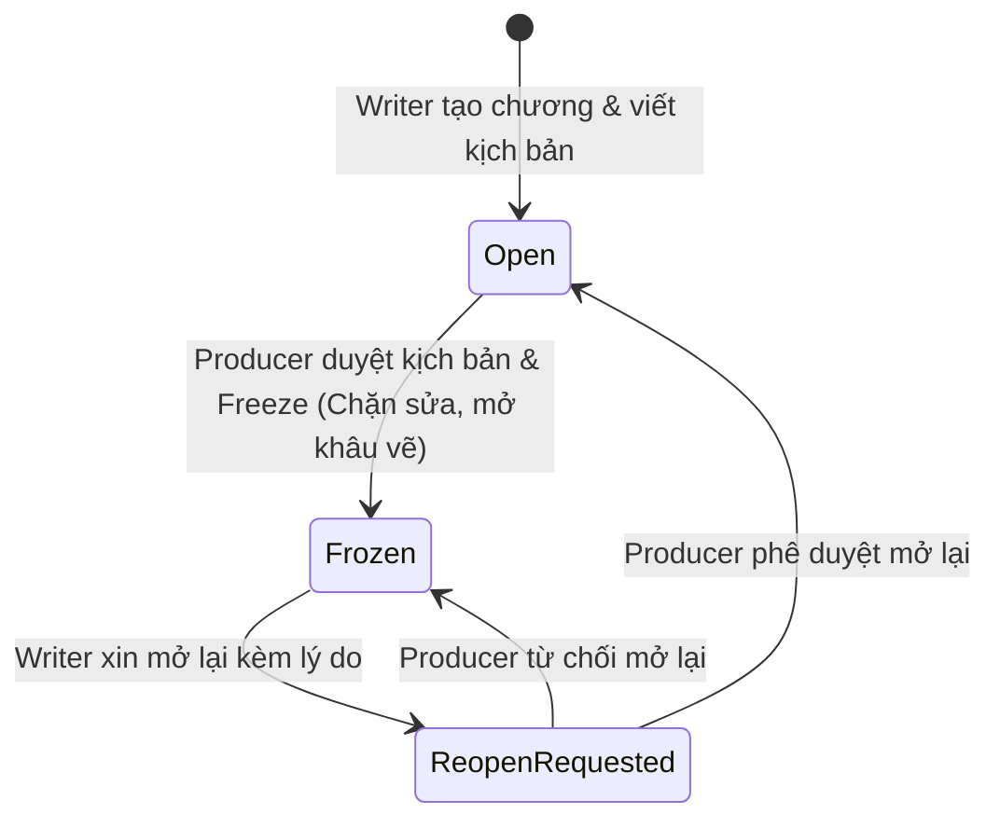
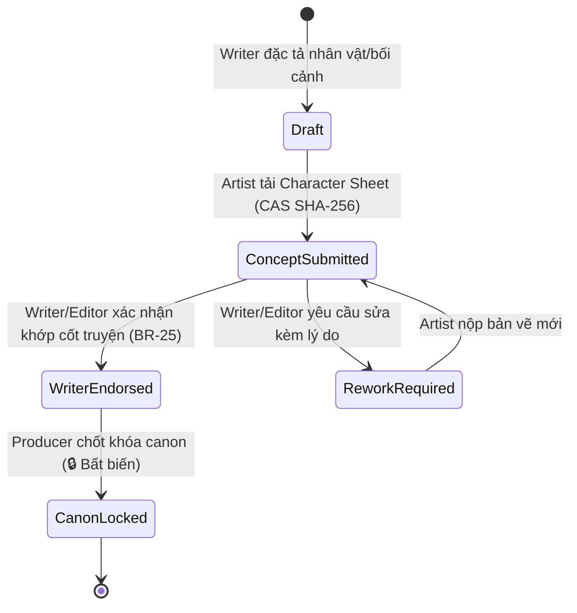
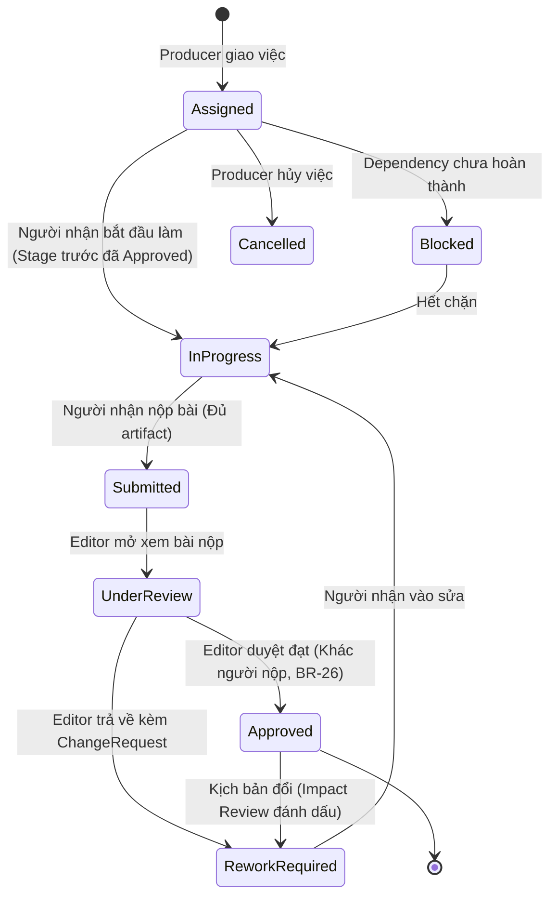

# PanelForge — Bộ Ngôn Ngữ Chung (Ubiquitous Language) & Quy Chuẩn Trạng Thái Hệ Thống

> **Dự án:** PanelForge Manga Production Platform (`FA26SE251` / `GFA26SE140`)  
> **Mục đích:** Thiết lập từ vựng chuẩn hóa duy nhất (Single Source of Truth) giữa **Mã nguồn (.NET, React, Flutter)**, **Tài liệu đồ án (Report 3 SRS, Report 4 SDD)**, và **Văn bản cam kết Hội đồng (BM04 Review 2)**.  
> **Áp dụng:** Giải quyết triệt để lỗi dùng sai trạng thái, lẫn lộn giữa thực thể cha - con, và không đồng nhất danh từ.  
> **Tài liệu bổ trợ chuyên sâu:** Xem [Quy chuẩn Đặt tên State Machine & Khung Chuẩn Hóa](file:///d:/FPT-STUDY/10_FALL-2026/SEP490/Report/02_Reports/PanelForge_State_Machine_Naming_Standards.md) (Ánh xạ ngữ pháp Parts of Speech, Casing, XState v5 `dot.case`, Guards/Actions).

---

## 1. NGUYÊN TẮC CỐT LÕI VỀ TRẠNG THÁI (CORE STATE PRINCIPLES)

Theo hướng dẫn chuyên đề Workflow của Trường (*slide W03, W07, W13*):
1. **Một thực thể (Entity) chỉ sở hữu vòng đời của chính nó:** Không được gán trạng thái của thực thể con (`Assignment`, `Script`) vào thực thể cha (`Chapter`).
2. **Năm khái niệm không được trùng lặp:**
   - **ChapterStatus:** Chương đang sản xuất, đã duyệt hay đã phát hành ra công chúng?
   - **ScriptLifecycle:** Kịch bản đang soạn, đã đóng băng hay đang xin mở lại?
   - **AssignmentStatus:** Người được giao việc (Artist/Letterer) đang làm đến đâu?
   - **StageProgressStatus:** Khung tranh / Trang đang ở nấc thang công đoạn nào?
   - **SubmissionStatus:** Bản nộp bài nào đang chờ duyệt, bản nào bị thay thế?
3. **Mỗi bước chuyển trạng thái (Transition) bắt buộc có:** Sự kiện kích hoạt (Event/Trigger), Điều kiện tiên quyết (Guards/BR), và Quyết định phân quyền (Actor/RBAC).

---

## 2. BỘ NGÔN NGỮ CHUNG (UBIQUITOUS LANGUAGE)

### 2.1. Phân vai & Người dùng (Roles & Actors)

| Thuật ngữ Tiếng Anh | Tiếng Việt chuẩn | Phạm vi | Mô tả trách nhiệm |
|---|---|---|---|
| **Administrator** | Quản trị viên hệ thống | Toàn hệ thống | Quản lý tài khoản (bao gồm duy nhất 1 tài khoản Publisher toàn hệ thống, Q12), tài khoản ngân hàng nền tảng (Q13), cấp quyền tạo Studio, quota AI. Không can thiệp nội dung. |
| **Producer** | Giám đốc sản xuất / Chủ Studio | Workspace | Quản lý workspace, tạo Series, Lock Canon Bible, đóng băng kịch bản (Gate 1), giao việc Page/Panel, nghiệm thu chương (Gate 3) và phát hành (Q7). |
| **Writer** | Tác giả kịch bản | Workspace / Series | Độc quyền sáng tác kịch bản (`Page -> Panel -> Content`), gắn thẻ Bible, Endorse Bible concept, đề xuất mở lại kịch bản. |
| **Artist** | Họa sĩ (Chì / Mực) | Workspace / Series | Vẽ Concept Art Bible, thực hiện Pencil & Ink trên Page được giao (mặc định có cả `graphic:write` và `letter:write` theo BR-31). |
| **Letterer** | Người đặt thoại & SFX | Workspace / Series | Vai trò phụ việc tùy chọn (`letter:write` only): bố trí Position Record bóng thoại `{x,y,w,h}`, nội dung đa ngôn ngữ và SFX. |
| **Editor** | Biên tập viên | Workspace / Series | Duyệt Gate 2 (`CompositeUnderReview`), khoanh vùng tạo Change Request (sinh nhiều CR chung `group_id` nếu vắt nhiều Panel ≥ 15%), duyệt bản dịch `ChapterEdition`. |
| **Publisher** | Đối tác phát hành (1 tài khoản duy nhất) | Publisher Portal | Xem/tải gói bàn giao & PreviewLink chỉ đọc; **quy định thương mại** (Free/Trả phí, `price_vnd`, `free_preview_pages`) theo từng ấn bản ngôn ngữ (Q7, Q12). Không sửa nội dung hay phát hành. |
| **External Reviewer** | Người đánh giá bên ngoài | Ngoài nền tảng | Nhận link xem thử có watermark (`PreviewLink`), gửi nhận xét trước ngày xuất bản. Không có tài khoản WS. |
| **Reader** | Độc giả | Web Catalog / Mobile Reader | Đăng ký tài khoản `User`, chọn ngôn ngữ đọc, nạp Ví VNĐ (`wallets`) và mở khóa từng ấn bản ngôn ngữ (`edition_entitlements`). |

---

### 2.2. Danh mục Thực thể Nghiệp vụ (Business Entities)

| Thực thể (Entity) | Cấp độ (Scope) | Định nghĩa chuẩn |
|---|---|---|
| **StudioWorkspace** | Toàn cục | Không gian làm việc khép kín của một Studio, độc lập về dữ liệu, thành viên và quota. |
| **Series** | Workspace | Một bộ truyện tranh, có cấu trúc pipeline công đoạn, hướng đọc (RTL/LTR), Bible riêng. |
| **SeriesBible** | Series | Hồ sơ kinh thánh bối cảnh của Series; lưu trữ thiết kế nhân vật, sự kiện, địa điểm, luật thế giới. |
| **BibleEntryRevision** | SeriesBible | Phiên bản của một mục Bible; có chương bắt đầu hiệu lực và ảnh tham chiếu CAS SHA-256. |
| **Chapter** | Series | Một chương truyện (gồm cờ `IsScriptFrozen`, `ChapterStatus` và tập hợp `Page`). |
| **ChapterEdition** | Chapter × Lang | Ấn bản theo từng ngôn ngữ (`original_language` / `release_languages`) với trạng thái xuất bản và giá VNĐ riêng (Q9, Q10). |
| **Scene (Ẩn dưới DB)** | Chapter | Một Scene mặc định ẩn do hệ thống tạo cho mỗi Chapter (`scene_id` NOT NULL dưới DB theo D2); không hiển thị trên UI kịch bản và đã bỏ `ChapterScript` (D5). |
| **PanelContent** | Panel | Đơn vị nội dung trong Panel (`ACTION_DIRECTION`, `DIALOGUE/THOUGHT`, `NARRATION`, `SFX`), chữ thuần; thoại ghi tên người nói `speaker_label`. Liên kết Bible ở cấp chương qua Danh sách thực thể chương (Q16). |
| **Page** | Chapter | Một trang truyện vật lý trong chương; chứa một hoặc nhiều khung tranh (Panel). |
| **Panel** | Page | Một khung tranh; đơn vị cơ sở để giao việc, kiểm tra chất lượng và cô lập sửa chữa. |
| **Assignment** | Chapter / Panel | Thẻ phân công công việc cụ thể cho một thành viên ở một công đoạn (PipelineStage). |
| **Submission** | Assignment | Lần nộp bài của nghệ sĩ (gắn asset hash và số revision cụ thể). |
| **ChangeRequest** | Submission | Phiếu yêu cầu chỉnh sửa do Editor phát hành, khoanh vùng lỗi trên panel hoặc ảnh. |
| **StageProgress** | Panel × Stage | Tiến độ kiểm duyệt cổng kỹ thuật của một panel qua từng công đoạn. |
| **AiWorkflowRun** | Scene / Chapter | Một phiên chạy ngầm của tiến trình AI nhiều bước (Multi-agent run). |
| **AiSuggestion** | AiWorkflowRun | Một đề xuất cụ thể do AI đưa ra; bắt buộc chờ con người phê chuẩn. |
| **PreviewLink** | Chapter | Đường dẫn xem trước bảo mật có giới hạn thời gian, sinh watermark cho người ngoài. |
| **PreviewFeedback** | PreviewLink / Mobile | Nhận xét của độc giả/reviewer gắn với vị trí panel hoặc chương đang xem. |

---

## 3. BẢNG QUY CHUẨN TRẠNG THÁI TOÀN HỆ THỐNG (STATE ENUMS & MACHINES)

### 3.1. ChapterStatus (Vòng đời Chương — chuẩn V2.6 Final)
*Thực thể: `Chapter` — Người quyết định: `Producer`*



| Tên trạng thái | Ý nghĩa chuẩn | Quyền chuyển | Ghi chú & Điểm sửa |
|---|---|---|---|
| `PreProduction` | Đang chuẩn bị kịch bản & Series Bible trước Gate 1. | Mặc định | Khóa sửa kịch bản khi sang `InProduction`. |
| `InProduction` | Chương đang trong quá trình vẽ tranh & đặt thoại. | Producer | Bắt đầu từ Gate 1. |
| `ChapterApproved` | Producer xác nhận toàn bộ trang đã hoàn tất và đạt Gate 3. | Producer | Gộp `Locked` cũ vào `ChapterApproved` theo **Q1**. |
| `HandedOffAndPublished` | Chương đã bàn giao & phát hành công khai cho độc giả. | Producer | `Published` là trạng thái trên từng `ChapterEdition` (**Q7, Q10**). |

> [!WARNING]
> **ĐIỂM SỬA QUAN TRỌNG:** Loại bỏ hoàn toàn chữ `Locked` khỏi vòng đời Chapter. Không đưa `Frozen` hay `InProgress` vào `ChapterStatus`!

---

### 3.2. Script Lifecycle (Vòng đời Kịch bản trên Chapter)
*Thực thể: Cờ `IsScriptFrozen` & `ScriptReopenStatus` trên `Chapter` — Quyết định: `Writer` & `Producer`*



| Trạng thái kịch bản | Điều kiện dữ liệu | Ý nghĩa |
|---|---|---|
| `Open` (Drafting) | `IsScriptFrozen = false`, `ScriptReopenStatus = None / Approved` | Writer toàn quyền thêm/sửa/xóa kịch bản; khâu vẽ chưa mở. |
| `Frozen` | `IsScriptFrozen = true`, `ScriptReopenStatus = None / Rejected` | Kịch bản chỉ đọc (Read-only); Producer mở khâu phân trang/vẽ. Sửa kịch bản trả về **HTTP 409**. |
| `ReopenRequested` | `IsScriptFrozen = true`, `ScriptReopenStatus = Requested` | Writer gửi yêu cầu mở lại kèm lý do; kịch bản vẫn đang đóng băng chờ Producer duyệt. |

---

### 3.3. BibleRevisionStatus (Vòng đời Series Bible 2 tầng)
*Thực thể: `BibleEntryRevision` — Quyết định: `Artist`, `Writer/Editor`, `Producer`*



| Tên trạng thái | Ý nghĩa chuẩn | Actor thực hiện |
|---|---|---|
| `Draft` | Bản mô tả đặc tả văn bản của Writer (chờ Artist vẽ concept). | Writer |
| `ConceptSubmitted` | Artist đã tải bản vẽ lên kho Asset CAS SHA-256. | Artist |
| `ReworkRequired` | Bản vẽ bị trả về kèm yêu cầu chỉnh sửa. | Writer / Editor |
| `WriterEndorsed` | Writer xác nhận bản vẽ đúng với tinh thần kịch bản (**Điều kiện cần để Lock**). | Writer |
| `CanonLocked` | Producer khóa vĩnh viễn làm bản mẫu chính thức của Series. Không thể unlock; muốn sửa phải tạo revision mới qua `/supersede`. | Producer |

---

### 3.4. AssignmentStatus (Trạng thái Nhiệm vụ phân công)
*Thực thể: `Assignment` — Quyết định: `Artist`, `Letterer`, `Editor`*



| Tên chuẩn thống nhất | Tên cũ / Alias trong code | Ý nghĩa chuẩn |
|---|---|---|
| `Assigned` | `Assigned` | Đã giao việc, chờ người nhận bắt đầu. |
| `Blocked` | `Blocked` | Bị chặn do khâu trước chưa xong hoặc phụ thuộc kịch bản. |
| `InProgress` | `InProgress` | Người nhận đang thực hiện công việc. |
| `Submitted` | `Submitted` | Đã nộp bài, tạo Submission Pending. |
| `UnderReview` | `Reviewing` (trong BM04) | Editor đang thẩm định bài nộp. |
| `Approved` | `Approved` / `Done` | Editor duyệt đạt, mở khóa stage kế tiếp. |
| `ReworkRequired` | `ReworkRequired` | Bị trả về từ cổng duyệt hoặc bị cờ Impact Review do kịch bản đổi. |
| `Cancelled` | (Planned RF-17) | Producer hủy bỏ nhiệm vụ hoặc tái phân công. |

> [!TIP]
> **THỐNG NHẤT DANH TỪ:** Thống nhất dùng **`UnderReview`** (trong code) hoặc cho phép hiển thị trên UI là **`In Review` / `Reviewing`**. Trong tài liệu SDD & SRS, ghi rõ: `UnderReview (Reviewing)`.

---

### 3.5. StageProgressStatus (Tiến độ Kỹ thuật của Panel)
*Thực thể: `StageProgress` — Đơn vị: Panel × Stage*

- `InProgress`: Đang vẽ / gia công.
- `Submitted`: Đã nộp bài.
- `InReview`: Editor đang mở xem xét.
- `ChangesRequested`: Có yêu cầu sửa đổi (tương ứng với `ReworkRequired` bên Assignment).
- `Approved`: Công đoạn đã được duyệt, đóng băng chỉ đọc.

---

### 3.6. SubmissionStatus & ChangeRequestStatus
*Thực thể: `Submission` & `ChangeRequest` — Module Quality Control*

- **Submission:**
  - `Pending`: Mới nộp, chờ xem xét.
  - `Approved`: Được chấp thuận.
  - `Rejected`: Bị từ chối.
  - `Superseded`: Bị thay thế khi nghệ sĩ nộp lại bản vẽ mới sau chỉnh sửa.
- **ChangeRequest:**
  - `Open`: Editor phát hành yêu cầu sửa kèm vùng khoanh.
  - `Resolved`: Nghệ sĩ đã sửa xong và đánh dấu giải quyết.
  - `Verified`: Editor kiểm tra lại và xác nhận đã sửa đạt.
  - `Rejected`: Producer/Editor bác bỏ yêu cầu sửa sau khi trao đổi.

---

### 3.7. AI Workflow & Suggestion Status
*Thực thể: `AiWorkflowRun` & `AiSuggestion` — Module AI*

- **AiRunStatus:** `Queued` $\rightarrow$ `Running` $\rightarrow$ `WaitingForHuman` (chờ người) / `Completed` (hoàn tất) / `Failed` (thất bại) / `Interrupted` (bị gián đoạn).
- **AiSuggestionStatus:** `Pending` $\rightarrow$ `Accepted` (chấp nhận, tạo revision) / `Rejected` (từ chối, không đổi gì) / `ChangesRequested` (yêu cầu sửa).

---

## 4. MA TRẬN ĐỐI CHIẾU ĐIỂM LỆCH (DISCREPANCY MATRIX) & GIẢI PHÁP KHẮC PHỤC

| Mục so sánh | Trong Code hiện tại | Trong Commitment BM04 | Trong Report 3 (SRS) / Report 4 (SDD) | Điểm lệch & Nguy cơ | Giải pháp chuẩn hóa thống nhất |
|---|---|---|---|---|---|
| **1. Vòng đời Chapter** | `InProduction, Approved, Locked, Published` | `InProduction → Approved → Published` | Nhiều chỗ còn ghi `Locked` | Code và báo cáo còn tồn tại chữ `Locked` trong khi BM04 đã bỏ. | • Giữ BM04 theo chuẩn mới bỏ `Locked`.<br>• Cập nhật task **RF-16** xóa `Locked` khỏi code trước 20/11.<br>• Tìm và thay thế `Locked` $\rightarrow$ `Approved` trong SRS/SDD. |
| **2. Kịch bản vs Chapter (WF-03)** | `Chapter.IsScriptFrozen` & `ScriptReopenStatus` | Ghi gộp: `Chapter: InProduction → Frozen → ReopenRequested...` | Một số sơ đồ vẽ lẫn vào Chapter | Nhầm lẫn thực thể cha (`Chapter`) với trạng thái kịch bản (`Script`) và tác vụ (`Assignment`). | • Sửa câu chữ trong BM04 mục 6.3:<br>`Script: Open → Frozen → ReopenRequested → Open;`<br>`Assignment: Approved → ReworkRequired → InProgress.` |
| **3. Trạng thái duyệt việc** | `AssignmentStatus.UnderReview` | `Assignment: ... → Reviewing → ...` | SDD §4 ghi `UnderReview`, BM04 ghi `Reviewing` | Lệch danh từ giữa code (`UnderReview`) và BM04 (`Reviewing`). | • Chấp nhận `UnderReview` là mã nội bộ (Code enum), `Reviewing` là nhãn hiển thị nghiệp vụ (Display Label). Bổ sung chú thích này vào SDD. |
| **4. Cờ hủy Assignment** | Chưa có enum `Cancelled` | BM04 ghi có `Cancelled` | State machine §6.4 có vẽ `Cancelled` | Code chưa định nghĩa giá trị enum `Cancelled = 8`. | • Nằm trong task **RF-17** (hạn 20/11) do Tâm phụ trách. Thêm `Cancelled = 8` vào `AssignmentStatus.cs`. |
| **5. Tài khoản Reader** | `Catalog API` public không cần auth; Mobile có `ReaderAccount` | Ghi: `Publisher and Reader have accounts (BR-07, BR-24)` | SRS phân định Web Reader và Mobile Reader | Dễ bị hiểu lầm là độc giả Web cũng bắt buộc phải đăng ký tài khoản mới được đọc truyện. | • Làm rõ trong SRS và BM04: *"Reader reads public catalog on Web; Mobile reader registers ReaderAccount for library and bookmark features."* |

---

## 5. TỔ CHỨC CẤU TRÚC THƯ MỤC CHUẨN ĐỒ ÁN (FOLDER STRUCTURE REFACTORING)

Toàn bộ thư mục `Report` đã được tái cấu trúc thành 6 nhóm chức năng rõ ràng, không còn file rác hay file lộn xộn ở thư mục gốc:

```
D:\FPT-STUDY\10_FALL-2026\SEP490\Report\
│
├── 00_Huong_Dan_Templates/         # Toàn bộ hướng dẫn của Trường & Giảng viên
│   ├── Capstone_Huong-dan-chuan-bi-Review-va-Hoi-dong_v1.3.pdf
│   ├── Casptone Project Excel Template.xlsx
│   ├── Mo-hinh-hoa-hanh-vi-Activity-Sequence-State-Machine.pdf
│   └── Workflow_La_Gi_Dinh_Nghia_Va_Dac_Ta.pdf      # [ĐÃ CHUYỂN VÀO] Slide quy chuẩn Workflow
│
├── 01_Phieu_De_Tai_BM01/           # Phiếu đăng ký đề tài & Hồ sơ thay đổi (BM01, BM03)
│   ├── GFA26SE140_Phieu_FA26SE251_JapanComicWorkflow_V1.3.docx
│   └── _Old_Versions/
│
├── 02_Reports/                     # Các tập báo cáo chuyên môn (Report 1 -> Report 6)
│   ├── PanelForge_Ubiquitous_Language_and_State_Glossary.md  # [FILE NÀY] Từ vựng & Trạng thái chuẩn
│   ├── PanelForge_State_Machine_Naming_Standards.md          # [MỚI] Quy chuẩn đặt tên State Machine & XState v5
│   ├── Report1_Introduction/
│   ├── Report2_Management_Plan/
│   ├── Report3_SRS/                # Đặc tả yêu cầu phần mềm
│   │   ├── PanelForge_57_Use_Cases.docx             # [ĐÃ CHUYỂN VÀO] Danh sách 57 Use Cases
│   │   ├── PanelForge_UseCase_Diagram.mmd           # [ĐÃ CHUYỂN VÀO] Sơ đồ Use Case Mermaid
│   │   ├── PanelForge_UseCase_Diagram.puml          # [ĐÃ CHUYỂN VÀO] Sơ đồ Use Case PlantUML
│   │   └── Report3_Software Requirement Specification.docx
│   ├── Report4_SDD/                # Thiết kế kiến trúc & Dữ liệu
│   │   ├── PanelForge_Production_Workflow_Optimization.md # [ĐÃ CHUYỂN VÀO] Báo cáo tối ưu hóa quy trình
│   │   ├── Report4_PanelForge_Architecture_and_Diagrams.docx # [ĐÃ ĐƯA TỪ PENDING VÀO]
│   │   └── Report4_Software Design Document.docx
│   ├── Report5_Testing/            # Kế hoạch & Kết quả kiểm thử
│   └── Report6_UserGuides/         # Hướng dẫn sử dụng
│
├── 03_Defense_Review/              # Tài liệu các đợt Review và Bảo vệ Hội đồng
│   ├── Review2/                    # [MỚI] Tài liệu đợt Review 2
│   │   ├── SEP490_FA26SE251_R2_Commitment.docx       # Cam kết BM04
│   │   └── phu-luc-A-defense-1.1.md                 # Đề xuất khối lượng công việc
│   └── Defense1.1/                 # [MỚI] Chuẩn bị hồ sơ cho Defense 1.1
│
├── 04_Final_Report/                # Bộ báo cáo tổng hợp cuối kỳ (gộp tất cả các report)
│
├── 05_Visualizers_Prototypes/      # [MỚI] Bộ công cụ HTML trực quan hóa tương tác
│   ├── PanelForge_Editor_Workspace.html
│   ├── PanelForge_Sequential_Workflow.html
│   ├── PanelForge_Workflows_Swimlane.html
│   └── PanelForge_Workflows_Visualizer.html
│
└── _Archive_Dumps/                 # [MỚI] Lưu trữ các file trích xuất tạm (*_dump.txt)
    ├── bm01_v1.3_dump.txt
    ├── report1_dump.txt
    └── report2_dump.txt
```
