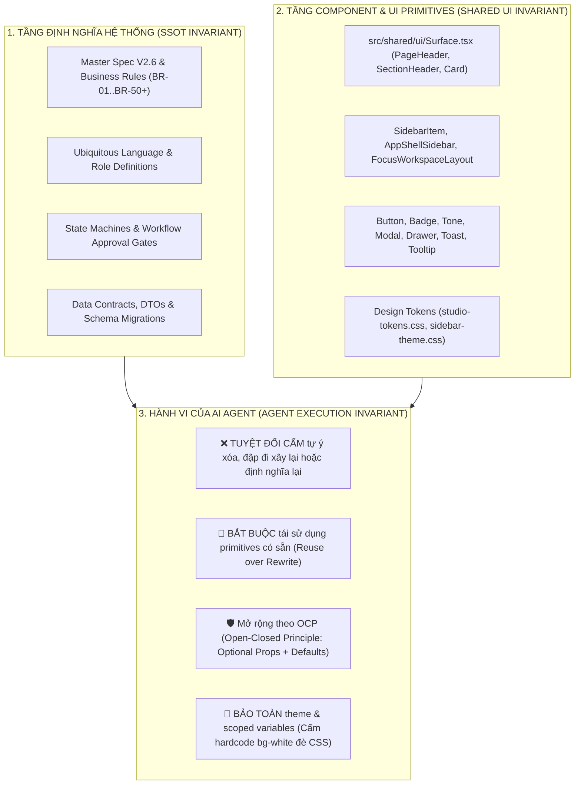

# QUY CHUẨN BẤT BIẾN ĐỊNH NGHĨA HỆ THỐNG & COMPONENT DÙNG CHUNG CHO AI AGENT
## (System Definitions & Shared Components Immutability Invariant)

> **Dự án tốt nghiệp:** PanelForge – Nền tảng đồng sáng tác và quản lý sản xuất truyện tranh Manga hỗ trợ bởi AI Agent  
> **Mã nhóm:** FA26SE251 · **Học kỳ:** Fall 2026 – Spring 2027  
> **Áp dụng cho:** Tất cả các AI Agents (Claude Code, Antigravity, Cursor, Codex) và toàn bộ thành viên phát triển (.NET Backend, React Frontend, Flutter Mobile).

---

## 1. TỔNG QUAN & NGUYÊN TẮC CỐT LÕI (CORE PHILOSOPHY)

Trong môi trường phát triển đa kho mã nguồn (Multi-Repo) với sự tham gia của nhiều AI Agent làm việc song song trên các nhánh độc lập, **rủi ro lớn nhất là AI Agent tự ý viết đè (trample), tái tạo trùng lặp (duplicate), thay đổi giao diện/hợp đồng (break contract), hoặc loại bỏ các định nghĩa nền tảng và component dùng chung của hệ thống**.

Tài liệu này xác lập **Quy tắc Bất biến Cốt lõi (Immutability Invariant)** nhằm bảo vệ tính toàn vẹn của hệ thống:



---

## 2. BỐN ĐIỀU KHOẢN BẤT BIẾN TUYỆT ĐỐI (THE 4 ABSOLUTE INVARIANTS)

### 🔹 Điều 1: Bất biến Định nghĩa Hệ thống & Nghiệp vụ (System Definitions & Ubiquitous Language)
1. **Vai trò Hệ thống (Roles - Phân tầng Spec D10):**
   - Phân tầng 2 cấp rõ rệt theo Spec D10:
     - **Cấp Studio (`WorkspaceRole`):** Chỉ gồm `PRODUCER` (Owner/Quản trị Studio) và `MEMBER` (Thành viên chung). Khi mời thành viên vào Studio qua `InviteMemberModal`, chỉ chọn giữa Producer và Member.
     - **Cấp Series (`series_members` / `SeriesRole`):** Phân vai chuyên môn sản xuất độc lập cho từng bộ truyện: `PRODUCER`, `WRITER`, `ARTIST`, `LETTERER`, `EDITOR`. Một người dùng có thể là Artist ở Series A nhưng là Writer hoặc Editor ở Series B.
     - **Toàn hệ thống:** `ADMIN` (quản trị nền tảng), `PUBLISHER` (quản lý xuất bản/phát hành) và `READER` (độc giả trên Web/Mobile).
   - ❌ **CẤM** tự chế ra các vai trò mới, đổi tên vai trò hoặc thay đổi đường dẫn mặc định (`getRoleDefaultPath`) mà không có yêu cầu từ Master Spec V2.6.
2. **Quy trình & Máy trạng thái (State Machines & Gates):**
   - Vòng đời sản xuất chương (`PreProduction` $\rightarrow$ `InProduction` $\rightarrow$ `ChapterApproved` $\rightarrow$ `ChapterPublished` / `ChapterHandedOff`).
   - 4 Cổng kiểm soát chất lượng (Gates 1–4) và luồng phê duyệt Bible Revisions, Concept Art, Script Refreeze.
   - ❌ **CẤM** bỏ qua các điều kiện kiểm tra (gate checks), không tự ý đổi tên enum hoặc bỏ qua các bước trong state transition.
3. **Hợp đồng Dữ liệu (DTOs & API Contracts):**
   - Không được tự ý xóa, đổi kiểu dữ liệu các trường DTO dùng chung giữa Backend, Frontend và Mobile.
   - Khi cần truyền thêm dữ liệu, **phải bổ sung trường tùy chọn (nullable/optional field)**, đảm bảo tương thích ngược 100%.

---

### 🔹 Điều 2: Bất biến Component Dùng chung & UI Primitives (Shared UI Invariant)
1. **Tập hợp Primitives Chuẩn tại `src/shared/ui/`:**
   - Mọi trang màn hình, view nghiệp vụ hoặc modal trong Frontend **BẮT BUỘC** sử dụng các component dùng chung tại `src/shared/ui/`:
     - `PageHeader`, `SectionHeader`: Header tiêu chuẩn màn hình và khối nghiệp vụ (điểm nhấn "Mực Cam & Giấy Kraft").
     - `Card`, `CardHeader`, `CardBody`: Thẻ hiển thị dữ liệu chuẩn theo thiết kế Stitch & Lucian.
     - `SidebarItem`: Mục menu thanh điều hướng có hỗ trợ tooltip, badge, trạng thái read-only.
     - `Button`, `Badge`, `Tone`: Các nút bấm, nhãn trạng thái có tone màu chuẩn (`brand`, `neutral`, `success`, `warning`, `danger`, `info`).
2. **Quy tắc Tái sử dụng (Reuse over Rewrite):**
   - ❌ **CẤM** tự code thẻ `div` với CSS Tailwind rời rạc thay vì dùng primitive chuẩn (ví dụ: tự dựng khung header thẻ bằng `div className="flex border-b..."` thay vì dùng `CardHeader`).
   - ❌ **CẤM** tự tạo component trùng lặp trong thư mục cục bộ của từng vai trò (`src/roles/*/components/`) khi chức năng đó đã có trong `src/shared/ui/`.
3. **Quy tắc Mở rộng Tương thích Ngược (Open-Closed Principle):**
   - Khi một màn hình cần thêm thuộc tính hiển thị (ví dụ: icon phụ, badge tùy biến, action button):
     - **ĐƯỢC PHÉP:** Bổ sung optional prop vào interface (ví dụ: `extraAction?: React.ReactNode;`).
     - **CẤM:** Sửa prop bắt buộc, đổi tên prop hiện có, hoặc làm thay đổi layout mặc định của các màn hình đang sử dụng primitive đó.

---

### 🔹 Điều 3: Bảo toàn Giao diện Theme & Biến Scoped (Theme Protection Invariant)
1. **Kiến trúc Sidebar Theme của PanelForge:**
   - Sidebar hỗ trợ 4 preset theme (`paper`, `ink`, `ocean`, `plum`), lưu trữ qua `localStorage` (`pf.sidebar.theme`) và CustomEvent đồng bộ.
   - Toàn bộ màu nền, chữ, viền, hover của Sidebar được điều khiển thông qua CSS Custom Properties scoped vào `.pf-sidebar[data-sb-theme="..."]`:
     - `--sb-bg`, `--sb-surface`, `--sb-surface-hover`, `--sb-text`, `--sb-muted`, `--sb-border`, `--sb-hover`, `--sb-accent`, `--sb-popover`.
     - Các class tiện ích tương ứng: `pf-sb-chrome`, `pf-sb-surface`, `pf-sb-action`, `pf-sb-text`, `pf-sb-muted`, `pf-sb-popover`.
2. **Quy tắc Chống Đè Màu (No Style Trampling):**
   - ❌ **TUYỆT ĐỐI CẤM** đặt các class Tailwind màu cố định (như `bg-white`, `text-stone-900`, `border-[#E7E5E4]`, `!bg-white`) lên `<aside>`, header, footer hoặc các thẻ con bên trong `.pf-sidebar`. Hành vi này sẽ phá hủy giao diện khi người dùng chọn theme tối (`ink`, `ocean`, `plum`).
   - Luôn sử dụng `pf-sb-chrome` hoặc `pf-sb-surface` để kế thừa màu sắc từ theme hiện hành.
3. **Bảo tồn Bộ chuyển Theme khi Merge Code:**
   - Trong mọi thao tác merge code từ nhánh khác (như `dev` hoặc `origin/*`), **bắt buộc duy trì bộ chuyển đổi theme (`SIDEBAR_THEMES`, `onChangeTheme`) và menu popover người dùng**, không để code merge ghi đè làm mất tính năng này.

---

### 🔹 Điều 4: Kiểm soát Sửa đổi & Quy trình Thực thi của AI Agent
Khi AI Agent thực hiện bất kỳ nhiệm vụ nào (sửa lỗi, thêm tính năng, refactor, merge conflict), **BẮT BUỘC tuân thủ quy trình 5 bước**:

```text
[Bước 1: Tra cứu SSOT]
   └── Đọc panelforge-hub/docs/ để hiểu đúng ngữ cảnh nghiệp vụ và State Machine liên quan.

[Bước 2: Quét Component Sẵn có]
   └── Kiểm tra src/shared/ui/ và src/styles/ để dùng lại primitives, tokens có sẵn.

[Bước 3: Mở rộng Không Phá vỡ (OCP)]
   └── Chỉ thêm optional prop, giữ nguyên interface và hành vi mặc định cho consumers cũ.

[Bước 4: Kiểm thử Theo Bán kính Ảnh hưởng (Targeted Testing)]
   └── Chạy test của module đang sửa:
       powershell -File panelforge-hub/.agents/scripts/run_module_tests.ps1 -Module <tên_module>
   └── Chạy kiểm tra i18n key parity:
       npm --prefix panelforge-fe run i18n:check

[Bước 5: Fast Build Verification & Local Commit]
   └── Xác thực Build không lỗi, commit cục bộ trên {work-branch}.
   └── CHỈ push khi hoàn thành trọn vẹn 1 module lớn hoặc khi có lệnh trực tiếp từ Người dùng.
```

---

## 3. DANH MỤC CÁC VÙNG BẢO VỆ BẤT BIẾN (PROTECTED SYSTEM ZONES)

| Kho mã nguồn | Thư mục / File được bảo vệ | Trách nhiệm bảo vệ |
| :--- | :--- | :--- |
| **Frontend** (`panelforge-fe`) | `src/shared/ui/` (`Surface.tsx`, `Sidebar.tsx`, v.v.) | Bộ Primitives dùng chung cho toàn bộ app. Cấm sửa đổi phá vỡ. |
| **Frontend** (`panelforge-fe`) | `src/styles/` (`studio-tokens.css`, `sidebar-theme.css`, `index.css`) | Hệ thống tokens, màu sắc, phông chữ và scoped variables. Cấm sửa token cốt lõi. |
| **Frontend** (`panelforge-fe`) | `src/app/AppShell.tsx`, `AppShellSidebar.tsx`, `FocusWorkspaceLayout.tsx`, `sidebarTheme.ts`, `useSidebarTheme.ts` | Khung sườn ứng dụng và hệ thống Sidebar Theme. Cấm hardcode class đè màu. |
| **Frontend** (`panelforge-fe`) | `src/roles/roles.ts` | Bảng định nghĩa quyền và điều hướng vai trò. Cấm tự chế role mới. |
| **Frontend** (`panelforge-fe`) | `src/locales/` (`vi/`, `en/`) | Toàn bộ 20 namespaces song ngữ. Phải duy trì đối chiếu 100% key parity (10.619 keys). |
| **Backend** (`PanelForge_FA26SE251`) | `Domain/Entities/`, `Domain/Enums/` | Toàn bộ thực thể và enum miền nghiệp vụ. Cấm đổi enum giá trị có sẵn. |
| **Backend** (`PanelForge_FA26SE251`) | `Infrastructure/Persistence/Configurations/` | Cấu hình EF Core và quan hệ bảng DB. Cấm sửa mapping mà không có migration tương thích. |
| **Backend** (`PanelForge_FA26SE251`) | `Application/Common/Interfaces/` | Hợp đồng giao tiếp (Contracts). Mọi mở rộng phải tương thích ngược. |
| **Hub** (`panelforge-hub`) | `docs/standards/`, `docs/V2.6/` | Nơi tập trung toàn bộ chân lý hệ thống (SSOT). Mọi quyết định code phải dựa vào đây. |

---

## 4. BẢNG TỰ KIỂM TRƯỚC KHI COMMIT (AGENT PRE-COMMIT SELF-CHECKLIST)

Trước khi thực hiện `git commit`, AI Agent **BẮT BUỘC** tự trả lời "CÓ" cho 7 câu hỏi sau:

- [ ] **1. Tái sử dụng:** Tôi đã sử dụng các component có sẵn tại `src/shared/ui/` thay vì tự tạo thẻ HTML/style riêng lẻ chưa?
- [ ] **2. Không phá vỡ:** Props của các component dùng chung mà tôi sửa có giữ nguyên kiểu dữ liệu và tính tương thích ngược (optional props + default values) không?
- [ ] **3. Bảo toàn Theme:** Tôi có tránh việc hardcode `bg-white`, `border-stone-200` làm đè lên các scoped theme (`data-sb-theme`) của Sidebar và Shell không?
- [ ] **4. Vai trò chuẩn:** Các logic phân quyền có dựa trên đúng phân tầng vai trò 2 cấp (Studio Scope: Producer/Member; Series Scope: Producer/Writer/Artist/Letterer/Editor) theo Master Spec V2.6 và Spec D10 không?
- [ ] **5. Kiểm thử module:** Tôi đã chạy và vượt qua các test suite liên quan trực tiếp đến module đang sửa chưa?
- [ ] **6. i18n Parity:** Nếu có bổ sung text giao diện, tôi đã thêm đầy đủ cả hai file `vi` và `en` với key khớp 100% chưa?
- [ ] **7. Quy tắc Push:** Tôi có ghi nhớ chỉ commit cục bộ trên `{work-branch}` và KHÔNG tự ý push trừ khi có yêu cầu trực tiếp từ Người dùng?
