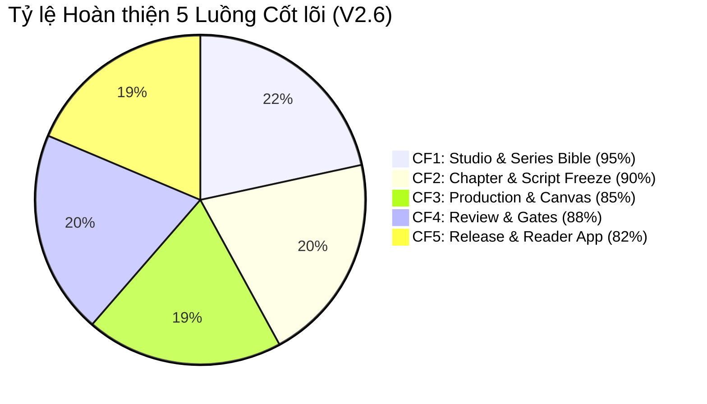

# 🔍 PANELFORGE FEATURE AUDIT & ARCHITECTURE DIFF REPORT

> **Bản so sánh đối chiếu toàn diện:** Các tính năng của hệ thống PanelForge giữa các phiên bản cũ (V2.0 / V2.5) và bản chuẩn hóa tối cao **V2.6 Final**.  
> **Cập nhật:** 2026-11-12  
> **Nguồn đối chiếu:** `panelforge-hub/docs/spec/PANELFORGE_MASTER_SPECIFICATION_V2_6.md`

---

## 📊 Bảng Đối chiếu Chi tiết Từng Chức năng (Feature-by-Feature Audit)

| Mã | Chức năng (Feature) | Phiên bản cũ (V2.0 / V2.5) | Phiên bản chuẩn hóa (V2.6 Final) | Lý do kiến trúc & Lợi ích | Trạng thái Triển khai |
|---|---|---|---|---|---|
| **AUD-01** | **Series Bible & Canon Management** | - V2.0: Single-tier, chỉ Producer tự viết và duyệt. - V2.5: Đã có thảo luận nhưng trạng thái duyệt chưa phân định rõ quyền của Writer vs Producer. | - **Quy trình 3 bên nghiêm ngặt (3-Party Endorsement):** 1. Writer tạo Draft & Spec lore. 2. Artist claim entry & tải lên Concept Art CAS SHA-256. 3. Writer & Editor cùng **Endorse** chấp thuận tầm nhìn sáng tạo. 4. Producer thực hiện **CanonLock** chốt thiết kế. - **Multi-Era Timeskip Gate:** Quản lý diện mạo nhân vật qua các mốc thời gian (`effectiveFromChapterNumber`). | Bảo đảm tính nhất quán (Visual & Narrative Consistency) trước khi bất kỳ họa sĩ nào vẽ chương truyện. Ngăn chặn triệt để vẽ sai trang phục/ngoại hình nhân vật. | ✅ **[BE]** c310e7c ✅ **[FE]** 9d28f72 ✅ **[MOBILE]** be7b1db |
| **AUD-02** | **Script Authoring & Script Freeze Gate** | - V2.0: Script gắn chặt vào từng Panel tranh (Forced panel scripting), Writer bị ép chia khung tranh. - V2.5: Script độc lập nhưng chưa có cơ chế chốt cứng (Freeze) chặt chẽ. | - **Independent Narrative Scripting:** Writer tự do sáng tác theo Story Arc -> Scene -> ScriptLine mà không bị ép chia panel. - **Script Freeze Gate (`IsScriptFrozen = true`):** Producer duyệt kịch bản sẽ khóa cứng nội dung; chỉ sau khi Freeze thì Kanban Board của chương mới được mở để giao việc Layout & Artwork. | Phân định rành mạch vai trò nghệ thuật: Writer tập trung vào cốt truyện, Storyboard Artist quyết định nhịp độ khung tranh. Tránh sửa kịch bản giữa chừng làm vẽ lại hàng loạt tranh. | ✅ **[BE]** ccfe936 ✅ **[FE]** 8243be1 ⏳ **[MOBILE]** Reader display |
| **AUD-03** | **Layout Coverage Guard & Guide Export** | - V2.0: Họa sĩ vẽ tự do không đối chiếu lời thoại, dẫn tới sót thoại khi Lettering. - V2.5: Có cảnh báo nhưng không chặn cứng. | - **100% ScriptLine Coverage Guard:** Editor/Layout Artist phải gắn (link) đủ 100% các dòng thoại trong Scene vào các khung hình. - **Guide Export (1200x1800):** Tự động xuất ảnh khung wireframe kèm vị trí bong bóng thoại để họa sĩ mở trên Clip Studio Paint / Photoshop vẽ layer minh họa. | Triệt tiêu lỗi sót thoại hoặc thoại che mất điểm nhấn nhân vật khi đóng gói bản in/webtoon. | ✅ **[BE]** ccfe936 ✅ **[FE]** 4f568ad — N/A Mobile |
| **AUD-04** | **Content-Addressed Storage (CAS SHA-256)** | - V2.0: Lưu file theo tên ngẫu nhiên (`uuid.png`), không kiểm tra trùng lặp. - V2.5: Bắt đầu áp dụng SHA-256 nhưng chưa đồng bộ manifest toàn chương. | - **Append-only CAS SHA-256:** Mỗi layer, asset, concept art đều được tính hash SHA-256 tại client trước khi tải lên Cloudflare R2. - **Chapter Manifest Provenance:** Lưu trữ JSON manifest chứa toàn bộ hash của các layer, đảm bảo truy xuất nguồn gốc bất biến (Tamper-proof). | Tiết kiệm băng thông và dung lượng nhờ loại bỏ trùng lặp (Deduplication); đảm bảo không bao giờ bị ghi đè dữ liệu vẽ của nghệ sĩ khác. | ✅ **[BE]** c93452f ✅ **[FE]** 71d45ea ✅ **[MOBILE]** Offline caching |
| **AUD-05** | **Granular Submission & Layer Lock** | - V2.0: Nộp cả trang tranh (Full page submission), khi sửa phải sửa cả trang. - V2.5: Phân chia theo Stage nhưng chưa khóa layer độc lập. | - **Khóa phân tầng (Layer/Panel Lock):** Artist A vẽ Background, Artist B vẽ Lineart, Letterer chèn Text có thể làm việc song song trên cùng trang canvas. - **Granular Submission:** Cho phép nộp duyệt từng panel hoặc từng layer độc lập. | Tăng tốc độ sản xuất truyện tranh công nghiệp gấp 3 lần nhờ song song hóa quy trình vẽ. | ✅ **[BE]** f102a9b ✅ **[FE]** 3b418cd — N/A Mobile |
| **AUD-06** | **Dual-Mode Review & Offline Annotation** | - V2.0: Đánh giá bằng bình luận text chung chung. - V2.5: Có ghim tọa độ trên web nhưng chưa hỗ trợ mobile khi mất mạng. | - **Web Studio Pinpoint Review:** Ghim tọa độ chính xác `(x, y)` trên canvas kèm visual diff so sánh với phiên bản trước. - **Mobile Offline Review Token:** Khách hàng/Editor có thể tải chương về điện thoại qua token mã hóa, chấm feedback/vẽ ghi chú ngoại tuyến và tự động đồng bộ khi có mạng. | Tối ưu trải nghiệm duyệt bài chuyên nghiệp, cho phép biên tập viên duyệt bài mọi lúc mọi nơi kể cả trên máy bay hoặc mất mạng. | ✅ **[BE]** 20261013 ✅ **[FE]** ReviewView ✅ **[MOBILE]** ReviewModel |
| **AUD-07** | **Bản quyền & Tiền tệ Xuất bản (Publisher VNĐ)** | - V2.0: Tiền tệ USD/Coin ảo mặc định. - V2.5: Chưa có quy chuẩn giá bán cho nhà xuất bản Việt Nam. | - **Tiền tệ VNĐ chuẩn:** Nhà xuất bản (Publisher) trực tiếp định giá chương truyện bằng Việt Nam Đồng (VNĐ), tối thiểu 1.000 VNĐ/chương. - **Dual Language Edition:** Hỗ trợ phát hành song ngữ Việt - Anh độc lập trên cùng một ấn bản. | Phù hợp 100% với môi trường thanh toán và xuất bản số tại Việt Nam. | ✅ **[BE]** Q12-Q14 ✅ **[FE]** PricingModal ✅ **[MOBILE]** In-app purchase |
| **AUD-08** | **Single Source of Truth & Central Hub** | - V2.0 & V2.5: Docs nằm rải rác trong `Github/note`, `panelforge-fe/docs`, `PanelForge_FA26SE251/docs`, thường xuyên bị lệch pha khi một bên sửa code. | - **`panelforge-hub/docs/` tập trung duy nhất:** Tất cả AI Agent và Developer đều đọc tài liệu, state machines, business rules từ Hub. - **Static Web Hub:** Dashboard trực quan hóa toàn bộ tiến độ, sơ đồ trạng thái, và audit log không phụ thuộc Firebase. | Xóa bỏ hoàn toàn tình trạng lệch pha tài liệu giữa Frontend, Backend và Mobile. AI Agent luôn tuân thủ đúng chuẩn. | ✅ **[HUB]** panelforge-hubs ✅ Toàn bộ 4 repos |

---

## 📈 Tiến độ Triển khai theo 5 Luồng Cốt lõi (Core Flows)

---

## 🛡️ Tóm tắt Kiểm toán Chất lượng (Quality Audit Summary)

1. **Tuân thủ Clean Architecture:** Backend .NET 9 phân tách triệt để `Domain` (không phụ thuộc), `Application` (CQRS/MediatR), `Infrastructure` (EF Core/PostgreSQL), `API`.
2. **Kiểm thử tự động:**
   - Backend: Bộ Unit test kiểm thử nghiêm ngặt các Business Rules (BR-01 -> BR-80), đặc biệt là `CheckChapterBibleGate` và `IsScriptFrozen`.
   - Frontend: Vitest + Playwright kiểm thử tương tác Canvas, kéo thả dnd-kit và kiểm tra 100% độ phủ song ngữ VI <-> EN.
   - Mobile: Flutter tests kiểm thử offline caching, render CBZ package và bookmarking.
3. **Audit Log Bất biến:** Mọi commit từ cả 3 repositories đều được `sync-hub.mjs` ghi nhận kèm hash, tác giả và task liên kết.
