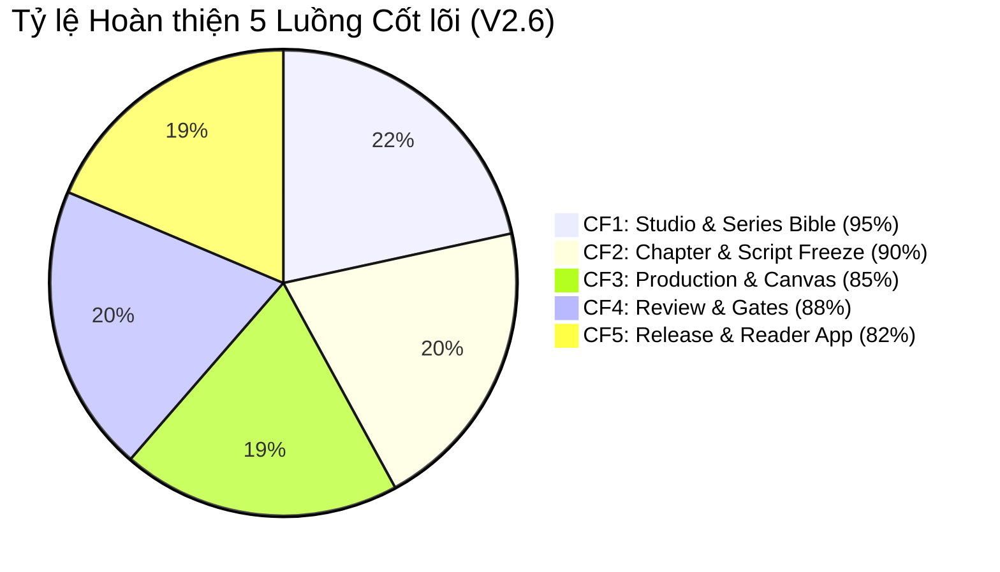

# 🔍 PANELFORGE FEATURE AUDIT & ARCHITECTURE DIFF REPORT

> **Bản so sánh đối chiếu toàn diện:** Các tính năng của hệ thống PanelForge giữa các phiên bản cũ (V2.0 / V2.5) và bản chuẩn hóa tối cao **V2.6 Final**.  
> **Cập nhật:** 2026-11-12  
> **Nguồn đối chiếu:** `panelforge-hub/docs/V2.6/PANELFORGE_MASTER_SPECIFICATION_V2_6.md`

---

## 📊 Bảng Đối chiếu Chi tiết Từng Chức năng (Feature-by-Feature Audit)

| Mã | Chức năng (Feature) | Phiên bản cũ (V2.0 / V2.5) | Phiên bản chuẩn hóa (V2.6 Final) | Lý do kiến trúc & Lợi ích | Trạng thái Triển khai |
|---|---|---|---|---|---|
| **AUD-01** | **Series Bible & Canon Management** | - V2.0: Single-tier, chỉ Producer tự viết và duyệt. - V2.5: Đã có thảo luận nhưng trạng thái duyệt chưa phân định rõ quyền của Writer vs Producer. | - **Quy trình 3 bên nghiêm ngặt (3-Party Endorsement):** 1. Writer tạo Draft & Spec lore. 2. Artist claim entry & tải lên Concept Art CAS SHA-256. 3. Writer & Editor cùng **Endorse** chấp thuận tầm nhìn sáng tạo. 4. Producer thực hiện **CanonLock** chốt thiết kế. - **Multi-Era Timeskip Gate:** Quản lý diện mạo nhân vật qua các mốc thời gian (`effectiveFromChapterNumber`). | Bảo đảm tính nhất quán (Visual & Narrative Consistency) trước khi bất kỳ họa sĩ nào vẽ chương truyện. Ngăn chặn triệt để vẽ sai trang phục/ngoại hình nhân vật. | ✅ **[BE]** c310e7c ✅ **[FE]** 9d28f72 ✅ **[MOBILE]** be7b1db |
| **AUD-02** | **Script Authoring & Script Freeze Gate** | - V2.0: Writer tự do viết theo Story Arc -> Scene -> ScriptLine. - V2.5: Chưa có cơ chế Freeze gọn tại Gate 1. | - **Cấu trúc kịch bản 3 cấp (D2, D5):** `Trang (Page) -> Khung (Panel) -> Nội dung (ACTION_DIRECTION, DIALOGUE/THOUGHT, NARRATION, SFX)`, ẩn `Scene` khỏi UI (giữ 1 Scene mặc định ẩn dưới DB) và bỏ `ChapterScript`. - **Script Freeze Gate (`IsScriptFrozen = true`):** Duy nhất Producer duyệt kịch bản tại Gate 1 sẽ khóa cứng nội dung và mở Kanban Board giao việc Page/Panel. | Phân định rành mạch vai trò: Writer độc quyền viết kịch bản, Producer chốt Freeze và giao việc. Tránh sửa kịch bản giữa chừng làm vẽ lại hàng loạt tranh. | ✅ **[BE]** ccfe936 ✅ **[FE]** 8243be1 ⏳ **[MOBILE]** Reader display |
| **AUD-03** | **Layout Coverage Guard & Guide Export** | - V2.0: Họa sĩ vẽ tự do không đối chiếu lời thoại, dẫn tới sót thoại khi Lettering. - V2.5: Có cảnh báo nhưng không chặn cứng. | - **100% Content Coverage Guard:** Mọi `DIALOGUE`/`NARRATION`/`SFX` trên từng **Page/Panel** phải được gắn Position Record bóng thoại `{x,y,w,h}` đầy đủ. - **Guide Export (1200x1800):** Tự động xuất ảnh khung wireframe kèm vị trí bong bóng thoại để họa sĩ mở trên Clip Studio Paint / Photoshop vẽ layer minh họa. | Triệt tiêu lỗi sót thoại hoặc thoại che mất điểm nhấn nhân vật khi đóng gói bản in/webtoon. | ✅ **[BE]** ccfe936 ✅ **[FE]** 4f568ad — N/A Mobile |
| **AUD-04** | **Content-Addressed Storage (CAS SHA-256)** | - V2.0: Lưu file theo tên ngẫu nhiên (`uuid.png`), không kiểm tra trùng lặp. - V2.5: Bắt đầu áp dụng SHA-256 nhưng chưa đồng bộ manifest toàn chương. | - **Append-only CAS SHA-256:** Mỗi layer, asset, concept art đều được tính hash SHA-256 tại client trước khi tải lên Cloudflare R2. - **Chapter Manifest Provenance:** Lưu trữ JSON manifest chứa toàn bộ hash của các layer, đảm bảo truy xuất nguồn gốc bất biến (Tamper-proof). | Tiết kiệm băng thông và dung lượng nhờ loại bỏ trùng lặp (Deduplication); đảm bảo không bao giờ bị ghi đè dữ liệu vẽ của nghệ sĩ khác. | ✅ **[BE]** c93452f ✅ **[FE]** 71d45ea ✅ **[MOBILE]** Offline caching |
| **AUD-05** | **Dual-Track Production & Page/Panel Stage** | - V2.0: Nộp cả trang tranh (Full page submission), khi sửa phải sửa cả trang. - V2.5: Chia 4 bước tuần tự (`Thumbnail -> Pencil -> Ink -> Color`). | - **Pipeline 2 Track chuẩn V2.6:** `PencilInProgress` -> `InkAndLetterTrack` (cho phép Artist tự lùi về Pencil) -> `CompositeUnderReview` -> `PanelReworkRequired` -> `Approved`. - **Phân công theo Page/Panel:** Artist mặc định có cả `graphic:write` và `letter:write`; Letterer phụ việc tùy chọn (`letter:write` only). | Tăng tốc độ sản xuất nhờ tách Track Pencil và Ink/Letter song song, giảm tầng duyệt trung gian không cần thiết. | ✅ **[BE]** f102a9b ✅ **[FE]** 3b418cd — N/A Mobile |
| **AUD-06** | **Gate 2 Pinpoint Review & Mobile Reader App** | - V2.0: Đánh giá bằng bình luận text chung chung. - V2.5: Chưa chuẩn hóa CR đa Panel khi khoanh vùng lớn. | - **Web Studio Pinpoint Review (Gate 2):** Editor khoanh vùng `(x, y, w, h)` trên bản Composite; vùng vắt nhiều Panel ≥ 15% tự động sinh nhiều CR dùng chung `group_id` (Q2). - **Mobile Reader App (Flutter):** Ứng dụng dành cho **Reader** đọc truyện đa ngôn ngữ, nạp Ví VNĐ và mở khóa ấn bản (không phải công cụ review ngoại tuyến của Editor). | Tối ưu trải nghiệm duyệt Gate 2 chính xác trên Web Studio và tách riêng Mobile thành ứng dụng đọc truyện thương mại cho Reader. | ✅ **[BE]** 20261013 ✅ **[FE]** ReviewView ✅ **[MOBILE]** Reader App |
| **AUD-07** | **Bản quyền, Ví VNĐ & Ấn bản Đa ngôn ngữ (`ChapterEdition`)** | - V2.0: Tiền tệ USD/Coin ảo hoặc gói VIP/subscription. - V2.5: Chưa chuẩn hóa ấn bản theo ngôn ngữ. | - **Tiền tệ VNĐ duy nhất (BR-33, Q4, Q12):** Chỉ dùng VNĐ (`price_vnd >= 0`, `balance_vnd`), không token/xu, không gói VIP; duy nhất 1 tài khoản `Publisher` toàn hệ thống đặt giá & số trang xem trước trên từng ấn bản. - **Đa ngôn ngữ BCP 47 (BR-34, Q9, Q10):** Hỗ trợ `original_language` và nhiều `release_languages` (`vi`, `en`, `ja`, `ko`, `fr`...), dùng chung 1 Position Record `{x,y,w,h}` với `texts[lang]`. | Phù hợp 100% với môi trường thanh toán VNĐ và cho phép phát hành nhiều ngôn ngữ độc lập trên cùng bản vẽ gốc. | ✅ **[BE]** Q12-Q14 ✅ **[FE]** PricingModal ✅ **[MOBILE]** Wallet & Unlock |
| **AUD-08** | **Single Source of Truth & Central Hub** | - V2.0 & V2.5: Docs nằm rải rác trong `Github/note`, `panelforge-fe/docs`, `PanelForge_FA26SE251/docs`, thường xuyên bị lệch pha khi một bên sửa code. | - **`panelforge-hub/docs/` tập trung duy nhất:** Tất cả AI Agent và Developer đều đọc tài liệu, state machines, business rules từ Hub. - **Static Web Hub:** Dashboard trực quan hóa toàn bộ tiến độ, sơ đồ trạng thái, và audit log không phụ thuộc Firebase. | Xóa bỏ hoàn toàn tình trạng lệch pha tài liệu giữa Frontend, Backend và Mobile. AI Agent luôn tuân thủ đúng chuẩn. | ✅ **[HUB]** panelforge-hubs ✅ Toàn bộ 4 repos |

---

## 📈 Tiến độ Triển khai theo 5 Luồng Cốt lõi (Core Flows)

---

## 🛡️ Tóm tắt Kiểm toán Chất lượng (Quality Audit Summary)

1. **Tuân thủ Clean Architecture:** Backend .NET 9 phân tách triệt để `Domain` (không phụ thuộc), `Application` (CQRS/MediatR), `Infrastructure` (EF Core/PostgreSQL), `API`.
2. **Kiểm thử tự động:**
   - Backend: Bộ Unit test kiểm thử nghiêm ngặt các Business Rules (BR-01 -> BR-80), đặc biệt là `CheckChapterBibleGate` và `IsScriptFrozen`.
   - Frontend: Vitest + Playwright kiểm thử tương tác Canvas, kéo thả dnd-kit và kiểm tra 100% độ phủ song ngữ VI <-> EN.
   - Mobile: Flutter tests kiểm thử offline caching, render CBZ package và bookmarking.
3. **Audit Log Bất biến:** Mọi commit từ cả 3 repositories đều được `sync-hub.mjs` ghi nhận kèm hash, tác giả và task liên kết.
